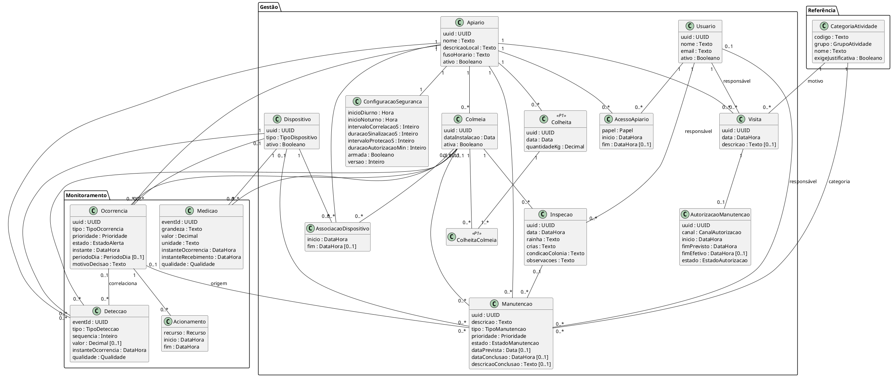
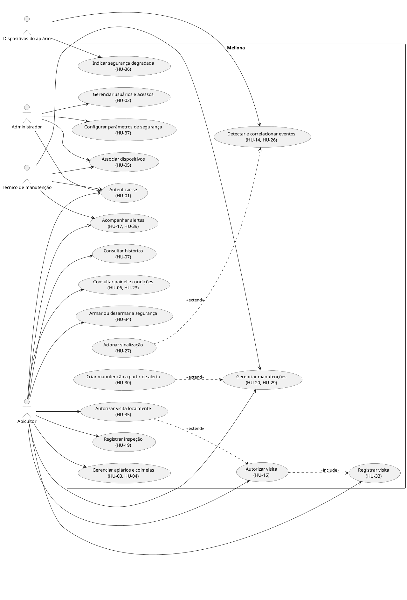
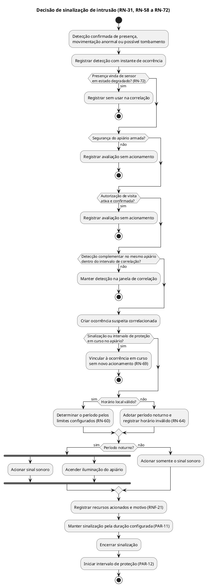
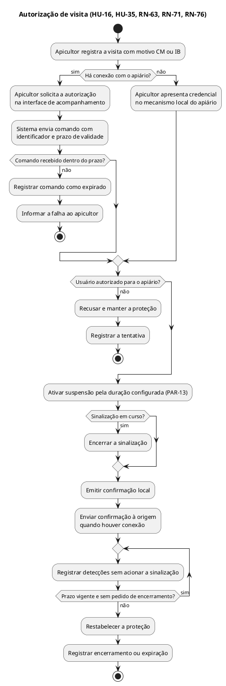
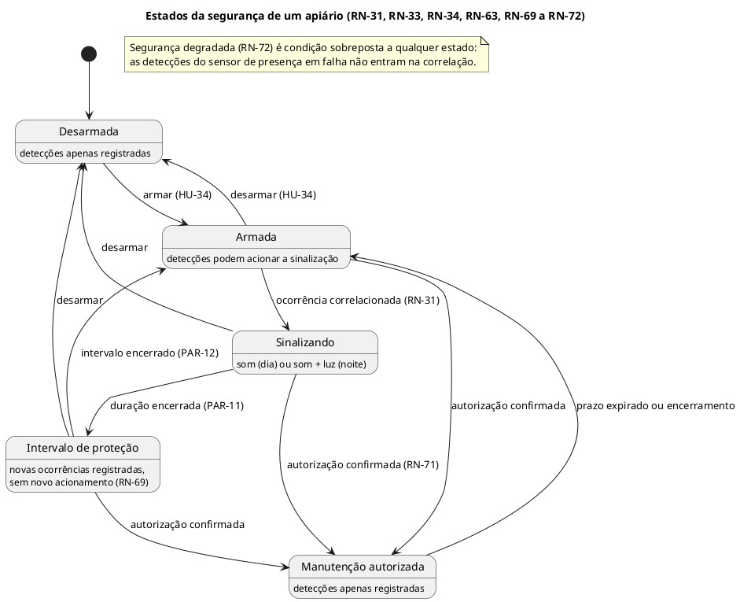

# Mellona — Sistema Inteligente de Monitoramento e Gerenciamento de Apiários e Colmeias

**Documento de Especificação de Requisitos de Software (ERS)**

**Versão:** 1.1.2  
**Data:** 31 de outubro de 2026  
**Situação:** Especificação preliminar revisada — pendente de validação com usuários (ver Seção 6)  
**Natureza:** Projeto acadêmico de Engenharia de Software  
**Disciplinas atendidas:** Interação Humano-Computador (IHC), Software para Persistência de Dados (SPD) e Software para Sistemas Ubíquos (SSU)

## Histórico de versões

| Versão | Data | Descrição |
|---|---|---|
| 1.0 | 20/10/2026 | Especificação preliminar: objetivos, domínio, escopo, histórias de usuário, requisitos não funcionais, regras de negócio e cenários de validação. |
| 1.1 | 20/10/2026 | Adequação às três disciplinas. Inclusões: contexto acadêmico (1.4); caracterização como sistema ubíquo (2.5); análise de impacto e riscos (3.4–3.5); pessoas-chave, perfis, proto-personas e cenários de uso (5.1–5.4); processo de design e plano de coleta de dados (Seção 6); interfaces e restrições de projeto (Seção 7); HU-34 a HU-39 e Épico E07; RNF-21 a RNF-27; RN-64 a RN-76; parâmetros operacionais (Seção 12); modelo conceitual de dados e contrato de eventos (Seção 13); modelos UML (Seção 14); CV-22 a CV-36; pendências (Seção 17); Apêndices B, C e D. Ajustes: HU-02, HU-05, HU-16, HU-17, HU-22, HU-23, RNF-11, RNF-16 (P1 → P0), RN-06, RN-07, RN-15, RN-23, RN-31, RN-33, RN-34 e RN-61 passam a referenciar parâmetros e regras novas. Identificadores da v1.0 foram preservados. |
| 1.1.1 | 29/10/2026 | Alinhamento aos artefatos das disciplinas. Processo de design passa a ser o ciclo de vida em estrela, como na PF1 de IHC (6.1, 6.2). Técnicas de coleta alinhadas à PF1: T1 passa a ser estudo de campo com vídeos publicados por apicultores e T2, brainstorming de necessidades e desejos; o questionário online e a observação de visita foram retirados (6.3 a 6.5 e Apêndice C). Inclusões da Atividade 02 de SSU: PAR-21 (tolerância de atraso), complemento da RN-66 (ocorrência detectada com atraso), 13.5.2, 13.5.3 e 13.6. Referência às hipóteses corrigida para H1 a H9 (3.4). Pessoas-chave preenchidas (5.1) e pendências P-01 e P-04 atualizadas (Seção 17). |
| 1.1.2 | 31/10/2026 | Inclusões da Atividade 03 de SSU (protótipo da decisão e atuação no Wokwi): rearme na RN-70; ativação do sensor de presença definida como pulso em modo de disparo único (PAR-07); PAR-22 (validade da leitura de aceleração); eventos `leitura.invalida` e `leitura.normalizada` (13.4.2); Atividade 03 marcada como atendida no Apêndice D.2. |

## Sumário

1. Objetivo
2. Domínio da aplicação
3. Contexto da aplicação
4. Escopo do sistema
5. Usuários, partes interessadas e pessoas-chave
6. Processo de elaboração e validação dos requisitos
7. Interfaces do sistema e restrições de projeto
8. Requisitos funcionais
9. Backlog de funcionalidades futuras
10. Requisitos não funcionais
11. Regras de negócio
12. Parâmetros operacionais iniciais
13. Requisitos de informação: modelo conceitual e eventos
14. Modelos de comportamento (UML)
15. Cenários de validação da primeira versão
16. Matriz de rastreabilidade
17. Pendências e decisões a validar
18. Considerações finais
- Apêndice A — Classificação das atividades de manejo e manutenção
- Apêndice B — Glossário
- Apêndice C — Roteiros de coleta de dados
- Apêndice D — Atendimento às demandas das disciplinas

---

# 1. Objetivo

## 1.1. Objetivo geral

Desenvolver o **Mellona**, um sistema inteligente de monitoramento e gerenciamento de apiários e colmeias, destinado a auxiliar apicultores brasileiros no acompanhamento das condições ambientais, na identificação de situações de risco, na segurança patrimonial e na administração das atividades apícolas.

O sistema deverá permitir o acompanhamento remoto das colmeias, a identificação de alterações ambientais e físicas, o acionamento automático de recursos de segurança diante de ocorrências suspeitas e a organização das informações sobre apiários, colmeias, dispositivos, inspeções e manutenções.

## 1.2. Objetivos específicos

- Monitorar temperatura e umidade das colmeias.
- Identificar movimentações anormais, inclinações e possíveis tombamentos das colmeias.
- Detectar presença em áreas monitoradas dos apiários.
- Correlacionar detecções de presença com movimentações anormais de colmeias.
- Acionar sinalização sonora em situações suspeitas identificadas durante o dia.
- Acionar sinalização sonora e iluminação do apiário em situações suspeitas identificadas durante a noite.
- Evitar acionamentos indevidos durante visitas autorizadas do apicultor.
- Permitir o funcionamento local das funções críticas de segurança durante interrupções da internet.
- Disponibilizar informações atualizadas sobre as condições monitoradas.
- Manter históricos de medições e ocorrências.
- Identificar dispositivos sem comunicação.
- Gerenciar os cadastros de apiários, colmeias e dispositivos.
- Permitir a consulta e o acompanhamento de alertas.
- Registrar inspeções e atividades de manutenção.
- Organizar as visitas realizadas aos apiários.
- Oferecer uma interface de acompanhamento e gerenciamento acessível aos usuários.
- Possibilitar a incorporação de novas funcionalidades em versões futuras.

## 1.3. Resultados esperados

Espera-se que o Mellona contribua para reduzir a necessidade de deslocamentos exclusivamente destinados a verificações simples, facilitar a identificação de problemas e melhorar a organização das informações dos apiários.

O monitoramento das condições ambientais, a identificação de movimentações e a detecção de presença deverão apoiar a tomada de decisões do apicultor.

A sinalização de segurança deverá atuar de maneira diferenciada durante o dia e a noite, utilizando as condições detectadas para reduzir acionamentos desnecessários.

Os resultados operacionais deverão ser avaliados por meio de testes e validação com usuários.

## 1.4. Finalidade deste documento e contexto acadêmico

Este ERS é a referência comum de requisitos para um único sistema desenvolvido em três disciplinas. Cada disciplina avalia uma parte diferente do Mellona:

| Disciplina | Parte do Mellona avaliada | Seções deste documento mais utilizadas |
|---|---|---|
| Interação Humano-Computador (IHC) | Processo de design, requisitos de usuário e protótipo da interface | 3.4, 5, 6, 8, 10 (RNF-10, RNF-11, RNF-24 a RNF-27), 14, Apêndices B e C |
| Software para Persistência de Dados (SPD) | Modelo de entidades, persistência relacional e documental, integração entre bases e testes | 7, 8 (E02, E05, E07), 11.1, 11.10, 13, 15, 16 |
| Software para Sistemas Ubíquos (SSU) | Sensoriamento, eventos, estado, janelas temporais, decisão local, atuação e comunicação | 2.5, 3.5, 11.3, 11.7, 11.11, 11.12, 12, 13.4 a 13.6, 14.2 a 14.4, 15, Apêndice D.2 |

O Apêndice D relaciona cada item exigido pelas disciplinas à seção que o atende e indica o que deve ser entregue em outros artefatos.

Este documento estabelece **o que** o sistema deve fazer. As decisões de arquitetura e implementação (distribuição concreta entre dispositivo, borda e nuvem; diagramas de componentes, sequência e implantação; código e testes) serão registradas em documentos próprios de cada disciplina, que deverão ser rastreáveis a este ERS.

# 2. Domínio da aplicação

O Mellona está inserido no domínio da **apicultura de precisão**, com aplicação inicial na criação e no manejo de abelhas da espécie *Apis mellifera* no contexto brasileiro.

A aplicação compreende quatro áreas principais.

## 2.1. Monitoramento apícola

Acompanhamento de condições ambientais e físicas das colmeias, incluindo temperatura, umidade, movimentação, inclinação e possíveis tombamentos.

## 2.2. Segurança dos apiários

Identificação de situações potencialmente suspeitas por meio da combinação de eventos de presença e movimentação de colmeias, com sinalização adequada ao período do dia e controle de acessos autorizados.

## 2.3. Gerenciamento apícola

Organização e acompanhamento das informações referentes a apiários, colmeias, dispositivos, usuários, medições, alertas e atividades operacionais.

## 2.4. Manejo e manutenção

Registro de inspeções, manutenção de estruturas e equipamentos e organização das atividades realizadas nos apiários.

Para fins de classificação, as atividades são divididas em:

**Manutenções Físicas (CM):** conservação e reparo de estruturas, componentes e equipamentos.

**Manejo/Intervenções Biológicas (IB):** atividades relacionadas diretamente às condições biológicas das colônias.

As classificações estão detalhadas no **Apêndice A**.

O Mellona não substitui as inspeções presenciais nem o conhecimento técnico do apicultor.

## 2.5. Caracterização como sistema ubíquo

| Classificação | Justificativa no Mellona |
|---|---|
| **Internet das Coisas (IoT)** | Dispositivos instalados nas colmeias e no apiário coletam dados e os transmitem para consulta remota. |
| **Sistema ciberfísico** | O sistema observa um fenômeno físico (posição e movimento da colmeia, presença no apiário) e atua sobre o ambiente (sinal sonoro e iluminação), fechando um laço percepção–decisão–atuação. |
| **Aplicação ubíqua e sensível ao contexto** | A mesma combinação de detecções produz respostas diferentes conforme o contexto: período do dia (RN-58, RN-59), estado da segurança (RN-70) e existência de autorização de visita (RN-63). A interação com o sistema de segurança é predominantemente implícita: o apicultor não precisa comandar o alarme. |

**Dimensões de classificação:**

| Dimensão | Mellona |
|---|---|
| Interação | Híbrida: implícita na segurança, explícita na gestão e na autorização de visitas |
| Mobilidade | Dispositivos fixos no apiário; usuário móvel |
| Abrangência | Local (apiário) com consolidação global (todos os apiários do usuário) |
| Processamento | Local no apiário para funções críticas; remoto para histórico e gestão (Seção 13.6) |
| Resposta | Informar (painel e alertas), recomendar (manutenções a partir de alertas) e atuar (sinalização) |

**Mudanças de contexto que alteram o comportamento:**

| Mudança de contexto | Adaptação esperada | Requisitos |
|---|---|---|
| Passagem do período diurno para o noturno | A mesma ocorrência passa a acionar também a iluminação | RN-58, RN-59, RN-60 |
| Início de visita com autorização confirmada | Detecções continuam registradas, mas não acionam a sinalização | HU-16, RN-16, RN-63 |
| Perda da conexão com a internet | Funções de segurança continuam locais; registros ficam retidos para envio posterior | RNF-01, RNF-02, RN-35 |
| Falha do sensor de presença | A segurança passa ao estado degradado e o usuário é alertado | HU-36, RN-72 |
| Horário local indisponível | O período noturno é adotado e a condição é registrada | RN-64 |

# 3. Contexto da aplicação

## 3.1. Contextualização

A apicultura brasileira é praticada em regiões com diferentes características ambientais, climáticas e geográficas.

Muitos apiários encontram-se em áreas rurais afastadas, onde o acompanhamento contínuo depende de visitas presenciais.

Durante os intervalos entre visitas, podem ocorrer alterações nas condições ambientais, danos às estruturas, movimentações anormais das colmeias e acessos suspeitos.

O apicultor também precisa organizar informações de diferentes apiários e colmeias, realizar inspeções e acompanhar necessidades de manutenção.

Entre os principais problemas que motivam o desenvolvimento do Mellona estão:

- Dificuldade de acompanhar remotamente as condições das colmeias.
- Possibilidade de alterações ambientais não identificadas oportunamente.
- Movimentações, inclinações e tombamentos das caixas.
- Presença suspeita e riscos patrimoniais.
- Necessidade de distinguir possíveis situações de intrusão de eventos físicos isolados.
- Falhas de dispositivos de monitoramento.
- Falta de centralização das informações.
- Dificuldade de consultar históricos de medições e ocorrências.
- Falta de organização das inspeções e manutenções.
- Dependência de visitas presenciais para determinadas verificações.

Outros desafios da apicultura, como escassez de água, alimentação suplementar e monitoramento da abertura das colmeias, poderão motivar funcionalidades futuras.

## 3.2. Problema central

Como auxiliar o apicultor no monitoramento, na proteção e no gerenciamento de seus apiários e colmeias, permitindo identificar situações relevantes à distância, executar sinalizações de segurança adequadas às condições detectadas e organizar as informações necessárias ao manejo?

## 3.3. Solução proposta

O Mellona disponibilizará funcionalidades para aquisição e apresentação de informações ambientais e físicas, identificação de eventos, correlação de detecções suspeitas e armazenamento de históricos.

A sinalização patrimonial deverá considerar conjuntamente a presença no apiário, a movimentação anormal de uma colmeia, a existência de visita autorizada e o período do dia.

Durante o dia, a situação suspeita confirmada deverá produzir sinalização sonora.

Durante a noite, a mesma situação deverá produzir sinalização sonora e acender uma lâmpada destinada a iluminar a área monitorada do apiário.

O sistema também oferecerá ferramentas para gerenciamento de apiários, colmeias, dispositivos, inspeções e manutenções.

## 3.4. Análise de impacto

As descrições da situação atual abaixo são hipóteses baseadas em pesquisa secundária. Elas serão confirmadas ou corrigidas pela coleta de dados com apicultores (Seção 6, hipóteses H1 a H9).

### 3.4.1. Quem será afetado

| Grupo | Tipo de impacto | Descrição |
|---|---|---|
| Apicultores | Direto | Passam a acompanhar as colmeias à distância, recebem alertas e registram inspeções, manutenções e visitas no sistema. |
| Técnicos de manutenção | Direto | Recebem ocorrências e manutenções vinculadas a recursos identificados. |
| Administradores do sistema | Direto | Gerenciam usuários, permissões, dispositivos e parâmetros. |
| Auxiliares e familiares que acompanham visitas | Indireto | Precisam conhecer o modo de manutenção autorizada para não disparar a sinalização. |
| Proprietários das terras onde há apiários e vizinhança | Indireto | Podem ouvir o sinal sonoro e ver a iluminação noturna; podem ser chamados a verificar ocorrências. |
| Associações e cooperativas de apicultores | Indireto | Podem usar históricos de ocorrências e manutenções para orientação técnica e gestão coletiva. |
| Colônias de abelhas | Indireto (não humano) | Podem ser perturbadas por som, luz e manuseio de equipamentos; o sistema deve minimizar esse efeito (RNF-18). |

### 3.4.2. Processos alterados

| Processo | Situação atual presumida | Situação com o Mellona | Hipótese |
|---|---|---|---|
| Verificação das condições das colmeias | Feita apenas em visitas presenciais | Consulta remota de temperatura, umidade, inclinação e estado dos dispositivos | H2, H8 |
| Detecção de furto, vandalismo ou tombamento | Descoberta na visita seguinte, às vezes dias depois | Alerta registrado no momento da ocorrência e sinalização local para inibir a ação | H1 |
| Visitas ao apiário | Não registradas ou registradas informalmente | Registro com motivo classificado (CM/IB) e autorização associada | H4 |
| Registro de inspeções | Memória do apicultor, caderno de campo ou planilha | Histórico digital por colmeia | H7 |
| Manutenção de estruturas e equipamentos | Identificada e lembrada informalmente | Cadastro classificado (CM-01 a CM-07), com estado, responsável e vínculo a alertas | H7 |

### 3.4.3. Impactos esperados e efeitos indesejados

**Esperados:** redução de deslocamentos para verificações simples; resposta mais rápida a tombamentos e acessos suspeitos; histórico organizado de inspeções, manutenções e visitas.

**Indesejados a controlar:** alarmes falsos que gerem perturbação e perda de confiança; perturbação das abelhas e da vizinhança (RNF-18); dependência de equipamentos que exigem manutenção (CM-06); custo de implantação incompatível com pequenos produtores; exposição da localização dos apiários (Seção 3.5, R3).

## 3.5. Riscos e compromissos de projeto

| ID | Risco ou compromisso | Consequência | Tratamento nos requisitos |
|---|---|---|---|
| **R1** | **Principal:** confiabilidade da decisão local de segurança — equilíbrio entre falsos positivos e falsos negativos | Alarmes falsos perturbam pessoas e abelhas e reduzem a confiança; alarmes ausentes deixam o apiário desprotegido | Exigência de duas detecções correlacionadas (RN-31), confirmação de cada detecção (PAR-07, PAR-08), estado degradado visível (RN-72), testes CV-03 a CV-14 e CV-25 |
| R2 | Conectividade limitada nas áreas rurais | Perda de dados e de comandos remotos | Processamento local (RNF-20), retenção local (RNF-02), autorização local (HU-35) |
| R3 | Privacidade e sigilo da localização dos apiários | A localização exposta facilita furtos; dados pessoais dos usuários exigem proteção | RNF-16 elevado a P0; coleta de dados sem localização exata (Seção 6.3) |
| R4 | Consumo de energia dos dispositivos | Interrupção do monitoramento em campo | RNF-06; heartbeat e detecção de silêncio (RNF-09) |
| R5 | Bem-estar das abelhas e convivência com a vizinhança | Defensividade da colônia, reclamações, abandono do uso | RNF-18; duração (RN-33) e intervalo de proteção (RN-34) |
| R6 | Uso indevido de comandos remotos (desarmar ou suspender a segurança) | Desproteção intencional do apiário | Autenticação (RNF-08), autorização (RN-28), registro (RN-29), validade de comandos (RN-76) |
| R7 | Divergência entre bases de dados replicadas | Cadastros ou alertas inconsistentes entre as interfaces | Identificador universal (RN-73), propagação idempotente (RN-74), política de conflito (RN-75), RNF-22 |

**Compromissos assumidos:**

- **Automação × controle:** a sinalização é automática, mas a suspensão exige autorização explícita e confirmada.
- **Borda × nuvem:** as funções críticas ficam no apiário; histórico e gestão ficam centralizados.
- **Conveniência × privacidade:** o sistema não identifica pessoas (HU-26) e trata a localização dos apiários como informação sensível.

# 4. Escopo do sistema

## 4.1. Primeira versão — MVP

### Monitoramento ambiental e físico

- Temperatura das colmeias.
- Umidade das colmeias.
- Movimentações anormais de colmeias.
- Inclinação e possíveis tombamentos.
- Presença em áreas monitoradas.
- Estado de comunicação dos dispositivos.
- Histórico de medições e eventos.

### Segurança e automação

- Detecção de presença no apiário.
- Identificação de movimentação anormal de colmeias.
- Correlação temporal entre presença e movimentação no mesmo apiário.
- Identificação dos períodos diurno e noturno.
- Acionamento sonoro durante o dia, quando confirmadas as condições de segurança estabelecidas.
- Acionamento sonoro e iluminação do apiário durante a noite, quando confirmadas essas condições.
- Controle da duração e repetição dos alarmes.
- Modo de manutenção autorizada.
- Autorização local de visita, sem dependência da internet.
- Armação e desarme da segurança de cada apiário.
- Indicação de segurança degradada quando o sensor de presença falhar.
- Configuração dos parâmetros de segurança.
- Registro e acompanhamento de ocorrências.
- Continuidade das funções locais de segurança durante interrupções da internet.

### Gerenciamento

- Autenticação.
- Cadastro de apiários e colmeias.
- Cadastro e associação de dispositivos.
- Painel geral de monitoramento.
- Central de alertas.
- Histórico de informações.
- Registro de inspeções.
- Cadastro e acompanhamento de manutenções físicas.
- Registro básico de visitas e de seus motivos, classificados como CM ou IB.
- Disponibilidade dos cadastros e dos alertas tanto na aplicação de gestão quanto na de acompanhamento, sem registro duplicado.

## 4.2. Funcionalidades futuras — fora do MVP

### Abertura de colmeias

- Monitoramento eletrônico de abertura e fechamento.
- Detecção de abertura ou violação não autorizada.
- Alarmes específicos relacionados à abertura.
- Gerenciamento e automação dessas operações.

### Alimentação artificial proteica e energética

- Monitoramento da disponibilidade de alimento.
- Gerenciamento especializado de suplementação.
- Controle de quantidades, períodos e dosagens.
- Automação do fornecimento.

### Monitoramento e abastecimento de água

- Leitura do nível de água.
- Acompanhamento remoto dos reservatórios.
- Alertas de nível baixo.
- Controle automático ou manual remoto do abastecimento.
- Gerenciamento dos parâmetros e ciclos de abastecimento.

### Outras funcionalidades futuras

- Monitoramento do peso das colmeias.
- Rastreamento de localização.
- Identificação automatizada de doenças.
- Predição de enxameação.
- Gerenciamento especializado de intervenções biológicas.
- Análises avançadas de produtividade.
- Exportação de dados.

**Delimitação:** o monitoramento de movimentação física da colmeia previsto no MVP não inclui monitoramento de abertura ou fechamento da tampa, funcionalidade reservada para versões futuras.

**Revisão prevista:** a prioridade do monitoramento do peso das colmeias (HU-09) será reavaliada após a coleta de dados com apicultores (hipótese H5, Seção 6.4). Caso a coleta indique que o acompanhamento de reservas e produção é prioritário em relação à segurança patrimonial, o escopo do MVP deverá ser revisto.

# 5. Usuários, partes interessadas e pessoas-chave

| Perfil | Descrição | Principais necessidades |
|---|---|---|
| Apicultor | Responsável pelo manejo das colmeias e dos apiários | Monitorar condições, acompanhar alertas, consultar históricos e organizar atividades |
| Administrador | Responsável pela administração do sistema | Gerenciar usuários, permissões e recursos |
| Técnico de manutenção | Responsável por verificações e reparos | Consultar ocorrências, identificar falhas e registrar manutenções |

Uma mesma pessoa poderá desempenhar mais de um papel, conforme suas responsabilidades.

## 5.1. Pessoas-chave

| Grupo | Pessoas | Envolvimento |
|---|---|---|
| Desenvolvimento | Bárbara Nogueira (projeto individual nas três disciplinas) · GitHub: [BarbaraNogueiraCS](https://github.com/BarbaraNogueiraCS) | Elicitação, design, implementação, testes e documentação |
| Orientação e avaliação | Docentes das disciplinas de IHC, SPD e SSU | Definem os requisitos acadêmicos e avaliam as entregas |
| Usuários diretos | Apicultores, técnicos de manutenção e administradores | Participam do brainstorming e da avaliação do protótipo; no estudo de campo, são observados em vídeos que publicam (Seção 6) |
| Partes afetadas indiretamente | Auxiliares de campo, proprietários das terras, vizinhança, associações e cooperativas | Consultados quando possível; considerados na análise de impacto (3.4) |

## 5.2. Perfis de usuário (provisórios)

Perfis elaborados a partir de pesquisa secundária. Serão revisados com os resultados da coleta (Seção 6.5).

| Característica | Apicultor | Técnico de manutenção | Administrador |
|---|---|---|---|
| Objetivo principal | Saber se as colmeias estão bem sem precisar ir ao apiário; agir rápido diante de problemas | Saber o que consertar, onde e com que prioridade | Manter usuários, dispositivos e parâmetros corretos |
| Contexto de uso | Em casa, na estrada e no apiário (sol forte, véu e luvas, sinal fraco) | No apiário e no escritório | Escritório |
| Dispositivo provável | Smartphone; computador eventualmente | Smartphone e computador | Computador |
| Familiaridade com tecnologia | Variável, de básica a intermediária; uso frequente de aplicativos de mensagem | Intermediária | Intermediária a avançada |
| Frequência de uso esperada | Diária (consulta rápida) e pontual (alertas, visitas) | Semanal e sob demanda | Eventual |
| Tarefas críticas | Consultar painel, reconhecer alerta, autorizar visita, registrar inspeção | Registrar e concluir manutenção, verificar dispositivos | Cadastrar usuários e dispositivos, configurar parâmetros |

## 5.3. Proto-personas

> **Proto-personas são hipotéticas.** Foram construídas antes da coleta de dados primários para orientar o roteiro de pesquisa e o protótipo inicial. Deverão ser substituídas por personas derivadas dos resultados da Seção 6.5.

### Persona P1 — Antônio, apicultor de pequeno porte

- **Perfil:** 58 anos, produz mel há 20 anos, tem cerca de 40 colmeias em dois apiários instalados em terras de terceiros, a dezenas de quilômetros de casa.
- **Tecnologia:** smartphone Android básico; usa aplicativos de mensagem diariamente, mas evita aplicativos com muitas telas. O sinal de celular no apiário é fraco ou ausente.
- **Objetivos:** saber se as caixas continuam no lugar e em boas condições sem precisar viajar; não ser surpreendido por furtos ou tombamentos.
- **Frustrações:** perdeu colmeias para furto e só descobriu na visita seguinte; não tem registro organizado das revisões.
- **Necessidade-chave para o Mellona:** alertas claros e poucas telas; autorizar a própria visita mesmo sem sinal.

### Persona P2 — Carla, técnica de uma cooperativa apícola

- **Perfil:** 34 anos, técnica em agropecuária, acompanha apiários de vários cooperados.
- **Tecnologia:** notebook no escritório e smartphone em campo; confortável com planilhas e aplicativos.
- **Objetivos:** organizar as manutenções por prioridade, saber quais dispositivos estão sem comunicação e manter histórico para orientar os cooperados.
- **Frustrações:** informações espalhadas em mensagens e cadernos; dificuldade de saber se um problema já foi tratado.
- **Necessidade-chave para o Mellona:** central de alertas vinculada a manutenções, filtros por categoria e histórico por apiário.

## 5.4. Cenários de uso

Os cenários de uso descrevem situações de interação com o sistema do ponto de vista dos usuários. Diferem dos cenários de validação da Seção 15, que definem resultados verificáveis por teste.

**SU-01 — Ocorrência noturna.** São 2h da manhã. Uma pessoa entra no apiário de Antônio e levanta uma colmeia. O sensor de presença e o sensor da colmeia confirmam as detecções em menos de um minuto. O sistema, no próprio apiário, aciona o sinal sonoro e acende a iluminação por 30 segundos. Quando o sinal de celular permite, Antônio recebe a notificação, abre o alerta e vê a colmeia afetada, o horário e os recursos acionados. No dia seguinte, ele reconhece o alerta e registra uma manutenção do cavalete. *(HU-14, HU-26, HU-27, HU-17, HU-18, HU-30)*

**SU-02 — Visita sem sinal de celular.** Antônio chega ao apiário para revisar a rainha de duas colmeias. Não há sinal de internet. Ele usa o mecanismo local de autorização no apiário, recebe a confirmação local de que a proteção foi suspensa por 60 minutos e trabalha sem disparar a sinalização. Ao sair, encerra a autorização. Quando a conexão retorna, a visita (motivo IB-01) e a autorização aparecem no histórico. *(HU-33, HU-16, HU-35, RN-71)*

**SU-03 — Manutenção a partir de tombamento.** Após uma ventania, uma colmeia fica inclinada mais de 15 graus por mais de 10 segundos. O sistema registra uma ocorrência de possível tombamento, sem acionar a sinalização, porque não houve presença correlacionada. Carla vê o alerta na central, cria a partir dele uma manutenção CM-02 (cavaletes e suportes) com prioridade alta e a atribui a si mesma. Ao concluir o reparo, registra a descrição do serviço. *(HU-14, HU-17, HU-30, HU-20, HU-29)*

**SU-04 — Acompanhamento de rotina.** No café da manhã, Antônio abre o painel e verifica que os dois apiários estão armados, sem alertas ativos, com medições atualizadas há menos de dois minutos. Um dos dispositivos aparece sem comunicação há três intervalos; ele toca no aviso e vê que se trata do nó da colmeia A1-07. *(HU-23, HU-06, HU-08, HU-34)*

# 6. Processo de elaboração e validação dos requisitos

## 6.1. Processo de design adotado

O Mellona adota o **ciclo de vida em estrela** (Hix e Hartson, 1993), o mesmo da PF1 de IHC. A avaliação ocupa o centro, e as demais atividades (análise, especificação de requisitos, projeto conceitual e especificação do design, prototipação e implementação) se ligam a ela, sem ordem fixa. A escolha se justifica por três características do processo que correspondem às necessidades do projeto:

- **Avaliação entre atividades:** os requisitos partem de hipóteses ainda não confirmadas com apicultores, e cada resultado é avaliado antes de seguir.
- **Métricas observáveis:** o desempenho dos usuários é medido (por exemplo, RNF-10 e RNF-25).
- **Iteração:** cada avaliação pode levar de volta a qualquer atividade, até que as metas de usabilidade sejam atendidas.

| Atividade da estrela | O que é produzido | Etapa de IHC | Versão do ERS |
|---|---|---|---|
| Análise (preliminar) | Pesquisa secundária sobre a apicultura brasileira e a apicultura de precisão; definição do problema e do escopo inicial | — | 1.0 |
| Avaliação (revisão de consistência) | Lacunas de requisitos e hipóteses explícitas | PF1 | 1.1 |
| Especificação de requisitos | Correção das lacunas, perfis provisórios, proto-personas, metas de usabilidade e plano de coleta | PF1 | 1.1 |
| Avaliação com usuários e análise (consolidação) | Aplicação das técnicas de coleta; personas e cenários derivados; revisão dos requisitos | PF1 | 1.2 |
| Projeto conceitual e especificação do design; prototipação | Guia de estilo e protótipo navegável | PF2 | — |
| Avaliação do protótipo | Avaliação em sala, com método justificado | PF3 | 1.3 (correções) |
| Iteração final | Integração dos resultados e versão final do protótipo | PF4 | Final |

A implementação, quinta ponta da estrela, fica fora do escopo de IHC, cujo produto é o protótipo. O sistema é construído nas disciplinas de SPD e SSU.

## 6.2. Aplicação do processo até esta versão

1. **Análise, pesquisa secundária:** levantamento sobre produção de mel no Brasil, manejo, alimentação em períodos de escassez, principais problemas dos apicultores e barreiras de adoção de tecnologia em campo.
2. **Análise, definição do problema e do escopo (v1.0):** recorte do MVP em monitoramento ambiental e físico, segurança patrimonial e gestão de atividades.
3. **Avaliação, revisão de consistência (v1.1):** identificação de lacunas de requisitos (por exemplo, autorização de visita sem internet, fonte de horário, falha do sensor de presença) e explicitação das hipóteses que dependem de confirmação com usuários.
4. **Especificação de requisitos (v1.1):** correção das lacunas, metas de usabilidade, parâmetros operacionais e plano de coleta de dados.

## 6.3. Técnicas de coleta de dados

Serão aplicadas **duas técnicas complementares**, as mesmas da PF1 de IHC: um **estudo de campo** feito com a observação de vídeos que apicultores publicam em seus canais, que mostra o que eles fazem no apiário, e um **brainstorming de necessidades e desejos**, que mostra o que dizem precisar. A comparação entre as duas permite triangular os dados.

| Item | T1 — Estudo de campo (vídeos de apicultores) | T2 — Brainstorming de necessidades e desejos |
|---|---|---|
| Objetivo | Observar a rotina, os problemas, as práticas atuais e o vocabulário dos apicultores no próprio apiário, sem a interferência de um entrevistador | Gerar em grupo o maior número possível de necessidades e desejos e priorizá-los |
| Fontes ou participantes | Vídeos de apicultores brasileiros em seus canais no YouTube e em outras plataformas de vídeo, gravados no apiário ou com relato da própria experiência | Grupo de apicultores e, se possível, um técnico ou auxiliar de campo |
| Meta de amostra | Pelo menos 10 vídeos de 5 canais diferentes, cobrindo revisão e manejo, rotina de visita, furto ou vandalismo e colmeias tombadas | Uma sessão com 4 a 8 participantes |
| Seleção ou recrutamento | Busca por termos como "rotina do apicultor", "revisão de colmeias", "furto de colmeias" e "colmeia tombada". Entram vídeos de quem trabalha com as próprias colmeias, com cenas reais ou relato em primeira pessoa; ficam de fora propagandas e aulas sem cenas de apiário | Associações e cooperativas de apicultores, contatos pessoais e grupos de apicultores em redes sociais |
| Aplicação | Cada vídeo é assistido inteiro uma vez e os trechos relevantes são revistos, com o roteiro do Apêndice C.1; sem contato com os autores | Presencial, com notas adesivas, ou por videochamada com quadro colaborativo, de 60 a 90 minutos, com o roteiro do Apêndice C.2 |
| Registro | Ficha por vídeo: canal, título, link, data de publicação e duração; para cada item do roteiro, o minuto do trecho, o que é mostrado e o que é dito | Todas as ideias transcritas, fotos ou exportação do quadro, votos de cada grupo e áudio gravado com permissão |
| Análise | Agrupamento dos trechos por tema (diagrama de afinidade) e evidências para cada hipótese, separando o que foi visto do que foi relatado | Agrupamento das ideias por afinidade e ordenação das necessidades pelo número de votos |
| Limitações | O vídeo mostra só o que o autor escolheu gravar e editar; quem mantém um canal tende a ter mais experiência e mais familiaridade com tecnologia que a média (viés em H3); não há perguntas de acompanhamento | Os participantes podem se influenciar e vozes dominantes podem pesar mais; a facilitação e a votação individual reduzem esse efeito |

**Cuidados éticos:** no estudo de campo, só são usados vídeos abertos ao público, publicados pelos próprios apicultores, sem contato com os autores; cada vídeo é citado com canal, título e link, e não são registrados dados de terceiros que apareçam nas imagens. No brainstorming, cada participante será informado sobre o objetivo acadêmico, a voluntariedade e o anonimato, e dará seu consentimento antes da coleta; nomes completos não entram nos registros analisados. Nas duas técnicas, a **localização exata dos apiários** não é registrada, mesmo quando aparece em um vídeo, por se tratar de informação sensível à segurança patrimonial (risco R3).

## 6.4. Hipóteses a validar

| ID | Hipótese | Requisitos afetados | Itens dos roteiros | Se a hipótese for refutada |
|---|---|---|---|---|
| H1 | Furto, vandalismo e tombamento de colmeias são problemas relevantes para os apicultores | E04 (HU-14, HU-26, HU-27) | O-06 a O-08; B-01 | Rebaixar a sinalização de segurança para P1 e revisar o MVP |
| H2 | Os apiários ficam em locais com conexão de internet instável ou ausente | RNF-01, RNF-02, RNF-20, HU-35 | O-04; B-03 | Simplificar a operação offline, mantendo a retenção de dados |
| H3 | O apicultor usa smartphone durante o dia, inclusive em deslocamento | Interface I2 (Seção 7) | O-11; B-04 | Priorizar a interface de gestão e notificações por outros canais |
| H4 | As visitas são frequentes, podem ocorrer à noite e envolver auxiliares | HU-16, HU-33, HU-35 | O-03, O-05; B-03 | Simplificar o fluxo de autorização |
| H5 | O acompanhamento de peso e reservas é menos prioritário que a segurança patrimonial | HU-09 (P2) | O-09; B-02 e votação | Promover HU-09 ao MVP |
| H6 | Sinal sonoro e iluminação noturna são aceitáveis para o apicultor, a vizinhança e o manejo | HU-27, RNF-18 | O-08, O-10; B-04 | Revisar os recursos de sinalização e priorizar notificação remota |
| H7 | Inspeções e manutenções são registradas de forma informal ou não são registradas | E05 | O-12; B-05 | Reduzir o escopo de E05 ao essencial |
| H8 | Deslocamentos apenas para verificações simples são frequentes e custosos | Objetivo geral; HU-23 | O-02; B-01, B-02 | Reposicionar o valor do produto |
| H9 | O uso de luvas e véu dificulta interações com o smartphone no apiário | RNF-27, HU-35 | O-11; B-03 | Remover RNF-27 |

## 6.5. Resultados da coleta

> **A preencher após a aplicação das técnicas.** Esta seção não deve conter dados presumidos.

| Técnica | Data de aplicação | Fontes ou participantes | Principais resultados |
|---|---|---|---|
| T1 — Estudo de campo (vídeos) | [preencher] | [n vídeos de n canais] | [preencher] |
| T2 — Brainstorming | [preencher] | [n] | [preencher] |

| Hipótese | Resultado (confirmada, refutada, parcial) | Evidência | Alteração nos requisitos |
|---|---|---|---|
| H1 a H9 | [preencher] | [preencher] | [preencher] |

## 6.6. Incorporação dos resultados

- Cada hipótese refutada ou parcialmente confirmada deverá gerar uma alteração registrada no histórico de versões.
- Requisitos novos ou alterados deverão indicar a evidência que os originou (técnica e resultado).
- As proto-personas da Seção 5.3 deverão ser substituídas por personas derivadas dos dados.
- Os cenários de uso da Seção 5.4 deverão ser revisados à luz das tarefas e do vocabulário observados.

# 7. Interfaces do sistema e restrições de projeto

## 7.1. Interfaces do sistema

| ID | Interface | Finalidade | Usuários |
|---|---|---|---|
| **I1** | Aplicação de gestão | Cadastros, inspeções, manutenções, visitas, usuários e configuração de parâmetros | Administrador, técnico, apicultor |
| **I2** | Aplicação de acompanhamento | Painel, alertas, histórico, armação da segurança, autorização de visita e registro rápido em campo; adaptável a diferentes tamanhos de tela | Apicultor, técnico |
| **I3** | Interface programática de monitoramento | Recebimento e consulta de medições, eventos, ocorrências e estados; fornece dados à I2 e participa da integração entre bases | Outros componentes do sistema |
| **I4** | Interface física local do apiário | Sinal sonoro, iluminação da área monitorada, mecanismo local de autorização e indicador de estado da segurança | Apicultor e pessoas presentes no apiário |

## 7.2. Alocação das histórias de usuário às interfaces

Legenda: ● interface principal · ○ interface secundária

| HU | I1 Gestão | I2 Acompanhamento | I3 API | I4 Local |
|---|---|---|---|---|
| HU-01 Autenticação | ● | ● | ○ | |
| HU-02 Usuários e permissões | ● | | | |
| HU-03, HU-04, HU-05 Cadastros | ● | ○ | ○ | |
| HU-06, HU-07, HU-08 Monitoramento | ○ | ● | ● | |
| HU-14, HU-26 Detecções | | ○ | ● | ● |
| HU-27 Sinalização | | ○ | ○ | ● |
| HU-16 Modo de manutenção | | ● | ○ | ● |
| HU-17 Central de alertas | ○ | ● | ● | |
| HU-18 Notificações | | ● | ○ | |
| HU-19 Inspeções | ○ | ● | | |
| HU-20, HU-29, HU-30, HU-31 Manutenções | ● | ○ | | |
| HU-22 Colheitas | ● | | | |
| HU-23 Painel | | ● | ● | |
| HU-24 Relatórios | ● | | | |
| HU-33 Motivo de visita | ○ | ● | | |
| HU-34 Armar e desarmar | ○ | ● | ○ | ● |
| HU-35 Autorização local | | | | ● |
| HU-36 Segurança degradada | | ● | ○ | ● |
| HU-37 Parâmetros de segurança | ● | | ○ | |
| HU-38 Integração entre bases | ● | | ● | |
| HU-39 Explicação das decisões | ○ | ● | ● | |

## 7.3. Restrições de projeto

As restrições abaixo decorrem das arquiteturas de referência e das exigências das disciplinas. Elas delimitam a implementação acadêmica sem alterar os requisitos de usuário.

| ID | Restrição | Origem |
|---|---|---|
| **RES-01** | A interface I1 será uma aplicação desktop em Java com JavaFX, organizada no padrão MVC, com operações de cadastro sobre persistência relacional por ORM (ORMLite) em SQLite. | SPD |
| **RES-02** | A interface I3 será uma API REST com representações JSON, implementada com Spring Boot e persistência documental por ODM (Spring Data MongoDB), oferecendo criação, consulta, atualização e inativação dos recursos de monitoramento. | SPD |
| **RES-03** | A integração entre a base relacional e a base documental será feita por middleware em Java, com Redis como barramento de eventos (Pub/Sub, cliente Lettuce). Como o Pub/Sub não retém mensagens, o middleware deverá dispor de mecanismo complementar que atenda à RNF-22. | SPD |
| **RES-04** | As classes de domínio e os repositórios terão testes unitários automatizados com JUnit. | SPD |
| **RES-05** | Código, configuração e documentação ficarão no repositório GitHub de cada grupo, com instruções de instalação, execução e testes, documentação de código (JavaDoc e Markdown) e tarefas registradas como issues. | SPD, SSU |
| **RES-06** | O protótipo dos dispositivos do apiário usará ESP32 simulado no Wokwi, com sensores e atuadores simulados (por exemplo, PIR para presença, MPU6050 para inclinação e movimento, DHT22 para temperatura e umidade, buzzer para o sinal sonoro, LED ou relé representando a lâmpada, módulo de relógio para o horário local). Entradas substitutas (botão, chave, potenciômetro) deverão ter a grandeza representada declarada. | SSU |
| **RES-07** | A comunicação entre os dispositivos e os serviços usará protocolo escolhido e justificado a partir dos requisitos (por exemplo, MQTT ou HTTP), considerando RNF-02, RN-23, RN-67 e RN-76. | SSU |
| **RES-08** | LoRaWAN, BLE real, aplicativo Android nativo, Kafka, gRPC e serviços de nuvem gerenciados ficam fora do protótipo acadêmico e podem integrar versões futuras. | SSU |
| **RES-09** | O protótipo de interface será digital, navegável e elaborado em ferramenta de prototipagem (por exemplo, Figma). Deverá cobrir as tarefas essenciais da interface I2 e, opcionalmente, telas da interface I1. | IHC |

## 7.4. Limites da validação acadêmica

Os requisitos abaixo dependem de hardware e ambiente reais. Serão especificados, mas **não integrarão os critérios de aceite do protótipo simulado**:

- RNF-06 (autonomia energética) e RNF-14 (proteção contra intempéries).
- Precisão, calibração e ruído reais dos sensores; alcance e interferência da comunicação.
- Distinção real entre pessoas, animais e vegetação pelo sensor de presença.
- Efeito real do som e da luz sobre as abelhas e a vizinhança (RNF-18), que exige observação em campo.

No protótipo simulado, o horário local deverá vir de um módulo de relógio simulado ou de sincronização por rede. O tempo desde o início da execução do dispositivo não representa horário local e não poderá ser usado para determinar o período do dia.

# 8. Requisitos funcionais

Os requisitos funcionais estão organizados em épicos e histórias de usuário.

Cada história apresenta a necessidade do usuário, a prioridade e os critérios de aceite.

## 8.1. Classificação de prioridades

| Prioridade | Significado |
|---|---|
| P0 — Essencial | Obrigatória para a primeira versão |
| P1 — Importante | Melhoria posterior às funcionalidades essenciais |
| P2 — Futura | Fora do escopo do MVP |

---

## ÉPICO E01 — Autenticação e controle de acesso

**Objetivo:** controlar o acesso às informações e operações do sistema.

### HU-01 — Autenticação de usuários

**Prioridade:** P0

Como apicultor, quero acessar o sistema utilizando minhas credenciais, para consultar e gerenciar meus apiários com segurança.

**Critérios de aceite:**
- Permitir acesso com credenciais válidas.
- Negar acesso com credenciais inválidas.
- Permitir encerramento da sessão.

### HU-02 — Gerenciamento de usuários e permissões

**Prioridade:** P1

Como administrador, quero gerenciar usuários e permissões, para controlar o acesso aos recursos do sistema.

**Critérios de aceite:**
- Permitir cadastrar, editar e desativar usuários.
- Restringir operações não autorizadas.
- Controlar o acesso aos recursos permitidos.
- Permitir atribuir a um usuário um ou mais papéis.
- Permitir definir a quais apiários cada usuário tem acesso e com qual papel, preservando o histórico de acessos.

---

## ÉPICO E02 — Gerenciamento de apiários, colmeias e dispositivos

**Objetivo:** organizar os recursos físicos e permitir sua identificação e acompanhamento.

### HU-03 — Cadastro de apiários

**Prioridade:** P0

Como apicultor, quero cadastrar e gerenciar meus apiários, para organizar minhas áreas de criação.

**Critérios de aceite:**
- Permitir cadastrar, consultar e editar apiários.
- Exibir colmeias associadas.
- Preservar os registros históricos após a inativação de um apiário.

### HU-04 — Cadastro de colmeias

**Prioridade:** P0

Como apicultor, quero cadastrar individualmente minhas colmeias, para acompanhar suas condições e atividades.

**Critérios de aceite:**
- Exigir identificação única.
- Vincular cada colmeia a um apiário.
- Permitir consultar e atualizar informações.
- Preservar o histórico associado.

### HU-05 — Associação de dispositivos

**Prioridade:** P0

Como administrador ou técnico, quero associar dispositivos a apiários e colmeias, para identificar a origem das informações coletadas.

**Critérios de aceite:**
- Identificar unicamente cada dispositivo.
- Permitir vinculação ao recurso correspondente.
- Impedir associações ativas conflitantes.
- Relacionar as medições ao dispositivo de origem.
- Registrar o início e o término de cada associação, preservando o histórico.
- Permitir que uma colmeia tenha mais de um dispositivo associado e que um dispositivo seja reassociado a outra colmeia ao longo do tempo.
- Associar o sensor de presença ao apiário e os dispositivos de colmeia à colmeia correspondente.

---

## ÉPICO E03 — Monitoramento ambiental e físico

**Objetivo:** acompanhar as condições das colmeias e disponibilizar informações que auxiliem na identificação de problemas.

### HU-06 — Visualização das condições monitoradas

**Prioridade:** P0

Como apicultor, quero visualizar as condições ambientais e físicas das colmeias, para acompanhar suas alterações remotamente.

**Critérios de aceite:**
- Exibir temperatura, umidade e inclinação.
- Apresentar o estado de monitoramento de movimentações.
- Informar o horário das últimas medições.
- Identificar informações desatualizadas.
- Diferenciar valores válidos de dados indisponíveis.

### HU-07 — Histórico de medições

**Prioridade:** P0

Como apicultor, quero consultar o histórico das medições, para identificar mudanças nas condições das colmeias ao longo do tempo.

**Critérios de aceite:**
- Armazenar medições com origem e horário.
- Permitir consultas por colmeia e período.
- Apresentar as informações em gráficos ou tabelas.
- Identificar períodos sem medições disponíveis.

### HU-08 — Estado dos dispositivos

**Prioridade:** P0

Como apicultor, quero verificar o estado dos dispositivos, para identificar falhas e interrupções do monitoramento.

**Critérios de aceite:**
- Registrar a última comunicação recebida.
- Identificar dispositivos sem comunicação.
- Atualizar o estado quando novas informações válidas forem recebidas.

---

## ÉPICO E04 — Segurança, detecção de eventos e alertas

**Objetivo:** identificar possíveis riscos aos apiários e executar medidas de sinalização de acordo com as condições detectadas e o período do dia.

### HU-14 — Detecção de movimentação anormal e tombamento

**Prioridade:** P0

Como apicultor, quero identificar movimentações anormais, inclinações e possíveis tombamentos das colmeias, para verificar alterações que possam indicar problemas ou situações suspeitas.

**Critérios de aceite:**
- Identificar movimentações anormais das colmeias conforme parâmetros definidos.
- Identificar inclinações persistentes acima do limite configurado.
- Diferenciar um evento de movimentação de uma ocorrência de possível tombamento.
- Registrar o apiário, a colmeia, o tipo de evento e o horário.
- Evitar a classificação de vibrações passageiras irrelevantes como movimentações anormais confirmadas.
- Disponibilizar eventos confirmados para correlação com as detecções de presença.

### HU-26 — Detecção de presença

**Prioridade:** P0

Como apicultor, quero detectar presença em áreas monitoradas dos apiários, para identificar atividades potencialmente suspeitas.

**Critérios de aceite:**
- Detectar presença na área monitorada.
- Registrar apiário, origem e horário.
- Considerar o estado de segurança do apiário.
- Disponibilizar o evento para correlação com movimentações de colmeias.
- Não classificar automaticamente a presença como humana ou criminosa.

### HU-27 — Acionamento de alarme sonoro e iluminação do apiário

**Prioridade:** P0

Como apicultor, quero que o sistema acione os recursos de segurança quando houver presença suspeita associada à movimentação de uma colmeia fora de uma visita autorizada, para inibir possíveis invasões.

**Critérios de aceite:**

- Exigir a identificação de presença na área monitorada do apiário.
- Exigir também a identificação de movimentação anormal de uma colmeia pertencente ao mesmo apiário.
- Considerar as detecções relacionadas quando ocorrerem dentro do intervalo de correlação definido.
- Não acionar os recursos de inibição se houver somente presença ou somente movimentação.
- Não acionar os recursos durante uma visita com autorização de manutenção ativa e confirmada.
- **Durante o dia:** acionar exclusivamente o sinal sonoro, sem acender a lâmpada de iluminação do apiário por causa da ocorrência.
- **Durante a noite:** acionar simultaneamente o sinal sonoro e a lâmpada responsável por iluminar a área monitorada do apiário.
- Encerrar automaticamente o sinal sonoro e a iluminação acionada pelo evento após o período configurado.
- Registrar a ocorrência, o período do dia e os recursos acionados.
- Evitar acionamentos excessivamente repetitivos.
- Executar o acionamento localmente, sem depender de acesso à internet.

A iluminação noturna deverá efetivamente iluminar a área monitorada do apiário, não sendo considerada equivalente a uma luz indicadora de estado do dispositivo.

### HU-16 — Modo de manutenção autorizada

**Prioridade:** P0

Como apicultor, quero suspender temporariamente os alarmes de intrusão durante uma visita autorizada, para realizar minhas atividades sem provocar acionamentos indevidos.

**Critérios de aceite:**
- Permitir ativação por usuário autorizado.
- Permitir associar a autorização à visita registrada.
- Registrar o período autorizado.
- Informar se a suspensão foi efetivamente confirmada.
- Impedir o acionamento dos sinais de inibição de intrusão durante o período autorizado.
- Encerrar a autorização após o prazo configurado ou mediante solicitação autorizada.
- Restabelecer a proteção após o término.
- Preservar as demais funções de monitoramento.
- Não considerar o simples registro de uma visita como confirmação da desativação do alarme.
- Permitir a solicitação remota quando houver conexão com o apiário e a autorização local quando não houver (HU-35).
- Apresentar os estados da autorização: solicitada, confirmada, encerrada e expirada.
- Exibir o tempo restante da autorização confirmada.
- Encerrar a sinalização em curso quando uma autorização for confirmada durante a sinalização.
- Recusar solicitações cujo prazo de validade tenha expirado antes da execução (RN-76).

### HU-17 — Central de alertas

**Prioridade:** P0

Como apicultor, quero consultar e acompanhar os alertas do sistema, para identificar situações que necessitem de atenção.

**Critérios de aceite:**
- Registrar ocorrências de movimentação anormal, possível tombamento, presença e falhas de comunicação.
- Registrar também segurança degradada (RN-72) e horário local inválido (RN-64).
- Identificar quando uma presença e uma movimentação forem correlacionadas como ocorrência suspeita.
- Exibir origem, tipo, horário, prioridade e estado.
- Informar os recursos de sinalização acionados nas ocorrências de segurança.
- Permitir reconhecer e encerrar ocorrências.
- Preservar o histórico.
- Permitir relacionar alertas a atividades de manutenção.

### HU-18 — Notificações de situações críticas

**Prioridade:** P1

Como apicultor, quero receber notificações sobre situações críticas, para tomar conhecimento de ocorrências relevantes.

**Critérios de aceite:**
- Gerar notificações na aplicação.
- Identificar o recurso relacionado.
- Permitir consultar os detalhes.
- Disponibilizar informações preservadas após a reconexão.

### HU-34 — Armação e desarme da segurança do apiário

**Prioridade:** P0

Como apicultor, quero armar e desarmar a segurança de cada apiário, para controlar quando a sinalização de intrusão pode ser acionada.

**Critérios de aceite:**
- Permitir armar e desarmar a segurança por apiário, somente a usuários autorizados.
- Apresentar o estado atual da segurança de cada apiário.
- Com a segurança desarmada, continuar registrando as detecções sem acionar a sinalização.
- Exigir confirmação do apiário antes de apresentar a alteração como efetivada (RN-30).
- Registrar quem alterou o estado, quando e por qual canal (RN-29).
- Distinguir o desarme da autorização de visita: o desarme não tem prazo nem está vinculado a uma visita (RN-70).

### HU-35 — Autorização local de visita sem internet

**Prioridade:** P0

Como apicultor, quero autorizar minha visita diretamente no apiário quando não houver internet, para não disparar a sinalização ao chegar.

**Critérios de aceite:**
- Disponibilizar no apiário um mecanismo de autorização que funcione sem internet.
- Exigir credencial de usuário autorizado para o apiário.
- Aplicar a duração padrão da autorização e o limite máximo (PAR-13).
- Informar localmente, de forma perceptível e distinta da iluminação de segurança, que a autorização foi confirmada e quando foi encerrada.
- Permitir encerrar a autorização localmente antes do prazo.
- Registrar a autorização localmente e disponibilizá-la ao sistema quando a conexão for restabelecida, sem duplicação (RN-23, RN-67).
- Recusar credenciais inválidas sem suspender a proteção e registrar a tentativa.

### HU-36 — Indicação de segurança degradada

**Prioridade:** P0

Como apicultor, quero ser avisado quando a proteção do apiário estiver comprometida por falha do sensor de presença, para não acreditar que o apiário está protegido quando não está.

**Critérios de aceite:**
- Identificar o sensor de presença sem comunicação, com leituras inválidas ou ativo continuamente por mais tempo que o limite (PAR-19).
- Colocar a segurança do apiário no estado degradado e exibi-lo no painel e no indicador local.
- Gerar alerta de prioridade alta.
- Enquanto degradada, não usar as detecções do sensor afetado na correlação.
- Restabelecer o estado normal quando o sensor voltar a produzir leituras válidas, registrando o período degradado.

### HU-37 — Configuração dos parâmetros de segurança

**Prioridade:** P0

Como administrador, quero configurar os parâmetros de segurança de cada apiário, para adequar o comportamento do sistema ao local e ao manejo.

**Critérios de aceite:**
- Permitir configurar os limites dos períodos diurno e noturno, o intervalo de correlação, a duração da sinalização, o intervalo de proteção e a duração da autorização.
- Validar os valores contra as faixas permitidas e recusar valores fora delas.
- Iniciar cada apiário com os valores padrão da Seção 12.
- Registrar cada alteração com o valor anterior, o novo valor, o responsável e o horário (RN-29).
- Aplicar a configuração ao apiário somente após a confirmação local (RN-30) e informar quando ainda estiver pendente.

### HU-39 — Explicação das decisões de segurança

**Prioridade:** P1

Como apicultor, quero entender por que a sinalização foi ou não acionada em uma ocorrência, para confiar no sistema e ajustar seus parâmetros.

**Critérios de aceite:**
- Exibir, para cada ocorrência, as detecções consideradas e seus horários.
- Informar o período do dia, o estado da segurança, a existência de autorização e os parâmetros aplicados.
- Informar o motivo da decisão em linguagem simples (por exemplo: "sem presença correlacionada", "visita autorizada ativa", "intervalo de proteção em curso").

---

## ÉPICO E05 — Inspeções, manejo e manutenção

**Objetivo:** organizar registros de inspeção, atividades de manutenção e visitas aos apiários.

### HU-19 — Registro de inspeções

**Prioridade:** P0

Como apicultor, quero registrar inspeções realizadas nas colmeias, para manter um histórico das condições observadas.

**Critérios de aceite:**
- Registrar data, responsável, colmeia e observações.
- Permitir registrar informações gerais sobre rainha, crias e condições da colônia.
- Disponibilizar o histórico por colmeia.
- Permitir relacionar uma inspeção a necessidades de manutenção.

### HU-20 — Gerenciamento de manutenções físicas

**Prioridade:** P0

Como apicultor ou técnico, quero cadastrar e acompanhar manutenções físicas, para organizar os reparos necessários.

**Critérios de aceite:**
- Permitir cadastrar manutenção com descrição, categoria, tipo e prioridade.
- Associar a manutenção ao apiário, colmeia ou dispositivo, conforme aplicável.
- Permitir definir responsável e data prevista.
- Acompanhar os estados pendente, em andamento e concluída.
- Registrar a conclusão e a descrição do serviço realizado.
- Preservar o histórico.

### HU-29 — Classificação das manutenções físicas

**Prioridade:** P0

Como apicultor, quero classificar as manutenções físicas conforme o componente afetado, para organizar as atividades e identificar problemas recorrentes.

**Critérios de aceite:**
- Disponibilizar as categorias CM-01 a CM-07 do Apêndice A.
- Exigir uma categoria válida.
- Permitir distinguir manutenção preventiva e corretiva.
- Permitir consultar e filtrar registros por categoria.
- Exigir justificativa para CM-07 — Outros.

### HU-30 — Associação de manutenção a alertas

**Prioridade:** P0

Como apicultor, quero relacionar uma manutenção a um alerta, para documentar as medidas adotadas diante de um problema identificado.

**Critérios de aceite:**
- Permitir iniciar uma manutenção a partir de uma ocorrência.
- Identificar o recurso associado, quando disponível.
- Preservar a relação entre alerta e manutenção.
- Informar quando já existir manutenção ativa vinculada à mesma ocorrência.

### HU-33 — Registro do motivo da visita ao apiário

**Prioridade:** P0

Como apicultor, quero informar o motivo da minha visita ao apiário, classificando-o como Manutenção Física (CM) ou Manejo/Intervenção Biológica (IB), para manter um histórico organizado das finalidades das visitas.

**Critérios de aceite:**
- Registrar apiário, responsável e data da visita.
- Permitir selecionar CM ou IB.
- Apresentar as categorias correspondentes do Apêndice A.
- Exigir a seleção de uma categoria válida.
- Permitir uma descrição complementar.
- Disponibilizar o histórico das visitas.
- Permitir relacionar a visita ao modo de manutenção autorizada.

O registro do motivo da visita não deverá exigir o cadastro antecipado das atividades que serão executadas.

### HU-31 — Planejamento de manutenção preventiva

**Prioridade:** P1

Como apicultor, quero programar manutenções preventivas, para reduzir falhas decorrentes de desgaste e falta de conservação.

**Critérios de aceite:**
- Permitir registrar data prevista.
- Consultar atividades planejadas.
- Identificar manutenções vencidas e não concluídas.
- Preservar o histórico.

### HU-22 — Registro de colheitas

**Prioridade:** P1

Como apicultor, quero registrar a quantidade de mel colhida, para acompanhar a produtividade dos apiários.

**Critérios de aceite:**
- Registrar data, apiário e quantidade.
- Associar colmeias, quando possível.
- Permitir associar uma colheita a uma ou mais colmeias, e uma colmeia a várias colheitas.
- Permitir consultas por período.
- Preservar o histórico.

---

## ÉPICO E06 — Visualização e relatórios

**Objetivo:** apresentar informações relevantes para o acompanhamento e gerenciamento dos apiários.

### HU-23 — Painel geral de monitoramento

**Prioridade:** P0

Como apicultor, quero visualizar um painel geral dos apiários, para identificar rapidamente situações que precisam de atenção.

**Critérios de aceite:**
- Apresentar os apiários e suas colmeias.
- Exibir informações ambientais e físicas atualizadas.
- Destacar alertas ativos.
- Identificar dispositivos sem comunicação.
- Apresentar o estado do sistema de segurança: armada, desarmada, em manutenção autorizada, sinalizando ou degradada.
- Informar se o apiário está em período diurno ou noturno.
- Mostrar um resumo das manutenções pendentes.
- Permitir acessar os detalhes de cada recurso.

### HU-24 — Relatórios gerenciais

**Prioridade:** P1

Como apicultor, quero consultar relatórios das atividades, para acompanhar o histórico operacional dos apiários.

**Critérios de aceite:**
- Permitir consultas por apiário e período.
- Apresentar ocorrências, inspeções e manutenções.
- Disponibilizar informações sobre as categorias de atividades registradas.
- Exibir informações de produção, quando disponíveis.

---

## ÉPICO E07 — Integração e consistência das informações

**Objetivo:** garantir que as informações registradas em uma interface estejam disponíveis nas demais, sem duplicação nem perda.

### HU-38 — Disponibilidade dos cadastros e alertas entre as interfaces

**Prioridade:** P0

Como apicultor, quero que os cadastros feitos na aplicação de gestão apareçam no acompanhamento e que os alertas do monitoramento apareçam na gestão, para não precisar registrar a mesma informação duas vezes.

**Critérios de aceite:**
- Disponibilizar na interface de acompanhamento os apiários, colmeias, dispositivos e associações criados, alterados ou inativados na interface de gestão.
- Disponibilizar na interface de gestão os alertas e seus estados, permitindo criar manutenções a partir deles (HU-30).
- Disponibilizar na interface de gestão as visitas e autorizações registradas em campo.
- Propagar cada operação uma única vez, sem gerar registros duplicados (RN-74).
- Não reenviar à origem uma operação recebida de outra base (RN-74).
- Reprocessar automaticamente operações pendentes após indisponibilidade de qualquer componente, sem perda silenciosa (RNF-22).
- Aplicar a política de conflitos da RN-75 e registrar os conflitos resolvidos.
- Registrar cada operação propagada com origem, destino, horário e resultado (RNF-15).

# 9. Backlog de funcionalidades futuras

As histórias abaixo representam possibilidades de evolução do Mellona e não constituem requisitos obrigatórios da primeira versão.

| Código | Funcionalidade futura | Prioridade |
|---|---|---|
| HU-09 | Monitoramento do peso das colmeias | P2 |
| HU-10 | Monitoramento do nível de água | P2 |
| HU-11 | Abastecimento automático de água | P2 |
| HU-12 | Controle manual remoto do abastecimento | P2 |
| HU-13 | Configuração dos parâmetros de abastecimento | P2 |
| HU-15 | Monitoramento de abertura e violação de colmeias | P2 |
| HU-21 | Gerenciamento especializado da alimentação artificial proteica e energética | P2 |
| HU-25 | Exportação de dados | P2 |
| HU-28 | Automação da alimentação artificial | P2 |
| HU-32 | Gerenciamento especializado de intervenções biológicas | P2 |

## 9.1. Delimitação das funcionalidades futuras

O monitoramento da abertura de colmeias, a alimentação artificial e o monitoramento e abastecimento de água poderão integrar futuras versões mediante novos requisitos de monitoramento, gerenciamento, segurança e automação.

O gerenciamento especializado das intervenções biológicas também dependerá de requisitos próprios.

A identificação de uma categoria IB como motivo de visita não pressupõe a execução nem o gerenciamento especializado da respectiva intervenção.

# 10. Requisitos não funcionais

Os valores numéricos apresentados constituem metas iniciais, sujeitas à validação.

| Identificador | Requisito | Prioridade |
|---|---|---|
| **RNF-01** | As funções locais de monitoramento e sinalização deverão continuar operacionais durante interrupções de internet, quando os componentes locais necessários estiverem funcionais. | P0 |
| **RNF-02** | Medições e ocorrências deverão ser preservadas durante falhas de comunicação, com capacidade inicialmente proposta para pelo menos 48 horas de registros. | P0 |
| **RNF-03** | A resposta local a eventos confirmados de segurança deverá iniciar em até 2 segundos após a confirmação da combinação de eventos. | P0 |
| **RNF-04** | As medições ambientais deverão possuir atualização periódica, com referência inicial de 60 segundos e disponibilização de 95% das leituras em até 90 segundos, em condições estáveis. | P1 |
| **RNF-05** | Os recursos sonoros e de iluminação acionados por eventos de segurança deverão possuir duração limitada e encerramento seguro. | P0 |
| **RNF-06** | Os equipamentos deverão utilizar energia de maneira eficiente, com meta inicial de autonomia de laboratório de 24 horas com reserva dimensionada. | P1 |
| **RNF-07** | O sistema deverá preservar a integridade das informações e evitar duplicações e inconsistências nos registros. | P0 |
| **RNF-08** | O sistema deverá autenticar usuários e proteger credenciais e operações restritas. | P0 |
| **RNF-09** | Dispositivos sem comunicação deverão ser identificados após três intervalos consecutivos sem mensagens esperadas. | P0 |
| **RNF-10** | A interface deverá permitir o uso das funcionalidades essenciais com clareza, com meta de 80% de conclusão das tarefas sem assistência em testes de usabilidade. | P0 |
| **RNF-11** | A interface deverá adaptar-se a diferentes tamanhos de tela e não depender exclusivamente de cores para comunicar informações. Na interface de acompanhamento (I2), a adaptação deverá abranger telas de smartphone; na interface de gestão (I1), o redimensionamento da janela. | P0 |
| **RNF-12** | O sistema deverá permitir correções e alterações sem comprometer indevidamente outras funcionalidades. | P0 |
| **RNF-13** | O sistema deverá suportar a simulação de 30 colmeias distribuídas em três apiários. | P1 |
| **RNF-14** | Os equipamentos externos deverão possuir proteção apropriada às condições ambientais previstas. | P1 |
| **RNF-15** | Operações relevantes, incluindo detecções isoladas, ocorrências correlacionadas, acionamentos, autorizações e manutenções, deverão possuir registros que permitam sua rastreabilidade. | P0 |
| **RNF-16** | Informações de usuários e apiários deverão ser acessíveis apenas às pessoas autorizadas. A localização dos apiários será tratada como informação sensível à segurança patrimonial (risco R3). | P0 |
| **RNF-17** | A sinalização aplicável ao período deverá iniciar em até 2 segundos após a confirmação da ocorrência correlacionada, quando os componentes locais necessários estiverem operacionais. | P0 |
| **RNF-18** | A duração, frequência e intensidade do som e da iluminação deverão minimizar riscos e perturbações às pessoas e às abelhas. | P0 |

## RNF-19 — Confiabilidade da distinção entre os períodos

**Categoria:** Confiabilidade operacional  
**Prioridade:** P0

O sistema deverá determinar de maneira consistente se o apiário está em período diurno ou noturno, considerando sua referência local de horário e as configurações válidas.

Uma ocorrência deverá utilizar o período correspondente ao momento da confirmação do evento de segurança.

## RNF-20 — Independência da lógica de segurança

**Categoria:** Disponibilidade  
**Prioridade:** P0

A avaliação conjunta de presença e movimentação, a identificação do período do dia e o acionamento dos recursos correspondentes deverão continuar possíveis durante interrupções da internet, desde que os recursos locais necessários estejam operacionais e disponham de informações válidas.

## Requisitos não funcionais incluídos na versão 1.1

| Identificador | Requisito | Prioridade |
|---|---|---|
| **RNF-21** | **Explicabilidade.** Toda avaliação de segurança iniciada por uma detecção confirmada deverá registrar as detecções consideradas, os parâmetros aplicados, o período do dia, o estado da segurança, a existência de autorização e o motivo da decisão, inclusive quando não houver acionamento. | P0 |
| **RNF-22** | **Consistência entre bases.** Operações sobre entidades compartilhadas deverão ser propagadas entre as bases em até 10 segundos em condições normais (PAR-16). Nenhuma operação poderá ser perdida silenciosamente durante a indisponibilidade de qualquer componente; operações pendentes deverão ser reprocessadas automaticamente. | P0 |
| **RNF-23** | **Testabilidade.** As regras de cadastro (RN-01 a RN-04, RN-39 a RN-57, RN-73 a RN-75) deverão ser verificáveis por testes automatizados da camada de persistência; as regras de segurança (RN-31, RN-58 a RN-72) deverão ser verificáveis por cenários reproduzíveis com entradas controladas. | P0 |
| **RNF-24** | **Acessibilidade.** As interfaces deverão atender, no que for aplicável, ao nível AA das Diretrizes de Acessibilidade para Conteúdo Web (WCAG 2.1): contraste mínimo de 4,5:1 para texto, rótulos textuais para ícones, foco visível e navegação por teclado na interface de gestão. Na interface de acompanhamento, os alvos de toque deverão medir pelo menos 44 × 44 px. | P0 |
| **RNF-25** | **Eficiência das tarefas críticas.** Autorizar uma visita (remota ou localmente) deverá exigir no máximo 3 interações e 30 segundos; reconhecer um alerta a partir da notificação, no máximo 2 interações. Metas a verificar na avaliação do protótipo. | P1 |
| **RNF-26** | **Linguagem.** As interfaces deverão usar português brasileiro e a terminologia do Apêndice B. Mensagens de erro deverão informar a causa e a ação esperada do usuário. | P0 |
| **RNF-27** | **Uso com equipamento de proteção.** As interações essenciais em campo (consultar estado, autorizar e encerrar visita) deverão ser possíveis com luvas e véu de apicultura. Requisito dependente da confirmação da hipótese H9. | P1 |

# 11. Regras de negócio

## 11.1. Cadastro e gerenciamento

**RN-01:** cada colmeia deverá possuir identificação única.

**RN-02:** uma colmeia deverá pertencer a apenas um apiário ativo por vez.

**RN-03:** dispositivos não poderão possuir associações ativas conflitantes.

**RN-04:** registros históricos deverão ser preservados após a inativação dos recursos associados.

## 11.2. Monitoramento

**RN-05:** as medições deverão respeitar os intervalos configurados.

**RN-06:** dispositivos sem comunicação deverão ser identificados após três intervalos consecutivos sem mensagens esperadas (PAR-02, PAR-03).

**RN-07:** leituras inválidas não poderão ser apresentadas como condições normais. São inválidas as leituras ausentes, as fora das faixas válidas (PAR-05, PAR-06) e as sinalizadas como erro pelo próprio sensor. Leituras inválidas serão registradas com essa qualidade e não serão usadas em decisões.

**RN-08:** cada medição deverá possuir identificação de origem, valor e horário.

## 11.3. Segurança física

### RN-15 — Identificação de movimentação e tombamento

O sistema deverá identificar e registrar movimentações anormais das colmeias, diferenciando-as de inclinações persistentes que indiquem possíveis tombamentos.

Como referência inicial para possível tombamento, poderá ser utilizada uma inclinação superior a 15 graus em relação à posição de referência, mantida por 10 segundos.

A identificação de movimentação anormal deverá utilizar critérios definidos para distinguir eventos relevantes de vibrações passageiras.

Os critérios iniciais de movimentação anormal e de possível tombamento, incluindo a histerese de encerramento, estão em PAR-08 e PAR-09.

### RN-16 — Visitas autorizadas

Durante uma visita com autorização de manutenção ativa e confirmada, as detecções de presença e movimentação poderão continuar sendo registradas, mas não deverão provocar o acionamento dos recursos de inibição de intrusão.

### RN-17 — Duração da autorização

O modo de manutenção autorizada deverá possuir duração limitada e encerramento automático.

### RN-18 — Classificação de ocorrências

A detecção de presença ou movimentação não deverá ser apresentada automaticamente como confirmação de crime.

## 11.4. Alertas e ocorrências

**RN-19:** alertas deverão possuir prioridade identificável.

**RN-20:** cada alerta deverá registrar origem, tipo, horário e estado.

**RN-21:** alertas poderão assumir os estados ativo, reconhecido e resolvido.

**RN-22:** ausência de comunicação não deverá ser interpretada como condição normal.

**RN-23:** registros preservados durante interrupções deverão ser disponibilizados posteriormente, evitando duplicações indevidas. A identificação de duplicados e de eventos fora de ordem segue a RN-67.

## 11.5. Inspeções e manutenção

**RN-24:** inspeções deverão identificar colmeia, data e responsável.

**RN-25:** manutenções físicas deverão possuir descrição, categoria, prioridade e estado.

**RN-27:** medições e observações não constituirão diagnósticos sanitários definitivos.

**RN-39:** manutenções físicas deverão utilizar as categorias CM-01 a CM-07 definidas no Apêndice A.

**RN-40:** o cadastro de manutenção física deverá exigir categoria, tipo, descrição, prioridade e recurso associado.

**RN-41:** toda manutenção física deverá estar associada a um apiário e, quando aplicável, a uma colmeia ou dispositivo.

**RN-42:** manutenções poderão ser registradas manualmente ou a partir de um alerta.

**RN-43:** manutenções poderão assumir os estados pendente, em andamento e concluída.

**RN-44:** a conclusão de uma manutenção deverá registrar data, responsável e descrição da intervenção realizada.

**RN-45:** as prioridades das manutenções serão baixa, média ou alta.

**RN-46:** registrar uma manutenção não implica executar automaticamente reparos.

**RN-47:** o histórico deverá permanecer disponível após a conclusão das manutenções.

**RN-48:** manutenções preventivas poderão possuir data prevista; agendamento recorrente será uma melhoria.

**RN-49:** ao cadastrar manutenção a partir de um alerta, o sistema deverá informar sobre outra manutenção ativa já relacionada à ocorrência.

## 11.6. Classificação e registro de visitas

**RN-50:** os motivos de visita classificados como IB deverão utilizar as categorias IB-01 a IB-07 do Apêndice A.

**RN-51:** cada visita deverá possuir um motivo principal classificado como CM ou IB, com categoria pertencente ao grupo selecionado.

**RN-52:** o registro de uma visita deverá identificar apiário, responsável, motivo e data.

**RN-53:** o registro do motivo não exigirá o cadastro antecipado de uma intervenção.

**RN-54:** a classificação do motivo deverá permanecer disponível no histórico das visitas.

**RN-55:** o registro da visita não desativará automaticamente o alarme; a suspensão dependerá de autorização e confirmação próprias.

**RN-56:** a seleção de IB-05 — Manejo nutricional não habilitará funcionalidades especializadas de alimentação artificial.

**RN-57:** o motivo registrado não deverá ser interpretado automaticamente como atividade efetivamente executada.

## 11.7. Acionamento sonoro e iluminação do apiário

### RN-31 — Condições gerais para acionamento

O sistema deverá acionar os recursos de inibição de intrusão **somente quando todas as condições seguintes forem atendidas**:

1. Existir uma detecção confirmada de presença na área monitorada do apiário.
2. Existir uma detecção confirmada de movimentação anormal em pelo menos uma colmeia pertencente ao mesmo apiário.
3. As duas detecções ocorrerem dentro do intervalo de correlação estabelecido.
4. Não existir visita com autorização de manutenção ativa e confirmada para o apiário.
5. O sistema de segurança do apiário estiver ativo, isto é, armado (RN-70).

O acionamento dos recursos dependerá do período diurno ou noturno, conforme RN-58 e RN-59.

Uma ocorrência de possível tombamento conta como movimentação anormal confirmada para a condição 2 (RN-68). Detecções de um sensor de presença em estado degradado não satisfazem a condição 1 (RN-72).

### RN-58 — Acionamento durante o dia

Quando as condições da RN-31 forem satisfeitas **durante o período diurno**, o sistema deverá:

- Acionar o sinal sonoro para inibir a possível ação suspeita.
- Não acionar a lâmpada de iluminação do apiário em decorrência dessa ocorrência.
- Registrar o evento e o acionamento sonoro.

### RN-59 — Acionamento durante a noite

Quando as condições da RN-31 forem satisfeitas **durante o período noturno**, o sistema deverá:

- Acionar o sinal sonoro.
- Acender a lâmpada destinada a iluminar a área monitorada do apiário.
- Manter os dois recursos ativos durante o período de sinalização configurado, salvo necessidade de desligamento seguro.
- Registrar o evento e o acionamento dos dois recursos.

A finalidade da iluminação será aumentar a visibilidade do local e contribuir para a inibição de possíveis invasores.

### RN-60 — Definição dos períodos diurno e noturno

O sistema deverá utilizar uma definição válida dos períodos diurno e noturno para cada apiário, considerando seu horário local.

Os limites desses períodos deverão ser configuráveis por usuário autorizado.

Os horários e parâmetros utilizados para a classificação deverão ser preservados como parte das configurações de segurança.

### RN-61 — Correlação das detecções

Para que duas detecções sejam consideradas parte da mesma ocorrência suspeita:

- Deverão corresponder ao mesmo apiário.
- Deverão ocorrer dentro do intervalo de correlação configurado.
- Deverão atender aos critérios de confirmação definidos para cada tipo de evento.

O intervalo de correlação deverá ser configurável e validado por testes, considerando possíveis diferenças entre os instantes de detecção.

O valor inicial do intervalo está em PAR-10. A comparação usa os instantes de ocorrência das detecções, conforme RN-65.

### RN-62 — Detecções isoladas

Uma detecção isolada de presença ou uma movimentação anormal sem presença correlacionada não deverá acionar os recursos sonoros ou luminosos de inibição de intrusão.

Essas informações poderão gerar registros e alertas de monitoramento, conforme a natureza do evento.

Uma ocorrência de possível tombamento continuará podendo ser apresentada ao apicultor, mesmo quando não houver presença suspeita associada.

### RN-63 — Autorização de visita e inibição de intrusão

A existência de uma visita registrada não será suficiente, por si só, para suspender os alarmes.

A suspensão somente será considerada válida quando a visita estiver associada a uma autorização ativa e confirmada.

Ao término ou expiração da autorização, a proteção deverá ser restabelecida.

### RN-33 — Duração da sinalização

O acionamento sonoro e, quando aplicável, a iluminação deverão possuir duração limitada.

Como referência inicial, poderá ser utilizado o período de 30 segundos (PAR-11).

Ao término do período, os recursos acionados pela ocorrência deverão retornar ao estado normal.

### RN-34 — Prevenção de repetição excessiva

O sistema deverá evitar acionamentos sonoros excessivamente repetitivos decorrentes de uma mesma situação.

Como parâmetro inicial, poderá ser adotado um intervalo de proteção de 120 segundos (PAR-12).

A prevenção de novos acionamentos não deverá impedir o registro de novas detecções.

O significado de "mesma situação" é definido na RN-69.

### RN-35 — Operação sem internet

A identificação das condições de segurança e o acionamento dos recursos de inibição deverão funcionar durante interrupções da internet, desde que os componentes locais necessários permaneçam operacionais.

## 11.8. Autorização

**RN-28:** somente usuários autorizados poderão executar operações protegidas.

**RN-29:** alterações de parâmetros críticos deverão ser registradas.

**RN-30:** um comando somente poderá ser apresentado como executado após confirmação.

## 11.9. Regras de funcionalidades futuras

| Identificador | Funcionalidade |
|---|---|
| RN-09 a RN-14 | Monitoramento e abastecimento de água |
| RN-26 | Gerenciamento especializado da alimentação suplementar |
| RN-32 | Alarme por abertura de colmeia |
| RN-36 a RN-38 | Automação da alimentação artificial |

## 11.10. Integridade e consistência dos dados

**Complemento à RN-04:** registros com histórico não serão excluídos fisicamente. A inativação será tratada como alteração de estado, inclusive na propagação entre bases.

**RN-73 — Identificador universal.** Cada registro de entidade compartilhada entre as interfaces deverá possuir identificador único universal, gerado na criação, imutável e idêntico em todas as bases em que o registro existir. Identificadores internos de cada base (por exemplo, sequenciais) não poderão ser usados para correlacionar registros entre bases.

**RN-74 — Propagação de operações.** A criação, a alteração e a inativação de entidades compartilhadas deverão ser propagadas às demais bases. Cada operação terá identificador próprio e será aplicada uma única vez no destino, mesmo que recebida mais de uma vez. Uma operação aplicada a partir de outra base não será repropagada à base de origem.

| Entidades compartilhadas | Sentido da propagação |
|---|---|
| Apiário, Colmeia, Dispositivo, AssociacaoDispositivo, ConfiguracaoSeguranca, AcessoApiario | Gestão → monitoramento |
| Ocorrência (alerta) e seu estado | Monitoramento → gestão |
| Visita e AutorizacaoManutencao | Ambos os sentidos |

Medições, detecções e acionamentos permanecem na base de monitoramento e são consultados pela interface I3.

**RN-75 — Conflitos.** Quando o mesmo registro for alterado em bases diferentes antes da propagação, prevalecerá a alteração de instante mais recente. A versão descartada deverá ser registrada para auditoria.

## 11.11. Tempo, eventos e qualidade dos dados

**RN-64 — Fonte de horário local.** O período do dia deverá ser determinado por referência de horário mantida no próprio apiário, disponível sem internet e após reinícios, e sincronizada quando houver conexão. Sem referência válida, o sistema deverá adotar o período noturno, registrar a condição e gerar alerta de horário inválido.

**RN-65 — Instante de referência.** A correlação, a persistência de condições e a validade das informações deverão usar o instante de ocorrência registrado na origem, e não o instante de recebimento. Sem horário local válido, a origem deverá informar o tempo decorrido desde o seu início, e essa condição deverá constar do evento.

**RN-66 — Detecções atrasadas.** Uma detecção que chegar à avaliação depois de encerrado o intervalo de correlação a que pertence será registrada e marcada como atrasada, sem acionamento retroativo. Ela poderá ser vinculada à ocorrência correspondente no histórico. O intervalo de uma detecção é considerado encerrado quando o horário local do apiário, descontada a tolerância PAR-21, ultrapassa o instante de ocorrência da detecção somado ao PAR-10. Se a detecção atrasada completar, com outra detecção do mesmo apiário, as condições da RN-61, o serviço remoto deverá registrar a ocorrência como detectada com atraso, gerar alerta de prioridade alta e informar que a sinalização não foi acionada.

**RN-67 — Duplicação, perda e ordem.** Eventos serão identificados pelo identificador do evento e pelo número de sequência por dispositivo. Eventos com identificador já processado serão descartados do processamento. Saltos de sequência serão registrados como possível perda. Eventos fora de ordem serão avaliados pelo instante de ocorrência (RN-65), respeitada a RN-66.

## 11.12. Estados da segurança, autorização local e comandos

**RN-68 — Tombamento na correlação.** Uma ocorrência de possível tombamento será considerada movimentação anormal confirmada para fins da RN-31, sem deixar de gerar o alerta próprio previsto na RN-62.

**RN-69 — Mesma situação.** Para a RN-34, considera-se mesma situação qualquer nova ocorrência correlacionada no mesmo apiário durante a sinalização em curso ou durante o intervalo de proteção. Essas ocorrências serão registradas e vinculadas à ocorrência em curso, sem reiniciar a sinalização.

**RN-70 — Armação da segurança.** Cada apiário terá a segurança armada ou desarmada. Somente usuários autorizados poderão alterar esse estado. Com a segurança desarmada, as detecções continuam registradas, mas não acionam a sinalização. O desarme não substitui a autorização de visita, não tem prazo e deverá ser destacado no painel enquanto durar. Ao armar a segurança, ou ao terminar uma autorização de visita, as detecções ocorridas antes desse instante continuam registradas, mas não formam par para acionamento (rearme).

**RN-71 — Autorização local.** O apiário deverá dispor de mecanismo de autorização que funcione sem internet, aceite apenas credenciais de usuários com acesso ao apiário, aplique a duração da PAR-13, confirme localmente a suspensão por meio distinto da iluminação de segurança e registre a autorização para sincronização posterior. A confirmação de uma autorização durante sinalização em curso encerra a sinalização.

**RN-72 — Segurança degradada.** O sensor de presença será considerado em falha quando estiver sem comunicação (PAR-03), produzir leituras inválidas ou permanecer ativo continuamente por mais tempo que PAR-19. Nesse caso, a segurança do apiário passará ao estado degradado, será gerado alerta de prioridade alta e as detecções do sensor em falha não serão usadas na correlação. Movimentações anormais e possíveis tombamentos continuarão gerando alertas. O estado normal será restabelecido quando o sensor voltar a produzir leituras válidas.

**RN-76 — Validade e idempotência de comandos.** Comandos enviados ao apiário (armar, desarmar, autorizar visita, encerrar autorização, alterar configuração) deverão ter identificador único e prazo de validade (PAR-20). Comandos recebidos após o prazo não serão executados e serão registrados como expirados. Comandos repetidos com o mesmo identificador retornarão o resultado já registrado, sem repetir o efeito. O resultado de cada comando será informado à origem (RN-30).

# 12. Parâmetros operacionais iniciais

Os valores abaixo são metas iniciais. Deverão ser calibrados nos testes em simulação e na validação com usuários, e as alterações deverão ser registradas no histórico de versões. As faixas configuráveis delimitam os valores aceitos pela HU-37.

| ID | Parâmetro | Valor inicial | Faixa configurável | Requisitos |
|---|---|---|---|---|
| **PAR-01** | Intervalo de medição ambiental | 60 s | 10 a 600 s | RNF-04, RN-05 |
| **PAR-02** | Intervalo de heartbeat dos dispositivos | 60 s | 10 a 600 s | RN-06 |
| **PAR-03** | Limite para dispositivo sem comunicação | 3 × PAR-02 (180 s) | Derivado | RNF-09, RN-06 |
| **PAR-04** | Idade máxima de medição apresentada como atual | 3 × PAR-01 (180 s) | Derivado | HU-06 |
| **PAR-05** | Faixa válida de temperatura | −10 °C a 60 °C | Fixa | RN-07 |
| **PAR-06** | Faixa válida de umidade relativa | 0 % a 100 % | Fixa | RN-07 |
| **PAR-07** | Confirmação de presença | Pelo menos 2 ativações do sensor em até 10 s; cada ativação é um pulso do sensor em modo de disparo único, para que movimento contínuo produza ativações contáveis | 1 a 5 ativações; 2 a 60 s | HU-26, RN-61 |
| **PAR-08** | Movimentação anormal confirmada | Variação de inclinação ≥ 5° em relação à posição de referência ou variação de aceleração ≥ 0,3 g, mantida por pelo menos 2 s. Variações mais curtas são vibração passageira | 2° a 15°; 0,1 a 1 g; 1 a 10 s | HU-14, RN-15 |
| **PAR-09** | Possível tombamento | Inclinação > 15° mantida por 10 s; a condição só se encerra quando a inclinação voltar abaixo de 12° (histerese) | 10° a 45°; 5 a 60 s | RN-15 |
| **PAR-10** | Intervalo de correlação | 60 s entre os instantes de ocorrência | 10 a 300 s | RN-61 |
| **PAR-11** | Duração da sinalização | 30 s | 10 a 120 s | RN-33 |
| **PAR-12** | Intervalo de proteção contra repetição | 120 s, contados do encerramento da sinalização | 30 a 600 s | RN-34, RN-69 |
| **PAR-13** | Duração da autorização de visita | Padrão de 60 min; máximo de 240 min | 10 a 240 min | RN-17, HU-35 |
| **PAR-14** | Período diurno padrão | 06:00 a 17:59 no horário local; noturno de 18:00 a 05:59 | Qualquer par de horários válidos | RN-60 |
| **PAR-15** | Retenção local mínima | 48 h de registros | ≥ 48 h | RNF-02 |
| **PAR-16** | Tempo de propagação entre bases | Até 10 s em condições normais | — | RNF-22 |
| **PAR-17** | Tempo de resposta local | Até 2 s após a confirmação da ocorrência | — | RNF-03, RNF-17 |
| **PAR-18** | Carga de simulação | 30 colmeias em 3 apiários | — | RNF-13 |
| **PAR-19** | Sensor de presença travado | Ativo continuamente por mais de 10 min | 1 a 60 min | RN-72 |
| **PAR-20** | Validade de comandos enviados ao apiário | 60 s após a emissão | 10 a 300 s | RN-76 |
| **PAR-21** | Tolerância de atraso para encerrar o intervalo de correlação | 5 s | 1 a 30 s | RN-65, RN-66 |
| **PAR-22** | Validade da leitura de aceleração | Amostra inválida: sensor sem resposta, eixo saturado na escala de ±2 g ou módulo abaixo de 0,2 g. O sensor passa a falha após 10 amostras inválidas seguidas (1 s a 10 Hz) e volta após 10 válidas; a posição de referência não é recalibrada na volta | 0,1 a 0,5 g; 5 a 50 amostras | RN-07, RN-15 |

# 13. Requisitos de informação: modelo conceitual e eventos

Esta seção define as informações que o sistema deve manter e trocar. Ela não determina esquemas físicos de banco de dados, que serão definidos nos documentos de projeto.

## 13.1. Entidades

| Entidade | Descrição | Natureza | Escopo |
|---|---|---|---|
| Usuario | Pessoa com acesso ao sistema | Gestão | MVP |
| AcessoApiario | Vínculo de um usuário a um apiário, com papel e período | Gestão | MVP |
| Apiario | Área de criação com colmeias e sensor de presença | Gestão | MVP |
| ConfiguracaoSeguranca | Parâmetros de segurança e estado de armação de um apiário | Gestão (aplicada no apiário) | MVP |
| Colmeia | Caixa identificada individualmente | Gestão | MVP |
| Dispositivo | Equipamento que produz medições, detecções ou executa a sinalização | Gestão | MVP |
| AssociacaoDispositivo | Vínculo histórico de um dispositivo a um apiário e, quando aplicável, a uma colmeia | Gestão | MVP |
| Medicao | Leitura de temperatura ou umidade | Monitoramento | MVP |
| Deteccao | Presença, movimentação anormal ou possível tombamento confirmados | Monitoramento | MVP |
| Ocorrencia | Alerta gerado por detecção, correlação, falha de comunicação, segurança degradada ou horário inválido | Monitoramento (propagada à gestão) | MVP |
| Acionamento | Uso de um recurso de sinalização (som ou luz) em uma ocorrência | Monitoramento | MVP |
| Visita | Ida ao apiário com motivo classificado (CM ou IB) | Gestão (pode ser criada em campo) | MVP |
| AutorizacaoManutencao | Suspensão temporária da sinalização vinculada a uma visita | Gestão e segurança local | MVP |
| Inspecao | Registro das condições observadas em uma colmeia | Gestão | MVP |
| Manutencao | Atividade de manutenção física classificada | Gestão | MVP |
| CategoriaAtividade | Categorias CM-01 a CM-07 e IB-01 a IB-07 (Apêndice A) | Referência | MVP |
| Colheita | Quantidade de mel colhida em um apiário | Gestão | P1 |
| ColheitaColmeia | Vínculo entre uma colheita e as colmeias de origem | Gestão | P1 |

## 13.2. Relacionamentos

| Relacionamento | Cardinalidade | Tipo | Requisitos |
|---|---|---|---|
| Apiario — ConfiguracaoSeguranca | 1 : 1 | **1:1** | RN-60, HU-37 |
| Visita — AutorizacaoManutencao | 1 : 0..1 | **1:1** (opcional) | HU-16, RN-63 |
| Apiario — Colmeia | 1 : 0..N | 1:N | HU-04, RN-02 |
| Colmeia — Inspecao | 1 : 0..N | 1:N | HU-19, RN-24 |
| Apiario — Visita | 1 : 0..N | 1:N | HU-33, RN-52 |
| Ocorrencia — Manutencao | 0..1 : 0..N | 1:N | HU-30, RN-49 |
| Inspecao — Manutencao | 0..1 : 0..N | 1:N | HU-19 |
| Ocorrencia — Deteccao | 0..1 : 0..N | 1:N | RN-31, RN-61 |
| Ocorrencia — Acionamento | 1 : 0..N | 1:N | HU-27 |
| Dispositivo — Medicao / Deteccao | 1 : 0..N | 1:N | HU-05, RN-08 |
| CategoriaAtividade — Manutencao / Visita | 1 : 0..N | 1:N | RN-39, RN-50, RN-51 |
| **Usuario — Apiario** | N : N, por AcessoApiario | **N:N** com atributos | HU-02, RNF-16 |
| **Dispositivo — Colmeia** | N : N, por AssociacaoDispositivo | **N:N** com atributos (histórico) | HU-05, RN-03, RN-04 |
| **Colheita — Colmeia** | N : N, por ColheitaColmeia | **N:N** | HU-22 (P1) |

## 13.3. Diagrama de classes conceitual



**Domínios de valores:**

| Domínio | Valores |
|---|---|
| Papel | APICULTOR, ADMINISTRADOR, TECNICO |
| TipoDispositivo | NO_COLMEIA, SENSOR_PRESENCA, SEGURANCA_LOCAL |
| TipoDeteccao | PRESENCA, MOVIMENTACAO, TOMBAMENTO |
| TipoOcorrencia | MOVIMENTACAO_ANORMAL, TOMBAMENTO_POSSIVEL, PRESENCA, OCORRENCIA_SUSPEITA, SEM_COMUNICACAO, SEGURANCA_DEGRADADA, HORARIO_INVALIDO |
| EstadoAlerta | ATIVO, RECONHECIDO, RESOLVIDO (RN-21) |
| Prioridade | BAIXA, MEDIA, ALTA (RN-19, RN-45) |
| EstadoManutencao | PENDENTE, EM_ANDAMENTO, CONCLUIDA (RN-43) |
| TipoManutencao | PREVENTIVA, CORRETIVA (A.2.1) |
| GrupoAtividade | CM, IB (Apêndice A) |
| EstadoAutorizacao | SOLICITADA, CONFIRMADA, ENCERRADA, EXPIRADA, RECUSADA |
| CanalAutorizacao | REMOTO, LOCAL |
| Qualidade | VALIDO, INVALIDO, DESATUALIZADO, ATRASADO |
| PeriodoDia | DIURNO, NOTURNO |
| Recurso | SOM, LUZ |

## 13.4. Eventos e comandos

### 13.4.1. Atributos obrigatórios dos eventos

Os nomes dos campos seguem o contrato de evento adotado em SSU.

| Campo | Obrigatoriedade | Descrição |
|---|---|---|
| `schemaVersion` | Sempre | Versão do formato, para permitir evolução sem quebrar os participantes |
| `eventId` | Sempre | Identificador único do evento (RN-67) |
| `eventType` | Sempre | Tipo lógico do evento (13.4.2) |
| `deviceId` | Sempre | Dispositivo de origem (RN-08) |
| `entityId` | Sempre | Entidade observada, no formato `tipo:código` (por exemplo, `colmeia:A1-07`, `apiario:A1`) |
| `eventTime` | Sempre | Instante de ocorrência no horário local com fuso, em ISO 8601 (RN-65) |
| `timeSource` | Sempre | `RTC` quando o horário local é válido; `RELATIVO` quando `eventTime` representa o tempo desde o início do dispositivo (RN-64, RN-65) |
| `sequence` | Sempre | Número sequencial crescente por dispositivo (RN-67) |
| `value` e `unit` | Quando aplicável | Valor e unidade da grandeza (`C`, `%RH`, `deg`, `g`) |
| `state` | Sempre | Interpretação atual (por exemplo, `NORMAL`, `MOVIMENTACAO_ANORMAL`, `SINALIZANDO`) |
| `quality` | Sempre | `VALIDO`, `INVALIDO`, `DESATUALIZADO` ou `ATRASADO` (RN-07, RN-66) |
| `correlationId` | Quando aplicável | Liga detecções, ocorrência, acionamentos e comandos relacionados |
| `receivedAt` | Atribuído no recebimento | Instante de recebimento; não é enviado pela origem |

### 13.4.2. Tipos de evento

| `eventType` | Ocorrência representada | Produtor (papel lógico) | Entidade |
|---|---|---|---|
| `leitura.temperatura` | Temperatura interna da colmeia | Nó da colmeia | Colmeia |
| `leitura.umidade` | Umidade relativa interna da colmeia | Nó da colmeia | Colmeia |
| `dispositivo.heartbeat` | Sinal periódico de funcionamento (PAR-02) | Qualquer dispositivo | Dispositivo |
| `movimentacao.confirmada` | Movimentação anormal confirmada (PAR-08) | Nó da colmeia | Colmeia |
| `tombamento.possivel` | Inclinação persistente acima do limite (PAR-09) | Nó da colmeia | Colmeia |
| `tombamento.encerrado` | Retorno abaixo do limite de histerese (PAR-09) | Nó da colmeia | Colmeia |
| `presenca.confirmada` | Presença confirmada na área monitorada (PAR-07) | Sensor de presença | Apiário |
| `seguranca.avaliacao` | Resultado de cada avaliação de segurança, com o motivo (RNF-21) | Componente local de segurança | Apiário |
| `ocorrencia.suspeita` | Correlação satisfeita (RN-31) | Componente local de segurança | Apiário |
| `sinalizacao.iniciada` / `sinalizacao.encerrada` | Início e fim do uso de som e luz (RN-58, RN-59, RN-33) | Componente local de segurança | Apiário |
| `seguranca.estado` | Mudança entre armada, desarmada, manutenção autorizada, sinalizando, proteção e degradada | Componente local de segurança | Apiário |
| `autorizacao.estado` | Autorização solicitada, confirmada, encerrada, expirada ou recusada | Componente local de segurança | Apiário |
| `relogio.invalido` | Horário local indisponível (RN-64) | Componente local de segurança | Apiário |
| `dispositivo.sem_comunicacao` | Ausência de mensagens por PAR-03 | Componente que acompanha os heartbeats | Dispositivo |
| `leitura.invalida` / `leitura.normalizada` | Sensor de aceleração da colmeia em falha ou de volta à leitura válida (RN-07, PAR-22) | Nó da colmeia | Colmeia |

### 13.4.3. Comandos

Comandos expressam o que deve acontecer, enquanto eventos expressam o que foi observado. Todo comando possui `commandId`, `commandType`, `target`, `issuedBy`, `issuedAt` e `expiresAt` (RN-76). O resultado é informado por um evento cujo `correlationId` é o `commandId`, com estado `EXECUTADO`, `RECUSADO` ou `EXPIRADO` (RN-30).

| `commandType` | Finalidade | Campos adicionais |
|---|---|---|
| `comando.armar` / `comando.desarmar` | HU-34 | — |
| `comando.autorizar_visita` | HU-16 | `visitId`, `durationMin` |
| `comando.encerrar_autorizacao` | HU-16 | `authorizationId` |
| `comando.configurar` | HU-37 | Parâmetros alterados e `configVersion` |

### 13.4.4. Exemplos ilustrativos

Os exemplos abaixo não são normativos quanto à serialização; ilustram os atributos exigidos.

Movimentação anormal confirmada:

```json
{
  "schemaVersion": 1,
  "eventId": "6f1c2a9e-5b7d-4e1a-9c3f-2d8b7a1e4f00",
  "eventType": "movimentacao.confirmada",
  "deviceId": "no-colmeia-A1-07",
  "entityId": "colmeia:A1-07",
  "eventTime": "2026-10-21T02:14:31-03:00",
  "timeSource": "RTC",
  "sequence": 1842,
  "value": 7.5,
  "unit": "deg",
  "state": "MOVIMENTACAO_ANORMAL",
  "quality": "VALIDO"
}
```

Ocorrência suspeita correlacionada durante a noite:

```json
{
  "schemaVersion": 1,
  "eventId": "b3d0f6a2-8c41-4f7e-a2d9-51c7e0b9a6d3",
  "eventType": "ocorrencia.suspeita",
  "deviceId": "seguranca-apiario-A1",
  "entityId": "apiario:A1",
  "eventTime": "2026-10-21T02:14:32-03:00",
  "timeSource": "RTC",
  "sequence": 311,
  "state": "SINALIZANDO",
  "quality": "VALIDO",
  "correlationId": "ocr-A1-0311",
  "relatedEventIds": [
    "0c8e1b57-3a9d-4b62-9f14-7d2e5c8a1b90",
    "6f1c2a9e-5b7d-4e1a-9c3f-2d8b7a1e4f00"
  ],
  "period": "NOTURNO",
  "resources": ["SOM", "LUZ"]
}
```

Comando de autorização de visita:

```json
{
  "schemaVersion": 1,
  "commandId": "cmd-A1-20261021-0007",
  "commandType": "comando.autorizar_visita",
  "target": "apiario:A1",
  "issuedBy": "usuario:4e7c9b12-0d3a-4f8e-b6a1-92c5e7d3f018",
  "issuedAt": "2026-10-21T07:58:10-03:00",
  "expiresAt": "2026-10-21T07:59:10-03:00",
  "visitId": "visita:9a2f5c31-7b4e-4d09-8e6f-1c3a5b7d9e24",
  "durationMin": 60
}
```

## 13.5. Processamento temporal

### 13.5.1. Fluxo lógico

1. **Aquisição:** leitura dos sensores nos intervalos definidos (PAR-01) ou de forma contínua para movimento e presença.
2. **Validação:** verificação de ausência, faixa válida e erro do sensor; atribuição da qualidade (RN-07).
3. **Confirmação e filtragem:** aplicação dos critérios PAR-07, PAR-08 e PAR-09; descarte de vibrações passageiras.
4. **Registro do evento:** com identificador, sequência e instante de ocorrência (13.4.1).
5. **Correlação:** busca de detecção complementar no mesmo apiário dentro do intervalo de correlação (RN-61, PAR-10).
6. **Decisão:** verificação do estado da segurança, da autorização, do intervalo de proteção e do período do dia (RN-31, RN-58 a RN-72).
7. **Atuação:** sinal sonoro, ou sinal sonoro e iluminação, pela duração configurada (PAR-11).
8. **Registro da decisão e retenção:** registro do motivo (RNF-21) e retenção local até o envio (RNF-02).
9. **Consolidação remota:** histórico, painel, alertas, notificações e propagação entre bases (RNF-22).

### 13.5.2. Janela e estado

A correlação usa **janela deslizante por apiário**, com duração PAR-10, baseada no instante de ocorrência (RN-65). A janela de uma detecção se encerra quando o horário local, descontada a tolerância PAR-21, ultrapassa o instante de ocorrência somado ao PAR-10. A avaliação é disparada por cada nova detecção confirmada e complementada por verificação periódica, no mínimo a cada segundo, para expirar detecções antigas e encerrar sinalizações e autorizações.

| Escopo | Estado mantido | Requisitos |
|---|---|---|
| Apiário | Instante da última presença confirmada; estado da segurança; autorização vigente e fim previsto; fim do intervalo de proteção; configuração vigente e versão | RN-31, RN-34, RN-63, RN-70 |
| Colmeia | Posição de referência; início da condição de inclinação; movimentações confirmadas dentro do intervalo de correlação | RN-15, RN-61, PAR-08, PAR-09 |
| Dispositivo | Último identificador e última sequência processados; instante do último heartbeat | RN-06, RN-67 |
| Sensor de presença | Ativações recentes (PAR-07); início de ativação contínua (PAR-19) | HU-26, RN-72 |

### 13.5.3. Semântica temporal e eventos atrasados

A regra de segurança usa o **tempo do evento**, e não o tempo de processamento (RN-65). Após uma reconexão, eventos retidos chegam juntos; se o tempo de recebimento fosse usado, detecções ocorridas com horas de diferença poderiam ser correlacionadas indevidamente. Eventos que chegarem depois do encerramento da janela são registrados como atrasados e não produzem acionamento retroativo (RN-66). Quando um atrasado completa um par que o apiário não viu, a correlação é refeita no serviço remoto, que dispõe do histórico de todos os dispositivos, e a ocorrência é registrada como detectada com atraso.

## 13.6. Localidade do processamento

| Função | Localização exigida | Justificativa |
|---|---|---|
| Validação e confirmação das detecções | No apiário | Resposta em até 2 s (RNF-03) e operação sem internet (RNF-20) |
| Correlação, período do dia, decisão e acionamento | No apiário | RNF-20, RN-35 |
| Autorização local e estado da segurança | No apiário | HU-35, RN-71 |
| Retenção durante falhas de comunicação | No apiário | RNF-02 |
| Detecção de dispositivos silenciosos do apiário | No apiário | RNF-09 |
| Detecção de silêncio do apiário como um todo | Serviço remoto | O apiário silencioso não consegue reportar a própria falha |
| Histórico, painel, alertas, notificações e relatórios | Serviço remoto | Visão consolidada de vários apiários e volume de dados |
| Cadastros, inspeções e manutenções | Aplicação de gestão | RES-01 |
| Integração entre bases | Serviço remoto | RNF-22 |
| Correlação de detecções atrasadas | Serviço remoto | Exige o histórico de todos os dispositivos do apiário (RN-66) |

A distribuição concreta, com suas justificativas, está na Atividade 02 de SSU (itens 10 e 11): dispositivo (nó da colmeia e sensor de presença), borda (central do apiário) e nuvem (serviço remoto). A névoa não é usada.

# 14. Modelos de comportamento (UML)

Os diagramas estão em PlantUML e podem ser renderizados no site plantuml.com ou com a extensão PlantUML do VS Code.

## 14.1. Diagrama de casos de uso



## 14.2. Diagrama de atividades — decisão de sinalização



## 14.3. Diagrama de atividades — autorização de visita



## 14.4. Diagrama de estados — segurança do apiário



# 15. Cenários de validação da primeira versão

## CV-01 — Monitoramento ambiental

O sistema recebe medições de temperatura e umidade.

**Resultado esperado:** os dados são registrados e disponibilizados para consulta.

## CV-02 — Histórico ambiental

O apicultor consulta medições de uma colmeia em determinado período.

**Resultado esperado:** o sistema apresenta as informações disponíveis com seus horários e identifica períodos sem dados.

## CV-03 — Movimentação anormal de colmeia

Uma colmeia apresenta movimentação anormal confirmada, sem detecção correlacionada de presença.

**Resultado esperado:** a movimentação é registrada, mas os recursos de inibição de intrusão não são acionados.

## CV-04 — Possível tombamento

Uma colmeia apresenta inclinação persistente acima do limite configurado.

**Resultado esperado:** o sistema registra uma ocorrência de possível tombamento, independentemente de haver presença no apiário.

## CV-05 — Presença isolada

O sistema detecta presença no apiário, sem movimentação anormal correlacionada de colmeia.

**Resultado esperado:** a presença é registrada, mas não ocorre acionamento sonoro ou luminoso de inibição de intrusão.

## CV-06 — Ocorrência suspeita durante o dia

Durante o período diurno, ocorre detecção confirmada de presença no apiário e movimentação anormal de uma colmeia do mesmo apiário, dentro do intervalo de correlação, sem visita autorizada ativa.

**Resultado esperado:** o sistema aciona o sinal sonoro, mantém a lâmpada de iluminação desligada e registra a ocorrência.

## CV-07 — Ocorrência suspeita durante a noite

Durante o período noturno, ocorre detecção confirmada de presença no apiário e movimentação anormal de uma colmeia do mesmo apiário, dentro do intervalo de correlação, sem visita autorizada ativa.

**Resultado esperado:** o sistema aciona o sinal sonoro e acende a lâmpada de iluminação da área monitorada do apiário, registrando ambos os acionamentos.

## CV-08 — Visita autorizada durante o dia

O apicultor está no apiário com visita e autorização de manutenção ativas e confirmadas. Durante a atividade, são detectadas presença e movimentação de uma colmeia.

**Resultado esperado:** as detecções podem ser registradas, mas o sinal sonoro não é acionado.

## CV-09 — Visita autorizada durante a noite

O apicultor está no apiário durante o período noturno, com autorização de manutenção ativa e confirmada. Durante a atividade, são detectadas presença e movimentação.

**Resultado esperado:** o sistema não aciona o sinal sonoro nem a lâmpada de iluminação por motivo de intrusão.

## CV-10 — Visita registrada sem suspensão confirmada

Existe uma visita registrada, mas o modo de manutenção autorizada não foi efetivamente ativado.

O sistema detecta presença e movimentação correlacionadas.

**Resultado esperado:** a visita registrada, isoladamente, não impede o acionamento aplicável ao período, desde que as demais condições estejam satisfeitas.

## CV-11 — Detecções em apiários diferentes

É detectada presença no Apiário A e movimentação anormal de colmeia no Apiário B, dentro do mesmo intervalo de tempo.

**Resultado esperado:** os eventos são registrados, mas não são correlacionados para acionamento de intrusão.

## CV-12 — Detecções fora do intervalo de correlação

Uma presença e uma movimentação são registradas no mesmo apiário, mas fora do intervalo de correlação configurado.

**Resultado esperado:** não ocorre acionamento sonoro ou luminoso por combinação dessas detecções.

## CV-13 — Encerramento automático da sinalização

Uma ocorrência suspeita confirma as condições necessárias para acionar os recursos de segurança.

**Resultado esperado:** o sinal sonoro e, quando aplicável, a iluminação, são desligados após o período configurado.

## CV-14 — Mudança de período

São simuladas ocorrências válidas antes e depois do limite entre os períodos diurno e noturno.

**Resultado esperado:** durante o dia, somente o sinal sonoro é acionado; durante a noite, são acionados o sinal sonoro e a iluminação do apiário.

## CV-15 — Interrupção de internet

A conexão com a internet é interrompida durante o funcionamento.

**Resultado esperado:** as funções locais de monitoramento, correlação de eventos e sinalização permanecem operacionais quando os componentes necessários estiverem funcionais.

## CV-16 — Falha de comunicação

Um dispositivo deixa de transmitir as mensagens esperadas.

**Resultado esperado:** após os intervalos estabelecidos, o sistema identifica a ausência de comunicação.

## CV-17 — Gerenciamento de apiários e colmeias

O usuário cadastra um apiário, uma colmeia e um dispositivo.

**Resultado esperado:** os registros são associados corretamente e podem ser consultados.

## CV-18 — Registro de manutenção

O apicultor cadastra uma manutenção para corrigir um cavalete instável.

**Resultado esperado:** o sistema registra a categoria CM-02, o tipo, a prioridade, o recurso afetado e a situação da atividade.

## CV-19 — Manutenção relacionada a alerta

Uma ocorrência de possível tombamento é registrada, e o apicultor cadastra uma manutenção correspondente.

**Resultado esperado:** a manutenção permanece vinculada ao alerta.

## CV-20 — Registro de motivo de visita

O apicultor registra uma visita, selecionando grupo CM ou IB e a categoria correspondente.

**Resultado esperado:** o motivo é registrado e disponibilizado no histórico, sem exigir o cadastro antecipado de uma intervenção executada.

## CV-21 — Consulta ao painel geral

O usuário acessa o painel de monitoramento.

**Resultado esperado:** o sistema apresenta apiários, colmeias, medições, alertas, estados de comunicação e condições de segurança.

## CV-22 — Autorização local sem internet

A conexão com a internet está indisponível. O apicultor apresenta credencial válida no mecanismo local do apiário e, em seguida, são detectadas presença e movimentação correlacionadas.

**Resultado esperado:** a autorização é confirmada localmente por meio distinto da iluminação de segurança; a sinalização não é acionada; quando a conexão retorna, a autorização é disponibilizada no histórico uma única vez.

## CV-23 — Expiração da autorização

Uma autorização confirmada atinge o prazo configurado. Em seguida, ocorre presença e movimentação correlacionadas.

**Resultado esperado:** a proteção é restabelecida ao fim do prazo, o encerramento é registrado e a nova ocorrência aciona a sinalização aplicável ao período.

## CV-24 — Horário local inválido

O componente local reinicia sem referência de horário válida e sem conexão. Ocorre presença e movimentação correlacionadas.

**Resultado esperado:** o sistema adota o período noturno, aciona sinal sonoro e iluminação, registra a condição de horário inválido e gera alerta.

## CV-25 — Sensor de presença em falha

O sensor de presença permanece ativo continuamente por mais tempo que PAR-19. Em seguida, uma colmeia apresenta movimentação anormal.

**Resultado esperado:** a segurança passa ao estado degradado, é gerado alerta de prioridade alta, a movimentação gera alerta próprio e não ocorre acionamento por correlação com o sensor em falha.

## CV-26 — Leitura fora da faixa válida

O sensor de temperatura informa 85 °C ou deixa de responder.

**Resultado esperado:** a leitura é registrada como inválida, não é apresentada como condição normal e não é usada em decisões.

## CV-27 — Eventos duplicados e fora de ordem após reconexão

Após uma interrupção, o apiário envia eventos retidos, incluindo um evento repetido, um salto de sequência e um evento mais antigo recebido depois de um mais recente.

**Resultado esperado:** o evento repetido é descartado do processamento, o salto é registrado como possível perda e os eventos são avaliados pelo instante de ocorrência.

## CV-28 — Detecção atrasada

Uma detecção de presença ocorrida dentro do intervalo de correlação de uma movimentação chega à avaliação depois do encerramento desse intervalo.

**Resultado esperado:** a detecção é registrada como atrasada e vinculada ao histórico, sem acionamento retroativo.

## CV-29 — Possível tombamento com presença correlacionada

Durante a noite, com a segurança armada e sem autorização, uma colmeia apresenta inclinação persistente acima do limite e há presença confirmada no mesmo apiário dentro do intervalo de correlação.

**Resultado esperado:** o sistema registra o alerta de possível tombamento e a ocorrência suspeita, e aciona sinal sonoro e iluminação.

## CV-30 — Segurança desarmada

Com a segurança do apiário desarmada, ocorre presença e movimentação correlacionadas.

**Resultado esperado:** as detecções são registradas, a avaliação registra o motivo "segurança desarmada" e não há acionamento.

## CV-31 — Repetição dentro do intervalo de proteção

Logo após o encerramento de uma sinalização, nova presença e nova movimentação correlacionadas ocorrem no mesmo apiário, dentro do intervalo de proteção.

**Resultado esperado:** a nova ocorrência é registrada e vinculada à anterior, sem novo acionamento.

## CV-32 — Propagação de cadastro da gestão para o acompanhamento

O usuário cadastra uma colmeia e associa um dispositivo na interface de gestão.

**Resultado esperado:** a colmeia e a associação ficam disponíveis no acompanhamento em até PAR-16, com o mesmo identificador universal, sem duplicação.

## CV-33 — Propagação de alerta do monitoramento para a gestão

Uma ocorrência de possível tombamento é registrada pelo monitoramento.

**Resultado esperado:** o alerta fica disponível na interface de gestão, onde é possível criar uma manutenção vinculada a ele.

## CV-34 — Indisponibilidade da integração entre bases

O componente de integração fica indisponível enquanto são feitos cadastros na gestão e gerados alertas no monitoramento. Depois, volta a funcionar.

**Resultado esperado:** todas as operações pendentes são aplicadas no destino após o retorno, sem perda e sem duplicação, e nenhuma operação é reenviada à base de origem.

## CV-35 — Atualização concorrente

O mesmo registro de visita é alterado na gestão e no acompanhamento antes da propagação.

**Resultado esperado:** prevalece a alteração de instante mais recente e a versão descartada é registrada.

## CV-36 — Inclinação oscilando próximo ao limite

A inclinação de uma colmeia oscila entre 14° e 16° a cada poucos segundos.

**Resultado esperado:** nenhuma ocorrência de possível tombamento é gerada enquanto a inclinação não se mantiver acima de 15° por 10 segundos; uma condição já confirmada só é encerrada quando a inclinação ficar abaixo de 12°.

As funcionalidades especializadas definidas como futuras não integrarão os testes de aceitação do MVP.

# 16. Matriz de rastreabilidade

| Objetivo | Histórias de usuário | Regras de negócio | Requisitos não funcionais e parâmetros | Cenários de validação | Escopo |
|---|---|---|---|---|---|
| Autenticação e acesso | HU-01, HU-02 | RN-28 a RN-30 | RNF-08, RNF-16 | — | MVP / Melhoria |
| Gestão de apiários e colmeias | HU-03 a HU-05 | RN-01 a RN-04 | RNF-07 | CV-17 | MVP |
| Monitoramento ambiental e físico | HU-06 a HU-08 | RN-05 a RN-08 | RNF-04, RNF-09; PAR-01 a PAR-06 | CV-01, CV-02, CV-16, CV-26 | MVP |
| Detecção de movimentação e tombamento | HU-14 | RN-15, RN-61, RN-62, RN-68 | PAR-08, PAR-09 | CV-03, CV-04, CV-29, CV-36 | MVP |
| Detecção de presença | HU-26 | RN-18, RN-61, RN-62 | PAR-07 | CV-05 | MVP |
| Correlação de eventos de segurança | HU-14, HU-26, HU-27 | RN-31, RN-61, RN-65 a RN-68 | PAR-10 | CV-06, CV-07, CV-11, CV-12, CV-28 | MVP |
| Acionamento sonoro diurno | HU-27 | RN-31, RN-58 | RNF-03, RNF-17; PAR-17 | CV-06, CV-14 | MVP |
| Acionamento sonoro e iluminação noturna | HU-27 | RN-31, RN-59 | RNF-03, RNF-17; PAR-17 | CV-07, CV-14 | MVP |
| Identificação do período do dia | HU-27 | RN-60, RN-64 | RNF-19; PAR-14 | CV-14, CV-24 | MVP |
| Segurança durante visitas autorizadas | HU-16, HU-35 | RN-16, RN-17, RN-63, RN-71, RN-76 | RNF-25; PAR-13, PAR-20 | CV-08, CV-09, CV-10, CV-22, CV-23 | MVP |
| Armação da segurança | HU-34 | RN-31, RN-70 | — | CV-30 | MVP |
| Segurança degradada | HU-36 | RN-72 | PAR-19 | CV-25 | MVP |
| Controle e duração da sinalização | HU-27 | RN-33 a RN-35, RN-69 | RNF-05, RNF-18; PAR-11, PAR-12 | CV-13, CV-31 | MVP |
| Operação sem internet | HU-27, HU-35 | RN-23, RN-35, RN-67 | RNF-01, RNF-02, RNF-20; PAR-15 | CV-15, CV-22, CV-27 | MVP |
| Configuração de parâmetros | HU-37 | RN-29, RN-60 | Seção 12 | — | MVP |
| Explicação das decisões | HU-39 | — | RNF-15, RNF-21 | CV-30 | MVP / Melhoria |
| Gerenciamento de alertas | HU-17, HU-18 | RN-19 a RN-23 | — | CV-19 | MVP / Melhoria |
| Inspeções e manutenções | HU-19, HU-20, HU-29, HU-30 | RN-24, RN-25, RN-39 a RN-49 | — | CV-18, CV-19 | MVP |
| Registro do motivo de visita | HU-33 | RN-50 a RN-57 | — | CV-20 | MVP |
| Integração entre bases | HU-38 | RN-04, RN-73 a RN-75 | RNF-07, RNF-22; PAR-16 | CV-32 a CV-35 | MVP |
| Painel e relatórios | HU-23, HU-24 | RN-19 a RN-23 | RNF-10, RNF-11, RNF-24 a RNF-26 | CV-21 | MVP / Melhoria |
| Planejamento preventivo | HU-31 | RN-48 | — | — | Melhoria |
| Colheitas | HU-22 | — | — | — | Melhoria |
| Abertura de colmeias | HU-15 | RN-32 | — | — | Futura |
| Monitoramento e abastecimento de água | HU-10 a HU-13 | RN-09 a RN-14 | — | — | Futura |
| Alimentação artificial | HU-21, HU-28 | RN-26, RN-36 a RN-38 | — | — | Futura |
| Gerenciamento biológico especializado | HU-32 | A detalhar | — | — | Futura |

# 17. Pendências e decisões a validar

As decisões abaixo foram tomadas na versão 1.1 para eliminar ambiguidades. Devem ser confirmadas pelo grupo e, quando indicado, pela coleta de dados ou pelos testes.

| ID | Decisão ou pendência | Alternativa considerada | Validação |
|---|---|---|---|
| D-01 | Sem horário local válido, adotar o período noturno (RN-64) | Adotar o período diurno, que perturba menos; usar sensor de luminosidade como referência secundária | Grupo; CV-24 |
| D-02 | Possível tombamento conta como movimentação para a correlação (RN-68) | Tratar tombamento apenas como alerta | Grupo; CV-29 |
| D-03 | Com segurança degradada, movimentações geram somente alerta, sem sinalização (RN-72) | Acionar sinalização por movimentação isolada enquanto degradada | Grupo; CV-25 |
| D-04 | Conflitos entre bases resolvidos pela alteração mais recente (RN-75) | Prioridade fixa para uma das bases | Grupo; CV-35 |
| D-05 | Valores iniciais da Seção 12 (PAR-07 a PAR-13, PAR-19 a PAR-21) | — | Testes em simulação |
| D-06 | Prioridade de RNF-16 elevada para P0 | Manter P1 | Grupo |
| D-07 | Interface I2 como foco do protótipo de IHC (RES-09) | Prototipar a interface I1 | Grupo |
| D-08 | Monitoramento de peso mantido como P2 | Promover HU-09 ao MVP | Hipótese H5 |
| P-01 | Usuário GitHub informado em 5.1: BarbaraNogueiraCS | — | Resolvida |
| P-02 | Aplicar as técnicas de coleta e preencher a Seção 6.5 | — | PF1 de IHC |
| P-03 | Substituir proto-personas por personas derivadas dos dados | — | PF1 de IHC |
| P-04 | Mecanismo físico de autorização local: definido na Atividade 01 de SSU como teclado na central com código pessoal | — | Resolvida |

# 18. Considerações finais

O Mellona propõe reunir, em uma única solução, **monitoramento das condições das colmeias, segurança automatizada e gerenciamento de apiários**.

O sistema deverá auxiliar o apicultor a acompanhar informações ambientais e físicas, identificar alterações relevantes, receber alertas, consultar históricos e organizar seus recursos e atividades.

A sinalização de segurança deverá utilizar a combinação de presença suspeita no apiário e movimentação anormal de colmeia, respeitando o estado de proteção e a existência de visitas autorizadas.

Durante o dia, essa combinação deverá acionar o sinal sonoro.

Durante a noite, deverá acionar o sinal sonoro e a lâmpada destinada a iluminar a área monitorada do apiário.

As detecções isoladas continuarão disponíveis para monitoramento, sem provocar automaticamente a sinalização de inibição de intrusão.

O gerenciamento dos apiários e colmeias será complementado por registros de inspeções, manutenções e visitas, permitindo melhor organização das atividades apícolas.

As funcionalidades especializadas de abertura de colmeias, alimentação artificial proteica e energética, monitoramento do nível de água e controle de abastecimento permanecerão reservadas para versões futuras.

O documento estabelece as necessidades, funcionalidades, prioridades, critérios de aceite e regras de negócio. As tecnologias citadas na Seção 7.3 são restrições decorrentes das disciplinas; as decisões de arquitetura e implementação serão registradas nos documentos de projeto, rastreáveis a este ERS.

A versão 1.1 parte de pesquisa secundária. Seus requisitos de usuário deverão ser confirmados ou revistos com os resultados da coleta de dados (Seção 6) antes de serem tratados como validados.

---

# APÊNDICE A — Classificação das atividades de manejo e manutenção

## A.1. Finalidade

Este apêndice apresenta as categorias de referência para a classificação de manutenções físicas e de motivos de visitas relacionados ao manejo biológico das colônias.

A classificação é composta por dois grupos:

- **CM — Manutenções Físicas.**
- **IB — Manejo/Intervenções Biológicas.**

Cada grupo possui sete categorias.

A classificação constitui uma proposta de organização do Mellona e não representa uma taxonomia oficial da apicultura.

## A.2. Manutenções Físicas (CM)

| Código | Categoria | Descrição e exemplos |
|---|---|---|
| **CM-01** | Estrutura da caixa | Reparo ou substituição de caixas, tampas, fundos e melgueiras |
| **CM-02** | Cavaletes e suportes | Reforço, substituição e correção de estabilidade dos suportes |
| **CM-03** | Quadros e favos | Renovação e substituição de quadros e componentes internos deteriorados |
| **CM-04** | Higiene e conservação | Limpeza e correção de condições físicas inadequadas |
| **CM-05** | Proteção contra pragas | Inspeção e manutenção de barreiras físicas de proteção |
| **CM-06** | Equipamentos de monitoramento | Manutenção de sensores, fontes de energia, conexões, comunicação e sinalizadores |
| **CM-07** | Outros | Atividades físicas não enquadradas nas demais categorias, mediante justificativa |

### A.2.1. Tipos de manutenção

**Preventiva:** atividade realizada para reduzir a possibilidade de falhas ou deterioração.

**Corretiva:** atividade realizada para corrigir um problema identificado.

O registro de uma manutenção física não implica sua execução automática pelo sistema.

## A.3. Manejo/Intervenções Biológicas (IB)

| Código | Categoria | Descrição e exemplos |
|---|---|---|
| **IB-01** | Manejo da rainha | Avaliação, substituição e introdução de rainhas |
| **IB-02** | Manejo populacional e das crias | Avaliação das crias, fortalecimento e união de colônias |
| **IB-03** | Reprodução e enxameação | Divisão de colônias, formação de núcleos e manejo de enxames |
| **IB-04** | Manejo sanitário | Inspeção sanitária, investigação de doenças e acompanhamento de parasitas |
| **IB-05** | Manejo nutricional | Avaliação das reservas alimentares e condições nutricionais |
| **IB-06** | Manejo comportamental | Avaliação de pilhagem, defensividade e comportamentos anormais |
| **IB-07** | Manejo de adaptação ambiental | Avaliação de estresse climático e necessidades de adaptação do manejo |

A categoria IB-05 poderá ser utilizada para identificar genericamente um motivo nutricional de visita, sem implementar funcionalidades especializadas de alimentação artificial.

## A.4. Aplicação das classificações no Mellona

| Utilização | Grupo | Escopo |
|---|---|---|
| Classificação de manutenção física cadastrada | CM | MVP |
| Identificação do motivo principal de uma visita | CM ou IB | MVP |
| Registro geral de observações em inspeções | Conforme conteúdo observado | MVP |
| Gerenciamento especializado de intervenções biológicas | IB | Futuro |
| Gerenciamento especializado de alimentação artificial | IB-05 | Futuro |

A categoria selecionada para indicar o motivo de uma visita representa sua finalidade declarada, não a confirmação de que determinada atividade foi executada.

As classificações deste apêndice deverão permanecer consistentes com os requisitos funcionais e as regras de negócio que as utilizam.

---

# APÊNDICE B — Glossário

A coluna "Termo sugerido na interface" propõe o vocabulário a ser usado nas telas e no guia de estilo. Os termos sugeridos deverão ser validados com os usuários na coleta de dados.

| Termo técnico | Definição | Termo sugerido na interface |
|---|---|---|
| Apiário | Local onde ficam as colmeias de um apicultor | Apiário |
| Colmeia | Caixa que abriga uma colônia de abelhas, identificada individualmente (RN-01) | Colmeia ou caixa |
| Cavalete | Suporte sobre o qual a colmeia é instalada | Cavalete |
| Melgueira | Módulo superior da colmeia onde as abelhas armazenam o mel colhido | Melgueira |
| Dispositivo | Equipamento que mede, detecta ou sinaliza | Equipamento |
| Nó da colmeia | Dispositivo instalado na colmeia (temperatura, umidade, inclinação e movimento) | Sensor da colmeia |
| Sensor de presença | Dispositivo que detecta movimento na área monitorada do apiário | Sensor de presença |
| Componente local de segurança | Parte do sistema no apiário que correlaciona detecções e aciona a sinalização | Central do apiário |
| Heartbeat | Mensagem periódica que indica que o dispositivo está funcionando | Sinal do equipamento |
| Dispositivo sem comunicação | Dispositivo sem mensagens por três intervalos consecutivos (PAR-03) | Equipamento sem sinal |
| Movimentação anormal | Variação de posição ou aceleração que supera os critérios da PAR-08 | Colmeia mexida |
| Possível tombamento | Inclinação persistente acima do limite da PAR-09 | Colmeia inclinada ou caída |
| Presença confirmada | Detecção de movimento na área monitorada que atende à PAR-07; não identifica quem ou o quê | Movimento no apiário |
| Correlação | Associação de presença e movimentação no mesmo apiário dentro do intervalo de correlação | — |
| Ocorrência suspeita | Correlação que atende à RN-31; não confirma crime (RN-18) | Atividade suspeita |
| Ocorrência / alerta | Registro de situação que pode exigir atenção, com prioridade e estado | Alerta |
| Sinalização | Acionamento de sinal sonoro e, à noite, da iluminação do apiário | Sirene / Sirene e luz |
| Intervalo de proteção | Período após uma sinalização em que nova ocorrência não reaciona os recursos (RN-34) | — |
| Segurança armada / desarmada | Estado que permite ou impede a sinalização em um apiário (RN-70) | Proteção ligada / desligada |
| Segurança degradada | Estado em que a proteção está comprometida por falha do sensor de presença (RN-72) | Proteção com falha |
| Visita | Ida registrada ao apiário, com motivo CM ou IB | Visita |
| Autorização de manutenção | Suspensão temporária e confirmada da sinalização durante uma visita | Modo visita |
| Autorização local | Autorização feita no próprio apiário, sem internet (HU-35) | Modo visita no apiário |
| Período diurno / noturno | Faixas de horário local configuradas para o apiário (PAR-14) | Dia / noite |
| Inspeção | Registro das condições observadas em uma colmeia | Revisão |
| Manutenção física (CM) | Conservação ou reparo de estruturas e equipamentos (Apêndice A) | Conserto ou manutenção |
| Manejo / intervenção biológica (IB) | Atividade relacionada às condições biológicas da colônia (Apêndice A) | Manejo |
| Evento | Registro estruturado de algo que foi observado ou decidido (13.4) | — |
| Comando | Pedido para que algo aconteça no apiário, com validade e confirmação (RN-76) | — |
| Identificador universal | Identificador único de um registro, igual em todas as bases (RN-73) | — |
| Propagação | Envio de uma operação de uma base para outra (RN-74) | — |
| Interface de gestão (I1) | Aplicação de cadastros e atividades | — |
| Interface de acompanhamento (I2) | Aplicação de painel, alertas e uso em campo | — |

---

# APÊNDICE C — Roteiros de coleta de dados

## C.1. Roteiro de observação dos vídeos (T1)

**Procedimento:** cada vídeo é assistido com a ficha aberta. Para cada item, anota-se o minuto do trecho e se a informação foi mostrada na imagem ou apenas dita pelo apicultor: o que é mostrado conta como observação, e o que é dito, como relato. Itens que o vídeo não cobre ficam em branco; nada é inferido.

| ID | O que observar | Hipótese |
|---|---|---|
| **Perfil** | | |
| O-01 | Perfil do autor, quando informado: tempo de apicultura, número de colmeias e apiários, se a apicultura é a principal renda | — |
| **Rotina** | | |
| O-02 | Frequência das visitas, distância e tempo de deslocamento; visitas feitas só para conferir se está tudo bem | H8 |
| O-03 | Quem acompanha o apicultor na visita; visitas ao entardecer ou à noite e o motivo | H4 |
| O-04 | Sinal de celular e de internet no apiário: menções, ligações que falham, uso do celular sem rede | H2 |
| O-05 | Sequência da visita, da chegada à saída: preparo, equipamentos, abertura das caixas, revisão e fechamento | H4 |
| **Problemas e proteção** | | |
| O-06 | Problemas mostrados ou relatados com as colmeias: pragas, enxameação, falta de alimento, clima | H1 |
| O-07 | Furtos, vandalismo e colmeias tombadas: como e quando o apicultor descobriu, o prejuízo e o que fez | H1 |
| O-08 | Formas de proteção usadas hoje: cercas, cadeados, marcação das caixas, câmeras, rastreadores, apiário em local escondido | H1, H6 |
| O-09 | O que o apicultor confere primeiro ao chegar (peso das caixas, reservas, rainha, entrada da colmeia) e o que diz querer saber sem precisar ir | H5 |
| **Sinalização** | | |
| O-10 | Uso de alarmes, luzes ou outros dispositivos no apiário, ou comentários sobre eles; relação com o dono da terra e os vizinhos; reação das abelhas a barulho e luz | H6 |
| **Tecnologia** | | |
| O-11 | Uso do celular no apiário: para quê, se tira as luvas ou o véu, onde guarda o aparelho | H3, H9 |
| **Registros** | | |
| O-12 | Como registra revisões, problemas e consertos: caderno, anotação na tampa da caixa, planilha, aplicativo ou nenhum registro | H7 |
| O-13 | Consertos mais comuns em caixas, cavaletes e equipamentos | Apêndice A |
| **Vocabulário** | | |
| O-14 | Termos usados para colmeias, visitas, revisões e problemas, para validar os termos sugeridos na interface | Apêndice B |

**Ficha de registro por vídeo:** identificador (V-01, V-02…), canal, título, link, data de publicação, duração e situação mostrada; para cada item observado, o minuto do trecho, se foi mostrado ou dito, a descrição e, quando relevante, a citação literal.

## C.2. Roteiro do brainstorming (T2)

**Regras explicadas na abertura:** nenhuma crítica durante a geração de ideias; quantidade antes de qualidade; vale combinar e ampliar a ideia de outra pessoa; toda ideia é registrada. A sessão não pede nome completo, município nem localização dos apiários.

| Etapa | Duração | O que acontece |
|---|---|---|
| Abertura | 10 min | Objetivo acadêmico, consentimento, permissão para gravar e regras da sessão |
| Aquecimento | 5 min | Rodada rápida: cada participante conta há quanto tempo trabalha com apicultura e quantas colmeias tem |
| Geração | 35 a 45 min | Uma pergunta disparadora por vez; cada ideia vai para uma nota, é lida em voz alta e colada no quadro |
| Agrupamento | 10 a 15 min | O grupo junta as notas parecidas e dá nome a cada grupo de ideias |
| Priorização | 10 min | Cada participante distribui 3 votos entre os grupos que considera mais importantes |
| Fechamento | 5 min | Leitura dos grupos mais votados e comentários finais |

| ID | Pergunta disparadora | Hipótese |
|---|---|---|
| B-01 | Que problemas acontecem com suas colmeias entre uma visita e outra? | H1, H8 |
| B-02 | O que você gostaria de saber sobre o apiário sem precisar ir até lá? | H5, H8 |
| B-03 | O que atrapalha ou pode dar errado quando você chega e trabalha no apiário? | H2, H4, H9 |
| B-04 | Como você gostaria de ser avisado quando algo acontecer? O que seria incômodo? | H3, H6 |
| B-05 | O que você gostaria de registrar sobre visitas, revisões e consertos? | H7 |

---

# APÊNDICE D — Atendimento às demandas das disciplinas

**Legenda:** ✅ atendido neste ERS · 📝 planejado, com conteúdo a preencher · ➡️ fora do ERS (entregar em outro artefato, usando as seções indicadas como base)

## D.1. Interação Humano-Computador — Projeto Final

| Etapa | Item exigido | Situação | Onde |
|---|---|---|---|
| PF1 | Título e descrição | ✅ | Cabeçalho, 1.1 a 1.3 |
| PF1 | Pessoas-chave (desenvolvimento e uso) | ✅ | 5, 5.1 |
| PF1 | Avaliação de impacto: quem será afetado e quais processos mudam | ✅ | 3.4 |
| PF1 | Processo de design: nome, funcionamento e aplicação | ✅ | 6.1, 6.2 |
| PF1 | Duas ou mais técnicas de coleta, aplicação e resultados | 📝 | 6.3, 6.4, Apêndice C; resultados em 6.5 |
| PF1 | Requisitos funcionais e não funcionais | ✅ | 8, 10 |
| PF1 | Perfis, personas e cenários | 📝 | 5.2 a 5.4 (proto-personas a substituir após a coleta) |
| PF1 | Diagrama de casos de uso e de atividades | ✅ | 14.1 a 14.3 |
| PF2 | Guia de estilo | ➡️ | Terminologia: Apêndice B; tipos de tela e interfaces: 7.1, 7.2; acessibilidade: RNF-11, RNF-24 a RNF-27 |
| PF2 | Protótipo navegável com affordances, princípios e critérios indicados | ➡️ | Escopo: RES-09; tarefas: 5.4; critérios: RNF-10, RNF-11, RNF-24 |
| PF3 | Avaliação do protótipo | ➡️ | Metas: RNF-10, RNF-25; tarefas de teste: 5.4 |
| PF4 | Documento final e apresentação | ➡️ | Este ERS atualizado com os resultados de PF1 a PF3 |

## D.2. Software para Sistemas Ubíquos

| Atividade | Item exigido | Situação | Onde |
|---|---|---|---|
| Atividade 01 | Problema, usuários e situação de uso | ✅ | 3.1, 3.2, 5 |
| Atividade 01 | Contexto a ser percebido | ✅ | 2.5, 3.1 |
| Atividade 01 | Dispositivos e comunicação | ✅ | 7.1 (I4), RES-06, RES-07 |
| Atividade 01 | Processamento e resposta | ✅ | 11.7, 13.5, 13.6 |
| Atividade 01 | Risco principal | ✅ | 3.5 (R1) |
| Atividade 01 | Sensores, atuadores e gateway | ✅ | RES-06; papéis lógicos em 13.4.2 |
| Atividade 01 | Fluxo do sistema | ✅ | 13.5.1 |
| Atividade 01 | Classificação (IoT, ciberfísico, ubíquo) | ✅ | 2.5 |
| Atividade 01 | Contexto e adaptação | ✅ | 2.5 |
| Atividade 02 | Dois ou mais tipos de evento | ✅ | 13.4.2 |
| Atividade 02 | Contrato dos eventos | ✅ | 13.4.1 |
| Atividade 02 | Exemplos estruturados | ✅ | 13.4.4 |
| Atividade 02 | Validação: evento inválido, duplicado e desatualizado | ✅ | RN-07, RN-66, RN-67, PAR-04 |
| Atividade 02 | Operações no caminho dos eventos | ✅ | 13.5.1 |
| Atividade 02 | Regra com estado e janela | ✅ | RN-31, RN-61, 13.5.2, PAR-10 |
| Atividade 02 | Tempo do evento × tempo de processamento | ✅ | RN-65, 13.5.3 |
| Atividade 02 | Eventos atrasados | ✅ | RN-66, PAR-21 |
| Atividade 02 | Pseudocódigo da regra | ✅ | Atividade 02 de SSU, item 9; base: 14.2, RN-31, RN-58 a RN-72 |
| Atividade 02 | Distribuição de responsabilidades e justificativas | ✅ | 13.6; Atividade 02 de SSU, itens 10 e 11 |
| Atividade 02 | Comportamento diante de falhas | ✅ | RN-64, RN-72, RNF-01, RNF-02, CV-15, CV-16, CV-25 |
| Atividade 02 | Diagrama do fluxo e da distribuição | ✅ | Atividade 02 de SSU, item 13; base: 13.5.1, 13.6 |
| Atividade 03 | Recorte individual com estado, regra, atuação e testes | ✅ | Tabela D.2.1; Atividade 03 de SSU: recorte Decisão e atuação (RN-31, RN-33, RN-34, RN-58, RN-59, RN-69 a RN-72), protótipo no Wokwi e relatório |
| Atividade 03 | Teste adversarial por final de matrícula | ✅ | Tabela D.2.2 |
| Marco 2 | Contrato versionado com identificador do evento e correlação | ✅ | 13.4.1, 13.4.3 |
| Marco 2 | Comando com confirmação, validade e repetição segura | ✅ | RN-30, RN-76, 13.4.3 |
| Marco 2 | Falha ou repetição exercitada | ✅ | CV-15, CV-22, CV-27, CV-34 |

### D.2.1. Recortes sugeridos para a Atividade 03

| Perfil de responsabilidade | Recorte sugerido | Requisitos | Componentes simulados |
|---|---|---|---|
| Sensoriamento e qualidade | Validação de temperatura e umidade, sensor ausente e calibração da posição de referência da colmeia | RN-07, PAR-05, PAR-06, PAR-08 | DHT22, MPU6050 |
| Estado e processamento temporal | Possível tombamento com persistência e histerese; distinção entre movimentação e vibração passageira | RN-15, PAR-08, PAR-09 | MPU6050 |
| Decisão e atuação | Correlação de presença e movimentação, período do dia, duração e intervalo de proteção | RN-31, RN-33, RN-34, RN-58, RN-59, RN-69 | PIR, MPU6050 ou botão, buzzer, LED ou relé, relógio |
| Comunicação e resiliência | Heartbeat, número de sequência, retenção local e detecção de silêncio | RN-06, RN-23, RN-67, PAR-02, PAR-03 | ESP32 com qualquer sensor |
| Integração e observabilidade | Registro explicável das avaliações, estado da segurança e autorização local com expiração | RNF-21, RN-70, RN-71, HU-35 | Botão ou teclado, LED de estado, buzzer |

### D.2.2. Testes adversariais por final de matrícula

| Final | Situação exigida | Caso no Mellona | Cenário |
|---|---|---|---|
| 0 ou 1 | Entrada oscilando próximo ao limiar | Inclinação oscilando entre 14° e 16° | CV-36 |
| 2 ou 3 | Mudanças rápidas, ruído ou acionamentos repetidos | Sensor de presença disparando em rajada; nova correlação durante o intervalo de proteção | PAR-07, CV-31 |
| 4 ou 5 | Informação armazenada depois de perder a validade | Presença antiga fora do intervalo de correlação; autorização expirada | CV-12, CV-23 |
| 6 ou 7 | Leitura ausente, impossível ou fora da faixa | Temperatura de 85 °C ou sensor sem resposta | CV-26 |
| 8 ou 9 | Evento repetido, fora de ordem ou com salto na sequência | Eventos retidos enviados após reconexão | CV-27 |

## D.3. Software para Persistência de Dados

| Item exigido | Situação | Onde |
|---|---|---|
| Modelagem de entidades com relações 1:1, 1:N e N:N | ✅ | 13.1 a 13.3 |
| ORM e interface desktop MVC com CRUD | ✅ | RES-01; histórias da interface I1 em 7.2 |
| ODM e backend com API JSON | ✅ | RES-02; histórias da interface I3 em 7.2 |
| Integrador entre as bases relacional e documental | ✅ | RES-03, HU-38, RN-73 a RN-75, RNF-22, CV-32 a CV-35 |
| Testes unitários da camada de persistência | ✅ | RES-04, RNF-23; regras candidatas: RN-01, RN-02, RN-03, RN-43, RN-49, RN-51, RN-73 |
| Etapa 1 — Seção 1 (introdução) | ✅ | 1, 3 |
| Etapa 1 — Seção 2 (plano, objetivos e tecnologias) | ✅ | 1.1, 1.2, 7.3 |
| Etapa 1 — Seção 3 (divisão de tarefas) | ➡️ | Issues no repositório, derivadas das histórias de usuário |
| Etapa 1 — Seção 4 (diagramas de classes, componentes e sequência) | ✅ / ➡️ | Classes: 13.3; componentes e sequência no documento de projeto |
| Etapa 1 — Seção 5 (documentação do código) | ➡️ | RES-05 |
| Etapa 1 — Seção 6 (testes unitários) | ➡️ | Implementação baseada em RNF-23 |

## D.4. Itens fora do escopo deste ERS

- Distribuição concreta entre dispositivo, borda, névoa e nuvem (Atividade 02 de SSU); diagramas de componentes e de sequência (documento da Etapa 1 de SPD); diagrama de implantação e escolha final de protocolos (a definir).
- Pseudocódigo e código-fonte.
- Guia de estilo, protótipo navegável e relatório de avaliação de IHC.
- Relatórios individuais de SSU e SPD, incluindo a declaração de uso de IA generativa exigida pelas disciplinas.
