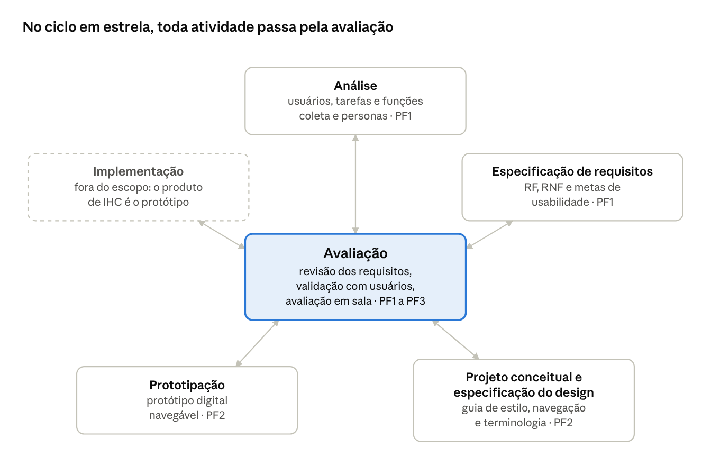
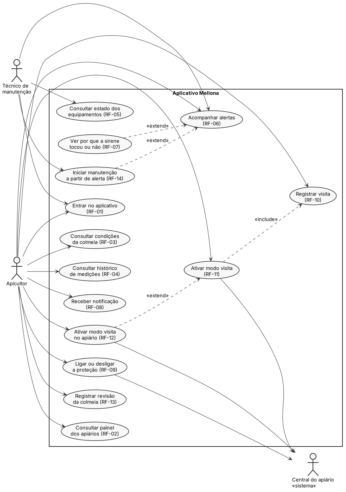
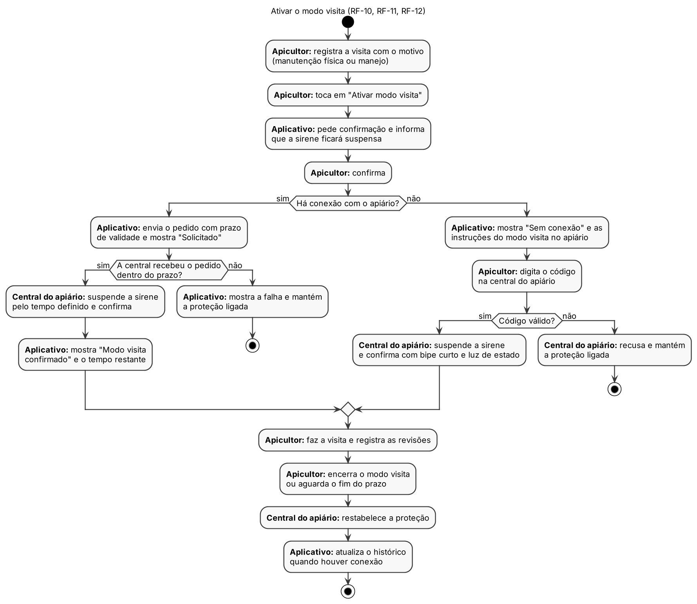

# Mellona — Projeto Final de IHC — Etapa 1 (PF1)

> Documento convertido de PDF para Markdown. O texto foi mantido sem revisão de conteúdo. Tabelas usam blocos de texto para preservar o alinhamento; imagens e links extraídos aparecem na página correspondente.

<!-- Página 1 do PDF original -->

Mellona — Projeto Final de IHC — Etapa 1 (PF1)


## Mellona — Projeto Final de IHC — Etapa 1


## (PF1)

​Oct 20, 2026


## 1. Título

Mellona — aplicativo móvel de acompanhamento e proteção de apiários

Tipo de interface: aplicativo para smartphone com interface gráfica de toque. A interação
se completa na interface física instalada no apiário (sirene, iluminação, indicador de
estado e mecanismo local de autorização de visita).


## 2. Descrição

O projeto concebe e prototipa o aplicativo com que o apicultor acompanha e protege seus
apiários à distância. O Mellona combina sensores nas colmeias e no apiário com uma
central local que aciona sirene e iluminação quando há movimento suspeito. O aplicativo é
a parte do sistema que o apicultor usa no dia a dia.

Problema. Muitos apiários ficam em áreas rurais afastadas, com sinal de celular fraco ou
ausente. Entre uma visita e outra, o apicultor não sabe se as caixas continuam no lugar e
em boas condições. Furtos e tombamentos costumam ser descobertos só na visita
seguinte. Revisões e consertos raramente ficam registrados de forma organizada.

Objetivo. Projetar uma interface que permita ao apicultor, em poucas interações e mesmo
em campo:

ver de relance se cada apiário está protegido e se há algo errado;
entender e tratar os alertas (colmeia mexida, colmeia inclinada, atividade suspeita,
equipamento sem sinal);
ligar e desligar a proteção de um apiário;
ativar o modo visita ao chegar ao apiário, com confirmação clara, para não disparar a
sirene;
registrar a visita com seu motivo (manutenção física ou manejo) e a revisão das
colmeias;
consultar o histórico de temperatura, umidade e ocorrências.

Escopo. Este projeto cobre o design do aplicativo móvel (interface I2 do ERS do Mellona) e
a interação com a interface física local. A aplicação desktop de gestão e o firmware dos
dispositivos são tratados em outras disciplinas e não fazem parte do protótipo.

Page 1 of 23

---

<!-- Página 2 do PDF original -->

Mellona — Projeto Final de IHC — Etapa 1 (PF1)


## 3. Pessoas-chave

O projeto é individual: Bárbara Nogueira conduz todas as atividades de design. Os
usuários participam da coleta de dados e da avaliação do protótipo.

```text
  Grupo                                    Pessoas                            Envolvimento

  Desenvolvimento                          Bárbara Nogueira                   Pesquisa com usuários, análise,
                                                                              especificação de requisitos,
                                                                              design da interação,
                                                                              prototipação e avaliação

  Orientação e                             Prof. Hugo A. D. do Nascimento e   Acompanham as etapas e
  avaliação                                Profa. Luciana Berretta            avaliam as entregas
                                           (INF/UFG)

  Usuário principal                        Apicultores                        Usam o aplicativo para
                                                                              acompanhar apiários, tratar
                                                                              alertas, autorizar visitas e
                                                                              registrar atividades; participam
                                                                              do brainstorming e da avaliação;
                                                                              no estudo de campo, são
                                                                              observados em vídeos que
                                                                              publicam sobre a própria rotina

  Usuários                                 Técnicos de manutenção             Consultam alertas e o estado
  secundários                                                                 dos equipamentos e registram
                                                                              manutenções

  Usuários                                 Administradores do sistema         Cadastram usuários e
  secundários                                                                 dispositivos e configuram
                                                                              parâmetros (tarefas feitas
                                                                              principalmente na aplicação de
                                                                              gestão)

  Afetados                                 Auxiliares de campo e familiares   Acompanham visitas e precisam
  indiretamente                                                               saber usar o modo visita

  Afetados                                 Proprietários das terras onde há   Ouvem a sirene e veem a
  indiretamente                            apiários e vizinhança              iluminação noturna

  Afetados                                 Associações e cooperativas de      Podem usar o histórico de
  indiretamente                            apicultores                        ocorrências e manutenções
                                                                              para orientar os associados
```

Page 2 of 23

---

<!-- Página 3 do PDF original -->

Mellona — Projeto Final de IHC — Etapa 1 (PF1)

```text
  Grupo                                    Pessoas                                Envolvimento

  Afetados                                 Colônias de abelhas                    Podem ser perturbadas por
  indiretamente                                                                   som, luz e manuseio dos
                                                                                  equipamentos
```


## 4. Avaliação de impacto e análise de mercado

O Mellona deve reduzir viagens feitas só para conferir as colmeias e encurtar o tempo
entre um furto ou tombamento e a reação do apicultor. Ele muda cinco processos da
rotina apícola. A situação atual descrita abaixo é uma hipótese da pesquisa secundária e
será confirmada ou corrigida pela coleta de dados (Seção 6).


### 4.1. Contexto de mercado

A produção brasileira de mel cresceu 4,5% em 2025 e chegou a 71,3 mil toneladas, o maior
valor da série do IBGE, com valor de produção de R$ 1,2 bilhão. Sul e Nordeste respondem
cada um por 37,1% da produção; Rio Grande do Sul (15,3%) e Paraná (15,0%) são os
maiores estados produtores (Agência Gov, set. 2026, com dados da PPM/IBGE).

A atividade é distribuída entre muitos produtores, em regiões com clima e conectividade
muito diferentes. Isso favorece uma interface simples, que funcione com sinal fraco e não
exija familiaridade avançada com tecnologia. Não foram encontrados dados consolidados
sobre a frequência de furtos de colmeias no Brasil; a relevância desse problema é a
primeira hipótese a validar com os apicultores (H1).

### 4.2. Quem será afetado

```text
  Grupo                                          Impacto esperado                 Efeito indesejado a controlar

  Apicultores                                    Acompanham os apiários à         Alarmes falsos, excesso de
                                                 distância, recebem alertas e     notificações, curva de
                                                 mantêm histórico de visitas,     aprendizado
                                                 revisões e consertos

  Técnicos de                                    Recebem problemas já             Registros incompletos feitos
  manutenção                                     vinculados à colmeia ou ao       em campo
                                                 equipamento afetado

  Auxiliares de campo                            Entram no apiário sem            Disparo indevido se o modo
                                                 disparar a sirene, desde que o   visita não for ativado
                                                 modo visita esteja confirmado
```

Page 3 of 23

**Links desta página no PDF:**

- [Agência Gov, set. 2026, com dados da PPM/IBGE](<https://agenciagov.ebc.com.br/noticias/202609/quantidade-do-gado-diminui-e-produtividade-aumenta-na-agropecuaria-mostra-ibge>)

---

<!-- Página 4 do PDF original -->

Mellona — Projeto Final de IHC — Etapa 1 (PF1)

```text
  Grupo                                          Impacto esperado                  Efeito indesejado a controlar

  Proprietários das terras                       Passam a ter um sinal de alerta   Incômodo com som e luz,
  e vizinhança                                   em caso de invasão                principalmente à noite

  Associações e                                  Podem orientar os associados      Exposição de dados dos
  cooperativas                                   com base em históricos            associados

  Colônias de abelhas                            Menos tempo expostas a            Perturbação por som, luz e
                                                 tombamentos não percebidos        manuseio dos equipamentos
```

### 4.3. Processos alterados

```text
  Processo                                           Hoje (hipótese)               Com o Mellona

  Verificar as condições das                         Só em visita presencial       Consulta no aplicativo de
  colmeias                                                                         temperatura, umidade,
                                                                                   inclinação e sinal dos
                                                                                   equipamentos

  Descobrir furto, vandalismo                        Na visita seguinte, às        Alerta no momento da
  ou tombamento                                      vezes dias depois             ocorrência e sirene no local
                                                                                   para inibir a ação

  Entrar no apiário                                  Sem registro                  Visita registrada com motivo e
                                                                                   modo visita confirmado antes
                                                                                   de mexer nas caixas

  Registrar revisões                                 De memória, em caderno        Revisão registrada por colmeia
                                                     ou planilha                   no próprio celular

  Tratar consertos                                   Lembrados                     Manutenção criada a partir do
                                                     informalmente                 alerta, com categoria,
                                                                                   prioridade e situação
```


## 5. Processo de design: ciclo de vida em estrela

O projeto segue o ciclo de vida em estrela (Hix e Hartson, 1993), em que a avaliação ocupa
o centro e todas as demais atividades se conectam a ela. Foi escolhido porque os
requisitos do Mellona partem de hipóteses ainda não confirmadas com apicultores, e o
processo exige avaliar cada resultado antes de seguir.

Page 4 of 23

---

<!-- Página 5 do PDF original -->

Mellona — Projeto Final de IHC — Etapa 1 (PF1)


### 5.1. Funcionamento

Seis atividades. Cinco ficam nas pontas da estrela: análise (de tarefas, de usuários e
funcional), especificação de requisitos, projeto conceitual e especificação do design,
prototipação e implementação. A sexta, avaliação, fica no centro.
Sem ordem fixa. O trabalho pode começar por qualquer ponta e seguir para qualquer
outra, desde que passe pela avaliação entre uma atividade e a seguinte.
Dois modos alternados. O modo analítico (de cima para baixo) organiza o que já se
sabe; o modo sintético (de baixo para cima) gera ideias e protótipos que revelam o que
ainda não se sabe.
Iterativo. Cada avaliação pode levar de volta a qualquer atividade, até que o resultado
atenda às metas de usabilidade.

ciclo de vida em estrela aplicado ao Mellona · 6 atividades

A implementação aparece tracejada porque o produto deste projeto é o protótipo, e não o
sistema implementado.

Page 5 of 23



---

<!-- Página 6 do PDF original -->

Mellona — Projeto Final de IHC — Etapa 1 (PF1)

### 5.2. Aplicação no projeto

```text
  Atividade                                      O que é feito no Mellona    Etapa   Situação

  Análise                                        Pesquisa secundária         PF1     Pesquisa secundária
                                                 sobre a apicultura                  concluída; coleta com
                                                 brasileira; estudo de               usuários planejada
                                                 campo com vídeos                    (Seção 6)
                                                 publicados por
                                                 apicultores e
                                                 brainstorming com
                                                 apicultores; perfis,
                                                 personas e cenários;
                                                 casos de uso e atividades

  Especificação de                               Requisitos funcionais e     PF1     Versão inicial concluída;
  requisitos                                     não funcionais com metas            revisão após a coleta
                                                 de usabilidade
                                                 mensuráveis (Seção 7)

  Projeto conceitual e                           Guia de estilo, mapa de     PF2     A fazer
  especificação do design                        navegação e terminologia
                                                 da interface

  Prototipação                                   Protótipo digital           PF2     A fazer
                                                 navegável do aplicativo

  Implementação                                  Não faz parte deste         —       Fora do escopo
                                                 projeto: o produto de IHC
                                                 é o protótipo

  Avaliação                                      Revisão de consistência     PF1 a   Revisão de consistência
                                                 dos requisitos; validação   PF3     concluída
                                                 das hipóteses com
                                                 usuários; avaliação do
                                                 protótipo em sala
```


### 5.3. Caminho percorrido até esta etapa

1. Análise (modo analítico): pesquisa secundária sobre produção, manejo e problemas
dos apicultores, que resultou na primeira versão dos requisitos.
2. Avaliação: revisão de consistência desses requisitos, que encontrou lacunas.
Exemplo: o apicultor que chegasse a um apiário sem internet não teria como ativar o
modo visita e dispararia a própria sirene.

Page 6 of 23

---

<!-- Página 7 do PDF original -->

Mellona — Projeto Final de IHC — Etapa 1 (PF1)

3. Especificação de requisitos: correção das lacunas e definição de metas de
usabilidade (Seção 7).
4. Avaliação com usuários: estudo de campo com vídeos de apicultores e brainstorming
para confirmar ou refutar nove hipóteses (Seção 6).
5. Análise (consolidação): revisão de perfis, personas, cenários e requisitos com os
resultados da coleta, antes de seguir para o projeto conceitual na PF2.


## 6. Técnicas de coleta de dados

Foram selecionadas duas técnicas complementares: estudo de campo, feito com a
observação de vídeos que apicultores publicam em seus canais, para ver a rotina, os
problemas e as práticas no próprio apiário, e brainstorming de necessidades e desejos dos
usuários, para gerar e priorizar em grupo o que os apicultores esperam do aplicativo. O
estudo de campo mostra o que os apicultores fazem e relatam espontaneamente; o
brainstorming mostra o que dizem precisar. Usar as duas permite triangular os dados. Os
resultados serão registrados na Seção 6.6 após a aplicação; nenhum resultado foi
presumido.

### 6.1. Planejamento da coleta

```text
  Ponto                                Decisão

  Objetivo                             Confirmar ou refutar as hipóteses H1 a H9 (6.3) e
                                       levantar necessidades, desejos, tarefas,
                                       vocabulário e contexto de uso dos apicultores

  De quem coletar                      Quem usará o sistema (apicultores e técnicos) e,
                                       quando possível, quem será afetado (auxiliares de
                                       campo). No estudo de campo, apicultores que
                                       mostram a própria rotina em vídeos publicados; no
                                       brainstorming, apicultores e técnicos convidados

  Que dados coletar                    Perfil do apicultor; relação com tecnologia;
                                       conhecimento do domínio; tarefas e práticas
                                       observadas nas visitas e no acompanhamento;
                                       vocabulário; necessidades e desejos priorizados
                                       pelo grupo
```

Page 7 of 23

---

<!-- Página 8 do PDF original -->

Mellona — Projeto Final de IHC — Etapa 1 (PF1)

```text
  Ponto                                Decisão

  Triangulação                         As práticas e os problemas observados nos vídeos
                                       são comparados com as necessidades geradas e
                                       priorizadas em grupo no brainstorming;
                                       divergências entre o que os apicultores fazem e o
                                       que dizem precisar são registradas como pontos a
                                       investigar

  Estudo-piloto                        Roteiro de observação aplicado a dois vídeos antes
                                       da coleta, para ajustar os itens e a ficha de registro;
                                       perguntas disparadoras do brainstorming testadas
                                       com duas pessoas, para corrigir perguntas
                                       ambíguas

  Ética                                Estudo de campo: apenas vídeos abertos ao
                                       público, publicados pelos próprios apicultores; sem
                                       contato com os autores; cada vídeo é citado com
                                       canal, título e link; não são registrados dados de
                                       terceiros que apareçam nas imagens.
                                       Brainstorming: explicação do objetivo e da forma
                                       de participação; consentimento antes da coleta;
                                       permissão para gravar o áudio; anonimato; dados
                                       brutos protegidos e descartados ao fim da
                                       disciplina. Nas duas técnicas, a localização exata
                                       dos apiários não é registrada, mesmo quando
                                       aparece no vídeo, por ser informação sensível ao
                                       risco de furto
```

As diretrizes éticas seguem o código de ética da ACM e as orientações da Aula 6. A aula
cita a Resolução CNS nº 196/96, hoje substituída pelas Resoluções CNS nº 466/2012 e nº
510/2016.

### 6.2. Técnicas selecionadas

```text
  Item                                   T1 — Estudo de campo (vídeos de        T2 — Brainstorming de
                                         apicultores)                           necessidades e desejos

  Objetivo                               Observar a rotina, os problemas,       Gerar em grupo o maior número
                                         as práticas atuais e o vocabulário     possível de necessidades e
                                         dos apicultores no próprio apiário,    desejos e priorizá-los
                                         sem a interferência de um
                                         entrevistador
```

Page 8 of 23

---

<!-- Página 9 do PDF original -->

Mellona — Projeto Final de IHC — Etapa 1 (PF1)

```text
  Item                                   T1 — Estudo de campo (vídeos de         T2 — Brainstorming de
                                         apicultores)                            necessidades e desejos

  Instrumento                            Roteiro de observação com 14            Cinco perguntas disparadoras
                                         itens (6.4) e uma ficha de registro     abertas, seguidas de
                                         por vídeo                               agrupamento das ideias e
                                                                                 votação

  Fontes ou                              Vídeos de apicultores brasileiros       Grupo de apicultores e, se
  participantes                          em seus canais no YouTube e em          possível, um técnico ou auxiliar
                                         outras plataformas de vídeo,            de campo
                                         gravados no apiário ou com relato
                                         da própria experiência

  Meta                                   Pelo menos 10 vídeos de 5 canais        Uma sessão com 4 a 8
                                         diferentes, cobrindo revisão e          participantes
                                         manejo, rotina de visita, furto ou
                                         vandalismo e colmeias tombadas

  Seleção ou                             Busca por termos como "rotina do        Associações e cooperativas de
  recrutamento                           apicultor", "revisão de colmeias",      apicultores, contatos pessoais e
                                         "furto de colmeias" e "colmeia          grupos de apicultores em redes
                                         tombada". Entram vídeos de quem         sociais; a sessão pode ser feita
                                         trabalha com as próprias                em uma reunião de associação
                                         colmeias, com cenas reais ou            ou cooperativa
                                         relato em primeira pessoa; ficam
                                         de fora propagandas e aulas sem
                                         cenas de apiário

  Aplicação                              Cada vídeo é assistido inteiro uma      Presencial, com notas adesivas,
                                         vez e os trechos relevantes são         ou por videochamada com
                                         revistos; sem contato com os            quadro colaborativo, de 60 a 90
                                         autores                                 minutos, com Bárbara como
                                                                                 facilitadora

  Registro                               Ficha por vídeo: canal, título, link,   Todas as ideias transcritas, fotos
                                         data de publicação e duração;           ou exportação do quadro, votos
                                         para cada item do roteiro, o            de cada grupo e áudio gravado
                                         minuto do trecho, o que é               com permissão
                                         mostrado e o que é dito, com
                                         citação literal quando relevante

  Análise                                Agrupamento dos trechos por             Agrupamento das ideias por
                                         tema (diagrama de afinidade) e          afinidade e ordenação das
                                         evidências para cada hipótese,          necessidades pelo número de
                                         separando o que foi visto do que        votos
                                         foi relatado
```

Page 9 of 23

---

<!-- Página 10 do PDF original -->

Mellona — Projeto Final de IHC — Etapa 1 (PF1)

```text
  Item                                   T1 — Estudo de campo (vídeos de    T2 — Brainstorming de
                                         apicultores)                       necessidades e desejos

  Limitações                             O vídeo mostra só o que o autor    Os participantes podem se
                                         escolheu gravar e editar; quem     influenciar e vozes dominantes
                                         mantém um canal tende a ter mais   podem pesar mais; a facilitação
                                         experiência e mais familiaridade   e a votação individual reduzem
                                         com tecnologia que a média (viés   esse efeito
                                         em H3); não há perguntas de
                                         acompanhamento
```

### 6.3. Hipóteses investigadas

```text
  ID          Hipótese                                                       Itens dos roteiros

  H1          Furto, vandalismo e tombamento de colmeias são                 O-06 a O-08; B-01
              problemas relevantes

  H2          Os apiários ficam em locais com internet instável              O-04; B-03
              ou ausente

  H3          O apicultor usa smartphone no dia a dia, inclusive             O-11; B-04
              em deslocamento

  H4          As visitas são frequentes, podem ocorrer à noite e             O-03, O-05; B-03
              envolver auxiliares

  H5          Acompanhar peso e reservas é menos prioritário                 O-09; B-02 e votação
              que a segurança

  H6          Sirene e iluminação noturna são aceitáveis para                O-08, O-10; B-04
              apicultor, vizinhança e manejo

  H7          Revisões e consertos são registrados de forma                  O-12; B-05
              informal ou não são registrados

  H8          Viagens apenas para conferir as colmeias são                   O-02; B-01, B-02
              frequentes e custosas

  H9          Luvas e véu dificultam o uso do celular no apiário             O-11; B-03
```


### 6.4. Roteiro de observação dos vídeos (T1)

Cada vídeo é assistido com a ficha aberta. Para cada item, anota-se o minuto do trecho e
se a informação foi mostrada na imagem ou apenas dita pelo apicultor: o que é mostrado
conta como observação, e o que é dito, como relato. Itens que o vídeo não cobre ficam em

Page 10 of 23

---

<!-- Página 11 do PDF original -->

Mellona — Projeto Final de IHC — Etapa 1 (PF1)

branco; nada é inferido.

```text
  ID            O que observar                                          Hipótese

  O-01          Perfil do autor, quando informado: tempo de             —
                apicultura, número de colmeias e apiários, se a
                apicultura é a principal renda

  O-02          Frequência das visitas, distância e tempo de            H8
                deslocamento; visitas feitas só para conferir se
                está tudo bem

  O-03          Quem acompanha o apicultor na visita; visitas ao        H4
                entardecer ou à noite e o motivo

  O-04          Sinal de celular e de internet no apiário: menções,     H2
                ligações que falham, uso do celular sem rede

  O-05          Sequência da visita, da chegada à saída: preparo,       H4
                equipamentos, abertura das caixas, revisão e
                fechamento

  O-06          Problemas mostrados ou relatados com as                 H1
                colmeias: pragas, enxameação, falta de alimento,
                clima

  O-07          Furtos, vandalismo e colmeias tombadas: como e          H1
                quando o apicultor descobriu, o prejuízo e o que fez

  O-08          Formas de proteção usadas hoje: cercas, cadeados,       H1, H6
                marcação das caixas, câmeras, rastreadores,
                apiário em local escondido

  O-09          O que o apicultor confere primeiro ao chegar (peso      H5
                das caixas, reservas, rainha, entrada da colmeia) e
                o que diz querer saber sem precisar ir

  O-10          Uso de alarmes, luzes ou outros dispositivos no         H6
                apiário, ou comentários sobre eles; relação com o
                dono da terra e os vizinhos; reação das abelhas a
                barulho e luz

  O-11          Uso do celular no apiário: para quê, se tira as luvas   H3, H9
                ou o véu, onde guarda o aparelho

  O-12          Como registra revisões, problemas e consertos:          H7
                caderno, anotação na tampa da caixa, planilha,
                aplicativo ou nenhum registro
```

Page 11 of 23

---

<!-- Página 12 do PDF original -->

Mellona — Projeto Final de IHC — Etapa 1 (PF1)

```text
  ID            O que observar                                                  Hipótese

  O-13          Consertos mais comuns em caixas, cavaletes e                    —
                equipamentos

  O-14          Termos usados para colmeias, visitas, revisões e                —
                problemas, para orientar os rótulos da interface
                (RNF-05)
```


### 6.5. Roteiro do brainstorming (T2)

Sessão em grupo conduzida pela facilitadora. As regras são explicadas no início: nenhuma
crítica durante a geração de ideias; quantidade antes de qualidade; vale combinar e
ampliar a ideia de outra pessoa; toda ideia é registrada. A sessão não pede nome
completo, município nem localização dos apiários.

```text
  Etapa                        Duração           O que acontece

  Abertura                     10 min            Objetivo acadêmico, consentimento, permissão
                                                 para gravar e regras da sessão

  Aquecimento                  5 min             Rodada rápida: cada participante conta há quanto
                                                 tempo trabalha com apicultura e quantas colmeias
                                                 tem

  Geração                      35 a 45 min       Uma pergunta disparadora por vez; cada ideia vai
                                                 para uma nota, é lida em voz alta e colada no
                                                 quadro

  Agrupamento                  10 a 15 min       O grupo junta as notas parecidas e dá nome a cada
                                                 grupo de ideias

  Priorização                  10 min            Cada participante distribui 3 votos entre os grupos
                                                 que considera mais importantes

  Fechamento                   5 min             Leitura dos grupos mais votados e comentários
                                                 finais

  ID            Pergunta disparadora                                            Hipótese

  B-01          Que problemas acontecem com suas colmeias                       H1, H8
                entre uma visita e outra?

  B-02          O que você gostaria de saber sobre o apiário sem                H5, H8
                precisar ir até lá?
```

Page 12 of 23

---

<!-- Página 13 do PDF original -->

Mellona — Projeto Final de IHC — Etapa 1 (PF1)

```text
  ID            Pergunta disparadora                                     Hipótese

  B-03          O que atrapalha ou pode dar errado quando você           H2, H4, H9
                chega e trabalha no apiário?

  B-04          Como você gostaria de ser avisado quando algo            H3, H6
                acontecer? O que seria incômodo?

  B-05          O que você gostaria de registrar sobre visitas,          H7
                revisões e consertos?
```


### 6.6. Resultados

A preencher com os dados reais após a aplicação das técnicas.

Estudo de campo (T1) — vídeos: \[ \]; canais: \[ \]; período da análise: \[ \]

Vídeos analisados (acrescentar uma linha por vídeo):

```text
 ID          Canal Título e link Publicação Duração Situação mostrada
```

V-01

V-02

V-03

V-04

V-05

Síntese por tema (cada evidência indica o vídeo e o minuto, por exemplo V-03, 4:12):

```text
  Tema                                                            Evidências   Síntese
```

Perfil dos autores (O-01)

Frequência de visitas e deslocamento (O-02)

Visitas com auxiliares ou à noite (O-03, O-05)

Sinal de internet no apiário (O-04)

Problemas com as colmeias (O-06)

Furtos, danos, tombamentos e formas de proteção
(O-07, O-08)

O que conferem ao chegar e querem saber à
distância (O-09)

Page 13 of 23

---

<!-- Página 14 do PDF original -->

Mellona — Projeto Final de IHC — Etapa 1 (PF1)

```text
  Tema                                                                      Evidências   Síntese
```

Alarmes, luzes e vizinhança (O-10)

Uso do celular, inclusive com luvas e véu (O-11)

Registro de revisões e consertos (O-12, O-13)

Vocabulário do apicultor (O-14)

Brainstorming (T2) — participantes: \[ \]; data: \[ \]; formato: \[presencial ou online\]

Todas as ideias geradas (acrescentar uma linha por ideia):

```text
  ID          Ideia, como foi dita               Pergunta     Grupo
```

I-01

I-02

I-03

I-04

I-05

Necessidades priorizadas pelo grupo:

```text
  Posição            Grupo de ideias             Votos      Hipóteses relacionadas
```

1

2

3

4

5

Situação das hipóteses

```text
  Hipótese             Resultado             Evidência      Alteração nos requisitos
```

H1

H2

H3

Page 14 of 23

---

<!-- Página 15 do PDF original -->

Mellona — Projeto Final de IHC — Etapa 1 (PF1)

```text
  Hipótese             Resultado             Evidência   Alteração nos requisitos
```

H4

H5

H6

H7

H8

H9


## 7. Requisitos funcionais e não funcionais

O aplicativo tem 14 requisitos funcionais e 13 não funcionais. Eles derivam do ERS do
Mellona (versão 1.1), restritos ao que o apicultor faz no celular; a coluna Origem permite
rastrear cada um. Serão revisados com os resultados da coleta.

### 7.1. Requisitos funcionais

```text
  ID             O aplicativo deve permitir                                  Prioridade   Origem

  RF-01          Entrar com credenciais e sair da conta                      Essencial    HU-01

  RF-            Ver no painel, para cada apiário: estado da                 Essencial    HU-23, HU-34, HU-
  02             proteção (ligada, desligada, modo visita, sirene                         36
                 tocando ou com falha), período dia ou noite,
                 alertas ativos e equipamentos sem sinal

  RF-            Consultar temperatura, umidade e inclinação                 Essencial    HU-06
  03             de cada colmeia, com o horário da última
                 medição e indicação de dado desatualizado ou
                 indisponível

  RF-            Consultar o histórico de medições por colmeia               Essencial    HU-07
  04             e período, em gráfico, com os períodos sem
                 dados destacados

  RF-            Consultar o estado e a última comunicação de                Essencial    HU-08
  05             cada equipamento

  RF-            Acompanhar alertas (tipo, colmeia ou apiário,               Essencial    HU-17
  06             horário, prioridade, estado, sirene e luz
                 acionadas), reconhecê-los e encerrá-los
```

Page 15 of 23

---

<!-- Página 16 do PDF original -->

Mellona — Projeto Final de IHC — Etapa 1 (PF1)

```text
  ID             O aplicativo deve permitir                           Prioridade   Origem

  RF-            Ver por que a sirene tocou ou não tocou em           Importante   HU-39
  07             uma ocorrência

  RF-            Receber notificações de situações críticas e         Importante   HU-18
  08             abrir o alerta a partir delas

  RF-            Ligar e desligar a proteção de um apiário,           Essencial    HU-34
  09             vendo quando o apiário confirmou a mudança

  RF-10          Registrar uma visita com motivo do grupo             Essencial    HU-33
                 manutenção física (CM) ou manejo (IB) e a
                 categoria correspondente

  RF-11          Ativar o modo visita vinculado à visita,             Essencial    HU-16
                 acompanhar seus estados (solicitado,
                 confirmado, encerrado, expirado) e o tempo
                 restante, e encerrá-lo antes do prazo

  RF-12          Ser orientado a usar o mecanismo local do            Essencial    HU-35
                 apiário quando não houver conexão para ativar
                 o modo visita

  RF-13          Registrar a revisão de uma colmeia: rainha,          Essencial    HU-19
                 crias, condições da colônia e observações

  RF-14          Iniciar uma manutenção a partir de um alerta         Essencial    HU-30
```


### 7.2. Requisitos não funcionais

Os requisitos de usabilidade estão organizados pelas metas e critérios de qualidade de
IHC vistos nas Aulas 1 e 2.

```text
  ID              Meta ou critério               Requisito                         Origem

  RNF-            Eficácia                       Pelo menos 80% das tarefas        RNF-10 do ERS
  01                                             essenciais concluídas sem
                                                 ajuda no teste de usabilidade

  RNF-            Eficiência                     Ativar o modo visita em até 3     RNF-25 do ERS
  02                                             interações e 30 segundos;
                                                 reconhecer um alerta em até 2
                                                 interações a partir da
                                                 notificação
```

Page 16 of 23

---

<!-- Página 17 do PDF original -->

Mellona — Projeto Final de IHC — Etapa 1 (PF1)

```text
  ID              Meta ou critério               Requisito                          Origem

  RNF-            Segurança de uso               Ações que deixam o apiário         RN-30 do ERS
  03                                             desprotegido (desligar a
                                                 proteção, ativar o modo visita)
                                                 pedem confirmação e informam
                                                 a consequência; o estado só
                                                 aparece como confirmado
                                                 depois da resposta do apiário

  RNF-            Utilidade                      A primeira tela responde, sem      HU-23 do ERS
  04                                             navegação, se cada apiário está
                                                 protegido e se há algo que exige
                                                 atenção

  RNF-            Facilidade de                  As tarefas essenciais podem        RNF-26 e Apêndice
  05              aprendizado                    ser feitas no primeiro uso, sem    B do ERS
                                                 treinamento, com o vocabulário
                                                 do apicultor (por exemplo,
                                                 "colmeia mexida", "modo visita",
                                                 "revisão")

  RNF-            Facilidade de                  Navegação principal com no         Meta de
  06              memorização                    máximo cinco destinos fixos;       usabilidade
                                                 ações recorrentes sempre no
                                                 mesmo lugar, com ícone e rótulo

  RNF-            Comunicabilidade               Todo comando mostra se está        HU-06, RN-07, RN-
  07                                             pendente, confirmado ou            30 do ERS
                                                 falhou; toda medição mostra o
                                                 horário e se está desatualizada

  RNF-            Acessibilidade                 Contraste mínimo de 4,5:1 para     RNF-11, RNF-24 do
  08                                             texto (WCAG 2.1, nível AA);        ERS
                                                 estados comunicados por cor,
                                                 ícone e texto juntos; ícones com
                                                 rótulo textual

  RNF-            Acessibilidade e               Alvos de toque de pelo menos       RNF-24, RNF-27 do
  09              contexto de uso                44 × 44 px; textos legíveis sob    ERS
                                                 sol forte; interações essenciais
                                                 possíveis com luvas e véu (a
                                                 confirmar pela hipótese H9)

  RNF-            Adaptação                      Interface adaptada a telas de      RNF-11 do ERS
  10                                             smartphone em orientação
                                                 retrato
```

Page 17 of 23

---

<!-- Página 18 do PDF original -->

Mellona — Projeto Final de IHC — Etapa 1 (PF1)

```text
  ID              Meta ou critério                       Requisito                            Origem

  RNF-            Conectividade                          Sem conexão, o aplicativo            H2; RN-23 do ERS
  11                                                     mostra os últimos dados com
                                                         horário e aviso de "sem
                                                         conexão"; visitas e revisões
                                                         registradas sem internet são
                                                         enviadas depois, sem
                                                         duplicação

  RNF-            Segurança da                           Autenticação de usuários e           RNF-08 do ERS
  12              informação                             proteção de credenciais

  RNF-            Privacidade                            A localização dos apiários só é      RNF-16 do ERS
  13                                                     visível a usuários autorizados
```


## 8. Perfis de usuário, personas e cenários

Os dados são organizados em três representações: perfis, que descrevem os grupos de
usuários; personas, que dão rosto ao usuário principal e ao secundário; e cenários, que
mostram as tarefas em contexto. Nesta versão, as três se baseiam na pesquisa secundária
e serão revisadas com os resultados da Seção 6.6.

### 8.1. Perfis de usuário

```text
  Característica                           Apicultor (principal)                 Técnico de manutenção
                                                                                 (secundário)

  Objetivo com o                           Saber se as colmeias estão bem        Saber o que consertar, onde e
  aplicativo                               sem ir ao apiário e agir rápido       com que prioridade
                                           diante de problemas

  Conhecimento do                          Alto: manejo, revisões, safra,        Médio a alto: estruturas,
  domínio                                  comportamento das abelhas             equipamentos e manejo básico

  Experiência com                          Variável, de básica a                 Intermediária
  tecnologia                               intermediária; uso diário de
                                           aplicativos de mensagem

  Dispositivo                              Smartphone; computador                Smartphone e computador
                                           eventualmente

  Contexto de uso                          Em casa, na estrada e no apiário:     No apiário e no escritório
                                           sol forte, luvas e véu, sinal fraco
                                           ou ausente
```

Page 18 of 23

---

<!-- Página 19 do PDF original -->

Mellona — Projeto Final de IHC — Etapa 1 (PF1)

```text
  Característica                           Apicultor (principal)                 Técnico de manutenção
                                                                                 (secundário)

  Frequência                               Consultas rápidas diárias; uso        Semanal e sob demanda
                                           intenso em alertas e visitas

  Tarefas críticas                         Consultar o painel, tratar alertas,   Consultar alertas e
                                           ativar o modo visita, registrar       equipamentos, iniciar
                                           visita e revisão                      manutenções

  Gravidade dos erros                      Alta: esquecer o modo visita          Média: manutenção registrada
                                           dispara a sirene; confiar em          no recurso errado
                                           proteção que não foi confirmada
                                           deixa o apiário desprotegido
```


### 8.2. Personas

Persona principal — Antônio, 58 anos, apicultor de pequeno porte

Quem é: produz mel há 20 anos; tem cerca de 40 colmeias em dois apiários instalados
em terras de terceiros, a dezenas de quilômetros de casa.
Tecnologia: smartphone Android básico. Usa aplicativos de mensagem todos os dias,
mas evita aplicativos com muitas telas. No apiário, o sinal é fraco ou ausente.
Objetivos: saber se as caixas continuam no lugar e em boas condições sem viajar; não
ser surpreendido por furtos ou tombamentos.
Frustrações: já perdeu colmeias e só descobriu na visita seguinte; não tem registro
organizado das revisões.
O que espera do Mellona: poucas telas, alertas claros e um jeito de entrar no apiário
sem disparar a sirene, mesmo sem sinal.

Persona secundária — Carla, 34 anos, técnica de uma cooperativa apícola

Quem é: técnica em agropecuária; acompanha os apiários de vários cooperados.
Tecnologia: notebook no escritório e smartphone em campo; à vontade com planilhas
e aplicativos.
Objetivos: priorizar consertos, saber quais equipamentos estão sem sinal e manter
histórico para orientar os cooperados.
Frustrações: informações espalhadas em mensagens e cadernos; não sabe se um
problema já foi tratado.
O que espera do Mellona: alertas ligados às manutenções e histórico por apiário.

Page 19 of 23

---

<!-- Página 20 do PDF original -->

Mellona — Projeto Final de IHC — Etapa 1 (PF1)


### 8.3. Cenários

Cada cenário apresenta o problema como acontece hoje e a interação proposta com o
aplicativo.

C1 — Atividade suspeita à noite (RF-02, RF-06, RF-07, RF-08)

Hoje: uma pessoa entra no apiário de Antônio de madrugada e leva duas caixas. Ele só
percebe na visita, uma semana depois.
Com o Mellona: o sensor de presença e o sensor da colmeia detectam a ação. A
central do apiário toca a sirene e acende a luz por 30 segundos, sem depender da
internet. Quando o sinal permite, Antônio recebe a notificação "Atividade suspeita —
Apiário Serra, colmeia A1-07, 2h14". Ele abre o alerta, vê que a sirene e a luz foram
acionadas e liga para o dono da terra. Pela manhã, reconhece o alerta.

C2 — Visita sem sinal de celular (RF-10, RF-11, RF-12, RF-13)

Hoje: Antônio chega ao apiário para revisar a rainha de duas colmeias. Sem sinal, ele
não teria como avisar o sistema e dispararia a sirene ao mexer nas caixas.
Com o Mellona: em casa, ele registra a visita com o motivo "Manejo — rainha (IB-01)".
No apiário, o aplicativo mostra "sem conexão" e indica o modo visita local. Antônio
digita seu código na central do apiário, que confirma com um bipe curto e uma luz de
estado verde. Ele revisa as colmeias e registra a revisão no celular. Quando o sinal
volta, visita, modo visita e revisão aparecem no histórico.

C3 — Colmeia inclinada após ventania (RF-03, RF-06, RF-14)

Hoje: uma colmeia tomba numa ventania. O apicultor só descobre na visita seguinte,
com a colônia enfraquecida.
Com o Mellona: a colmeia fica inclinada mais de 15 graus por mais de 10 segundos. O
aplicativo mostra o alerta "Colmeia inclinada ou caída", sem sirene, porque não houve
presença. Carla abre o alerta e cria uma manutenção "Cavaletes e suportes (CM-02)"
com prioridade alta.

C4 — Conferência diária (RF-02, RF-03, RF-05)

Hoje: para saber se está tudo bem, Antônio precisa ir ao apiário.
Com o Mellona: no café da manhã, ele abre o aplicativo e vê os dois apiários com
proteção ligada, sem alertas e com medições de dois minutos atrás. Um aviso indica
um equipamento sem sinal; ele toca no aviso e vê que é o sensor da colmeia A1-07.


## 9. Diagrama de casos de uso

O aplicativo tem 14 casos de uso, um por requisito funcional, com dois atores humanos e a
central do apiário como ator sistema.

Page 20 of 23

---

<!-- Página 21 do PDF original -->

Mellona — Projeto Final de IHC — Etapa 1 (PF1)

Page 21 of 23



---

<!-- Página 22 do PDF original -->

Mellona — Projeto Final de IHC — Etapa 1 (PF1)

Atores. O apicultor é o ator principal. O técnico de manutenção usa alertas,
equipamentos e manutenções. A central do apiário confirma as mudanças de
proteção e o modo visita.
«include». Ativar o modo visita sempre inclui registrar a visita, porque a suspensão da
sirene só vale vinculada a uma visita.
«extend». O modo visita no apiário estende o modo visita quando não há conexão. Ver
o motivo da decisão e iniciar uma manutenção estendem o acompanhamento de
alertas.


## 10. Diagrama de atividades

O diagrama modela a tarefa mais crítica do aplicativo: ativar o modo visita, com e sem
conexão com o apiário. Um erro nessa tarefa dispara a sirene sobre o próprio apicultor ou
deixa o apiário desprotegido.

Page 22 of 23



---

<!-- Página 23 do PDF original -->

Mellona — Projeto Final de IHC — Etapa 1 (PF1)

Com conexão: o aplicativo envia o pedido com prazo de validade e só mostra "Modo
visita confirmado" depois da resposta da central (RNF-03, RNF-07).
Sem conexão: o aplicativo não finge que funcionou; mostra "Sem conexão" e orienta o
uso do código na central, que confirma com bipe curto e luz de estado.
Encerramento: a proteção volta ao fim do prazo ou quando o apicultor encerra a
visita; o histórico é atualizado quando houver conexão.


## Referências

AGÊNCIA GOV. Quantidade do gado diminui e produtividade aumenta na
agropecuária, mostra IBGE. Brasília, set. 2026. Disponível em: agenciagov.ebc.com.br.
ASSOCIATION FOR COMPUTING MACHINERY (ACM). Code of Ethics and
Professional Conduct. 1992.
BARBOSA, S. D. J.; SILVA, B. S. Interação humano-computador. Rio de Janeiro: Elsevier,
2010.
BRASIL. Conselho Nacional de Saúde. Resolução nº 466, de 12 de dezembro de 2012;
Resolução nº 510, de 7 de abril de 2016.
COOPER, A.; REIMANN, R.; CRONIN, D. About Face 3: the essentials of interaction
design. Indianapolis: Wiley, 2007.
HIX, D.; HARTSON, H. R. Developing user interfaces: ensuring usability through
product and process. New York: John Wiley & Sons, 1993.
NASCIMENTO, H. A. D.; BERRETTA, L. Interação Humano-Computador: Aulas 1, 2, 5 e 6.
Goiânia: INF/UFG, 2026. Notas de aula.
NOGUEIRA, B. Mellona: Especificação de Requisitos de Software, versão 1.1. Goiânia,
2026. Documento do projeto.
ROSSON, M. B.; CARROLL, J. M. Usability engineering: scenario-based development of
human-computer interaction. San Francisco: Morgan Kaufmann, 2002.
W3C. Web Content Accessibility Guidelines (WCAG) 2.1. 2018. Disponível em:
w3.org/TR/WCAG21.

Page 23 of 23

**Links desta página no PDF:**

- [agenciagov.ebc.com.br](<https://agenciagov.ebc.com.br/noticias/202609/quantidade-do-gado-diminui-e-produtividade-aumenta-na-agropecuaria-mostra-ibge>)
- [w3.org/TR/WCAG21](<https://www.w3.org/TR/WCAG21/>)

---
