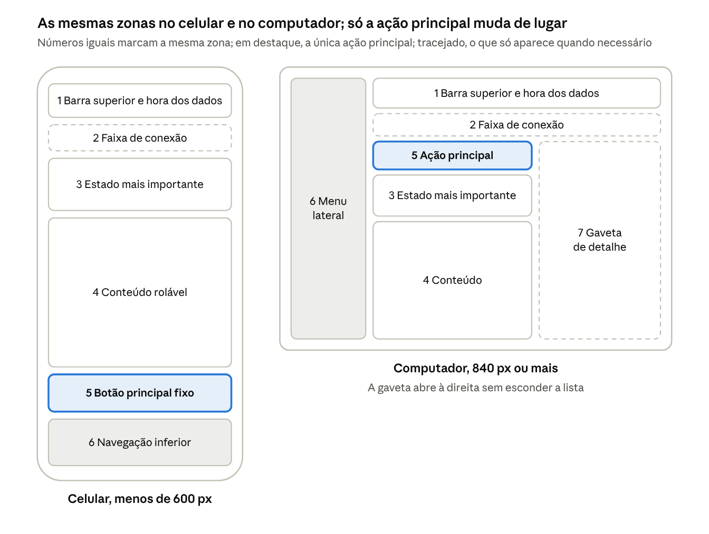
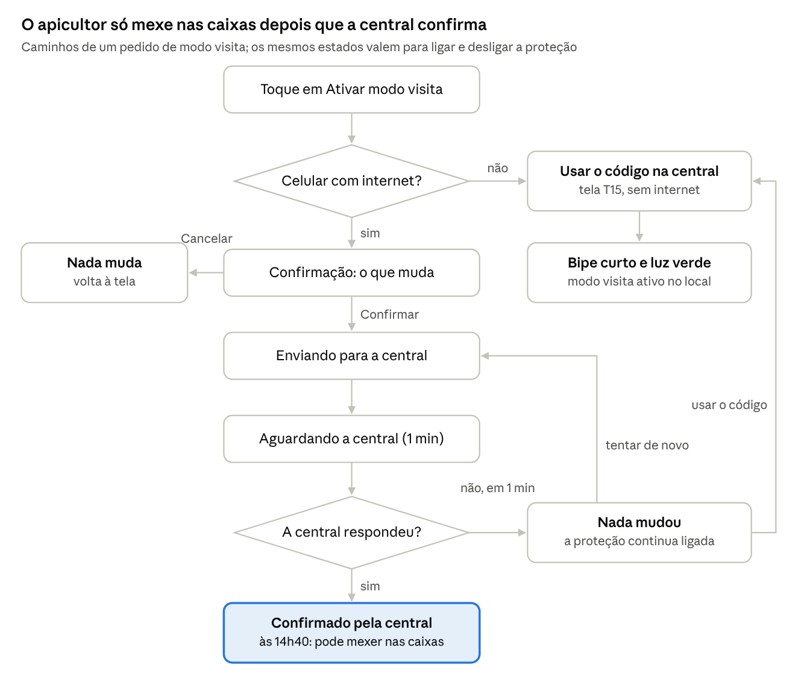

# Mellona — Guia de estilo e especificação das telas

| Identificação | Registro |
| --- | --- |
| Autora | Bárbara Nogueira |
| Disciplina | Interação Humano-Computador — INF/UFG |
| Interface | Aplicativo de acompanhamento do apicultor e sua interação com a central do apiário |
| Guia de estilo | Versão 1.1, com inclusão do Figma em 28/10/2026 |
| Revisão documental | 05/11/2026 |
| Requisitos de origem | ERS e PF1; personas e hipóteses ainda pendentes de validação com usuários |

## Sumário

1. [Introdução](#1-introdução)
2. [Resultados de análise](#2-resultados-de-análise)
3. [Elementos de interface](#3-elementos-de-interface)
4. [Elementos de interação](#4-elementos-de-interação)
5. [Elementos de ação](#5-elementos-de-ação)
6. [Vocabulário e padrões](#6-vocabulário-e-padrões)
7. [Navegação e tarefas críticas](#7-navegação-e-tarefas-críticas)
8. [Especificação das 18 telas](#8-especificação-das-18-telas)
9. [Estados globais](#9-estados-globais)
10. [Responsividade](#10-responsividade)
11. [Acessibilidade](#11-acessibilidade)
12. [Rastreabilidade e pendências](#12-rastreabilidade-e-pendências)
13. [Referências](#13-referências)

## 1. Introdução

### 1.1 Objetivo e alcance

Este guia registra as decisões de design do Mellona e especifica as 18 telas do aplicativo. Seu objetivo é manter a mesma palavra para o mesmo conceito, a mesma aparência para o mesmo estado e a mesma posição para a mesma ação. O apicultor deve saber, em um olhar, se os apiários precisam de atenção e compreender o que pode fazer com segurança.

O documento define **como a interface deve funcionar**. As capturas do que foi construído, o inventário de telas implementadas e a revisão dos 25 problemas estão em [Protótipos e análise da PF2](prototipos-e-analise-pf2.md). A avaliação formal em sala pertence à PF3.

A referência de requisitos é o [ERS](../../docs/ERS.md). Os identificadores RF e RNF usados aqui são os da [PF1 de IHC](../pf1-planejamento/PF1.md); as referências RN, PAR e HU remetem ao ERS. As propostas ao final deste documento não alteram automaticamente as regras do sistema.

### 1.2 Público-alvo

| Público | Uso do documento |
| --- | --- |
| Designer — Bárbara Nogueira | Definir, desenhar e revisar a interação e as telas |
| Desenvolvimento | Implementar cores, tipografia, componentes, estados e comportamentos |
| Avaliadores | Comparar o protótipo com as regras e tarefas especificadas |
| Suporte e técnicos de cooperativa | Usar o mesmo vocabulário do apicultor e orientar as tarefas |

### 1.3 Uso em produção e manutenção

Antes de criar uma tela, identifique seu tipo na seção 6, escolha os componentes das seções 3 a 5 e consulte sua especificação na seção 8. No Figma, mantenha cores e textos como estilos e controles como componentes de uma biblioteca. No bolt.new, forneça os mesmos valores ao solicitar a implementação.

Antes de considerar uma tela pronta, confira:

- Estado comunicado por cor, ícone e texto.
- Uma ação principal, com nome que diga o que acontece.
- Texto de decisão com pelo menos 16 px e contraste mínimo de 4,5:1.
- Alvos de interação com pelo menos 48 × 48 px no protótipo web.
- Termos do vocabulário da seção 6 e horário dos dados do apiário.
- Estados de carregamento, vazio, erro e falta de conexão.
- Funcionamento no celular de 360 px e com texto ampliado.

Na manutenção, atualize primeiro a regra compartilhada e depois as telas afetadas. Quando uma avaliação encontrar um problema, registre também a regra que evita sua repetição. A autora mantém o guia, que deve ser revisto depois da PF3 e antes da PF4.

### 1.4 Histórico e decisões consolidadas

| Data | Versão ou marco | Registro |
| --- | --- | --- |
| 20/10/2026 | Especificação inicial | Definição das telas T01 a T18 |
| 21/10/2026 | Guia 1.0 | Regras de estilo e revisão das primeiras telas no bolt.new |
| 28/10/2026 | Guia 1.1 | Inclusão do Figma no fluxo de prototipação |
| 05/11/2026 | Revisão documental | Consolidação do guia e das telas, com análise do protótipo em documento próprio |

As seguintes decisões resolvem diferenças entre os documentos anteriores:

| Assunto | Decisão adotada |
| --- | --- |
| Família de ícones | **Lucide**, como definido no guia da PF2, substitui a proposta inicial de Material Symbols e os desenhos anteriores de ícones do domínio |
| Apiário e colmeia | Hexágono preenchido para apiário e vazado para colmeia; acompanhados de texto. O hexágono não determina o formato de botões |
| Modo visita | Ícone `user-check`; o olho fica reservado a mostrar ou ocultar senha e código |
| Identidade visual | Logotipo descrito no guia: hexágono em Mel com gota e nome Mellona. A abelha estilizada da especificação inicial não é uma segunda regra de marca |
| Navegação expandida | Menu lateral de 248 px; o trilho de 80 px fica para a faixa média |
| Ação para iniciar uma visita | “Registrar visita”, podendo aparecer como “Vou ao apiário” no Painel e “Vou a este apiário” no detalhe, sempre levando a T13 |
| Proteção com falha | Própolis queimada; Cinza-cera indica falta de dados ou comunicação. Falha na proteção exige atenção, mesmo quando o diagnóstico envolve um sensor sem sinal |
| Acessibilidade | A PF1 citava WCAG 2.1 AA; a análise da PF2 adota WCAG 2.2 AA como referência mais abrangente. A conformidade do protótipo continua pendente de verificação |

No protótipo web, as medidas são expressas em px de CSS. Na eventual implementação Android, dimensões de layout usam dp e texto usa sp, acompanhando o ajuste do sistema. Os valores não autorizam tratar pixels físicos e unidades lógicas como equivalentes em qualquer aparelho.

## 2. Resultados de análise

### 2.1 Usuários e ambiente de trabalho

As decisões vêm dos perfis e cenários da PF1. Antônio tem 58 anos e familiaridade básica a intermediária com tecnologia. Carla, 34 anos, é técnica de cooperativa e acompanha vários apiários. As personas são provisórias: o estudo de campo com vídeos de apicultores e o brainstorming ainda precisam ser aplicados e registrados.

| Ambiente | Condições de uso | Consequência para a interface |
| --- | --- | --- |
| Casa — Antônio | Android básico, boa conexão, consultas no café da manhã e alertas de madrugada; C1 e C4 | Estado dos apiários em um olhar, tema escuro e notificações legíveis |
| Estrada — Antônio | Sinal intermitente e pouca atenção disponível | Horário dos dados visível; registros locais enviados após reconexão |
| Apiário — Antônio | Sol, luvas, véu, mãos ocupadas, abelhas agitadas e possível ausência de sinal; C2 e C3 | Alto contraste, botões grandes na base, pouca digitação e autorização local de visita |
| Escritório da cooperativa — Carla | Notebook, mouse e teclado; vários apiários | Lista e detalhe lado a lado, filtros visíveis e atalhos |

O erro de segurança pode ocorrer nos dois sentidos: uma sirene pode tocar sobre o apicultor, ou a interface pode apresentar como protegido um apiário com problema. Por isso, o aplicativo não confirma um comando antes da resposta da central.

### 2.2 Necessidades e decisões de design

| Propriedade do usuário | Fonte | Decisão de design | Telas |
| --- | --- | --- | --- |
| 58 anos, familiaridade básica a intermediária com tecnologia | Persona Antônio; perfil do apicultor | Texto base de 18 px, suporte à fonte do sistema até 200%, frases curtas, no máximo quatro destinos na navegação | Todas |
| Smartphone Android básico | Persona Antônio | Interface leve, que funciona em telas de 360 px de largura; nenhum gesto obrigatório: todo deslize tem um botão equivalente | Todas |
| Sinal fraco ou ausente no apiário | Persona Antônio; hipótese H2 | Faixa "Sem conexão" visível; últimos dados com horário; registros guardados no aparelho e enviados depois; modo visita local | T03, T14, T15, T16 |
| Luvas, véu e sol forte em campo | Perfil do apicultor; hipótese H9 | Alvos de toque de pelo menos 48 × 48 dp; ações principais em botões de 56 dp de altura; tema claro de alto contraste durante o dia | T13 a T16 |
| Já perdeu colmeias e quer alertas claros | Persona Antônio | Alerta escrito como frase, com o que aconteceu, onde, quando e o que o sistema fez | T08, T09, T10 |
| Usa aplicativos de mensagem todos os dias | Persona Antônio | Notificação com ação direta; opção de compartilhar o alerta sem a localização do apiário | T09, T10 |
| Erros de alta gravidade (sirene disparada sobre si, apiário desprotegido) | Perfil do apicultor | Confirmação antes de desproteger; estado "confirmado" só após resposta da central; botão "Encerrar visita" sempre visível | T11, T14, T15 |
| Acompanha vários apiários e prioriza consertos | Persona Carla | Filtros por apiário, prioridade e situação; manutenção criada a partir do alerta | T08, T09, T17 |
| Usa notebook no escritório | Persona Carla | Layout com dois painéis (lista e detalhe) a partir de 840 px de largura | Todas |
| Recebe alertas de madrugada | Cenário C1 | Tema escuro automático à noite; notificação crítica legível na tela bloqueada | T10, T18 |

## 3. Elementos de interface

### 3.1 Disposição espacial, grade e metáforas

Toda tela segue a ordem: identificação e horário dos dados, estado mais importante, conteúdo e ação principal. O espaçamento usa uma grade de 8: 4 apenas entre ícone e texto, 8 dentro de componentes, 16 entre cartões e alvos vizinhos e 32 entre seções. Cabeçalhos podem usar um sobretítulo curto, como “MONITORAMENTO”, acima de “Alertas”.

| Faixa | Estrutura | Margem e colunas |
| --- | --- | --- |
| Menos de 600 | Barra superior de 64; navegação inferior de 80; conteúdo rolável e ação principal fixa acima da navegação | 16; 4 colunas |
| 600 a 839 | Trilho lateral de 80; cartões em duas colunas | 24; 8 colunas |
| 840 ou mais | Menu lateral de 248; conteúdo de até 1200; lista e detalhe lado a lado; gaveta à direita | 32; 12 colunas |

| Metáfora | Significado e aplicação |
| --- | --- |
| Painel de instrumentos | Situação mais grave no alto do Início; informações complementares abaixo |
| Cartão | Uma ficha por apiário, colmeia ou alerta; o conteúdo pertence à mesma entidade |
| Gaveta lateral | Detalhe sem perder a referência da lista; fechar devolve ao ponto anterior |
| Linha do tempo | Sequência temporal no detalhe do alerta |
| Faixa no topo | Estado que afeta o aplicativo inteiro, como falta de conexão |
| Favo de mel | Identidade visual em logotipo e ilustrações; não reduz a área de botões |

### 3.2 Janelas e superfícies

Apenas uma janela modal deve ficar aberta por vez. O foco vai para o título ao abrir e retorna ao acionador ao fechar.

| Tipo | Uso e comportamento |
| --- | --- |
| Tela cheia | Destinos da navegação e formulários no celular; título de até duas linhas e botão Voltar |
| Gaveta lateral | Detalhe a partir de 840; largura de 480 a 520; fundo escurecido; fecha pelo X, Esc ou toque fora. No celular vira tela cheia |
| Folha inferior | Confirmações e escolhas rápidas no celular; Cancelar à esquerda; em telas maiores vira diálogo |
| Caixa de diálogo | Ações de risco; pergunta com consequência, dois botões e Cancelar primeiro; largura de 400 a 480 |
| Faixa fixa | Condição global, como “Sem conexão”; não pode ser fechada enquanto durar e mostra o horário dos dados |
| Aviso temporário | Confirmação leve, por pelo menos 10 s, com botão de fechar; nunca é o único registro de informação importante |
| Notificação do sistema | Alerta com aplicativo fechado; título e texto compreensíveis sozinhos, sem localização do apiário |

### 3.3 Tipografia

A família é **Atkinson Hyperlegible**, nos pesos regular e negrito; a alternativa é a fonte do sistema, como Roboto no Android. A distinção de I, l e 1, O e 0, b e d favorece a leitura de códigos como A1-07 sob sol forte.

| Estilo | Tamanho / entrelinha | Peso | Uso |
| --- | --- | --- | --- |
| Destaque | 32 / 40 | Negrito | Estado geral e tempo restante do modo visita |
| Título | 24 / 32 | Negrito | Tela ou gaveta |
| Subtítulo | 20 / 28 | Negrito | Seção, cartão e diálogo |
| Corpo | 18 / 28 | Regular; negrito em botões | Conteúdo, campos e ações |
| Corpo pequeno | 16 / 24 | Regular | Horários, descrições e ajuda |
| Rótulo | 14 / 20 | Negrito | Sobretítulos, navegação e etiquetas com ícone; nunca informação necessária para decidir |

A interface deve acomodar texto ampliado a 200%. Nenhuma informação de decisão fica abaixo de 16. Números de medições usam algarismos de largura fixa; em tabelas, ficam alinhados à direita.

Em diálogos, o título é uma pergunta com a consequência, em 20 negrito, e o corpo usa 16 a 18. Formulários têm rótulo acima do campo em 16 negrito, texto digitado em 18 e erro em 16 negrito com ícone. Maiúsculas ficam restritas a sobretítulos de até três palavras; itálico não carrega informação essencial. Parágrafos devem ter cerca de 70 caracteres por linha.

### 3.4 Cores

A paleta usa referências de cera, favo, mel, própolis, florada e céu. Os contrastes abaixo são os valores registrados nos documentos de origem; a aplicação deve ser conferida no código final. Um valor calculado para a paleta não comprova que todas as telas o utilizam corretamente.

#### Tema claro

| Token | Nome | Valor | Uso | Contraste registrado |
| --- | --- | --- | --- | --- |
| `bg` | Cera | `#FFF8EA` | Fundo das telas | Base |
| `surface` | Branco | `#FFFFFF` | Cartões, gavetas e diálogos | Base |
| `surface-tint` | Favo | `#FCE7B2` | Destaque suave e dicas | 13,40:1 com Própolis |
| `text` | Própolis | `#2B1D0E` | Texto principal e títulos | 15,46:1 sobre Cera |
| `text-muted` | Casca | `#5C4A36` | Texto secundário e horários | 7,99:1 sobre Cera |
| `primary` | Mel escuro | `#8A4B00` | Ação principal, links e aba ativa | 6,80:1 com branco; 6,44:1 sobre Cera |
| `accent` | Mel | `#E9A23B` | Marca e decoração | 2,05:1 sobre Cera; 7,55:1 com Própolis |
| `border` | Moldura | `#8C7558` | Bordas de campos e controles | 4,14:1 sobre Cera |
| `divider` | Cera velha | `#E6D9C2` | Divisórias decorativas | Sem função textual |

#### Cores de estado

| Estado | Nome | Cor sólida | Branco sobre a sólida | Texto / fundo da etiqueta | Contraste da etiqueta |
| --- | --- | --- | --- | --- | --- |
| Protegido, normal, concluído | Florada | `#2E7D4F` | 5,05:1 | `#1E5C38` / `#E3F1E7` | 6,81:1 |
| Modo visita, informação e foco | Céu | `#1F5FAD` | 6,37:1 | `#174A88` / `#E3ECF8` | 7,43:1 |
| Atenção, proteção desligada ou com falha | Própolis queimada | `#B54708` | 5,43:1 | `#8A3605` / `#FDEBD9` | 6,92:1 |
| Sirene, alerta crítico e erro | Ferroada | `#B3261E` | 6,54:1 | `#8C1D18` / `#FBE4E2` | 7,51:1 |
| Sem dados, sem comunicação ou desconhecido | Cinza-cera | `#4A3F33` | — | `#4A3F33` / `#ECE6DC` | 8,25:1 |

Sobre Cera, os contrastes registrados das cores sólidas são: Florada 4,77:1, Céu 6,02:1, Própolis queimada 5,13:1 e Ferroada 6,18:1.

#### Tema escuro

| Token | Hex | Uso | Contraste medido |
| --- | --- | --- | --- |
| bg | #1A130B | Fundo (noite na colmeia) | base |
| surface | #2A2015 | Cartões | base |
| text | #F5EBDD | Texto principal | 15,60:1 sobre o fundo; 13,53:1 sobre cartão |
| text-muted | #CDBBA3 | Texto secundário | 9,84:1 |
| primary | #F2B451 | Botão principal, com texto #1A130B | 10,00:1 |
| border | #8A7860 | Bordas de campos | 4,32:1 |
| Florada | #7FD1A0 | Protegido | 10,10:1 sobre o fundo; 8,76:1 sobre cartão |
| Céu | #9CC2F5 | Modo visita, foco | 10,03:1 |
| Própolis queimada | #F8B46B | Proteção desligada | 10,27:1 |
| Ferroada | #FF9C94 | Sirene, crítico | 9,14:1 sobre o fundo; 7,93:1 sobre cartão |

O tema é configurado em T18, acompanha o sistema ou o período noturno e mantém o significado dos estados. Etiquetas usam texto e borda na cor do estado sobre o cartão, sem fundo colorido.

#### Regras de uso

1. Todo estado combina cor, ícone e texto; a cor sozinha não basta.
2. Verde comunica proteção, azul visita ou informação, laranja atenção, vermelho sirene ou erro e cinza ausência de dados.
3. Cor de estado não é decoração: os dias de uma agenda não recebem cores diferentes sem significado.
4. Vermelho é reservado a sirene, alerta crítico, erro impeditivo e à ação que deixa o apiário desprotegido.
5. Mel não é texto sobre Cera. Use Mel escuro em botões e links.
6. Texto normal deve atingir 4,5:1; ícones, bordas e foco, 3:1. Texto grande segue o limiar aplicável de 3:1.
7. Fundos de estado ficam em etiquetas, faixas e no cartão principal; o restante usa Cera e Branco.
8. Destaque uma situação por vez, usando a diferença para orientar a atenção.
9. O foco de teclado tem anel de 3 em Céu, com afastamento de 2 do componente.

### 3.5 Símbolos não tipográficos

A família **Lucide** usa o mesmo traço e cantos arredondados em toda a interface. Tamanhos: 20 em etiquetas, 24 em listas, 32 em cartões e 48 no estado principal. Um conceito tem um ícone consistente; ícones com significado vêm com texto, e os decorativos são ignorados pelo leitor de tela.

| Conceito | Ícone | Cor ou regra |
| --- | --- | --- |
| Protegido | `shield-check` | Florada |
| Proteção desligada | `shield-off` | Própolis queimada |
| Proteção com falha | `shield-alert` | Própolis queimada |
| Sirene e atividade suspeita | `siren` | Ferroada; nunca pisca |
| Atenção | `triangle-alert` | Própolis queimada ou Ferroada conforme a prioridade |
| Modo visita | `user-check` | Céu |
| Celular sem internet | `wifi-off` | Cinza-cera; faixa global |
| Apiário sem comunicação | `cloud-off` | Cinza-cera; cartão do apiário |
| Apiário | `hexagon` preenchido | Mel |
| Colmeia e quantidade de colmeias | `hexagon` vazado | Própolis; nunca ícone de pessoas |
| Equipamentos | `activity` | Própolis |
| Manutenção | `wrench` | Própolis; não reutilizar para equipamentos |
| Histórico | `history` | Própolis |
| Início, Alertas, Visitas e Perfil | `house`, `bell`, `calendar-days`, `user` | Própolis; Mel escuro no destino ativo |
| Hora da informação | `clock` | Casca |
| Mostrar e ocultar | `eye`, `eye-off` | Casca; apenas senha e código |
| Abrir e fechar detalhe | `chevron-right`, `x` | Casca; seta apenas em item que abre outra tela |
| Registrar, confirmar e sair | `plus`, `check`, `log-out` | Cor do botão |

O logotipo usa hexágono em Mel com gota, ao lado de Mellona. Ilustrações usam hexágonos e linhas finas; não se usam emojis. O hexágono não deve recortar botões e reduzir a área útil de toque e texto.

### 3.6 Componentes compartilhados

| Componente | Especificação | Onde aparece |
| --- | --- | --- |
| Barra superior | 64 dp; botão voltar (48 × 48 dp), título de até duas linhas e no máximo uma ação à direita | Todas as telas internas |
| Navegação inferior | 80 dp; quatro destinos com ícone e rótulo sempre visíveis: Início, Alertas, Visitas, Perfil. A aba Alertas mostra o número de alertas não lidos | Celular |
| Trilho de navegação | Coluna lateral de 80 dp com os mesmos quatro destinos | Faixa média |
| Faixa de conexão | Faixa fixa abaixo da barra superior: ícone, "Sem conexão" e o horário dos últimos dados. Não pode ser fechada enquanto o problema durar | Todas, quando sem conexão |
| Cartão de estado | Altura mínima de 88 dp; faixa colorida de 8 dp à esquerda, ícone de 32 dp, nome, estado por extenso, "atualizado há X min" e seta. O cartão inteiro é tocável | T03, T04 |
| Etiqueta de estado | 32 dp de altura, ícone de 20 dp e texto, cantos arredondados | Listas, cabeçalhos |
| Folha de confirmação | Folha que sobe da base da tela: título com a consequência ("A proteção do Apiário Serra ficará desligada"), resumo do que muda e dois botões de 56 dp; o de cancelar fica à esquerda | T11, T14 |
| Contador regressivo | Tempo restante em 32 sp, barra de progresso e horário de término por extenso ("termina às 15h40") | T14, T15 |
| Linha do tempo | Eventos em ordem com horário, ícone e descrição | T09 |
| Gráfico de linha | Uma série por gráfico, com faixa de referência e tabela equivalente acessível | T06 |
| Aviso temporário | Mensagem na base da tela que fica pelo menos 10 s e tem botão para fechar; nunca é o único registro de algo importante | Confirmações leves |
| Estado vazio | Ilustração com hexágonos, uma frase sobre o que falta e uma ação | Listas sem itens |
| Esqueleto de carregamento | Blocos cinza no formato do conteúdo; o leitor de tela anuncia "Carregando" | Todas as listas |

Botões, campos e controles de seleção seguem a seção 5.

As medidas da tabela são especificações de layout; aplique a unidade lógica da plataforma. Na faixa expandida, use o menu lateral da seção 3.1 em lugar do trilho médio.

### 3.7 Animações

A animação deve explicar origem ou mudança de estado. Todo toque recebe resposta visível em até 400 ms; a espera pela central mostra progresso sem antecipar o resultado.

| Movimento | Duração | Regra |
| --- | --- | --- |
| Gaveta e folha inferior | 250 ms ao abrir; 200 ms ao fechar | Deslizam da borda; fundo escurece junto |
| Etiqueta de estado | 150 ms | Troca de texto e cor sem salto de layout |
| Aviso temporário | 150 ms | Fica pelo menos 10 s |
| Esqueleto de carregamento | Pulso lento de 1,5 s | Sem piscar |
| Barra do modo visita | Atualização a cada minuto | Sem movimento contínuo |

Com redução de movimento ativa, as transições viram cortes. Nenhum elemento pisca mais de três vezes por segundo. “Tudo protegido” fica estático; o estado normal não pede atenção por movimento.

### 3.8 Visualização de informação

| Elemento | Regra |
| --- | --- |
| Indicador numérico | Número de 24 a 32, rótulo e apoio de 16 em Casca; até quatro por linha; toque abre a lista |
| Etiqueta | Cápsula com ícone de 20 e texto, igual em todas as telas |
| Gráfico | Uma medida por gráfico, eixo com unidade, resumo textual e tabela acessível; falhas hachuradas e rotuladas “sem dados”, sem linha atravessando a lacuna |
| Linha do tempo | Horário, ícone e descrição; do mais antigo ao mais recente |
| Barra de progresso | Sempre acompanhada da hora de término por extenso |
| Medida agregada de apiário | Explicitar “média de 22 colmeias” ou “de 33,9 a 35,2 °C”; não apresentar medida de colmeia como valor de todo o apiário |
| Mapa | Oculto por padrão, por privacidade e risco de furto; quando autorizado, marcador simples e sem compartilhamento da localização |
| Diagrama | Somente em ajuda, como “Como funciona o modo visita” |

## 4. Elementos de interação

### 4.1 Estilos

| Estilo | Aplicação | Justificativa |
| --- | --- | --- |
| Menus e listas | Quatro destinos; apiários, alertas, visitas e categorias | Reconhecer é mais fácil do que lembrar |
| Formulários curtos | Entrada, visita, revisão e manutenção | Poucos campos, preferencialmente escolhas |
| Manipulação direta | Cartões, interruptores e gráfico | Resposta imediata; todo gesto tem botão equivalente |
| Assistente em passos | Primeiro acesso e autorização local de visita | Orientação em tarefa rara ou crítica |
| Linguagem natural | Apenas ditado do teclado no campo de observações | Evita digitar de luvas; não representa comando de voz interpretado pelo aplicativo |

### 4.2 Escolha de um estilo

1. No apiário, priorize seleção em alvos grandes, com pouca digitação e sem gesto fino.
2. Quando houver risco de desproteção ou perda de dados, use confirmação com a consequência.
3. Em tarefa rara ou com várias etapas, mostre “Passo 1 de 3”.
4. Em tarefa frequente e rápida, use lista com a opção mais provável já preenchida.

### 4.3 Aceleradores

No celular: Registrar visita no Painel; Histórico, Equipamentos e Proteção no apiário; Ver alerta e Estou ciente na notificação; Revisar a próxima colmeia após salvar; campos com Hoje, Você e apiário atual.

| Tecla | Ação |
| --- | --- |
| Alt + 1, 2, 3, 4 | Início, Alertas, Visitas e Perfil |
| Alt + V | Registrar visita |
| / | Buscar colmeia pelo identificador |
| Esc | Fechar gaveta, folha ou diálogo |
| Tab / Shift + Tab | Próximo / anterior elemento |
| Enter / Espaço | Ativar elemento em foco |
| Setas | Percorrer lista e pontos do gráfico |

Desligar proteção, encerrar modo visita e sair da conta não têm atalho. A ajuda em Perfil informa as teclas, também presentes nas dicas dos botões. O atalho Alt + A da camada de anotações de IHC é um recurso do protótipo, descrito no documento de análise.

## 5. Elementos de ação

### 5.1 Preenchimento de campos

- Rótulo visível acima do campo; o exemplo interno não o substitui.
- Altura de 56 e borda de 2 em Moldura; em foco, borda Céu.
- Teclado adequado ao dado; preenchimento automático e gerenciadores de senha permitidos.
- Validação ao tocar no botão, preservando o que foi digitado.
- Erro com ícone e orientação concreta abaixo do campo; resumo no topo e foco no primeiro erro.
- Campo obrigatório identificado por palavra, não apenas asterisco.
- Registros podem ficar guardados no celular sem conexão; comandos de segurança não são enfileirados para execução posterior.

### 5.2 Seleção

| Situação | Controle | Exemplo |
| --- | --- | --- |
| Uma escolha entre 2 e 4 | Seletor segmentado, opções visíveis e alvo mínimo de 48 | Situação da rainha; duração do modo visita |
| Uma escolha entre 5 e 7 com descrição | Lista com linhas de 56 | Categoria da visita, CM ou IB, com código e nome |
| Mais de 7 opções | Lista com busca | Colmeia |
| Ligar ou desligar imediatamente | Interruptor sem seta | Alertas críticos |
| Várias escolhas | Etiquetas ou caixas de seleção | Marcações da revisão |
| Filtrar lista | Etiquetas removíveis e Limpar filtros | Apiário e prioridade |

A opção escolhida tem cor, contorno e verificação. Linha com seta abre outra tela; linha com interruptor muda um estado. Não combine os dois comportamentos na mesma linha.

### 5.3 Ativação

| Tipo | Aparência | Uso |
| --- | --- | --- |
| Principal | Mel escuro, texto branco de 18 negrito, altura de 56 e largura total no celular | Uma ação principal: Entrar, Estou ciente, Salvar revisão ou Encerrar visita |
| Secundário | Contorno de 2 em Mel escuro, fundo transparente | Criar manutenção, Ver visita, Editar perfil |
| Risco | Ferroada e texto branco, dentro de confirmação | Desligar proteção |
| Link | Mel escuro e negrito | Esqueci minha senha, Ver detalhes |
| Ícone | Área de 48 × 48 e nome acessível | Fechar, mostrar senha |

Todo botão contempla normal, passagem do mouse, foco, pressionado, carregando e indisponível. O foco usa anel de 3 em Céu; o carregamento informa “Entrando…”. Evite indisponibilidade sem explicação: quando possível, permita a ação e diga o que falta. **Encerrar visita é ação principal, não de risco**, pois devolve a proteção ao apiário.

## 6. Vocabulário e padrões

### 6.1 Terminologia e tom

| Use | Em vez de | Significado |
| --- | --- | --- |
| Apiário | Local, sítio | Conjunto de colmeias em um terreno |
| Colmeia A1-07 | Caixa, nó | Uma colmeia, sempre com o identificador |
| Central do apiário | Gateway, hub | O equipamento no apiário que tem sirene, luz e teclado |
| Equipamento | Dispositivo | Qualquer sensor ou a central |
| Proteção ligada, Protegido | Segurança armada | A sirene e a luz podem ser acionadas |
| Proteção desligada | Desarmado | Os sensores registram, mas nada é acionado |
| Proteção com falha | Segurança degradada | O sensor de presença não está funcionando |
| Modo visita | Autorização de manutenção | A sirene fica pausada por um tempo, durante uma visita |
| Colmeia mexida | Movimentação anormal | A caixa foi movida ou sacudida |
| Colmeia inclinada ou caída | Tombamento possível | A caixa ficou inclinada mais de 15° por mais de 10 s |
| Atividade suspeita | Invasão, furto | Presença e colmeia mexida ao mesmo tempo; não confirma um crime |
| Estou ciente | Reconhecer | A pessoa viu o alerta |
| Encerrar alerta | Resolver | O problema foi tratado |
| Revisão | Inspeção | Registro do que se viu dentro da colmeia |
| Crias | Criações | Ovos, larvas e pupas da colônia |
| Manutenção | Chamado, ordem de serviço | Conserto ou cuidado com estrutura e equipamentos |
| Manutenção física (CM) e Manejo das abelhas (IB) | Os códigos sozinhos | Os dois grupos de motivo de visita; o código sempre vem com o nome |
| Sem conexão | Offline, erro de rede | O celular está sem internet |
| Sem notícias do apiário desde 14h05 | Sem conexão, quando se refere ao celular | A central do apiário não responde, embora o celular tenha internet |
| Meu código da central | Código do apiário, PIN | Código pessoal: cada pessoa tem o seu |

Frases começam pelo que importa e usam “você”. Erros não culpam a pessoa: “E-mail, celular ou senha não conferem”. Toda informação do apiário mostra quando foi obtida. Números têm unidade e seguem o padrão brasileiro: “34,8 °C”, “62 %”, “18°”, “14h05”, “21/10” e “qua., 21 de outubro”.

### 6.2 Tipos de tela

| Tipo | Estrutura, de cima para baixo | Telas |
| --- | --- | --- |
| Painel de estado | Estado geral, avisos, cartões, ação principal | Início (T03) |
| Lista | Título, abas ou filtros, itens em cartão com seta, estado vazio | Alertas (T08), Visitas (T12), colmeias (T04), equipamentos (T07) |
| Detalhe | Nome e etiqueta de estado, resumo em uma frase, dados, ação principal e secundária | Apiário (T04), colmeia (T05), alerta (T09); gaveta lateral no computador |
| Formulário | Título, campos na ordem da tarefa, botão principal fixo | Entrada (T01), visita (T13), revisão (T16), manutenção (T17) |
| Confirmação | Pergunta com a consequência, o que muda, "Cancelar" e a ação | Proteção (T11), ativar modo visita (T14), sair da conta |
| Em andamento | Estado em destaque, horário de término, ação de encerrar | Modo visita (T14) |
| Passo a passo | "Passo 1 de 3", instrução, ilustração, botão para seguir | Primeiro acesso (T02), modo visita pela central (T15) |
| Estado vazio | Ilustração, frase sobre o que falta, uma ação | Qualquer lista sem itens, como "Visitas anteriores" |

### 6.3 Sequências de diálogo

| Situação | Sequência |
| --- | --- |
| Ação de risco | Pedido → confirmação com consequência → Cancelar sem alteração ou confirmação que envia o comando |
| Comando à central | Usar os estados e as mensagens da seção 9.2; a figura abaixo apresenta a sequência e a alternativa local |
| Registro | Salvar → Visita registrada; sem internet, Guardada no celular. Será enviada quando houver conexão → Enviada |
| Erro de formulário | Enviar → resumo no topo, erro no campo e foco no primeiro problema → corrigir → enviar |
| Reconhecer alerta | Estou ciente → Desfazer por 10 s → Reconhecido por você às 7h05 |
| Sair | Sair da aplicação → confirmação com aviso de registros pendentes → Cancelar ou Sair |

A confirmação da central, ou o bipe curto com luz verde no procedimento local, indica que o modo visita foi ativado. A tela não deve apresentar como autorizado um pedido ainda aguardando resposta.

## 7. Navegação e tarefas críticas

O aplicativo tem quatro destinos fixos na navegação principal. Os demais destinos são telas internas, abertas a partir deles ou de uma notificação. A meta de até três interações se aplica ao modo visita com uma visita já registrada; registrar uma visita do início exige mais passos.

| Destino fixo | Tela raiz | Telas internas |
| --- | --- | --- |
| Início | T03 Painel | T04 Apiário → T05 Colmeia → T06 Histórico; T04 → T07 Equipamentos; T04 → T11 Proteção |
| Alertas | T08 Alertas | T09 Detalhe do alerta → T17 Nova manutenção |
| Visitas | T12 Visitas | T13 Registrar visita → T14 Modo visita (ou T15, sem conexão) → T16 Registrar revisão |
| Perfil | T18 Perfil e configurações | Ajuda, código do apiário, aparência, notificações |

Fora da navegação principal ficam T01 Entrada e T02 Primeiro acesso, antes do Painel, e T10 Notificação, que vive no sistema do celular e abre T09.

Atalhos. O Painel tem dois atalhos para as tarefas mais frequentes: tocar em um alerta abre T09, e o botão "Vou ao apiário" abre T13 com o apiário já escolhido. Enquanto um modo visita estiver ativo, uma faixa azul fixa acima da navegação inferior leva de volta a T14 de qualquer tela.

### Tarefas críticas

| Tarefa | Caminho | Interações registradas | Meta ou cenário |
| --- | --- | --- | --- |
| Ativar modo visita, com visita registrada | T03 → Visita de hoje → Ativar modo visita → confirmar | 2 a partir do cartão | RNF-02: até 3 interações e 30 s |
| Registrar e ativar na mesma ocasião | T03 → Registrar visita → T13 → Salvar e ativar modo visita → confirmar | 5 a 6 | Fora da contagem da visita já registrada; T02 e T13 incentivam o registro antes de sair |
| Reconhecer alerta | T10 → T09 → Estou ciente | 2 | RNF-02 |
| Saber se há problemas | Abrir T03 | 0 após abrir o aplicativo | RNF-04 |
| Encontrar equipamento sem sinal | T03 → aviso do equipamento → T07 filtrada | 1 | C4 |
| Criar manutenção a partir de alerta | T09 → Criar manutenção → T17 preenchida → Salvar | 2 | C3 |

## 8. Especificação das 18 telas

As telas abaixo detalham conteúdo, ações e exceções. Tipografia, alvos de toque, foco, formulários e representação dos estados seguem as seções 3 a 6 e 9; só particularidades são descritas novamente. Os exemplos usam Antônio e os apiários Serra, com 22 colmeias, e Barreiro, com 18.

| Tela | Nome |
| --- | --- |
| T01 | [Entrada](#t01--entrada) |
| T02 | [Primeiro acesso](#t02--primeiro-acesso) |
| T03 | [Painel (Início)](#t03--painel-início) |
| T04 | [Apiário](#t04--apiário) |
| T05 | [Colmeia](#t05--colmeia) |
| T06 | [Histórico de medições](#t06--histórico-de-medições) |
| T07 | [Equipamentos](#t07--equipamentos) |
| T08 | [Alertas](#t08--alertas) |
| T09 | [Detalhe do alerta](#t09--detalhe-do-alerta) |
| T10 | [Notificação](#t10--notificação) |
| T11 | [Proteção do apiário](#t11--proteção-do-apiário) |
| T12 | [Visitas](#t12--visitas) |
| T13 | [Registrar visita](#t13--registrar-visita) |
| T14 | [Modo visita](#t14--modo-visita) |
| T15 | [Modo visita sem conexão](#t15--modo-visita-sem-conexão) |
| T16 | [Registrar revisão](#t16--registrar-revisão) |
| T17 | [Nova manutenção](#t17--nova-manutenção) |
| T18 | [Perfil e configurações](#t18--perfil-e-configurações) |

### 8.1 Telas de acesso

#### T01 — Entrada

**Objetivo:** entrar na conta com segurança e sem atrito.

**Requisitos:** RF-01, RNF-12.

**Personas:** Antônio, que digita devagar e não quer repetir o login no campo; Carla, que entra também pelo notebook.

**Conteúdo, de cima para baixo:**

1. Logotipo do Mellona (hexágono em Mel com gota) e o nome.
2. Frase de apresentação: "Proteção e acompanhamento dos seus apiários."
3. Campo "E-mail ou número de celular", com teclado de e-mail.
4. Campo "Senha", com botão "Mostrar" (ícone de olho e texto) à direita.
5. Caixa "Continuar conectado neste celular", marcada por padrão.
6. Botão principal "Entrar".
7. Link "Esqueci minha senha".

**Interações:**

O botão "Entrar" fica sempre ativo; os campos são validados ao tocar nele, e não enquanto a pessoa digita. "Continuar conectado" vem marcado porque, no apiário, sem sinal, não seria possível entrar de novo. A sessão fica guardada de forma segura no aparelho. Depois do primeiro acesso, o aplicativo abre direto no Painel (T03), mesmo sem conexão, com os últimos dados guardados.

**Estados:**

| Estado | Comportamento |
| --- | --- |
| Enviando | O botão mostra um indicador e o texto "Entrando…"; os campos ficam bloqueados |
| Credenciais erradas | Mensagem acima dos campos: "E-mail, celular ou senha não conferem. Confira e tente de novo." O e-mail digitado é mantido e o foco vai para a mensagem |
| Muitas tentativas | "Por segurança, aguarde 5 minutos para tentar de novo", com contagem regressiva |
| Sem conexão no primeiro acesso | "Sem conexão. Para entrar pela primeira vez, é preciso internet." e botão "Tentar de novo" |

**Acessibilidade:**

Rótulos sempre visíveis acima dos campos; campos marcados para preenchimento automático e gerenciadores de senha; nenhum desafio visual do tipo CAPTCHA; mensagens de erro anunciadas pelo leitor de tela; o botão "Mostrar" informa o estado ("Senha visível" ou "Senha oculta").

**Responsividade:**

No celular, os elementos ocupam a largura toda com margem de 16 dp. A partir de 600 dp, o formulário fica em um cartão centralizado de até 480 dp. A partir de 840 dp, a tela se divide: à esquerda, uma ilustração de favo em Mel e Favo; à direita, o formulário.

#### T02 — Primeiro acesso

**Objetivo:** em até três passos, ajustar a leitura, pedir permissão para notificações e explicar o modo visita antes da primeira ida ao apiário.

**Requisitos:** RF-08, RF-11, RF-12, RNF-05.

**Personas:** Antônio, que evita aplicativos complicados e precisa entender o modo visita antes de chegar ao apiário sem sinal.

**Conteúdo:**

uma sequência de três passos. No topo de cada passo, o texto "Passo 1 de 3" e três pontos de progresso; no canto superior direito, o botão "Pular".

##### Passo 1 — "Boas-vindas, Antônio"

Três linhas, cada uma com ícone: "Avisamos se alguém mexer nas suas colmeias"; "Mostramos temperatura, umidade e inclinação de cada colmeia"; "Guardamos o histórico de visitas e revisões". Ajuste "Tamanho do texto": seletor com três opções, Normal, Grande e Muito grande, e uma frase de exemplo que muda na hora. Botão principal "Continuar".

##### Passo 2 — "Quer ser avisado na hora?"

Ilustração de uma notificação real: "Atividade suspeita — Apiário Serra, colmeia A1-07, 2h14". Explicação: "Se alguém mexer nas colmeias, mesmo de madrugada, você recebe um aviso no celular." Botão principal "Permitir avisos", que abre o pedido do próprio Android; botão secundário "Agora não".

Se a pessoa recusar, o Painel mostra depois um aviso discreto: "Avisos desligados. Você pode perder alertas.", com o botão "Ligar".

##### Passo 3 — "Antes de ir ao apiário"

Ilustração do apicultor de véu em azul Céu. Texto: "Ative o modo visita para mexer nas caixas sem tocar a sirene. Sem sinal no apiário? Digite seu código no teclado da central do apiário." Linha com o código mascarado ("••••••") e o botão "Mostrar meu código", que pede a senha ou a biometria do celular antes de exibir. Botão principal "Começar", que leva ao Painel.

**Interações:**

Os passos avançam por botão; deslizar é opcional. "Voltar" do sistema retorna ao passo anterior. O conteúdo fica disponível depois em Perfil \> Ajuda.

**Estados:**

| Estado | Comportamento específico |
| --- | --- |
| Sem apiário liberado | O passo 3 informa: "Você ainda não tem acesso a nenhum apiário. Peça ao administrador para liberar o acesso." |
| Sem código cadastrado | A linha do código diz: "Seu código ainda não foi criado. Fale com o administrador." |
| Notificações bloqueadas no sistema | O passo 2 explica como liberar nas configurações do Android e tem um botão que leva direto a elas |

**Acessibilidade:**

O leitor de tela anuncia "Passo 1 de 3" ao entrar em cada passo; as ilustrações são decorativas, porque o texto contém toda a informação; a escolha do tamanho do texto vale para todo o aplicativo e se soma à configuração do Android.

**Responsividade:**

No celular, um passo por tela. A partir de 840 dp, os três passos aparecem como três cartões lado a lado, com um único botão "Começar" no final.

### 8.2 Telas de acompanhamento

#### T03 — Painel (Início)

**Objetivo:** responder, sem nenhum toque, se cada apiário está protegido e se há algo que exige atenção.

**Requisitos:** RF-02, RF-03, RF-05, RNF-04, RNF-07.

**Personas e cenários:** Antônio no café da manhã (C4); Carla, que acompanha vários apiários.

**Conteúdo, de cima para baixo:**

1. Barra superior: logotipo pequeno, "Início" e, à direita, "Atualizado às 7h12" com o botão "Atualizar".
2. Faixa de conexão, quando o celular estiver sem internet.
3. Estado geral: ícone de 48 dp e uma frase em 32 sp, seguida de uma linha de apoio. A frase mostra a situação mais grave, nesta ordem: Sirene tocando: "Sirene tocando no Apiário Serra" (Ferroada), com "Colmeia A1-07 mexida às 2h14". Alerta de prioridade alta ativo: "1 alerta precisa de atenção" (Ferroada). Proteção com falha: "Proteção com falha no Apiário Barreiro" (Própolis queimada), com "O sensor de presença não está funcionando". Apiário sem comunicação: "Sem notícias do Apiário Serra desde 14h05" (Cinza-cera). Proteção desligada: "Proteção desligada no Apiário Serra" (Própolis queimada), com "desde ontem, 16h20". Tudo certo: "Tudo protegido" (Florada), com "2 apiários · nenhum alerta". O bloco inteiro é tocável e leva ao alerta (T09), quando há um só, ou à lista de alertas (T08).
4. Avisos secundários, em linhas de 56 dp com ícone e seta: "1 equipamento sem sinal" (abre T07 já filtrada), "3 manutenções pendentes" (abre T04 na aba Manutenções), "Avisos do celular desligados" (abre as configurações).
5. Cartão "Visita de hoje", quando há visita registrada para o dia: "Apiário Serra · Manejo da rainha (IB-01)" e o botão "Ativar modo visita". Com o modo visita ativo, o cartão fica azul: "Modo visita ativo · termina às 15h40", com o botão "Ver".
6. "Seus apiários": um cartão de estado por apiário, com nome, etiqueta de estado, período do dia (ícone de sol ou lua e "Dia" ou "Noite"), a linha "22 colmeias · 0 alertas · 1 equipamento sem sinal" e "atualizado há 2 min". Apiários com problema aparecem primeiro; os demais, em ordem alfabética.
7. Botão principal fixo acima da navegação: "Vou ao apiário", que abre T13. Enquanto a sirene estiver tocando, ele muda para "Ver o que aconteceu".

**Interações:**

Puxar a tela para baixo também atualiza, mas o botão "Atualizar" existe para quem não conhece o gesto. Os dados se atualizam sozinhos a cada minuto com o aplicativo aberto; quando o estado geral muda, a frase muda sem mover o restante da tela.

**Estados:**

| Estado | Comportamento específico |
| --- | --- |
| Carregando, sem dados guardados | Esqueleto de dois cartões e o texto "Buscando seus apiários…" |
| Carregando, com dados guardados | Mostra os dados guardados imediatamente, com "Atualizando…" no lugar do horário |
| Celular sem internet | Faixa "Sem conexão. Dados de 14h05." Cada etiqueta de estado ganha o horário: "Protegido às 14h05". O estado geral passa a "Último estado conhecido" e nunca afirma "Tudo protegido" |
| Central do apiário sem comunicação | O cartão do apiário fica Cinza-cera, com "Sem comunicação com o apiário desde 14h05". A sirene e a luz continuam funcionando no local; o texto de ajuda explica isso |
| Nenhum apiário liberado | Estado vazio: "Você ainda não tem acesso a nenhum apiário. Peça ao administrador para liberar." |
| Erro do servidor | "Não foi possível atualizar. Mostrando dados de 14h05." e botão "Tentar de novo" |

**Acessibilidade:**

O leitor de tela lê cada cartão como uma frase única ("Apiário Serra, protegido, dia, 22 colmeias, nenhum alerta, 1 equipamento sem sinal, atualizado há 2 minutos"). Mudanças no estado geral são anunciadas; a sirene tocando é anunciada com prioridade, interrompendo a leitura. A ordem de leitura segue a ordem visual.

**Responsividade:**

No celular, uma coluna. De 600 a 839 dp, os cartões de apiário ficam em duas colunas e a navegação passa para o trilho lateral. A partir de 840 dp, a tela vira lista e detalhe: o Painel ocupa uma coluna de 360 dp e o apiário escolhido (T04) abre ao lado.

#### T04 — Apiário

**Objetivo:** mostrar tudo o que há em um apiário e dar acesso à proteção, às colmeias e aos equipamentos.

**Requisitos:** RF-02, RF-03, RF-05, RF-09.

**Personas:** Antônio, que quer conferir um apiário específico; Carla, que prioriza consertos.

**Conteúdo, de cima para baixo:**

1. Barra superior: voltar, "Apiário Serra" e o menu "Mais", com a opção "Ver localização" (só para quem tem acesso ao apiário, RNF-13).
2. Cabeçalho de proteção: etiqueta grande com o estado ("Protegido desde 6h00"), o período ("Dia, até 17h59") e o botão secundário "Proteção", que abre T11.
3. Faixa de alerta, quando houver alerta ativo: "Colmeia A1-07 mexida · 2h14", com o botão "Ver".

4. Três números tocáveis: "22 colmeias", "1 alerta ativo" e "1 equipamento sem sinal". O primeiro rola até a lista, o segundo abre T08 filtrada e o terceiro abre T07.
5. Abas "Colmeias" e "Manutenções".
6. Aba Colmeias: campo "Buscar colmeia (ex.: A1-07)", filtros "Todas", "Precisam de atenção" e "Sem dados", e a lista. Cada linha tem 72 dp: identificador em negrito ("A1-07"), etiqueta de estado ("Normal", "Mexida", "Possível tombamento" ou "Sem dados"), as três medições ("34,8 °C · 62 % · 2°") e "há 2 min". Colmeias com problema aparecem primeiro.
7. Aba Manutenções: manutenções pendentes e em andamento, cada uma com etiqueta de prioridade (Alta, Média ou Baixa, sempre por extenso), categoria ("CM-02 · Cavaletes e suportes"), recurso ("Colmeia A1-07") e responsável. Botão "Nova manutenção", que abre T17.
8. Link "Equipamentos do apiário", que abre T07.
9. Botão principal: "Vou a este apiário", que abre T13 com o apiário já escolhido.

**Estados:**

Medições inválidas ou desatualizadas seguem a seção 9.3.

| Estado | Comportamento específico |
| --- | --- |
| Sem manutenções | "Nenhuma manutenção pendente neste apiário" e o botão "Nova manutenção" |
| Busca sem resultado | "Nenhuma colmeia com 'A3'. Confira o identificador." |

**Acessibilidade:**

Unidades lidas por extenso ("34,8 graus Celsius, umidade de 62 por cento, inclinação de 2 graus"). As abas informam qual está selecionada. A localização nunca aparece na tela principal, para que não seja exposta em uma foto da tela ou em um compartilhamento.

**Responsividade:**

No celular, uma coluna. A partir de 840 dp, a lista de colmeias fica à esquerda e a colmeia escolhida (T05) abre à direita; a aba Manutenções vira uma tabela com colunas ordenáveis.

#### T05 — Colmeia

**Objetivo:** mostrar as condições de uma colmeia e dar acesso ao histórico e à revisão.

**Requisitos:** RF-03, RF-04, RF-13.

**Personas e cenários:** Antônio conferindo a colmeia de um aviso (C4) ou após uma ventania (C3).

**Conteúdo, de cima para baixo:**

1. Barra superior: voltar, "Colmeia A1-07" e, abaixo, "Apiário Serra".
2. Estado da colmeia: etiqueta com frase completa, como "Normal", "Mexida às 2h14", "Possível tombamento: inclinada 18° desde 15h32" ou "Sem dados desde 6h58".
3. Três cartões de medição, com o valor em 32 sp: Temperatura "34,8 °C", Umidade "62 %" e Inclinação "2°" (com "referência: 0°"). Cada cartão traz "medido às 7h10 (há 2 min)" e leva ao histórico daquela medida.
4. Linha "Movimentação: monitorando", ou "Movimentação: sem monitoramento" quando o sensor não comunica.
5. Aviso fixo em texto pequeno: "As medições ajudam a acompanhar a colmeia, mas não são diagnóstico." (RN-27)
6. "Últimas revisões": as três mais recentes, como "12/10 · Antônio · Rainha vista, crias boas", e o link "Ver todas".
7. Botão principal: "Registrar revisão", que abre T16. Botão secundário: "Ver histórico", que abre T06.

**Estados:**

Medições inválidas ou desatualizadas seguem a seção 9.3.

| Estado | Comportamento específico |
| --- | --- |
| Nunca recebeu medições | "Ainda sem medições. Confira se o sensor desta colmeia está ligado." e link para T07 |
| Leitura inválida | "—" e "Leitura inválida às 7h10" |
| Sem revisões | "Nenhuma revisão registrada. A primeira fica guardada aqui." |

**Acessibilidade:**

Cada cartão de medição é lido como "Temperatura, 34,8 graus Celsius, medida às 7 e 10, há 2 minutos". O estado da colmeia vem antes das medições na ordem de leitura.

**Responsividade:**

No celular, os três cartões ficam empilhados; a partir de 600 dp, lado a lado. A partir de 840 dp, a tela aparece como painel de detalhe ao lado da lista de colmeias.

#### T06 — Histórico de medições

**Objetivo:** mostrar como uma medida mudou ao longo do tempo, com as falhas de dados à vista.

**Requisitos:** RF-04.

**Personas:** Antônio, que quer saber o que aconteceu durante a noite; Carla, que orienta cooperados com base no histórico.

**Conteúdo, de cima para baixo:**

1. Barra superior: voltar e "Histórico · A1-07".
2. Seletor de medida: Temperatura, Umidade ou Inclinação. Um gráfico mostra uma medida por vez.
3. Seletor de período: "24 h", "7 dias", "30 dias" e "Escolher datas".
4. Resumo em texto: "Nas últimas 24 h: mínima de 33,9 °C, máxima de 35,2 °C. Sem dados das 3h10 às 4h05."
5. Gráfico de linha: eixo vertical com a unidade e eixo de tempo em horas ou dias. Períodos sem dados aparecem como faixa hachurada com o rótulo "sem dados"; a linha nunca é ligada por cima da falha. Uma faixa de referência só aparece se tiver sido configurada.
6. Linha de eventos sob o gráfico: ícones de alertas, visitas e revisões no período; tocar em um deles abre o registro.
7. Botão "Ver como tabela": lista com horário, valor e qualidade (válida, inválida, atrasada).

**Interações:**

Tocar no gráfico e arrastar mostra o valor e o horário do ponto; o mesmo vale para as setas do teclado. A tabela é a alternativa completa para quem não consegue usar o gráfico.

**Estados:**

| Estado | Comportamento específico |
| --- | --- |
| Período sem nenhum dado | "Sem medições entre 10/10 e 12/10." e sugestão de outro período |
| Celular sem internet | Mostra apenas o período guardado no celular e avisa: "Sem conexão. Mostrando dados até 14h05." |
| Carregando | Esqueleto do gráfico e "Carregando histórico…" |

**Acessibilidade:**

O resumo em texto vem antes do gráfico e é o que o leitor de tela lê primeiro. Falhas de dados são indicadas por hachura e rótulo, não só por cor. A tabela tem cabeçalhos de coluna.

**Responsividade:**

No celular, o gráfico tem 240 dp de altura e pode ser girado para a horizontal. A partir de 840 dp, gráfico e tabela aparecem lado a lado.

#### T07 — Equipamentos

**Objetivo:** mostrar quais equipamentos estão comunicando e quais precisam de conserto.

**Requisitos:** RF-05, RF-14.

**Personas e cenários:** Antônio achando o sensor sem sinal (C4); Carla priorizando consertos.

**Conteúdo, de cima para baixo:**

1. Barra superior: voltar e "Equipamentos · Apiário Serra".
2. Estado geral: "Todos os equipamentos estão comunicando" (Florada) ou "1 equipamento sem sinal" (Cinza-cera).
3. Filtros: "Todos (25)", "Sem sinal (1)" e "Com falha (0)".
4. Grupo "Central do apiário": sirene, luz e teclado do código local, cada um com seu estado, e a linha "Relógio da central: certo". Sem referência de horário (RN-64), a linha muda para "Relógio sem referência: o período dia ou noite pode estar errado".
5. Grupo "Sensor de presença": estado e último contato. Em falha, a linha explica: "Ativo sem parar há 12 min. A proteção fica com falha até isso ser resolvido."
6. Grupo "Sensores das colmeias (22)": uma linha por sensor, como "Sensor da colmeia A1-07 · Sem sinal desde 6h58" ou "Comunicando · último contato há 40 s".
7. Botão "Criar manutenção" em cada linha com problema, que abre T17 já com a categoria CM-06 (Equipamentos de monitoramento) e o equipamento escolhidos.

**Estados:**

Equipamentos são marcados "sem sinal" após 180 s sem mensagens (PAR-03), e o aplicativo nunca mostra um equipamento sem sinal como "comunicando" (RN-22). Quando o celular está sem internet, todos os estados ganham o horário da última atualização.

**Acessibilidade:**

Os grupos são títulos de seção, o que permite pular de um grupo ao outro com o leitor de tela; cada linha é lida com nome, estado e último contato.

**Responsividade:**

No celular, lista agrupada. A partir de 840 dp, vira uma tabela com as colunas equipamento, tipo, colmeia, estado, último contato e ação, ordenável por estado, como Carla precisa no escritório.

### 8.3 Telas de alertas

#### Nomes dos alertas na interface

Os tipos de ocorrência do ERS (Seção 13.3) aparecem com nomes do vocabulário do apicultor. As prioridades da tabela são uma proposta de design: o ERS exige que todo alerta tenha prioridade (RN-19), mas só fixa a da proteção com falha (RN-72). As demais devem ser confirmadas no ERS.

| Tipo no ERS | Nome na interface | Ícone | Prioridade proposta |
| --- | --- | --- | --- |
| OCORRENCIA_SUSPEITA | Atividade suspeita | `siren` | Alta |
| OCORRENCIA_SUSPEITA com detecção atrasada (RN-66) | Atividade suspeita, detectada com atraso | `siren` e selo de relógio | Alta |
| TOMBAMENTO_POSSIVEL | Colmeia inclinada ou caída | Caixa inclinada | Alta |
| SEGURANCA_DEGRADADA | Proteção com falha | `shield-alert` | Alta (RN-72) |
| MOVIMENTACAO_ANORMAL | Colmeia mexida | Caixa com linhas de movimento | Média |
| SEM_COMUNICACAO | Equipamento sem sinal | `cloud-off` | Média |
| HORARIO_INVALIDO | Relógio da central sem referência | Relógio com exclamação | Média |
| PRESENCA | Presença no apiário | Pessoa | Baixa |

#### T08 — Alertas

**Objetivo:** listar o que precisa de atenção, do mais urgente ao menos urgente.

**Requisitos:** RF-06.

**Personas:** Antônio, que quer saber o que aconteceu; Carla, que filtra por apiário e prioridade.

**Conteúdo, de cima para baixo:**

1. Barra superior: "Alertas".

2. Seletor de estado: "Ativos (2)", "Reconhecidos (1)" e "Encerrados".
3. Filtros: apiário ("Todos os apiários"), prioridade e tipo. Os filtros escolhidos aparecem como etiquetas removíveis, com o botão "Limpar filtros".
4. Lista de alertas, ordenada por prioridade e, dentro dela, do mais recente ao mais antigo. Cada item tem no mínimo 88 dp e mostra: Ícone do tipo e o nome ("Atividade suspeita"), em negrito quando ainda não foi aberto, com o texto "Novo". Onde: "Apiário Serra · Colmeia A1-07". Quando: "Hoje, 2h14 (há 5 h)". Etiqueta de prioridade por extenso ("Alta"). O que o sistema fez: "Sirene e luz acionadas" ou "Sem sirene". Estado, quando reconhecido: "Reconhecido por Carla às 7h02".

**Interações:**

Tocar em um item abre T09. Não há ações por deslize, para evitar que um alerta seja reconhecido por engano com o celular no bolso ou de luvas.

**Estados:**

| Estado | Comportamento específico |
| --- | --- |
| Nenhum alerta ativo | Ícone de escudo em Florada e "Nenhum alerta ativo. Seus apiários estão sem ocorrências." |
| Filtro sem resultado | "Nenhum alerta com esses filtros." e botão "Limpar filtros" |
| Celular sem internet | Faixa de conexão; a lista mostra os alertas recebidos até o horário indicado |

**Acessibilidade:**

Cada item é lido como "Novo. Atividade suspeita, prioridade alta. Apiário Serra, colmeia A1-07. Hoje, 2 e 14. Sirene e luz acionadas." O número de alertas ativos aparece no seletor e na aba da navegação, como número, e não como um ponto colorido.

**Responsividade:**

No celular, a lista ocupa a tela. A partir de 840 dp, a lista fica à esquerda e o alerta escolhido (T09) à direita; os filtros ficam sempre visíveis acima da lista.

#### T09 — Detalhe do alerta

**Objetivo:** dizer o que aconteceu, onde, quando, o que o sistema fez e por quê, e permitir agir.

**Requisitos:** RF-06, RF-07, RF-14, RNF-02.

**Personas e cenários:** Antônio de madrugada (C1); Carla após a ventania (C3).

**Conteúdo, de cima para baixo:**

1. Barra superior: voltar, "Alerta" e o botão "Compartilhar".
2. Cabeçalho: ícone de 48 dp, o nome do alerta em 24 sp, a etiqueta de prioridade e a etiqueta de estado ("Ativo", "Reconhecido" ou "Encerrado").
3. Frase-resumo: "Alguém esteve no Apiário Serra e a colmeia A1-07 foi mexida às 2h14. A sirene e a luz foram acionadas por 30 segundos."
4. Ressalva (RN-18): "Isso não confirma um furto. Confira o local com segurança, de preferência acompanhado."
5. "Por que a sirene tocou" (RF-07): uma frase visível e uma lista que se expande ao toque. Frase: "A sirene tocou porque houve presença e colmeia mexida em menos de 1 minuto, com a proteção ligada e sem modo visita." Lista das condições da RN-31, cada uma com ícone e o texto "atendida" ou "não atendida": presença confirmada às 2h13; colmeia A1-07 mexida às 2h14; intervalo de 13 s (limite de 60 s); proteção ligada; nenhum modo visita ativo; período da noite, por isso sirene e luz. Quando a sirene não toca, o título muda para "Por que a sirene não tocou", com motivos como "sem presença junto com a colmeia inclinada", "modo visita ativo", "aviso repetido dentro de 2 minutos", "proteção desligada", "sensor de presença com falha" ou "a detecção chegou depois da janela de 1 minuto". Este último aparece no alerta "Atividade suspeita, detectada com atraso", criado pelo serviço remoto quando um evento atrasado completa a ocorrência (RN-66).
6. Linha do tempo: 2h13 presença; 2h14 colmeia mexida; 2h14 sirene e luz ligadas; 2h14 aviso enviado ao celular; 2h15 sirene e luz desligadas; 7h05 reconhecido por Antônio. Detecções da mesma ocorrência (RN-69) aparecem agrupadas: "+2 detecções nesta ocorrência".
7. Manutenção ligada, quando existir (RN-49): "Manutenção CM-02 em andamento · Carla", com link.
8. Botões: com o alerta ativo, o principal é "Estou ciente". Depois de reconhecido, o principal passa a "Encerrar alerta". O secundário é "Criar manutenção", que abre T17.

**Interações:**

"Estou ciente" reconhece o alerta com um toque, sem confirmação, porque não altera a proteção. Um aviso temporário oferece "Desfazer" por 10 s. "Encerrar alerta" abre uma folha com o campo opcional "O que foi feito?" e os botões "Cancelar" e "Encerrar". "Compartilhar" monta um texto para aplicativos de mensagem, sem a localização do apiário: "Mellona: atividade suspeita no Apiário Serra, 20/10 às 2h14. Sirene e luz acionadas." A folha de compartilhamento avisa "A localização não é incluída".

**Estados:**

| Estado | Comportamento específico |
| --- | --- |
| Recebido com atraso | "Ocorreu às 2h14 · recebido às 6h50", porque a central estava sem internet. O horário principal é sempre o da ocorrência (RN-65) |
| Detecção atrasada (RN-66) | Na linha do tempo: "Chegou depois do intervalo de 60 s; não acionou a sirene" |
| Reconhecido por outra pessoa | "Reconhecido por Carla às 7h02"; o botão principal passa a "Encerrar alerta" |
| Ação sem internet | "Estou ciente" fica registrado no celular, com ícone de relógio e o texto "Será enviado quando houver conexão" |
| Manutenção já existente | Ao tocar em "Criar manutenção": "Já existe uma manutenção para esta ocorrência", com os botões "Ver manutenção" e "Criar outra" (RN-49) |

**Acessibilidade:**

A frase-resumo é o primeiro conteúdo lido depois do título. As condições usam ícone e texto ("atendida"), nunca só uma marca colorida. A linha do tempo é uma lista com horários por extenso.

**Responsividade:**

No celular, tela cheia, com os botões fixos na base. A partir de 840 dp, é o painel de detalhe de T08 e a linha do tempo fica ao lado da explicação.

#### T10 — Notificação

**Objetivo:** avisar na hora, de forma legível na tela bloqueada, e levar ao alerta com um toque.

**Requisitos:** RF-08, RNF-02.

**Personas e cenários:** Antônio de madrugada (C1), que usa aplicativos de mensagem e entende esse formato.

Canais de notificação do Android:

| Canal | Conteúdo | Comportamento |
| --- | --- | --- |
| Alertas críticos | Atividade suspeita (inclusive detectada com atraso), colmeia inclinada ou caída, proteção com falha | Som, vibração e aviso no topo da tela |
| Modo visita e proteção | Confirmação de comandos e fim do modo visita | Som curto |
| Avisos | Equipamento sem sinal, colmeia mexida, relógio sem referência | Sem som |

Conteúdo de uma notificação crítica:

Ícone do Mellona e o nome do canal. Título: "Atividade suspeita — Apiário Serra". Texto: "Colmeia A1-07 mexida às 2h14. Sirene e luz acionadas." Ações: "Ver alerta", que abre T09, e "Estou ciente", que reconhece o alerta. Como muda um registro, "Estou ciente" pede o desbloqueio do celular.

Outras notificações:

Agrupamento: várias detecções da mesma ocorrência viram uma notificação só: "Apiário Serra: 3 detecções na mesma ocorrência". Atraso: se a central ficou sem internet, a notificação diz "Ocorreu às 2h14 · recebido às 6h50". Comandos: "Proteção do Apiário Serra ligada. Confirmado pela central às 18h02." Fim do modo visita: "O modo visita no Apiário Serra termina em 10 minutos", com a ação "Abrir". Se terminar durante o trabalho, a sirene pode tocar sobre o apicultor; por isso, recomenda-se acrescentar ao ERS um requisito para prolongar o modo visita, respeitando o máximo de 240 min (PAR-13).

Privacidade: em T18, a opção "Mostrar detalhes na tela bloqueada" vem ligada, porque Antônio precisa ler o aviso sem desbloquear. Quem divide o celular pode desligá-la; o texto passa a "Novo alerta no Mellona". A localização do apiário nunca aparece na notificação.

**Acessibilidade:**

O título e o texto se entendem sozinhos, sem depender de ícone ou cor. O Android pode silenciar avisos no modo "Não perturbe"; T18 explica como liberar o canal de alertas críticos.

**Responsividade:**

Segue o padrão do sistema em cada aparelho; no computador, o navegador mostra a mesma notificação com o título e o texto.

### 8.4 Telas de proteção e visitas

Estas são as telas em que um erro custa mais caro: a sirene pode tocar sobre o próprio apicultor, ou o apiário pode ficar desprotegido sem que ele saiba. Por isso, todas seguem três regras: dizer a consequência antes de agir, mostrar o estado do comando a cada passo e só dizer "confirmado" quando a central responder (RN-30).

#### T11 — Proteção do apiário

**Objetivo:** ligar e desligar a proteção de um apiário, vendo quando a central confirmou.

**Requisitos:** RF-09, RNF-03, RNF-07.

**Personas:** Antônio, para quem a gravidade de um erro aqui é alta.

Formato: folha que sobe da base, aberta pelo botão "Proteção" em T04.

**Conteúdo, de cima para baixo:**

1. Título: "Proteção do Apiário Serra".
2. Estado atual: etiqueta grande, como "Protegido desde 6h00" ou "Proteção desligada desde ontem, 16h20, por Antônio".
3. Orientação: "Vai mexer nas caixas? Use o modo visita: a proteção volta sozinha no fim do prazo." e o link "Ativar modo visita". Isso conduz à opção mais segura, porque o desligamento não tem prazo (RN-70).
4. Ação: Com a proteção ligada: botão de risco "Desligar proteção". Ao tocá-lo, a folha mostra a confirmação: "Desligar a proteção do Apiário Serra? A sirene e a luz não serão acionadas até você ligar de novo. Os sensores continuam registrando.", com os botões "Cancelar" e "Desligar proteção". Com a proteção desligada: botão principal "Ligar proteção", sem confirmação extra, com a observação "Se alguém estiver mexendo nas caixas agora, a sirene pode tocar".
5. Últimas mudanças (RN-29): quem mudou, quando e por qual canal, como "Ontem, 18h02 · ligada por Antônio pelo aplicativo".

**Estados do comando (RN-76):**

Envio e espera seguem a seção 9.2, com validade de até 1 minuto. Ao confirmar o desligamento, informar “Proteção desligada. Confirmado pela central às 16h20”. Sem resposta, manter o estado anterior e indicar “A proteção continua ligada”, com Tentar de novo.

| Situação específica | Comportamento |
| --- | --- |
| Celular sem internet | Botão indisponível e mensagem “Sem conexão: não dá para mudar a proteção agora. Para entrar no apiário, use o código na central”, com link para T15 |
| Sem permissão — RN-28 | Estado visível sem ações: “Só quem tem permissão neste apiário pode mudar a proteção” |

**Acessibilidade:**

Cada mudança de estado do comando é anunciada pelo leitor de tela. Na confirmação, o foco vai para o título da pergunta, e o botão "Cancelar" vem primeiro na ordem de leitura.

**Responsividade:**

No celular, folha inferior. A partir de 600 dp, caixa de diálogo centralizada de 480 dp.

#### T12 — Visitas

**Objetivo:** reunir as visitas planejadas, a de hoje e o histórico com o motivo de cada uma.

**Requisitos:** RF-10, RF-11.

**Personas:** Antônio, que hoje não tem registro organizado; Carla, que acompanha as visitas dos cooperados.

**Conteúdo, de cima para baixo:**

1. Barra superior: "Visitas".
2. Cartão do modo visita ativo, quando houver: azul Céu, "Modo visita ativo · Apiário Serra · termina às 15h40" e botão "Ver".
3. "Hoje e próximas": visitas registradas, cada uma com data ("Hoje", "Amanhã" ou "Sex., 24/10"), apiário, motivo ("Manejo · IB-01 Manejo da rainha") e o estado do modo visita ("Não ativado", "Ativo", "Encerrado" ou "Expirado"). A visita de hoje traz o botão "Ativar modo visita".
4. "Anteriores": histórico agrupado por mês, com o resumo "Modo visita das 14h40 às 15h32 (pela central) · 2 revisões".
5. Filtros: apiário e grupo do motivo (Manutenção física ou Manejo).
6. Botão principal: "Registrar visita", que abre T13.

**Interações:**

Tocar em uma visita abre o resumo dela, com as ações "Ativar modo visita" (só no dia da visita) e "Registrar revisão".

**Estados:**

| Estado | Comportamento específico |
| --- | --- |
| Nenhuma visita | "Nenhuma visita registrada. Registre antes de ir ao apiário: assim o modo visita fica a um toque." |
| Registrada sem internet | Etiqueta "Aguardando envio" com ícone de relógio; some quando o registro chega ao servidor, sem duplicar (RN-23) |

**Acessibilidade:**

Os grupos "Hoje e próximas" e "Anteriores" são títulos de seção; datas são lidas por extenso.

**Responsividade:**

No celular, lista. A partir de 840 dp, lista à esquerda e resumo da visita à direita.

#### T13 — Registrar visita

**Objetivo:** registrar o motivo da visita em poucos toques, de preferência ainda em casa.

**Requisitos:** RF-10, RF-11.

**Personas e cenários:** Antônio antes de sair para o apiário (C2).

**Conteúdo, de cima para baixo:**

1. Barra superior: botão "Cancelar" e "Registrar visita".
2. Apiário: cartões de escolha única. Vem preenchido quando a tela é aberta a partir de um apiário, ou quando o usuário só tem um.
3. Data: opções "Hoje" (padrão), "Amanhã" e "Outra data".
4. Motivo: dois cartões grandes, lado a lado, com ícone e exemplos: "Manutenção física (CM)": caixas, cavaletes, equipamentos. "Manejo das abelhas (IB)": rainha, crias, sanidade.
5. Categoria: surge ao escolher o grupo; são sete opções em linhas de 56 dp, cada uma com código, nome e a descrição do Apêndice A do ERS (por exemplo, "IB-01 · Manejo da rainha — avaliação, substituição e introdução de rainhas"). A categoria "CM-07 · Outros" abre o campo obrigatório "Explique o motivo".
6. Descrição (opcional): campo de várias linhas; o teclado do Android permite ditar.
7. Responsável: "Antônio (você)", com opção de trocar por outra pessoa com acesso ao apiário.
8. Aviso (RN-55): "Registrar a visita não desliga a sirene. No dia, ative o modo visita."
9. Botões: se a data for hoje, o principal é "Salvar e ativar modo visita" e o secundário, "Só salvar". Para outras datas, o principal é "Salvar visita".

**Interações:**

Com o apiário preenchido, a visita fica registrada em três toques: grupo, categoria e salvar. Os campos são validados ao salvar.

**Estados:**

| Estado | Comportamento específico |
| --- | --- |
| Motivo não escolhido | Mensagem no topo, "Falta escolher o motivo da visita", e o foco vai para o grupo de opções |
| Sem internet | A visita é guardada no celular: "Visita guardada. Será enviada quando houver conexão." Se o botão for "Salvar e ativar", a próxima tela é T15 |
| Salva | Aviso "Visita registrada" e retorno à tela de origem |

**Acessibilidade:**

Cada grupo de opções tem um título lido antes das opções ("Motivo da visita, 1 de 2, Manutenção física"). Os códigos CM e IB nunca aparecem sozinhos: vêm sempre com o nome por extenso.

**Responsividade:**

No celular, uma coluna. A partir de 600 dp, o formulário tem no máximo 640 dp de largura, centralizado; os dois cartões de grupo continuam lado a lado.

#### T14 — Modo visita

**Objetivo:** suspender a sirene durante a visita com segurança, acompanhar o tempo e devolver a proteção no fim.

**Requisitos:** RF-11, RNF-02, RNF-03, RNF-07.

**Personas e cenários:** Antônio no apiário, de luvas e véu (C2).

Confirmação antes de ativar: uma folha inferior pergunta "Ativar o modo visita no Apiário Serra?" e explica: "A sirene e a luz não serão acionadas durante a visita. Os sensores continuam registrando. A proteção volta sozinha no fim." Abaixo, o seletor de duração: "30 min", "1 h" (padrão), "2 h" e "4 h", que é o máximo (PAR-13), com o horário de término atualizado ("termina às 15h40"). Botões: "Cancelar" e o principal "Ativar modo visita".

Conteúdo da tela, de cima para baixo:

1. Barra superior em Céu, para que o modo se distinga de qualquer outra tela: voltar e "Modo visita · Apiário Serra".
2. Estado em destaque: ícone de 48 dp e frase de 32 sp, conforme a tabela abaixo.
3. Contador: "52 min restantes", barra de progresso e "termina às 15h40". Só aparece depois da confirmação.
4. Visita: "Motivo: Manejo da rainha (IB-01)".
5. Atalho: botão secundário "Registrar revisão", que abre T16.
6. Botão principal fixo: "Encerrar visita".

Estados do modo visita:

| Estado (ERS) | Frase principal | Detalhe |
| --- | --- | --- |
| Solicitado | "Aguardando a central confirmar…" | "A sirene ainda pode tocar. Espere a confirmação antes de mexer nas caixas." Pedido válido por 1 minuto (PAR-20) |
| Confirmado | "Modo visita ativo" (Céu) | "Confirmado pela central às 14h40" e o contador |
| Recusado ou expirado antes de executar | "A central não confirmou. A proteção continua ligada." (Ferroada) | Botões "Tentar de novo" e "Usar o código na central" (T15) |
| Encerrado | "Visita encerrada. Proteção ligada de novo." (Florada) | "Confirmado pela central às 15h32" |
| Expirado pelo prazo | "O modo visita terminou às 15h40. Proteção ligada de novo." | Botão "Iniciar outro modo visita" |

**Interações:**

"Encerrar visita" abre uma folha: "Encerrar a visita e ligar a proteção? Afaste-se das colmeias antes: a sirene pode tocar se houver movimento.", com os botões "Continuar visita" e "Encerrar e proteger". Enquanto o modo visita estiver ativo, uma faixa azul fixa acima da navegação, em todas as telas, mostra "Modo visita · termina às 15h40" e leva de volta a T14. Se uma sirene estiver tocando quando a central confirmar o modo visita, ela para (RN-71); a tela informa "Sirene desligada pelo modo visita".

**Acessibilidade:**

O contador não é anunciado a cada segundo; o leitor de tela avisa quando faltam 10, 5 e 1 minuto. O horário de término por extenso é a informação principal, porque não muda. Os botões têm 56 dp de altura e ficam ao alcance do polegar, para uso de luvas (H9).

**Responsividade:**

No celular, tela cheia. A partir de 600 dp, o estado e o contador ficam à esquerda e a visita e o atalho, à direita.

#### T15 — Modo visita sem conexão

**Objetivo:** quando o celular não alcança a central, dizer com clareza que o modo visita ainda não está ativo e ensinar a ativá-lo no próprio apiário.

**Requisitos:** RF-12, RNF-03, RNF-11.

**Personas e cenários:** Antônio no apiário sem sinal (C2).

Quando aparece: ao tocar em "Ativar modo visita" sem conexão, ou depois de uma falha em T14. Toda a tela funciona sem internet.

**Conteúdo, de cima para baixo:**

1. Barra superior: voltar e "Modo visita na central".
2. Faixa de conexão: "Sem conexão. O celular não consegue falar com a central agora."
3. Frase principal, em 24 sp: "O modo visita ainda não está ativo. A proteção continua ligada até você digitar seu código na central."
4. Passo a passo numerado, com ilustração da central: a. "Vá até a central do apiário." b. "Digite seu código e aperte o botão de confirmar." c. "Espere o bipe curto e a luz verde. Pronto: modo visita por 60 minutos." d. "Para encerrar antes, digite o código de novo."
5. Seu código: mascarado ("••••••"), com o botão "Mostrar meu código", que pede a senha, o padrão ou a biometria do celular. O código aparece em dígitos de 40 sp, espaçados.
6. Se der errado: "Bipe longo e luz vermelha: código não aceito. A proteção continua ligada. Confira o código e tente de novo."
7. Botões: principal "Já ativei na central"; secundário "Tentar pelo celular".

**Interações:**

"Já ativei na central" não confirma nada: o aplicativo registra "Ativado na central às 14h40 (informado por você)" e mostra "termina por volta de 15h40" como estimativa. Quando a conexão voltar, o registro da central substitui a estimativa e a visita, o modo visita e as revisões aparecem no histórico, sem duplicação (RN-71, RN-23).

**Acessibilidade:**

Os passos são uma lista numerada; o código é lido dígito por dígito; a confirmação da central é percebida por som e por luz, o que ajuda quem não enxerga bem a luz sob o sol ou não ouve bem o bipe.

**Responsividade:**

No celular, tela cheia com rolagem. A partir de 600 dp, o passo a passo fica à esquerda e o código, à direita.

### 8.5 Telas de manejo e manutenção

#### T16 — Registrar revisão

**Objetivo:** registrar a revisão de uma colmeia no próprio apiário, de luvas, quase sem digitar e sem internet.

**Requisitos:** RF-13, RNF-09, RNF-11.

**Personas e cenários:** Antônio revisando a rainha de duas colmeias (C2), que hoje não tem registro organizado das revisões.

**Conteúdo, de cima para baixo:**

1. Barra superior: "Cancelar" e "Revisão".
2. Colmeia: preenchida quando a tela é aberta a partir de T05. Caso contrário, o campo "Qual colmeia?" oferece busca pelo identificador e as colmeias vistas por último.
3. Linha de contexto: "Agora · Antônio" (data, hora e responsável, RN-24), editável ao toque. Com um modo visita ativo, acrescenta "Ligada à visita de hoje (IB-01)".
4. Rainha: seletor com três opções de 56 dp: "Vista", "Sinais de rainha (ovos)" e "Não encontrada".
5. Crias: "Boas", "Poucas" e "Ausentes".
6. Condição da colônia: "Forte", "Média" e "Fraca".
7. Marcações rápidas (opcionais): etiquetas tocáveis, como "Pouco alimento", "Pilhagem", "Abelhas agitadas" e "Precisa de conserto".
8. Observações (opcional): campo de várias linhas, com ditado pelo teclado.
9. Aviso em texto pequeno (RN-27): "Revisões são observações, não diagnóstico sanitário."
10. Botão principal fixo: "Salvar revisão".

**Interações:**

Os três seletores são opcionais; o que não for marcado fica como "não avaliado". Uma revisão completa leva quatro toques. Ao salvar, uma folha confirma "Revisão da A1-07 salva" e oferece "Revisar a próxima (A1-08)" e "Concluir". Isso evita voltar à lista a cada colmeia. Se "Precisa de conserto" estiver marcada, a folha também oferece "Criar manutenção para a A1-07", que abre T17 preenchida.

**Estados:**

| Estado | Comportamento específico |
| --- | --- |
| Sem internet | A revisão é guardada no celular com a etiqueta "Aguardando envio" e enviada depois, sem duplicar (RNF-11) |
| Nenhum campo preenchido | Ao salvar: "Marque pelo menos uma informação ou escreva uma observação." |
| Saída sem salvar | "Descartar esta revisão?", com "Continuar editando" e "Descartar" |

**Acessibilidade:**

Cada seletor tem um título lido antes das opções; a opção marcada aparece com cor, contorno e ícone de verificação; nenhum campo depende de digitação para ser preenchido.

**Responsividade:**

No celular, uma coluna com os seletores em largura total. A partir de 600 dp, rainha, crias e condição ficam em três colunas.

#### T17 — Nova manutenção

**Objetivo:** transformar um alerta, um equipamento com problema ou uma revisão em uma manutenção com categoria, prioridade e responsável.

**Requisitos:** RF-14.

**Personas e cenários:** Carla depois da ventania (C3), que quer saber se um problema já foi tratado.

**Conteúdo, de cima para baixo:**

1. Barra superior: "Cancelar" e "Nova manutenção".
2. Aviso de duplicidade (RN-49), quando houver: "Já existe a manutenção CM-02 em andamento para esta ocorrência (Carla).", com os botões "Ver manutenção" e "Criar mesmo assim".
3. Origem: cartão somente leitura, "A partir do alerta: Colmeia inclinada ou caída · A1-07 · hoje, 15h32", com link para T09. Sem origem, o cartão não aparece (RN-42).
4. Recurso afetado (RN-41): apiário, e colmeia ou equipamento, já preenchidos a partir da origem.
5. Categoria: lista de CM-01 a CM-07, com nome e descrição. A categoria vem sugerida pelo tipo do alerta, com o rótulo "Sugerida": colmeia inclinada sugere CM-02 (Cavaletes e suportes); equipamento sem sinal sugere CM-06 (Equipamentos de monitoramento). CM-07 abre o campo obrigatório "Justificativa".
6. Tipo: "Corretiva" (padrão quando vem de um alerta) ou "Preventiva", que abre o campo "Data prevista" (RN-48).
7. Prioridade: "Alta", "Média" ou "Baixa" (RN-45), preenchida com a prioridade do alerta.
8. Descrição (obrigatória, RN-40): preenchida com um texto inicial editável, como "Colmeia A1-07 inclinada 18° desde 15h32."
9. Responsável: "Você" por padrão, com a lista de pessoas com acesso ao apiário.
10. Botão principal: "Salvar manutenção". A manutenção nasce com o estado "Pendente".

Acompanhamento: aberta a partir da aba Manutenções de T04, a mesma tela mostra a manutenção em modo de leitura, com a etiqueta de estado (Pendente, Em andamento ou Concluída, RN-43) e dois botões em sequência: "Iniciar" e "Concluir". "Concluir" pede data, responsável e a descrição do serviço feito (RN-44). O alerta de origem mostra a manutenção ligada (T09).

**Estados:**

| Estado | Comportamento específico |
| --- | --- |
| Campo obrigatório vazio | Resumo no topo ("Falta preencher: descrição") e mensagem abaixo do campo, com ícone |
| Sem internet | A manutenção é guardada no celular com "Aguardando envio" |
| Salva | Aviso "Manutenção criada" com o botão "Ver"; retorno à tela de origem |

**Acessibilidade:**

Campos obrigatórios marcados com a palavra "obrigatório" no rótulo, e não só com asterisco; a sugestão de categoria é anunciada ("CM-02, Cavaletes e suportes, sugerida").

**Responsividade:**

No celular, uma coluna. A partir de 840 dp, origem e recurso ficam à esquerda e categoria, tipo, prioridade e descrição, à direita, como Carla usa no notebook.

### 8.6 Perfil e configurações

#### T18 — Perfil e configurações

**Objetivo:** reunir o código da central, os ajustes de leitura e de avisos, os dados guardados no celular e a ajuda.

**Requisitos:** RF-01, RF-08, RF-12, RNF-05, RNF-08, RNF-13.

**Personas:** Antônio, que precisa ajustar o tamanho do texto e achar o código antes de viajar; Carla, que escolhe de quais apiários recebe avisos.

Conteúdo, em seções com título, de cima para baixo:

1. Cabeçalho: nome, papel ("Apicultor", "Técnico" ou "Administrador") e e-mail.
2. Meu código da central: código mascarado, botão "Mostrar" (pede a senha, o padrão ou a biometria do celular) e o texto "Use este código no teclado da central quando não houver sinal." O botão "Trocar código" exige conexão e só mostra o código novo como válido depois que as centrais confirmarem.
3. Leitura: "Tamanho do texto": Normal, Grande e Muito grande, com frase de exemplo. "Tema": "Automático (claro de dia, escuro à noite)", "Seguir o celular", "Sempre claro" e "Sempre escuro". "Contraste reforçado": deixa todo o texto em Própolis, engrossa as bordas para 3 dp e troca os fundos coloridos por contornos.
4. Avisos:

Um interruptor por canal (T10). Desligar "Alertas críticos" pede confirmação: "Sem este aviso, você não será avisado de atividade suspeita. Desligar mesmo assim?" "Receber avisos destes apiários": lista com uma caixa por apiário. "Mostrar detalhes na tela bloqueada", ligado por padrão. Link "Avisos e modo Não perturbe", que explica como liberar o canal crítico no Android.
5. Meus apiários: lista com o papel em cada apiário, somente leitura. Quem altera os acessos é o administrador.
6. Regras de cada apiário (somente leitura): período do dia ("Dia das 6h00 às 17h59"), duração da sirene ("30 segundos"), modo visita ("1 hora por padrão, até 4 horas") e intervalo para considerar a mesma ocorrência ("1 minuto"). Mostrar esses valores ajuda a entender as explicações de T09; a alteração fica com o administrador (HU-37), na aplicação de gestão.
7. Dados no celular: "Última atualização: hoje, 14h05", "3 registros aguardando envio" com o botão "Enviar agora", e "Apagar dados guardados", com confirmação.
8. Ajuda: "Como funciona o modo visita", "O que significa cada cor e ícone", "Rever o primeiro acesso" (T02) e "Falar com o suporte".
9. Sobre: versão do aplicativo e política de privacidade.
10. Sair da conta: botão secundário no fim da tela.

**Interações:**

Os ajustes de leitura valem na hora, sem botão de salvar. "Sair da conta" pede confirmação; se houver registros aguardando envio, a mensagem avisa: "3 registros ainda não foram enviados e serão perdidos se você sair agora.", com os botões "Enviar primeiro" e "Sair mesmo assim".

**Estados:**

| Estado | Comportamento específico |
| --- | --- |
| Sem internet | "Trocar código" e "Enviar agora" ficam indisponíveis com a explicação "Precisa de conexão"; o código continua visível após a verificação do celular |
| Avisos bloqueados no Android | A seção Avisos mostra "Os avisos estão bloqueados nas configurações do celular" e o botão "Abrir configurações" |
| Código não cadastrado | "Seu código ainda não foi criado. Fale com o administrador." |

**Acessibilidade:**

Cada interruptor informa nome e estado ("Mostrar detalhes na tela bloqueada, ligado"); as seções são títulos navegáveis; o código nunca é lido em voz alta sem que a pessoa toque em "Mostrar".

**Responsividade:**

No celular, uma lista longa com seções. A partir de 840 dp, as seções ficam em uma coluna à esquerda e o conteúdo da seção escolhida, à direita.
## 9. Estados globais

Os estados abaixo aparecem em várias telas e têm sempre a mesma aparência e o mesmo texto. Assim, o apicultor aprende o significado uma vez (RNF-06). Em todos eles, cor, ícone e texto aparecem juntos.

### 9.1 Estado da proteção do apiário

Corresponde aos estados de segurança do ERS (HU-23): armada, desarmada, em manutenção autorizada, sinalizando e degradada.

| Estado no ERS | Texto na interface | Exemplo para leitor de tela |
| --- | --- | --- |
| Armada | Protegido | "Protegido desde 6 horas" |
| Desarmada | Proteção desligada | "Proteção desligada desde ontem, 16 e 20" |
| Manutenção autorizada | Modo visita | "Modo visita, termina às 15 e 40" |
| Sinalizando | Sirene tocando | "Atenção: sirene tocando no Apiário Serra" |
| Degradada | Proteção com falha | "Proteção com falha: sensor de presença sem funcionar" |
| (sem comunicação) | Sem notícias desde 14h05 | "Sem comunicação com o apiário desde 14 e 05. Último estado: protegido" |

Os ícones e as cores são os da seção 3.5. As etiquetas devem permanecer distinguíveis nos dois temas e em escala de cinza.

### 9.2 Estado de um comando enviado à central

Vale para ligar e desligar a proteção, ativar e encerrar o modo visita e trocar o código (RN-30, RN-76).

| Estado | Texto | Aparência |
| --- | --- | --- |
| Enviando | "Enviando para a central…" | Indicador de progresso; o estado anterior continua visível |
| Aguardando | "Aguardando a central confirmar" | Contorno em Céu e relógio |
| Confirmado | "Confirmado pela central às 16h20" | Ícone de verificação em Florada |
| Expirado | "A central não respondeu a tempo. Nada mudou." | Ícone de relógio cortado em Ferroada e botão "Tentar de novo" |
| Recusado | "A central recusou o pedido. Nada mudou." | Ícone de proibido em Ferroada e o motivo, quando houver |
| Guardado no celular | "Será enviado quando houver conexão" | Relógio em Cinza-cera. Só vale para registros (visitas, revisões, manutenções, "Estou ciente"); comandos à central nunca ficam guardados para depois, porque poderiam chegar fora de hora |

### 9.3 Qualidade de uma medição

Corresponde aos valores de qualidade do ERS: válido, inválido, desatualizado e atrasado.

| Qualidade | Apresentação |
| --- | --- |
| Válida | Valor em Própolis e "há 2 min" |
| Desatualizada (mais de 180 s) | Valor em Cinza-cera, ícone de relógio e "última medição às 6h40" |
| Inválida | "—" e "Leitura inválida"; nunca zero |
| Atrasada | Valor normal com a nota "chegou às 6h50"; só no histórico e no detalhe |
| Indisponível | "Sem dados" e ícone de nuvem cortada |

### 9.4 Conexão

Há duas falhas diferentes, que o aplicativo nunca mistura:

- **Celular sem internet.** A faixa de conexão aparece em todas as telas: "Sem conexão. Dados de 14h05." Registros ficam guardados no celular; comandos à central ficam indisponíveis, com indicação de T15 para o modo visita.
- **Central do apiário sem comunicação.** O celular tem internet, mas o apiário não responde. O apiário aparece como "Sem notícias desde 14h05", e a ajuda explica que a sirene e a luz continuam funcionando no local, sem internet (RN-35).

Quando a conexão volta, a faixa muda por 5 s para "Conectado de novo. Dados atualizados.", em Florada, e some.

### 9.5 Faixa de modo visita

Enquanto houver um modo visita confirmado, uma faixa de 48 dp em Céu fica fixa acima da navegação, em todas as telas: ícone `user-check`, "Modo visita · Apiário Serra · termina às 15h40" e seta. Tocar nela abre T14. Nos últimos 10 minutos, o texto muda para "Modo visita termina em 10 min".

## 10. Responsividade

O projeto parte do celular de Antônio, em orientação retrato e com 360 dp de largura (RNF-10), e se amplia para o tablet e para o notebook de Carla. A mesma estrutura de telas vale em todos os tamanhos; o que muda é quantas telas aparecem ao mesmo tempo.

### 10.1 Faixas de largura

As faixas compacta, média e expandida, suas margens, colunas e navegação são definidas na seção 3.1. A compacta corresponde ao celular em retrato; a média, ao celular horizontal e tablet pequeno; a expandida, ao tablet grande e notebook. A tabela seguinte descreve apenas as adaptações particulares de cada tela.

### 10.2 O que muda em cada faixa

| Tela | Compacta | Média | Expandida |
| --- | --- | --- | --- |
| T03 Painel | Uma coluna | Apiários em duas colunas | Painel à esquerda e apiário (T04) à direita |
| T04 Apiário | Lista de colmeias | Lista em duas colunas | Colmeias à esquerda e colmeia (T05) à direita; manutenções em tabela |
| T06 Histórico | Gráfico de 240 dp; tabela sob demanda | Gráfico mais largo | Gráfico e tabela lado a lado |
| T07 Equipamentos | Lista agrupada | Lista agrupada | Tabela ordenável por estado |
| T08 e T09 Alertas | Lista, depois detalhe | Lista, depois detalhe | Lista e detalhe lado a lado; filtros sempre visíveis |
| T11, T14 confirmações | Folha inferior | Caixa de diálogo de 480 dp | Caixa de diálogo de 480 dp |
| T13, T16, T17 formulários | Uma coluna | Até 640 dp, centralizado | Duas colunas em T17; demais centralizados |
| T18 Perfil | Lista de seções | Lista de seções | Seções à esquerda, conteúdo à direita |

### 10.3 Regras gerais

- **Texto ampliado:** com a fonte do sistema em 200%, nada se sobrepõe nem é cortado. Cartões crescem na altura, linhas de três medições quebram em três linhas, e rótulos longos quebram em vez de terminar em reticências.
- **Sem rolagem horizontal:** a 320 px de largura, todo o conteúdo cabe em uma coluna (WCAG 1.4.10). A única exceção é a tabela de histórico, que pode rolar na horizontal com cabeçalho fixo.
- **Orientação:** o aplicativo funciona em retrato e na horizontal, sem travar a orientação. Na horizontal, o celular entra na faixa média.
- **Alcance do polegar:** no celular, a ação principal fica na base; ações raras ou de risco nunca ficam no canto superior, onde o polegar não alcança.
- **Mouse e teclado:** na faixa expandida, itens tocáveis ganham estado de passagem do mouse (fundo Favo), toda a navegação funciona pelo teclado e a tecla Esc fecha folhas e caixas de diálogo.

Mesma informação: nenhuma faixa esconde dados de outra; a tela maior só mostra mais coisas ao mesmo tempo.

## 11. Acessibilidade

A meta é o nível AA da WCAG 2.2, mantendo os requisitos de acessibilidade da PF1 (RNF-08) e, além dele, o uso em campo: sol forte, luvas, véu e sinal fraco (RNF-09). A tabela organiza as decisões pelos quatro princípios da WCAG.

### 11.1 Decisões por princípio

| Princípio | Critério WCAG | Decisão de projeto a verificar |
| --- | --- | --- |
| Perceptível | 1.1.1 Conteúdo não textual | Ícones com significado têm rótulo; ilustrações decorativas são ignoradas pelo leitor de tela; gráficos têm resumo em texto e tabela (T06) |
| Perceptível | 1.3.1 Informação e relações | Títulos de tela e de seção marcados como títulos; grupos de opções com título; tabelas com cabeçalho |
| Perceptível | 1.4.1 Uso da cor | Todo estado tem cor, ícone e texto (seção 9); falhas de dados no gráfico têm hachura e rótulo |
| Perceptível | 1.4.3 Contraste mínimo | Texto entre 4,77:1 e 15,6:1 nas combinações medidas (seção 3.4); o âmbar Mel não é usado como texto |
| Perceptível | 1.4.4 Redimensionar texto | Tamanhos em sp; layout a verificar com fonte do sistema em 200% |
| Perceptível | 1.4.10 Refluxo | Uma coluna a 320 px, sem rolagem horizontal (exceto a tabela de histórico) |
| Perceptível | 1.4.11 Contraste não textual | Bordas de campos com 4,14:1; ícones de estado com pelo menos 4,77:1; anel de foco com 6,02:1 |
| Operável | 2.1.1 Teclado | Todas as funções acessíveis por teclado e por controle por botões do Android |
| Operável | 2.2.1 Tempo ajustável | Avisos temporários ficam pelo menos 10 s e têm botão de fechar; o único limite de tempo do sistema, o modo visita, é escolhido pelo usuário e avisado antes do fim |
| Operável | 2.3.1 Três flashes | Nada pisca mais de três vezes por segundo, nem mesmo o estado "Sirene tocando" |
| Operável | 2.4.3 Ordem do foco | A ordem de leitura segue a ordem visual; em folhas e caixas de diálogo, o foco vai para o título e fica preso nelas até o fechamento |
| Operável | 2.4.7 Foco visível | Anel de 3 px em Céu, a 2 px do componente |
| Operável | 2.5.1 Gestos | Todo gesto (puxar para atualizar, arrastar no gráfico, deslizar entre passos) tem botão equivalente |
| Operável | 2.5.3 Rótulo no nome | O nome lido pelo leitor de tela começa pelo texto visível do botão, o que permite comandos de voz como "tocar em Estou ciente" |
| Compreensível | 3.1.1 Idioma | Conteúdo marcado como português do Brasil; números e datas no formato brasileiro (34,8 °C; 20/10; 14h05) |
| Compreensível | 3.2.3 Navegação consistente | Quatro destinos fixos; botão principal sempre na base |
| Compreensível | 3.3.1 e 3.3.3 Erros | Mensagem com ícone e texto junto do campo, dizendo como corrigir; resumo no topo em formulários |
| Compreensível | 3.3.4 Prevenção de erros | Confirmação com consequência antes de desligar a proteção, ativar e encerrar o modo visita; "Desfazer" após "Estou ciente" |
| Robusto | 4.1.2 Nome, função e valor | Componentes nativos ou com papéis acessíveis; interruptores e seletores informam o estado |
| Robusto | 4.1.3 Mensagens de estado | Mudanças de estado e confirmações da central são anunciadas sem mover o foco; a sirene tocando é anunciada com prioridade |

### 11.2 Acessibilidade no campo

| Situação | Decisão |
| --- | --- |
| Sol forte | Tema claro com texto Própolis sobre Cera (15,46:1); opção "Contraste reforçado"; nada essencial em cinza claro |
| Luvas e véu | Alvos de pelo menos 48 × 48 dp, acima dos 44 px de RNF-09; botões principais de 56 dp; 8 dp entre alvos vizinhos; nenhuma ação depende de precisão, como arrastar um controle deslizante |
| Uma mão ocupada | Ações principais na base da tela, ao alcance do polegar |
| Pouca familiaridade com tecnologia | Frases curtas no vocabulário do apicultor; códigos CM e IB sempre com nome por extenso; ajuda acessível em Perfil |
| Baixa visão ou leitura cansativa | Atkinson Hyperlegible, texto base de 18 sp e ajuste de tamanho próprio do aplicativo, somado ao do sistema |
| Dificuldade de audição | Confirmações da central por som e luz; nenhuma informação do aplicativo só por som |
| Daltonismo | Estados diferenciados por ícone e texto; verde e vermelho nunca são a única diferença |

### 11.3 Verificações previstas para o protótipo

As verificações abaixo estão previstas; os registros de execução e de problemas pertencem ao documento de protótipos e, quando aplicável, à avaliação da PF3:

1. Percorrer as tarefas críticas da seção 7 com o TalkBack ligado.
2. Repetir as telas com a fonte do sistema em 200% e verificar cortes e sobreposições.
3. Ver as telas em escala de cinza e com simulação de protanopia e deuteranopia.
4. Fazer as tarefas de T13 a T16 usando luvas de apicultor, para testar a hipótese H9.
5. Ler o Painel e o Modo visita ao ar livre, sob sol, com o brilho do celular no máximo.
6. Medir de novo o contraste de qualquer cor acrescentada depois desta versão.

## 12. Rastreabilidade e pendências

### 12.1 Requisitos funcionais × telas

Todos os 14 requisitos funcionais da PF1 têm pelo menos uma tela.

| Requisito | Descrição resumida | Telas principais | Telas de apoio |
| --- | --- | --- | --- |
| RF-01 | Entrar e sair da conta | T01 | T18 |
| RF-02 | Estado de cada apiário no painel | T03 | T04 |
| RF-03 | Temperatura, umidade e inclinação com horário | T05 | T03, T04 |
| RF-04 | Histórico de medições com falhas destacadas | T06 | T05 |
| RF-05 | Estado e última comunicação dos equipamentos | T07 | T03, T04 |
| RF-06 | Acompanhar, reconhecer e encerrar alertas | T08, T09 | T03 |
| RF-07 | Por que a sirene tocou ou não tocou | T09 | T18 (regras do apiário) |
| RF-08 | Notificações de situações críticas | T10 | T02, T18 |
| RF-09 | Ligar e desligar a proteção com confirmação | T11 | T04 |
| RF-10 | Registrar visita com motivo CM ou IB | T13 | T12 |
| RF-11 | Modo visita: estados, tempo restante e encerramento | T14 | T03, T12, T13 |
| RF-12 | Orientação para o mecanismo local sem conexão | T15 | T02, T18 |
| RF-13 | Registrar revisão de uma colmeia | T16 | T05, T14 |
| RF-14 | Iniciar manutenção a partir de um alerta | T17 | T07, T09, T16 |

### 12.2 Requisitos não funcionais × decisões

| Requisito | Onde está especificado |
| --- | --- |
| RNF-01 Eficácia | Vocabulário do apicultor, uma ação principal por tela, tarefas críticas da seção 7 |
| RNF-02 Eficiência | Modo visita em 2 toques a partir do cartão "Visita de hoje" (T03); alerta reconhecido em 2 toques a partir da notificação (T10, T09) |
| RNF-03 Segurança de uso | Confirmações com consequência (T11, T14); estado só confirmado após a central (seção 9.2) |
| RNF-04 Utilidade | Estado geral do Painel (T03), sem navegação |
| RNF-05 Aprendizado | Primeiro acesso (T02); termos do glossário; ajuda em T18 |
| RNF-06 Memorização | Quatro destinos fixos; estados globais iguais em todas as telas (seção 9) |
| RNF-07 Comunicabilidade | Estados de comando e de qualidade das medições (seções 9.2 e 9.3) |
| RNF-08 Acessibilidade | Contrastes medidos (seção 3.4); cor, ícone e texto juntos; seção 11 |
| RNF-09 Contexto de uso | Alvos de 48 dp e botões de 56 dp; tema claro de alto contraste; seção 11.2 |
| RNF-10 Adaptação | Projeto a partir de 360 dp em retrato; seção 10 |
| RNF-11 Conectividade | Faixa de conexão, registros guardados no celular e T15 |
| RNF-12 Segurança da informação | Sessão guardada de forma segura (T01); código exibido só após verificação do celular (T15, T18) |
| RNF-13 Privacidade | Localização só no menu de T04 e nunca em notificações ou compartilhamentos (T09, T10) |

### 12.3 Personas e cenários × telas

| Cenário | Persona | Sequência de telas |
| --- | --- | --- |
| C1 — Atividade suspeita à noite | Antônio | T10 → T09 (por que a sirene tocou) → "Estou ciente" |
| C2 — Visita sem sinal de celular | Antônio | T13 em casa → T15 no apiário → T16 → histórico em T12 quando o sinal volta |
| C3 — Colmeia inclinada após ventania | Carla | T08 → T09 (por que a sirene não tocou) → T17 com CM-02 e prioridade alta |
| C4 — Conferência diária | Antônio | T03 → aviso "1 equipamento sem sinal" → T07 |

### 12.4 Pendências e propostas para o ERS

As pendências abaixo foram levantadas em relação ao ERS v1.1. Devem ser conferidas contra a versão atual do ERS antes de serem tratadas como mudanças aprovadas:

1. Prolongar o modo visita. O ERS não permite estender uma autorização. Se o prazo acabar com o apicultor mexendo nas caixas, a sirene toca sobre ele. Proposta: novo requisito para prolongar até o máximo de 240 min (PAR-13), com aviso 10 min antes do fim.
2. Prioridade de cada tipo de alerta. O ERS só fixa a prioridade da proteção com falha (RN-72). A tabela da seção 8.3 é uma proposta a validar.
3. Comportamento do teclado da central. O encerramento local digitando o código de novo e os sinais de código recusado (bipe longo e luz vermelha) precisam ser confirmados com o projeto de SSU.
4. Código guardado no celular. Para funcionar sem sinal, T15 exibe o código guardado no aparelho, protegido pela verificação do celular. É uma troca entre disponibilidade e segurança que deve ser registrada como decisão.
5. Acompanhamento de manutenções no aplicativo. Iniciar e concluir manutenções (T17, modo de acompanhamento) vai além do RF-14 e corresponde à HU-20. Decidir se entra no escopo do aplicativo ou fica só na aplicação de gestão.
6. Validação com usuários. As decisões baseadas nas personas provisórias, em especial tamanho de texto, uso de luvas (H9) e conexão (H2), devem ser revistas depois do estudo de campo com vídeos de apicultores e do brainstorming da PF1.

## 13. Referências

- **Documentos do projeto:** [ERS](../../docs/ERS.md), [PF1](../pf1-planejamento/PF1.md) e [Protótipos e análise da PF2](prototipos-e-analise-pf2.md).
- **Enunciados da disciplina:** Projeto Final de IHC; Atividade — Guia de Estilo. A estrutura das seções 1 a 6 segue o enunciado do guia.
- HIX, D.; HARTSON, H. R. *Developing User Interfaces: Ensuring Usability Through Product and Process*. Wiley, 1993.
- NASCIMENTO, H. A. D.; BERRETTA, L. IHC — Aulas 01 a 03, Projeto Final e Atividade Guia de Estilo. INF/UFG, 2026.
- SILVA, B. S.; BARBOSA, S. D. J. *Interação Humano-Computador: Projetando a Experiência Perfeita*. Campus, 2010.
- W3C. [WCAG 2.2 — tradução autorizada para português](https://www.w3.org/Translations/WCAG22-pt-BR/). Referência adotada na PF2; acesso registrado no material de origem em 21/10/2026.
- BRASIL. Lei nº 13.146, de 6 de julho de 2015. Lei Brasileira de Inclusão, citada na PF2 como fundamento da meta de acessibilidade.
