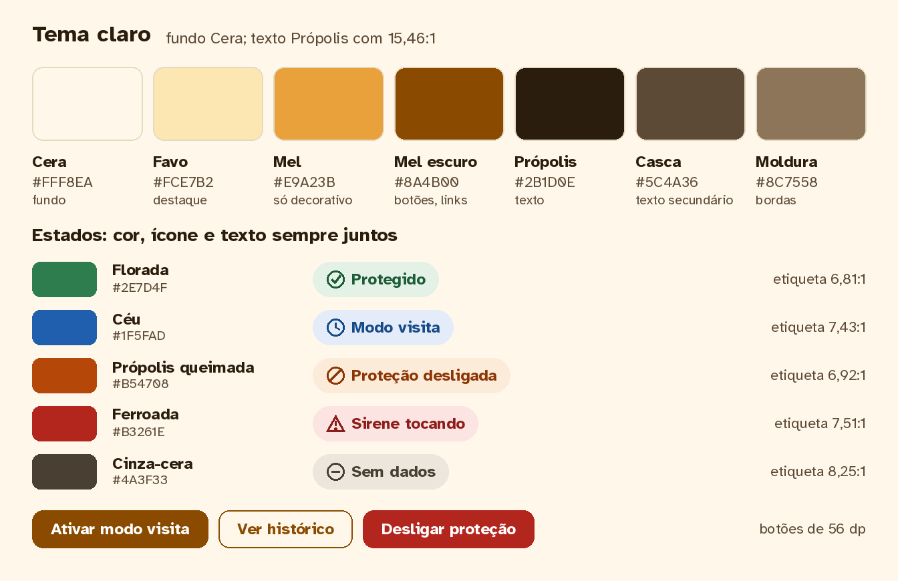
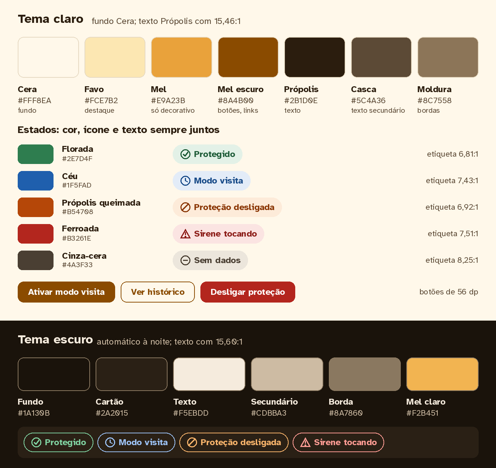
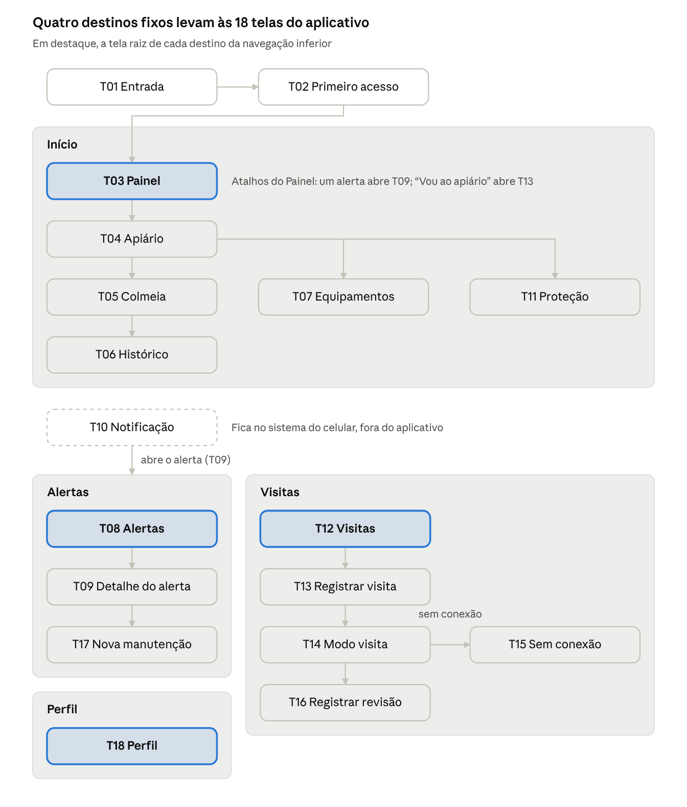

# Mellona — Guia de estilo e especificação das telas

## 1. Apresentação e organização

Autora: Bárbara Nogueira. Disciplina: Interação Humano-Computador, INF/UFG. Organização documental: 05/11/2026. Guia de estilo: versão 1.1, com a inclusão do Figma registrada em 28/10/2026.

Este documento reúne as decisões de design e a especificação das 18 telas do aplicativo. A seção 2 segue a estrutura da atividade Guia de Estilo: introdução, resultados de análise, elementos de interface, de interação e de ação, vocabulário e padrões. A seção 3 detalha princípios, paleta, componentes, navegação, telas T01 a T18, estados globais, responsividade, acessibilidade, rastreabilidade e pendências. A seção 4 reúne as referências.

A proposta é permitir que Antônio, apicultor, acompanhe seus apiários e trabalhe com segurança, inclusive com luvas e conexão instável; Carla, técnica de cooperativa, acompanha vários apiários. As personas são provisórias, e o estudo de campo com vídeos e o brainstorming da PF1 ainda precisam ser aplicados e registrados.

**Relação com os demais artefatos.** O [ERS](../../docs/ERS.md) define os requisitos e regras do sistema; a [PF1](../pf1-planejamento/PF1.md) documenta o planejamento. As telas e os comportamentos aqui descritos são especificações. A situação da implementação, as capturas, os princípios indicados no protótipo, os 25 problemas encontrados e as verificações pendentes estão em [Protótipos e análise da PF2](prototipos-e-analise-pf2.md).

Quando houver divergência entre o protótipo e o guia, o guia orienta a correção. As propostas de mudança do ERS listadas ao final da especificação permanecem propostas a validar; a reorganização documental não as aprova nem comprova implementação.

**Origem do conteúdo.** Consolidação do guia detalhado da PF2, das atualizações da versão resumida e da especificação completa das telas, originalmente datada de 20/10/2026. Cabeçalhos e rodapés de paginação foram retirados. Tabelas preservam o alinhamento da extração; imagens mantêm seus arquivos de origem.

**Navegação:** [Guia de estilo](#2-guia-de-estilo-do-mellona) · [Especificação das telas](#3-especificação-das-telas) · [Protótipos e análise](prototipos-e-analise-pf2.md).

## 2. Guia de estilo do Mellona

Este guia (versão 1.1) registra as decisões de design que todas as telas do aplicativo
devem seguir. Quando o protótipo e o guia divergem, vale o guia, e a divergência entra na
lista de ajustes da seção 3.3 de [Protótipos e análise da PF2](prototipos-e-analise-pf2.md).

### 2.1 Introdução

Objetivo. Garantir que as decisões da especificação das telas cheguem iguais ao produto:
a mesma cor para o mesmo estado, a mesma palavra para a mesma coisa e a mesma
posição para a mesma ação. O guia é a ponte entre o design e a implementação, hoje o
protótipo no bolt.new e, depois, o aplicativo ligado à API do projeto.

Organização e conteúdo. O guia segue a estrutura da atividade: 2.2 resultados de análise;
2.3 elementos de interface (disposição espacial e grid, janelas, tipografia, símbolos não
tipográficos, cores, animações e visualização de informação); 2.4 elementos de interação;
2.5 elementos de ação; 2.6 vocabulário e padrões.

Público-alvo do guia.

```text
  Público                                         O que usa do guia

  Designer (Bárbara Nogueira)                     Todas as seções, ao desenhar ou revisar uma
                                                  tela

  Quem implementa (protótipo no bolt.new e        Valores de cor, tipo e espaço (2.3),
  aplicativo final)                               componentes e estados (2.4 e 2.5), textos
                                                  padrão (2.6)

  Avaliadores da PF3 (professores e colegas)      O que foi decidido e por quê, para comparar
                                                  com o que encontrarem (2.6; 3.4 e 3.5 do documento de protótipos)

  Suporte e técnicos de cooperativa, como         Terminologia (2.6), para falar com o apicultor
  Carla                                           nas mesmas palavras do aplicativo
```

Como utilizar em produção. Antes de criar uma tela, escolha o tipo de tela (2.6), monte-a
com os componentes (2.4 e 2.5) e use apenas os valores de cor e tipo da seção 2.3. No
bolt.new, cole esses valores no pedido de cada tela, em vez de descrever cores com
palavras. Ao terminar, confira a lista:

Todo estado aparece com cor, ícone e texto juntos
Há uma única ação principal na tela
Texto necessário para decidir tem pelo menos 16 px e contraste de 4,5:1
Alvos de toque têm pelo menos 48 × 48 px
Os termos são os do glossário (2.6)
Toda informação vinda do apiário mostra a hora em que foi obtida
Os estados carregando, vazio, sem conexão e erro estão desenhados
A tela funciona a 360 px de largura

Como utilizar em manutenção. Qualquer mudança visual começa no guia e só depois vai
para as telas. Quando a avaliação encontrar um problema, registre no guia a regra que o
evita, além de corrigir a tela.

Como manter o guia. A dona do guia é Bárbara Nogueira, que aprova cada mudança. O
guia será revisto depois da avaliação da PF3 e antes da entrega da PF4. Cada mudança
ganha uma linha no histórico:

```text
  Data                    Versão          Mudança                                                Motivo

  21/10/2026              1.0             Primeira versão, a partir da especificação das telas   Entrega da
                                          e das primeiras telas no bolt.new                      PF2
```

Atualização da versão 1.1 (28/10/2026). O Figma foi incluído no fluxo de prototipação: cores, estilos de texto e componentes devem compor uma biblioteca; os mesmos valores orientam os pedidos de implementação no bolt.new. As telas existentes no bolt.new devem ser redesenhadas no Figma, e as próximas devem partir dessa biblioteca. Essa decisão não comprova a conclusão do trabalho no Figma; links e evidências continuam pendentes no documento de protótipos.

Na manutenção, correções de contraste devem atualizar os estilos compartilhados, incluindo Casca (#5C4A36) nos textos de apoio e o verde de etiqueta (#1E5C38), conforme a análise registrada na PF2. A aplicação e a conferência das correções permanecem pendentes.

| Data | Versão | Mudança |
| --- | --- | --- |
| 28/10/2026 | 1.1 | Inclusão do Figma como ferramenta de prototipação e biblioteca do guia |
| 05/11/2026 | Organização documental | Reunião do guia e das 18 telas; análise da implementação mantida em documento próprio |

### 2.2 Resultados de análise: o ambiente de trabalho do usuário

O apicultor usa o aplicativo em três lugares, e cada um impõe regras à interface. Os dados
vêm dos perfis, das personas (Antônio, 58 anos, apicultor; Carla, 34 anos, técnica de
cooperativa) e dos cenários C1 a C4 da PF1.

```text
  Ambiente                                   Condições de uso                  Consequência para a interface

  Casa (Antônio)                             Celular Android básico, boa       Estado de todos os apiários em
                                             conexão, consultas rápidas no     um olhar; tema escuro à noite;
                                             café da manhã e alertas de        notificação legível na tela
                                             madrugada (C1, C4)                bloqueada

  Estrada (Antônio)                          Sinal intermitente e pouco        Faixa de conexão com a hora dos
                                             tempo de atenção                  dados; registros guardados no
                                                                               aparelho e enviados depois

  Apiário (Antônio)                          Sol forte, luvas e véu, mãos      Alto contraste, alvos grandes,
                                             ocupadas, abelhas agitadas,       ações na base da tela, quase
                                             sem sinal (C2, C3); risco de a    nenhuma digitação, modo visita
                                             sirene tocar sobre ele            pela central do apiário

  Escritório da                              Notebook, mouse e teclado,        Lista e detalhe lado a lado,
  cooperativa (Carla)                        vários apiários para              filtros visíveis, atalhos de
                                             acompanhar                        teclado
```

Dois traços pesam em todas as decisões. Antônio tem familiaridade básica a intermediária
com tecnologia, então o vocabulário é o do apicultor e a navegação tem quatro destinos. E
os erros são graves (sirene disparada sobre o próprio apicultor, ou um apiário que parece
protegido e não está), então a interface nunca afirma o que a central do apiário não
confirmou. As personas são provisórias até a coleta da PF1 ser aplicada.

### 2.3 Elementos de interface

Disposição espacial e grid

Toda tela segue a mesma ordem de cima para baixo: onde estou e de quando são os dados,
o estado mais importante, a lista ou o conteúdo, e a ação principal. O espaçamento usa
uma grade de 8 px.

```text
  Faixa de                   Aparelho                   Estrutura da tela                    Margem /
  largura                                                                                    colunas

  Menos de                   Celular em retrato (o de   Barra superior de 64 px, faixa de    16 px / 4
  600 px                     Antônio)                   conexão quando houver,
                                                        conteúdo rolável, botão principal
                                                        fixo acima da navegação inferior
                                                        de 80 px

  600 a 839                  Celular na horizontal,     Trilho de navegação lateral;         24 px / 8
  px                         tablet pequeno             cartões em duas colunas

  840 px ou                  Notebook de Carla,         Menu lateral fixo de 248 px,         32 px / 12
  mais                       navegador                  conteúdo centralizado com até
                                                        1200 px e gaveta de detalhe à
                                                        direita, como no protótipo
```

Espaços: 4 px só entre ícone e texto; 8 px dentro de um componente; 16 px entre
cartões e entre alvos de toque vizinhos; 32 px entre seções.
Cabeçalho de seção: sobretítulo curto em maiúsculas ("MONITORAMENTO") acima
do título ("Alertas"), padrão já usado no protótipo.
Alcance do polegar: no celular, a ação principal fica na base. Ações raras ou de risco
nunca ficam no canto superior.

Metáforas espaciais.

```text
  Metáfora                    O que comunica                          Onde aparece

  Painel                      Como um painel de instrumentos: o       Início (T03)
                              estado mais grave fica no alto e o
                              resto, abaixo

  Cartão                      Uma ficha por apiário ou por colmeia;   Listas de apiários, colmeias e
                              tudo o que está dentro pertence a ela   alertas

  Metáfora                    O que comunica                            Onde aparece

  Gaveta                      O detalhe sai da direita sem              Detalhe do apiário, do alerta, modo
  lateral                     esconder a lista; fechar devolve o        visita e revisão
                              usuário ao ponto em que estava

  Linha do                    O que aconteceu, de cima para baixo,      Detalhe do alerta (T09)
  tempo                       na ordem dos horários

  Faixa no                    Um aviso que vale para o aplicativo       Sem conexão; modo visita ativo
  topo                        inteiro, e não para uma tela

  Favo de mel                 O hexágono marca a identidade do          Logotipo, ícone de colmeia e
                              Mellona; não é usado como forma de        ilustrações
                              botão
```

Janelas

O aplicativo usa sete tipos de janela. Apenas uma janela modal fica aberta por vez.

```text
  Tipo                           Quando usar                Regras                         No protótipo

  Tela cheia                     Destinos da navegação e    Barra superior com             Início, Alertas,
                                 formulários no celular     "Voltar" e título de até       Visitas, Perfil
                                                            duas linhas

  Gaveta lateral                 Detalhe de um item a       Abre à direita com 480 a       Apiário, alerta,
                                 partir de 840 px           520 px e escurece o            modo visita,
                                                            fundo; fecha com o X, a        revisão
                                                            tecla Esc ou um toque
                                                            fora; o foco vai para o
                                                            título; no celular vira tela
                                                            cheia

  Folha inferior                 Confirmações e             Sobe da base; "Cancelar"       Ainda não
                                 escolhas rápidas no        à esquerda; no
                                 celular                    computador vira caixa de
                                                            diálogo

  Caixa de                       Confirmar uma ação de      Título em forma de             "Sair da
  diálogo                        risco ou que não se        pergunta com a                 aplicação?"
                                 desfaz                     consequência; dois
                                                            botões, "Cancelar"
                                                            primeiro; largura de 400 a
                                                            480 px

  Tipo                           Quando usar               Regras                     No protótipo

  Faixa fixa                     Estado que vale para      Não pode ser fechada       "Sem conexão"
                                 todo o aplicativo         enquanto a situação
                                                           durar; mostra a hora dos
                                                           dados

  Aviso                          Confirmação leve, como    Fica pelo menos 10 s e     Ainda não
  temporário                     "Visita registrada"       tem botão de fechar;
                                                           nunca é o único registro
                                                           de algo importante

  Notificação do                 Alerta com o aplicativo   Título e texto se          Ainda não
  sistema                        fechado                   entendem sozinhos;
                                                           nunca mostram a
                                                           localização do apiário
```

O desenho abaixo mostra as mesmas zonas no celular e no computador.

zonas da tela · celular e computador

No celular, a navegação vai para a base e a ação principal fica logo acima dela; no
computador, a navegação vira menu lateral e o detalhe abre em gaveta.


Tipografia

O aplicativo usa uma única família, a Atkinson Hyperlegible, em dois pesos (regular e
negrito). Ela foi criada pelo Braille Institute para leitores com baixa visão e diferencia
caracteres que se confundem em identificadores de colmeia, como I, l e 1 ou O e 0. O
protótipo ainda usa outra família; a troca está na lista de ajustes (seção 3.3 de [Protótipos e análise da PF2](prototipos-e-analise-pf2.md)).

```text
  Estilo                        Tamanho /        Peso      Uso
                                entrelinha

  Destaque                      32 / 40 px       Negrito   Saudação e estado geral do Painel, tempo
                                                           restante do modo visita

  Título                        24 / 32 px       Negrito   Título da tela ou da gaveta

  Subtítulo                     20 / 28 px       Negrito   Título de seção, de cartão e de caixa de
                                                           diálogo

  Corpo                         18 / 28 px       Regular   Texto padrão, conteúdo de campos, botões
                                                           (em negrito)

  Corpo                         16 / 24 px       Regular   Horários, linhas de apoio, ajuda de campo
  pequeno

  Rótulo                        14 / 20 px       Negrito   Somente sobretítulos, itens de navegação
                                                           e etiquetas, sempre com ícone ou título ao
                                                           lado
```

No Android os tamanhos são dados em sp, para acompanhar o tamanho de fonte
escolhido pelo usuário; a interface deve funcionar com o texto ampliado a 200%.
Nenhuma informação necessária para decidir fica abaixo de 16 px.

Em diálogos. O título é uma pergunta que diz a consequência ("Desligar a proteção do
Apiário Serra?"), em 20 px negrito. O corpo explica o que muda, em 16 a 18 px. Os botões
dizem verbo e objeto ("Desligar proteção", "Cancelar"), nunca "OK" ou "Sim".

Em formulários. O rótulo fica sempre acima do campo, em 16 px negrito; o texto digitado
tem 18 px. O texto de exemplo dentro do campo é só um exemplo e nunca substitui o
rótulo. A mensagem de erro aparece abaixo do campo, em 16 px negrito, com ícone.

Em relatórios e listas (histórico, alertas, visitas). Números usam algarismos de largura fixa
e ficam alinhados à direita em tabelas. As unidades seguem o padrão brasileiro: "34,8 °C",
"62 %", "18°"; horas como "14h05"; datas como "21/10" ou "qua., 21 de outubro".

Regras gerais. Maiúsculas só em sobretítulos de até três palavras. Itálico não carrega
informação. Parágrafos têm no máximo cerca de 70 caracteres por linha.

Símbolos não tipográficos

Os ícones são da família Lucide, de traço fino e cantos arredondados, no mesmo estilo dos
que aparecem no protótipo. Esta versão do guia troca a família Material Symbols, prevista
na especificação das telas, para manter o que o protótipo já usa. Tamanhos: 20 px em
etiquetas, 24 px em listas, 32 px em cartões de estado e 48 px no estado principal de uma
tela.

A regra central é: um conceito, um ícone; um ícone, um conceito. Todo ícone com
significado vem com texto; ícones decorativos ficam ocultos para o leitor de tela.

```text
  Conceito                               Ícone Lucide      Cor                    Observação

  Protegido                               shield-check     Florada

  Proteção desligada                      shield-off       Própolis queimada

  Proteção com falha                      shield-alert     Própolis queimada

  Sirene tocando,                         siren            Ferroada               Nunca pisca
  atividade suspeita

  Atenção                                 triangle-alert   Própolis queimada ou
                                                           Ferroada, conforme a
                                                           prioridade

  Modo visita                             user-check       Céu                    O protótipo usa um olho,
                                                                                  que no mesmo aplicativo
                                                                                  já significa "mostrar"
                                                                                  (senha e código)

  Celular sem                             wifi-off         Cinza-cera             Faixa no topo
  internet

  Apiário sem                             cloud-off        Cinza-cera             Cartão do apiário; não
  comunicação                                                                     confundir com o anterior

  Apiário                                 hexagon          Mel
                                         preenchido

  Colmeia e                               hexagon vazado   Própolis               O protótipo usa o ícone
  quantidade de                                                                   de pessoas em "22
  colmeias                                                                        colmeias"

  Equipamentos                            activity         Própolis

  Manutenção                              wrench           Própolis               O protótipo usa a chave
                                                                                  também em
                                                                                  "Equipamentos"

  Conceito                               Ícone Lucide       Cor                    Observação

  Histórico                               history           Própolis

  Início, Alertas,                        house , bell ,    Própolis; Mel escuro
  Visitas, Perfil                         calendar-days ,   quando selecionado
                                          user

  Hora da                                 clock             Casca
  informação

  Mostrar e ocultar                       eye , eye-off     Casca                  Só para senha e código

  Abrir detalhe,                          chevron-right ,   Casca                  A seta só aparece em
  fechar                                  x                                        itens que abrem outra
                                                                                   tela

  Registrar,                              plus , check ,    Cor do botão
  confirmar, sair                         log-out
```

Logotipo e ilustrações. O logotipo é um hexágono em Mel com uma gota, ao lado da
palavra Mellona. Ilustrações usam hexágonos e linhas finas em Mel sobre Própolis, como
no painel esquerdo da tela de entrada. Emojis não são usados.

Cores

A paleta vem dos materiais do apiário (cera, favo, mel, própolis, florada e céu), e todas as
combinações de texto passam de 4,5:1 (WCAG 2.2, nível AA). As cores do protótipo estão
próximas, mas não iguais: o botão principal usa #954600 e o vermelho, #C80017. Os
valores abaixo são os oficiais.

```text
  Nome                         Valor             Uso                             Contraste

  Cera                         #FFF8EA           Fundo das telas                 Base

  Branco                       #FFFFFF           Cartões, gavetas e caixas de    Base
                                                 diálogo

  Favo                         #FCE7B2           Destaque suave: item            13,40:1 com
                                                 selecionado, cartão de dica     Própolis

  Mel                          #E9A23B           Logotipo e ilustrações; nunca   2,05:1 sobre
                                                 texto                           Cera

  Mel escuro                   #8A4B00           Botão principal, links, item    6,80:1 com texto
                                                 ativo do menu                   branco
```


```text
  Nome                         Valor                    Uso                               Contraste

  Própolis                     #2B1D0E                  Texto principal e títulos         15,46:1 sobre
                                                                                          Cera

  Casca                        #5C4A36                  Texto secundário: horários,       7,99:1 sobre
                                                        linhas de apoio, rótulos          Cera

  Moldura                      #8C7558                  Borda de campos e controles       4,14:1 sobre
                                                                                          Cera

  Florada                      #2E7D4F, texto           Protegido, concluído              Etiqueta 6,81:1
                               #1E5C38 sobre #E3F1E7

  Céu                          #1F5FAD, texto #174A88   Modo visita, informação, anel     Etiqueta 7,43:1
                               sobre #E3ECF8            de foco

  Própolis                     #B54708, texto           Atenção, proteção desligada       Etiqueta 6,92:1
  queimada                     #8A3605 sobre            ou com falha
                               #FDEBD9

  Ferroada                     #B3261E, texto #8C1D18   Sirene tocando, alerta crítico,   Etiqueta 7,51:1
                               sobre #FBE4E2            erro, botão de risco

  Cinza-cera                   #4A3F33 sobre            Sem dados, sem conexão            Etiqueta 8,25:1
                               #ECE6DC
```

O tema escuro (fundo #1A130B, cartão #2A2015, texto #F5EBDD) entra sozinho à noite e
mantém os mesmos significados; os valores completos estão na especificação das telas.

Mandamentos sobre o uso de cores.

1. Nunca use só a cor: todo estado tem cor, ícone e texto.
2. Uma cor, um significado. Verde é protegido, azul é modo visita ou informação, laranja
queimado é atenção, vermelho é sirene ou erro, cinza é sem dados.
3. Cor de estado não é decoração. Os dias coloridos da agenda (amarelo, verde e azul)
parecem categorias, mas não têm significado.
4. O vermelho é raro: só sirene, alerta crítico, erro que impede uma ação e o botão que
deixa o apiário desprotegido.
5. Mel não é texto: texto e botões usam Mel escuro.
6. Texto tem pelo menos 4,5:1 de contraste; ícones, bordas e foco, pelo menos 3:1.
7. Fundos coloridos ficam em etiquetas, faixas e no cartão de estado; o restante é Cera e
branco.
8. Uma cor de estado em destaque por vez: o que é diferente é o que se nota (efeito von
Restorff, Aula 2).

Animações

A animação só serve para mostrar de onde algo veio ou que algo mudou. Todo toque tem
resposta visível em até 400 ms (Limiar de Doherty, Aula 2); se a central demorar mais, a
tela mostra "Enviando para a central…".

```text
  Movimento                                      Duração                     Regra

  Gaveta lateral e folha                         250 ms para abrir, 200      Desliza da borda de onde veio; o
  inferior                                       ms para fechar              fundo escurece junto

  Mudança de estado de                           150 ms                      Troca de cor e texto, sem saltos
  uma etiqueta                                                               de layout

  Aviso temporário                               150 ms                      Aparece na base e fica pelo
                                                                             menos 10 s

  Esqueleto de                                   Pulso lento de 1,5 s        Sem piscar
  carregamento

  Barra do modo visita                           Atualiza a cada minuto      Sem animação contínua
```

Com "remover animações" ligado no sistema, as transições viram cortes. Nada pisca mais
de três vezes por segundo, nem mesmo a sirene tocando. O estado "Tudo protegido" não
tem movimento: se os anéis em volta do hexágono do Painel forem animados, devem parar,
porque movimento pede atenção e esse estado não precisa dela.

Visualização de informação

```text
  Elemento                                Regra de design                                 Onde

  Indicador numérico                      Número em 24 a 32 px, rótulo acima e linha      Painel
                                          de apoio abaixo, ambos em Casca e com 16
                                          px; no máximo quatro por linha; tocar abre a
                                          lista correspondente

  Etiqueta de estado                      Forma de cápsula, ícone de 20 px e texto;       Cartões, listas,
                                          mesma aparência em todas as telas               gavetas

  Gráfico de linha                        Uma medida por gráfico, eixo com unidade,       Histórico da colmeia
                                          períodos sem dados hachurados e                 (T06)
                                          rotulados "sem dados"; a linha nunca passa
                                          por cima de uma falha; resumo em texto
                                          antes e tabela equivalente

  Linha do tempo                          Horário, ícone e descrição por evento, do       Detalhe do alerta
                                          mais antigo ao mais recente

  Elemento                                Regra de design                                   Onde

  Barra de progresso                      Sempre acompanhada do horário de                  Modo visita
                                          término por extenso, que é a informação
                                          principal

  Medidas de um                           Temperatura e umidade são de cada                 Cartão e gaveta do
  apiário                                 colmeia; um valor do apiário inteiro precisa      apiário
                                          dizer o que é, como "média de 22 colmeias"
                                          ou "de 33,9 a 35,2 °C"

  Mapa                                    A localização do apiário não aparece por          Menu do apiário
                                          padrão, por privacidade e risco de furto
                                          (RNF-13); quando autorizada, um mapa
                                          simples com um marcador, sem opção de
                                          compartilhar

  Diagrama                                Só em telas de ajuda, como "Como funciona         Perfil > Ajuda
                                          o modo visita"
```

**Paleta de consulta da revisão 1.1:**



### 2.4 Elementos de interação

Estilos de interação

O Mellona combina seleção em menus e listas, formulários curtos e manipulação direta
por toque. Não usa linguagem de comando.

```text
  Estilo                                     Onde é usado                         Por que

  Seleção em menus e                         Navegação com quatro                 Reconhecer é mais fácil que
  listas                                     destinos; listas de apiários,        lembrar, o que favorece quem
                                             alertas e visitas; categorias de     tem pouca familiaridade com
                                             visita                               tecnologia

  Preenchimento de                           Entrada, registrar visita, revisão   Cada tarefa tem poucos
  formulário                                 e manutenção                         campos, quase todos de
                                                                                  escolha

  Manipulação direta                         Tocar no cartão para abrir,          Resposta imediata ao toque;
                                             interruptores, tocar e arrastar      todo gesto tem um botão
                                             no gráfico                           equivalente

  Assistente em passos                       Primeiro acesso (três passos) e      Tarefas raras ou críticas pedem
                                             modo visita pela central, sem        orientação passo a passo
                                             conexão

  Estilo                                     Onde é usado                     Por que

  Linguagem natural                          Somente o ditado do teclado do   Evita digitar com luvas; o
                                             celular, no campo de             aplicativo não interpreta
                                             observações                      comandos de voz
```

Seleção de um estilo

Para escolher o estilo de uma tarefa nova, aplique as perguntas na ordem:

1. A tarefa é feita no apiário? Então use seleção por toque em alvos grandes, sem
digitação e sem gestos finos.
2. Há risco de deixar o apiário desprotegido ou de perder dados? Então use formulário
com confirmação que diga a consequência.
3. É rara ou tem vários passos? Então use um assistente, com "Passo 1 de 3" visível.
4. É frequente e rápida? Então use seleção em lista, com o item mais provável já
escolhido.

Aceleradores

No celular, os aceleradores são atalhos e valores preenchidos: o botão "Registrar visita" no
Painel; os atalhos Histórico, Equipamentos e Proteção na gaveta do apiário; as ações "Ver
alerta" e "Estou ciente" na notificação; "Revisar a próxima colmeia" depois de salvar uma
revisão; e campos que já vêm com "Hoje", "Você" e o apiário atual.

No computador, as teclas de atalho são estas:

```text
  Tecla                            Ação

  Alt + 1, 2, 3, 4                 Ir para Início, Alertas, Visitas, Perfil

  Alt + V                          Registrar visita

  /                                Buscar colmeia pelo identificador

  Esc                              Fechar gaveta, folha ou caixa de diálogo

  Tab e Shift + Tab                Ir ao próximo ou ao anterior elemento

  Enter ou Espaço                  Ativar o elemento em foco

  Setas                            Mover entre itens de uma lista e entre pontos do
                                   gráfico
```

Nenhuma ação de risco (desligar a proteção, encerrar o modo visita, sair da conta) tem
tecla de atalho. Os atalhos aparecem em Perfil \> Ajuda e na dica de cada botão.

### 2.5 Elementos de ação

Preenchimento de campos

O rótulo fica sempre visível acima do campo; o texto de exemplo nunca o substitui.
O campo tem 56 px de altura e borda de 2 px em Moldura; em foco, a borda passa a
Céu.
O teclado combina com o dado: e-mail para "E-mail ou celular", numérico para o código.
Os campos aceitam o preenchimento automático e os gerenciadores de senha do
celular.
A validação acontece ao tocar no botão, e não durante a digitação.
O erro aparece abaixo do campo, com ícone, dizendo como corrigir ("Falta escolher o
motivo da visita"); o que já foi digitado é mantido.
Campos obrigatórios têm a palavra "obrigatório" no rótulo, e não só um asterisco.
Sem conexão, o formulário é guardado no aparelho e enviado depois.

Seleção

```text
  Situação                                       Controle                         Exemplo

  Escolha única entre 2 e 4                      Seletor segmentado: opções       Rainha ("Vista", "Sinais de
  opções                                         lado a lado, todas visíveis,     rainha", "Não encontrada");
                                                 com pelo menos 48 px             duração do modo visita

  Escolha única entre 5 e 7                      Lista de opções com linhas de    Categoria da visita (CM-01 a
  opções com descrição                           56 px                            CM-07, IB-01 a IB-07)

  Mais de 7 opções                               Lista com busca                  Colmeia

  Ligar ou desligar com                          Interruptor, sem seta ao lado    "Alertas críticos"
  efeito imediato

  Várias opções ao mesmo                         Etiquetas tocáveis ou caixas     Marcações rápidas da revisão
  tempo                                          de seleção

  Filtrar uma lista                              Etiquetas de filtro removíveis   Alertas por apiário e
                                                 e "Limpar filtros"               prioridade
```

A opção escolhida aparece com cor, contorno e ícone de verificação. Uma linha com seta
abre outra tela; uma linha com interruptor muda na hora. As duas coisas nunca aparecem
juntas na mesma linha.

Ativação

```text
  Botão                    Aparência                                 Uso

  Principal                Fundo Mel escuro, texto branco em         Um por tela: "Entrar", "Estou ciente",
                           18 px negrito, 56 px de altura, largura   "Salvar revisão", "Encerrar visita"
                           total no celular

  Secundário               Contorno de 2 px em Mel escuro,           "Criar manutenção", "Ver visita",
                           fundo transparente                        "Editar perfil"

  De risco                 Fundo Ferroada, texto branco              Só dentro de uma confirmação, para a
                                                                     ação que deixa o apiário
                                                                     desprotegido: "Desligar proteção"

  Link                     Texto em Mel escuro, negrito              "Esqueci minha senha", "Ver
                                                                     detalhes"

  Ícone                    Área de 48 × 48 px e nome lido pelo       Fechar (X), mostrar senha
                           leitor de tela
```

Cada botão tem seis estados: normal, mouse por cima (fundo um tom mais escuro), foco
(anel de 3 px em Céu), pressionado, carregando ("Entrando…") e indisponível. O estado
indisponível é evitado: é melhor deixar o botão ativo e explicar o que falta. "Encerrar
visita" é um botão principal, e não de risco, porque devolve a proteção ao apiário; no
protótipo ele está em vermelho.

### 2.6 Vocabulário e padrões

Terminologia

A interface fala como o apicultor. Os termos técnicos do ERS ficam no código e na
documentação; na tela, vale a coluna "Use".

```text
  Use                                            Em vez de                   Significado

  Apiário                                        Local, sítio                Conjunto de colmeias em um
                                                                             terreno

  Colmeia A1-07                                  Caixa, nó                   Uma colmeia, sempre com o
                                                                             identificador

  Central do apiário                             Gateway, hub                O equipamento no apiário
                                                                             que tem sirene, luz e teclado

  Equipamento                                    Dispositivo                 Qualquer sensor ou a central

  Use                                            Em vez de                     Significado

  Proteção ligada, Protegido                     Segurança armada              A sirene e a luz podem ser
                                                                               acionadas

  Proteção desligada                             Desarmado                     Os sensores registram, mas
                                                                               nada é acionado

  Proteção com falha                             Segurança degradada           O sensor de presença não
                                                                               está funcionando

  Modo visita                                    Autorização de manutenção     A sirene fica pausada por um
                                                                               tempo, durante uma visita

  Colmeia mexida                                 Movimentação anormal          A caixa foi movida ou
                                                                               sacudida

  Colmeia inclinada ou caída                     Tombamento possível           A caixa ficou inclinada mais
                                                                               de 15° por mais de 10 s

  Atividade suspeita                             Invasão, furto                Presença e colmeia mexida
                                                                               ao mesmo tempo; não
                                                                               confirma um crime

  Estou ciente                                   Reconhecer                    A pessoa viu o alerta

  Encerrar alerta                                Resolver                      O problema foi tratado

  Revisão                                        Inspeção                      Registro do que se viu dentro
                                                                               da colmeia

  Crias                                          Criações (usado no            Ovos, larvas e pupas da
                                                 protótipo)                    colônia

  Manutenção                                     Chamado, ordem de serviço     Conserto ou cuidado com
                                                                               estrutura e equipamentos

  Manutenção física (CM) e                       Os códigos sozinhos           Os dois grupos de motivo de
  Manejo das abelhas (IB)                                                      visita; o código sempre vem
                                                                               com o nome

  Sem conexão                                    Offline, erro de rede         O celular está sem internet

  Sem notícias do apiário                        Sem conexão (usado no         A central do apiário não
  desde 14h05                                    protótipo para o apiário)     responde, embora o celular
                                                                               tenha internet

  Meu código da central                          Código do apiário (usado no   Código pessoal: cada pessoa
                                                 protótipo), PIN               tem o seu
```

Tom dos textos. Frases curtas, começando pelo que importa, com "você". Erros não
culpam a pessoa ("E-mail, celular ou senha não conferem"). Toda informação do apiário diz
de quando é ("há 2 min", "às 14h05"), e todo número vem com unidade.

Tipos de tela

```text
  Tipo                           Estrutura, de cima para baixo            Telas

  Painel de                      Estado geral, avisos, cartões, ação      Início (T03)
  estado                         principal

  Lista                          Título, abas ou filtros, itens em        Alertas (T08), Visitas (T12),
                                 cartão com seta, estado vazio            colmeias (T04), equipamentos
                                                                          (T07)

  Detalhe                        Nome e etiqueta de estado, resumo        Apiário (T04), colmeia (T05), alerta
                                 em uma frase, dados, ação principal      (T09); gaveta lateral no computador
                                 e secundária

  Formulário                     Título, campos na ordem da tarefa,       Entrada (T01), visita (T13), revisão
                                 botão principal fixo                     (T16), manutenção (T17)

  Confirmação                    Pergunta com a consequência, o           Proteção (T11), ativar modo visita
                                 que muda, "Cancelar" e a ação            (T14), sair da conta

  Em                             Estado em destaque, horário de           Modo visita (T14)
  andamento                      término, ação de encerrar

  Passo a passo                  "Passo 1 de 3", instrução, ilustração,   Primeiro acesso (T02), modo visita
                                 botão para seguir                        pela central (T15)

  Estado vazio                   Ilustração, frase sobre o que falta,     Qualquer lista sem itens, como
                                 uma ação                                 "Visitas anteriores"
```

Sequências de diálogos

```text
  Situação                                                       Sequência

  Ação de risco (desligar proteção, ativar                       Pedido → confirmação com a consequência
  modo visita)                                                   → "Cancelar" volta sem mudar nada;
                                                                 confirmar envia o comando à central

  Comando à central                                              "Enviando para a central…" → "Aguardando a
                                                                 central confirmar" (até 1 min) → "Confirmado
                                                                 pela central às 14h40"; sem resposta: "Nada
                                                                 mudou" e "Tentar de novo"; sem internet:
                                                                 orientação para usar o código na central

  Situação                                       Sequência

  Registro (visita, revisão, manutenção)         Salvar → aviso "Visita registrada"; sem
                                                 internet: "Guardada no celular. Será enviada
                                                 quando houver conexão." → depois,
                                                 "Enviada"

  Erro em formulário                             Tocar no botão → resumo do que falta no
                                                 topo, mensagem no campo e foco no
                                                 primeiro erro → corrigir → enviar

  Reconhecer um alerta                           "Estou ciente" → aviso com "Desfazer" por 10
                                                 s → etiqueta "Reconhecido por você às
                                                 7h05"

  Sair da conta                                  "Sair da aplicação" → "Sair da aplicação?"
                                                 (com aviso se houver registros não
                                                 enviados) → "Cancelar" ou "Sair"
```

A sequência do comando à central é a mais crítica, porque decide se o apicultor pode ou
não mexer nas caixas. O desenho abaixo mostra seus caminhos.

sequência de diálogo · comando à central do apiário

Só dois pontos deixam mexer nas caixas: "Confirmado pela central" e o bipe curto com luz
verde da central; todos os outros caminhos terminam com a proteção ligada.

## 3. Especificação das telas

A numeração original das seções 1 a 14 da especificação passa a 3.1 a 3.14. Os identificadores das telas T01 a T18 e dos requisitos foram preservados. As definições gerais detalham a aplicação do guia; o inventário de telas construídas fica no documento de protótipos.

**Índice das 18 telas**

| Tela | Especificação |
| --- | --- |
| T01 | [Entrada](#t01--entrada) |
| T02 | [Primeiro acesso](#t02--primeiro-acesso) |
| T03 | [Painel (Início)](#t03--painel-início) |
| T04 | [Apiário](#t04--apiário) |
| T05 | [Colmeia](#t05--colmeia) |
| T06 | [Histórico de medições](#t06--histórico-de-medições) |
| T07 | [Equipamentos](#t07--equipamentos) |
| T08 | [Alertas](#t08--alertas) |
| T09 | [Detalhe do alerta](#t09--detalhe-do-alerta) |
| T10 | [Notificação](#t10--notificação) |
| T11 | [Proteção do apiário](#t11--proteção-do-apiário) |
| T12 | [Visitas](#t12--visitas) |
| T13 | [Registrar visita](#t13--registrar-visita) |
| T14 | [Modo visita](#t14--modo-visita) |
| T15 | [Modo visita sem conexão](#t15--modo-visita-sem-conexão) |
| T16 | [Registrar revisão](#t16--registrar-revisão) |
| T17 | [Nova manutenção](#t17--nova-manutenção) |
| T18 | [Perfil e configurações](#t18--perfil-e-configurações) |

### 3.1 Princípios de design

O aplicativo tem 18 telas (T01 a T18) e um objetivo central: Antônio deve saber, em um
olhar, se seus apiários estão bem, e agir com segurança mesmo no apiário, de luvas e sem
sinal. Esta seção descreve cada tela para orientar o protótipo navegável da PF2 e
alimenta o guia de estilo.

#### 3.1.1 Seis princípios

1. Uma pergunta por tela. O painel responde "está tudo bem?"; o apiário, "o que há neste
apiário?"; o alerta, "o que aconteceu e o que faço?".
2. Estado sempre explícito. Todo estado aparece em cor, ícone e texto juntos; nunca só
em cor.
3. Toda informação tem hora. Medições e estados mostram há quanto tempo foram
atualizados ("há 2 min", "sem dados desde 14h05").
4. Uma ação principal por tela. Ela fica em um botão largo na parte de baixo, ao alcance
do polegar.
5. Honestidade sobre a conexão. Comandos mostram se estão pendentes, confirmados
ou falharam; o aplicativo nunca apresenta como feito o que o apiário não confirmou.
6. Vocabulário do apicultor. Termos do glossário do ERS (Apêndice B): "colmeia mexida",
"modo visita", "revisão", "proteção ligada".

#### 3.1.2 Do perfil de usuário às decisões de design

```text
  Propriedade do usuário                          Fonte                 Decisão de design            Telas

  58 anos, familiaridade                          Persona Antônio;      Texto base de 18 px,         Todas
  básica a intermediária com                      perfil do apicultor   suporte à fonte do sistema
  tecnologia                                                            até 200%, frases curtas,
                                                                        no máximo quatro
                                                                        destinos na navegação

  Propriedade do usuário                          Fonte                  Decisão de design             Telas

  Smartphone Android                              Persona Antônio        Interface leve, que           Todas
  básico                                                                 funciona em telas de 360
                                                                         px de largura; nenhum
                                                                         gesto obrigatório: todo
                                                                         deslize tem um botão
                                                                         equivalente

  Sinal fraco ou ausente no                       Persona Antônio;       Faixa "Sem conexão"           T03, T14,
  apiário                                         hipótese H2            visível; últimos dados com    T15, T16
                                                                         horário; registros
                                                                         guardados no aparelho e
                                                                         enviados depois; modo
                                                                         visita local

  Luvas, véu e sol forte em                       Perfil do apicultor;   Alvos de toque de pelo        T13 a T16
  campo                                           hipótese H9            menos 48 × 48 dp; ações
                                                                         principais em botões de 56
                                                                         dp de altura; tema claro de
                                                                         alto contraste durante o
                                                                         dia

  Já perdeu colmeias e quer                       Persona Antônio        Alerta escrito como frase,    T08, T09,
  alertas claros                                                         com o que aconteceu,          T10
                                                                         onde, quando e o que o
                                                                         sistema fez

  Usa aplicativos de                              Persona Antônio        Notificação com ação          T09, T10
  mensagem todos os dias                                                 direta; opção de
                                                                         compartilhar o alerta sem
                                                                         a localização do apiário

  Erros de alta gravidade                         Perfil do apicultor    Confirmação antes de          T11, T14,
  (sirene disparada sobre si,                                            desproteger; estado           T15
  apiário desprotegido)                                                  "confirmado" só após
                                                                         resposta da central; botão
                                                                         "Encerrar visita" sempre
                                                                         visível

  Acompanha vários apiários                       Persona Carla          Filtros por apiário,          T08, T09,
  e prioriza consertos                                                   prioridade e situação;        T17
                                                                         manutenção criada a partir
                                                                         do alerta

  Propriedade do usuário                          Fonte           Decisão de design               Telas

  Usa notebook no escritório                      Persona Carla   Layout com dois painéis         Todas
                                                                  (lista e detalhe) a partir de
                                                                  840 px de largura

  Recebe alertas de                               Cenário C1      Tema escuro automático à        T10, T18
  madrugada                                                       noite; notificação crítica
                                                                  legível na tela bloqueada
```

### 3.2 Paleta de cores

A paleta vem dos materiais do apiário: mel, cera, favo, própolis, a florada que as abelhas
visitam e o céu aberto do campo. As cores de estado (vermelho, laranja, verde, azul)
seguem convenções que o apicultor já conhece de placas e painéis, para que o significado
seja imediato.

Todas as razões de contraste abaixo foram calculadas pela fórmula da WCAG 2.1. Texto
normal exige pelo menos 4,5:1; texto grande (24 px, ou 18,7 px em negrito) e componentes
não textuais, como bordas de campos e ícones de estado, exigem 3:1.

A imagem mostra as cores aplicadas: cada estado combina cor, ícone e texto, e o âmbar
Mel só aparece como superfície decorativa, nunca como texto.

#### 3.2.1 Cores da marca e da interface (tema claro)

```text
  Token                     Nome                  Hex       Uso                       Contraste medido

   bg                       Cera                  #FFF8EA   Fundo de todas as telas   base

   surface                  Branco                #FFFFFF   Cartões e folhas          base
                                                            inferiores

   surface-                 Favo                  #FCE7B2   Destaque suave: cartão    13,40:1 com Própolis
  tint                                                      em foco, faixa de dica
```



```text
  Token                     Nome                  Hex        Uso                            Contraste medido

   text                     Própolis              #2B1D0E    Texto principal e títulos      15,46:1 sobre Cera

   text-                    Casca                 #5C4A36    Texto secundário,              7,99:1 sobre Cera
  muted                                                      horários, rótulos

   primary                  Mel                   #8A4B00    Botão principal (texto         6,80:1 com branco; 6,44:1
                            escuro                           branco), links, aba ativa      sobre Cera

   accent                   Mel                   #E9A23B    Logotipo, ilustrações,         2,05:1 sobre Cera (só
                                                             barra de progresso             decorativo); 7,55:1 com
                                                             decorativa; nunca como         texto Própolis por cima
                                                             texto sobre Cera

   border                   Moldura               #8C7558    Borda de campos e              4,14:1 sobre Cera
                                                             controles

   divider                  Cera                  #E6D9C2    Divisórias decorativas         decorativo
                            velha                            entre itens de lista
```

#### 3.2.2 Cores de estado

Cada estado tem uma cor sólida (para ícones, bordas e botões com texto branco) e uma
combinação de texto e fundo claro (para etiquetas e faixas).

```text
 Estado                                    Nome             Sólida    Branco sobre    Etiqueta (texto /   Contraste da
                                                                      a sólida        fundo)              etiqueta

 Protegido, normal,                        Florada          #2E7D4F 5,05:1            #1E5C38 /           6,81:1
 concluído                                                                            #E3F1E7

 Modo visita, informação,                  Céu              #1F5FAD   6,37:1          #174A88 /           7,43:1
 foco                                                                                 #E3ECF8

 Proteção desligada,                       Própolis         #B54708   5,43:1          #8A3605 /           6,92:1
 atenção                                   queimada                                   #FDEBD9

 Sirene tocando, alerta                    Ferroada         #B3261E   6,54:1          #8C1D18 /           7,51:1
 crítico, erro                                                                        #FBE4E2

 Sem dados, com falha,                     Cinza-cera       #4A3F33   —               #4A3F33 /           8,25:1
 desconhecido                                                                         #ECE6DC
```

As cores sólidas de estado também passam como ícone ou texto sobre Cera: Florada
4,77:1, Céu 6,02:1, Própolis queimada 5,13:1 e Ferroada 6,18:1.

#### 3.2.3 Tema escuro

O tema escuro é ativado pelo sistema ou automaticamente à noite (configurável em T18).
Ele reduz o brilho na madrugada (cenário C1) sem mudar o significado das cores.

```text
  Token                            Hex            Uso                          Contraste medido

   bg                              #1A130B        Fundo (noite na colmeia)     base

   surface                         #2A2015        Cartões                      base

   text                            #F5EBDD        Texto principal              15,60:1 sobre o fundo; 13,53:1
                                                                               sobre cartão

   text-muted                      #CDBBA3        Texto secundário             9,84:1

   primary                         #F2B451        Botão principal, com texto   10,00:1
                                                  #1A130B

   border                          #8A7860        Bordas de campos             4,32:1

  Florada                          #7FD1A0        Protegido                    10,10:1 sobre o fundo; 8,76:1
                                                                               sobre cartão

  Céu                              #9CC2F5        Modo visita, foco            10,03:1

  Própolis                         #F8B46B        Proteção desligada           10,27:1
  queimada

  Ferroada                         #FF9C94        Sirene, crítico              9,14:1 sobre o fundo; 7,93:1
                                                                               sobre cartão
```

No tema escuro, as etiquetas de estado usam texto e borda na cor do estado sobre o
cartão, em vez de fundo colorido.

#### 3.2.4 Regras de uso

Nunca só a cor. Todo estado combina cor, ícone e texto (seção 3.11). A interface
continua legível em escala de cinza e para pessoas com daltonismo do tipo protanopia
ou deuteranopia, para quem verde e vermelho se confundem.
Vermelho é raro. Ferroada aparece só para sirene tocando, alerta crítico e erros que
impedem uma ação. Se tudo for vermelho, nada é urgente.
Mel não é texto. O âmbar claro (#E9A23B) é a cor da marca, mas tem 2,05:1 sobre
Cera; serve apenas a elementos decorativos. Texto e botões usam Mel escuro
(#8A4B00).
Foco visível. O anel de foco do teclado tem 3 px em Céu (#1F5FAD, 6,02:1 sobre Cera),
com 2 px de afastamento do componente.

### 3.3 Tipografia, grade, ícones e componentes

#### 3.3.1 Tipografia

Fonte: Atkinson Hyperlegible, criada pelo Braille Institute para leitores com baixa visão.
Ela diferencia letras que costumam se confundir (I, l e 1; O e 0; b e d), o que importa ao ler
nomes de colmeias como "C-01" sob sol forte. É gratuita e está no Google Fonts; a
alternativa é a fonte do sistema (Roboto no Android).

Os tamanhos são definidos em sp, a unidade que acompanha o tamanho de fonte
escolhido no Android. A interface deve funcionar com a fonte do sistema em até 200%.

```text
  Estilo                        Tamanho /         Peso      Uso
                                entrelinha

  Destaque                      32 / 40           Negrito   Estado geral no painel ("Tudo protegido"),
                                                            contador do modo visita

  Título                        24 / 32           Negrito   Título da tela

  Subtítulo                     20 / 28           Negrito   Título de seção e de cartão

  Corpo                         18 / 28           Regular   Texto padrão, campos, botões

  Corpo                         16 / 24           Regular   Horários, descrições secundárias
  pequeno

  Rótulo                        14 / 20           Negrito   Só rótulos da navegação e de gráficos,
                                                            sempre junto de um ícone
```

Números de medições usam algarismos de largura fixa, para que valores não "pulem" ao
atualizar. Nenhuma informação necessária para decidir aparece abaixo de 16 sp.

#### 3.3.2 Grade e espaçamento

Grade de 8 dp: todos os espaçamentos são múltiplos de 8 (4 dp só para ajustes finos
entre ícone e texto).
Margens laterais: 16 dp no celular, 24 dp no tablet, 32 dp no computador.
Colunas: 4 no celular, 8 no tablet, 12 no computador; conteúdo com no máximo 1200 dp
de largura.
Espaço entre cartões: 16 dp; entre seções: 32 dp.

#### 3.3.3 Ícones

Ícones da família Material Symbols (arredondados), que são gratuitos e conhecidos de
quem usa Android. Tamanhos: 24 dp em listas, 32 dp em cartões de estado e 48 dp no
estado principal de uma tela. Todo ícone com significado vem acompanhado de texto;
ícones sozinhos aparecem apenas em botões com rótulo acessível e dica ao manter
pressionado.

Ícones próprios do domínio, desenhados no mesmo traço:

```text
  Conceito                                Ícone                                  Observação

  Apiário                                 Três caixas de colmeia lado a          Usado na lista e no cabeçalho do
                                          lado                                   apiário

  Colmeia                                 Caixa de colmeia com tampa             Diferente do hexágono, que é
                                                                                 decorativo

  Protegido                               Escudo com marca de                    Florada
                                          verificação

  Proteção desligada                      Escudo cortado por uma linha           Própolis queimada

  Modo visita                             Chapéu de apicultor com véu            Céu

  Sirene tocando                          Sirene com ondas                       Ferroada; sem piscar

  Colmeia mexida                          Caixa inclinada com linhas de          Ferroada ou Própolis queimada,
                                          movimento                              conforme a gravidade

  Sem dados                               Nuvem cortada                          Cinza-cera

  Equipamento com                         Chave inglesa com ponto de             Cinza-cera
  falha                                   exclamação
```

O hexágono do favo é o motivo visual da marca: aparece no logotipo, em ilustrações de
estados vazios e em fundos de cabeçalho com baixa opacidade. Não é usado como
formato de botão, porque reduz a área útil de toque e de texto.

#### 3.3.4 Componentes

```text
  Componente                                      Especificação                               Onde aparece

  Barra superior                                  64 dp; botão voltar (48 × 48 dp), título    Todas as telas internas
                                                  de até duas linhas e no máximo uma
                                                  ação à direita

  Componente                                      Especificação                                Onde aparece

  Navegação inferior                              80 dp; quatro destinos com ícone e           Celular
                                                  rótulo sempre visíveis: Início, Alertas,
                                                  Visitas, Perfil. A aba Alertas mostra o
                                                  número de alertas não lidos

  Trilho de navegação                             Coluna lateral de 80 dp com os               Tablet e computador
                                                  mesmos quatro destinos

  Faixa de conexão                                Faixa fixa abaixo da barra superior:         Todas, quando sem
                                                  ícone, "Sem conexão" e o horário dos         conexão
                                                  últimos dados. Não pode ser fechada
                                                  enquanto o problema durar

  Cartão de estado                                Altura mínima de 88 dp; faixa colorida       T03, T04
                                                  de 8 dp à esquerda, ícone de 32 dp,
                                                  nome, estado por extenso, "atualizado
                                                  há X min" e seta. O cartão inteiro é
                                                  tocável

  Etiqueta de estado                              32 dp de altura, ícone de 20 dp e texto,     Listas, cabeçalhos
                                                  cantos arredondados

  Botão principal                                 56 dp de altura, largura total no celular,   Uma por tela
                                                  texto de 18 sp em negrito, cantos de 16
                                                  dp, fundo Mel escuro

  Botão secundário                                Mesmas medidas, contorno de 2 dp             Ações alternativas
                                                  em Mel escuro e fundo transparente

  Botão de risco                                  Mesmas medidas, fundo Ferroada; só           T11
                                                  para desligar a proteção, dentro da
                                                  folha de confirmação

  Folha de confirmação                            Folha que sobe da base da tela: título       T11, T14
                                                  com a consequência ("A proteção do
                                                  Apiário Serra ficará desligada"),
                                                  resumo do que muda e dois botões de
                                                  56 dp; o de cancelar fica à esquerda

  Campo de texto                                  56 dp, rótulo sempre visível acima do        T02, T13, T16, T17
                                                  campo (nunca só como texto de
                                                  exemplo), borda de 2 dp; erro abaixo
                                                  com ícone e texto

  Componente                                      Especificação                              Onde aparece

  Seletor segmentado                              Opções lado a lado de pelo menos 48        Duração do modo visita,
                                                  dp, com a escolhida marcada por cor,       filtros
                                                  contorno e ícone de verificação

  Item de verificação                             Linha inteira tocável de 56 dp, caixa de   T16
                                                  32 dp

  Contador regressivo                             Tempo restante em 32 sp, barra de          T14, T15
                                                  progresso e horário de término por
                                                  extenso ("termina às 15h40")

  Linha do tempo                                  Eventos em ordem com horário, ícone        T09
                                                  e descrição

  Gráfico de linha                                Uma série por gráfico, com faixa de        T06
                                                  referência e tabela equivalente
                                                  acessível

  Aviso temporário                                Mensagem na base da tela que fica          Confirmações leves
                                                  pelo menos 10 s e tem botão para
                                                  fechar; nunca é o único registro de
                                                  algo importante

  Estado vazio                                    Ilustração com hexágonos, uma frase        Listas sem itens
                                                  sobre o que falta e uma ação

  Esqueleto de                                    Blocos cinza no formato do conteúdo;       Todas as listas
  carregamento                                    o leitor de tela anuncia "Carregando"
```

#### 3.3.5 Movimento

Transições de 150 a 250 ms. Se o sistema estiver com "remover animações" ligado, o
aplicativo troca transições por cortes. Nenhum elemento pisca mais de três vezes por
segundo; o ícone da sirene, em vez de piscar, tem ondas fixas.

### 3.4 Mapa de navegação

O aplicativo tem quatro destinos fixos na navegação principal. Os demais destinos são
telas internas, abertas a partir deles ou de uma notificação. Nenhuma tarefa essencial
exige mais de três toques a partir do Início.

```text
  Destino                   Tela raiz                           Telas internas
  fixo

  Início                    T03 Painel                          T04 Apiário → T05 Colmeia → T06 Histórico; T04 →
                                                                T07 Equipamentos; T04 → T11 Proteção

  Alertas                   T08 Alertas                         T09 Detalhe do alerta → T17 Nova manutenção

  Visitas                   T12 Visitas                         T13 Registrar visita → T14 Modo visita (ou T15, sem
                                                                conexão) → T16 Registrar revisão

  Perfil                    T18 Perfil e                        Ajuda, código do apiário, aparência, notificações
                            configurações
```

Fora da navegação principal ficam T01 Entrada e T02 Primeiro acesso, antes do Painel, e
T10 Notificação, que vive no sistema do celular e abre T09.

Atalhos. O Painel tem dois atalhos para as tarefas mais frequentes: tocar em um alerta
abre T09, e o botão "Vou ao apiário" abre T13 com o apiário já escolhido. Enquanto um
modo visita estiver ativo, uma faixa azul fixa acima da navegação inferior leva de volta a
T14 de qualquer tela.

Caminhos das tarefas críticas.

```text
  Tarefa                                          Caminho                        Toques   Meta

  Ativar o modo visita (com                       T03 → cartão "Visita de        2        RNF-02: até 3
  visita já registrada)                           hoje" → "Ativar modo                    interações e 30 s
                                                  visita" → "Ativar modo
                                                  visita" na confirmação

  Registrar a visita e ativar                     T03 → "Vou ao apiário" →       5a6      Fora da meta de RNF-
  o modo visita no mesmo                          T13: apiário, grupo,                    02, que conta a partir da
  momento                                         categoria e "Salvar e                   visita registrada; por
                                                  ativar modo visita" →                   isso T02 e T13
                                                  confirmar                               incentivam registrar a
                                                                                          visita antes de sair

  Reconhecer um alerta                            T10 → T09 → "Estou             2        RNF-02: até 2
                                                  ciente"                                 interações

  Saber se está tudo bem                          Abrir o aplicativo (T03)       0        RNF-04

  Achar o equipamento                             T03 → aviso "1                 1        Cenário C4
  sem sinal                                       equipamento sem sinal"
                                                  → T07 filtrado

  Tarefa                                          Caminho                   Toques   Meta

  Criar manutenção a partir                       T09 → "Criar              2        Cenário C3
  de alerta                                       manutenção" → T17
                                                  (preenchida) → "Salvar"
```

O diagrama do mapa de navegação está logo abaixo.

mapa de navegação · 4 destinos fixos, 18 telas

Cada destino fixo agrupa suas telas internas. T10 vive no sistema do celular e abre o
alerta; T15 só aparece quando o celular não alcança a central.



### 3.5 Telas de acesso

Cada tela a seguir é descrita na mesma ordem: objetivo, requisitos atendidos, personas,
conteúdo de cima para baixo, interações, estados, acessibilidade e responsividade. Os
exemplos usam os dados das personas: os apiários Serra (22 colmeias) e Barreiro (18
colmeias) de Antônio.

#### T01 — Entrada

Objetivo: entrar na conta com segurança e sem atrito. Requisitos: RF-01, RNF-12.
Personas: Antônio, que digita devagar e não quer repetir o login no campo; Carla, que
entra também pelo notebook.

Conteúdo, de cima para baixo:

1. Logotipo do Mellona (hexágono em Mel com uma abelha estilizada) e o nome.
2. Frase de apresentação: "Proteção e acompanhamento dos seus apiários."
3. Campo "E-mail ou número de celular", com teclado de e-mail.
4. Campo "Senha", com botão "Mostrar" (ícone de olho e texto) à direita.
5. Caixa "Continuar conectado neste celular", marcada por padrão.
6. Botão principal "Entrar".
7. Link "Esqueci minha senha".

Interações:

O botão "Entrar" fica sempre ativo; os campos são validados ao tocar nele, e não
enquanto a pessoa digita.
"Continuar conectado" vem marcado porque, no apiário, sem sinal, não seria possível
entrar de novo. A sessão fica guardada de forma segura no aparelho.
Depois do primeiro acesso, o aplicativo abre direto no Painel (T03), mesmo sem
conexão, com os últimos dados guardados.

Estados:

```text
  Estado                                          Comportamento

  Enviando                                        O botão mostra um indicador e o texto
                                                  "Entrando…"; os campos ficam bloqueados

  Credenciais erradas                             Mensagem acima dos campos: "E-mail, celular ou
                                                  senha não conferem. Confira e tente de novo." O e-
                                                  mail digitado é mantido e o foco vai para a
                                                  mensagem

  Estado                                          Comportamento

  Muitas tentativas                               "Por segurança, aguarde 5 minutos para tentar de
                                                  novo", com contagem regressiva

  Sem conexão no primeiro acesso                  "Sem conexão. Para entrar pela primeira vez, é
                                                  preciso internet." e botão "Tentar de novo"
```

Acessibilidade: rótulos sempre visíveis acima dos campos; campos marcados para
preenchimento automático e gerenciadores de senha; nenhum desafio visual do tipo
CAPTCHA; mensagens de erro anunciadas pelo leitor de tela; o botão "Mostrar" informa o
estado ("Senha visível" ou "Senha oculta").

Responsividade: no celular, os elementos ocupam a largura toda com margem de 16 dp. A
partir de 600 dp, o formulário fica em um cartão centralizado de até 480 dp. A partir de
840 dp, a tela se divide: à esquerda, uma ilustração de favo em Mel e Favo; à direita, o
formulário.

#### T02 — Primeiro acesso

Objetivo: em até três passos, ajustar a leitura, pedir permissão para notificações e
explicar o modo visita antes da primeira ida ao apiário. Requisitos: RF-08, RF-11, RF-12,
RNF-05. Personas: Antônio, que evita aplicativos complicados e precisa entender o modo
visita antes de chegar ao apiário sem sinal.

Conteúdo: uma sequência de três passos. No topo de cada passo, o texto "Passo 1 de 3" e
três pontos de progresso; no canto superior direito, o botão "Pular".

Passo 1 — "Boas-vindas, Antônio"

Três linhas, cada uma com ícone: "Avisamos se alguém mexer nas suas colmeias";
"Mostramos temperatura, umidade e inclinação de cada colmeia"; "Guardamos o
histórico de visitas e revisões".
Ajuste "Tamanho do texto": seletor com três opções, Normal, Grande e Muito grande,
e uma frase de exemplo que muda na hora.
Botão principal "Continuar".

Passo 2 — "Quer ser avisado na hora?"

Ilustração de uma notificação real: "Atividade suspeita — Apiário Serra, colmeia A1-07,
2h14".
Explicação: "Se alguém mexer nas colmeias, mesmo de madrugada, você recebe um
aviso no celular."
Botão principal "Permitir avisos", que abre o pedido do próprio Android; botão
secundário "Agora não".

Se a pessoa recusar, o Painel mostra depois um aviso discreto: "Avisos desligados.
Você pode perder alertas.", com o botão "Ligar".

Passo 3 — "Antes de ir ao apiário"

Ilustração do apicultor de véu em azul Céu.
Texto: "Ative o modo visita para mexer nas caixas sem tocar a sirene. Sem sinal no
apiário? Digite seu código no teclado da central do apiário."
Linha com o código mascarado ("••••••") e o botão "Mostrar meu código", que pede a
senha ou a biometria do celular antes de exibir.
Botão principal "Começar", que leva ao Painel.

Interações: os passos avançam por botão; deslizar é opcional. "Voltar" do sistema retorna
ao passo anterior. O conteúdo fica disponível depois em Perfil \> Ajuda.

Estados:

```text
  Estado                                          Comportamento

  Sem apiário liberado                            O passo 3 informa: "Você ainda não tem acesso a
                                                  nenhum apiário. Peça ao administrador para liberar
                                                  o acesso."

  Sem código cadastrado                           A linha do código diz: "Seu código ainda não foi
                                                  criado. Fale com o administrador."

  Notificações bloqueadas no sistema              O passo 2 explica como liberar nas configurações
                                                  do Android e tem um botão que leva direto a elas
```

Acessibilidade: o leitor de tela anuncia "Passo 1 de 3" ao entrar em cada passo; as
ilustrações são decorativas, porque o texto contém toda a informação; a escolha do
tamanho do texto vale para todo o aplicativo e se soma à configuração do Android.

Responsividade: no celular, um passo por tela. A partir de 840 dp, os três passos
aparecem como três cartões lado a lado, com um único botão "Começar" no final.

### 3.6 Telas de acompanhamento

#### T03 — Painel (Início)

Objetivo: responder, sem nenhum toque, se cada apiário está protegido e se há algo que
exige atenção. Requisitos: RF-02, RF-03, RF-05, RNF-04, RNF-07. Personas e cenários:
Antônio no café da manhã (C4); Carla, que acompanha vários apiários.

Conteúdo, de cima para baixo:

1. Barra superior: logotipo pequeno, "Início" e, à direita, "Atualizado às 7h12" com o botão
"Atualizar".
2. Faixa de conexão, quando o celular estiver sem internet.
3. Estado geral: ícone de 48 dp e uma frase em 32 sp, seguida de uma linha de apoio. A
frase mostra a situação mais grave, nesta ordem:
Sirene tocando: "Sirene tocando no Apiário Serra" (Ferroada), com "Colmeia A1-07
mexida às 2h14".
Alerta de prioridade alta ativo: "1 alerta precisa de atenção" (Ferroada).
Proteção com falha: "Proteção com falha no Apiário Barreiro" (Própolis queimada),
com "O sensor de presença não está funcionando".
Apiário sem comunicação: "Sem notícias do Apiário Serra desde 14h05" (Cinza-
cera).
Proteção desligada: "Proteção desligada no Apiário Serra" (Própolis queimada),
com "desde ontem, 16h20".
Tudo certo: "Tudo protegido" (Florada), com "2 apiários · nenhum alerta". O bloco
inteiro é tocável e leva ao alerta (T09), quando há um só, ou à lista de alertas (T08).
4. Avisos secundários, em linhas de 56 dp com ícone e seta: "1 equipamento sem sinal"
(abre T07 já filtrada), "3 manutenções pendentes" (abre T04 na aba Manutenções),
"Avisos do celular desligados" (abre as configurações).
5. Cartão "Visita de hoje", quando há visita registrada para o dia: "Apiário Serra · Manejo
da rainha (IB-01)" e o botão "Ativar modo visita". Com o modo visita ativo, o cartão fica
azul: "Modo visita ativo · termina às 15h40", com o botão "Ver".
6. "Seus apiários": um cartão de estado por apiário, com nome, etiqueta de estado,
período do dia (ícone de sol ou lua e "Dia" ou "Noite"), a linha "22 colmeias · 0 alertas · 1
equipamento sem sinal" e "atualizado há 2 min". Apiários com problema aparecem
primeiro; os demais, em ordem alfabética.
7. Botão principal fixo acima da navegação: "Vou ao apiário", que abre T13. Enquanto a
sirene estiver tocando, ele muda para "Ver o que aconteceu".

Interações: puxar a tela para baixo também atualiza, mas o botão "Atualizar" existe para
quem não conhece o gesto. Os dados se atualizam sozinhos a cada minuto com o
aplicativo aberto; quando o estado geral muda, a frase muda sem mover o restante da tela.

Estados:

```text
  Estado                                          Comportamento

  Carregando, sem dados guardados                 Esqueleto de dois cartões e o texto "Buscando
                                                  seus apiários…"

  Estado                                          Comportamento

  Carregando, com dados guardados                 Mostra os dados guardados imediatamente, com
                                                  "Atualizando…" no lugar do horário

  Celular sem internet                            Faixa "Sem conexão. Dados de 14h05." Cada
                                                  etiqueta de estado ganha o horário: "Protegido às
                                                  14h05". O estado geral passa a "Último estado
                                                  conhecido" e nunca afirma "Tudo protegido"

  Central do apiário sem comunicação              O cartão do apiário fica Cinza-cera, com "Sem
                                                  comunicação com o apiário desde 14h05". A sirene
                                                  e a luz continuam funcionando no local; o texto de
                                                  ajuda explica isso

  Nenhum apiário liberado                         Estado vazio: "Você ainda não tem acesso a
                                                  nenhum apiário. Peça ao administrador para
                                                  liberar."

  Erro do servidor                                "Não foi possível atualizar. Mostrando dados de
                                                  14h05." e botão "Tentar de novo"
```

Acessibilidade: o leitor de tela lê cada cartão como uma frase única ("Apiário Serra,
protegido, dia, 22 colmeias, nenhum alerta, 1 equipamento sem sinal, atualizado há 2
minutos"). Mudanças no estado geral são anunciadas; a sirene tocando é anunciada com
prioridade, interrompendo a leitura. A ordem de leitura segue a ordem visual.

Responsividade: no celular, uma coluna. De 600 a 839 dp, os cartões de apiário ficam em
duas colunas e a navegação passa para o trilho lateral. A partir de 840 dp, a tela vira lista e
detalhe: o Painel ocupa uma coluna de 360 dp e o apiário escolhido (T04) abre ao lado.

#### T04 — Apiário

Objetivo: mostrar tudo o que há em um apiário e dar acesso à proteção, às colmeias e aos
equipamentos. Requisitos: RF-02, RF-03, RF-05, RF-09. Personas: Antônio, que quer
conferir um apiário específico; Carla, que prioriza consertos.

Conteúdo, de cima para baixo:

1. Barra superior: voltar, "Apiário Serra" e o menu "Mais", com a opção "Ver localização"
(só para quem tem acesso ao apiário, RNF-13).
2. Cabeçalho de proteção: etiqueta grande com o estado ("Protegido desde 6h00"), o
período ("Dia, até 17h59") e o botão secundário "Proteção", que abre T11.
3. Faixa de alerta, quando houver alerta ativo: "Colmeia A1-07 mexida · 2h14", com o
botão "Ver".

4. Três números tocáveis: "22 colmeias", "1 alerta ativo" e "1 equipamento sem sinal". O
primeiro rola até a lista, o segundo abre T08 filtrada e o terceiro abre T07.
5. Abas "Colmeias" e "Manutenções".
6. Aba Colmeias: campo "Buscar colmeia (ex.: A1-07)", filtros "Todas", "Precisam de
atenção" e "Sem dados", e a lista. Cada linha tem 72 dp: identificador em negrito ("A1-
07"), etiqueta de estado ("Normal", "Mexida", "Possível tombamento" ou "Sem dados"),
as três medições ("34,8 °C · 62 % · 2°") e "há 2 min". Colmeias com problema
aparecem primeiro.
7. Aba Manutenções: manutenções pendentes e em andamento, cada uma com
etiqueta de prioridade (Alta, Média ou Baixa, sempre por extenso), categoria ("CM-02
· Cavaletes e suportes"), recurso ("Colmeia A1-07") e responsável. Botão "Nova
manutenção", que abre T17.
8. Link "Equipamentos do apiário", que abre T07.
9. Botão principal: "Vou a este apiário", que abre T13 com o apiário já escolhido.

Estados:

```text
  Estado                                          Comportamento

  Medição desatualizada (mais de 180 s,           Valor em Cinza-cera com ícone de relógio e
  PAR-04)                                         "última medição às 6h40"

  Leitura inválida (RN-07)                        "—" no lugar do valor e "Leitura inválida"; nunca
                                                  um zero ou o último valor como se fosse atual

  Sem manutenções                                 "Nenhuma manutenção pendente neste
                                                  apiário" e o botão "Nova manutenção"

  Busca sem resultado                             "Nenhuma colmeia com 'A3'. Confira o
                                                  identificador."
```

Acessibilidade: unidades lidas por extenso ("34,8 graus Celsius, umidade de 62 por cento,
inclinação de 2 graus"). As abas informam qual está selecionada. A localização nunca
aparece na tela principal, para que não seja exposta em uma foto da tela ou em um
compartilhamento.

Responsividade: no celular, uma coluna. A partir de 840 dp, a lista de colmeias fica à
esquerda e a colmeia escolhida (T05) abre à direita; a aba Manutenções vira uma tabela
com colunas ordenáveis.

#### T05 — Colmeia

Objetivo: mostrar as condições de uma colmeia e dar acesso ao histórico e à revisão.
Requisitos: RF-03, RF-04, RF-13. Personas e cenários: Antônio conferindo a colmeia de um
aviso (C4) ou após uma ventania (C3).

Conteúdo, de cima para baixo:

1. Barra superior: voltar, "Colmeia A1-07" e, abaixo, "Apiário Serra".
2. Estado da colmeia: etiqueta com frase completa, como "Normal", "Mexida às 2h14",
"Possível tombamento: inclinada 18° desde 15h32" ou "Sem dados desde 6h58".
3. Três cartões de medição, com o valor em 32 sp: Temperatura "34,8 °C", Umidade "62
%" e Inclinação "2°" (com "referência: 0°"). Cada cartão traz "medido às 7h10 (há 2
min)" e leva ao histórico daquela medida.
4. Linha "Movimentação: monitorando", ou "Movimentação: sem monitoramento"
quando o sensor não comunica.
5. Aviso fixo em texto pequeno: "As medições ajudam a acompanhar a colmeia, mas não
são diagnóstico." (RN-27)
6. "Últimas revisões": as três mais recentes, como "12/10 · Antônio · Rainha vista, crias
boas", e o link "Ver todas".
7. Botão principal: "Registrar revisão", que abre T16. Botão secundário: "Ver histórico",
que abre T06.

Estados:

```text
  Estado                                          Comportamento

  Nunca recebeu medições                          "Ainda sem medições. Confira se o sensor desta
                                                  colmeia está ligado." e link para T07

  Medição desatualizada                           Valor em Cinza-cera, ícone de relógio e "última
                                                  medição às 6h40"

  Leitura inválida                                "—" e "Leitura inválida às 7h10"

  Sem revisões                                    "Nenhuma revisão registrada. A primeira fica
                                                  guardada aqui."
```

Acessibilidade: cada cartão de medição é lido como "Temperatura, 34,8 graus Celsius,
medida às 7 e 10, há 2 minutos". O estado da colmeia vem antes das medições na ordem de
leitura.

Responsividade: no celular, os três cartões ficam empilhados; a partir de 600 dp, lado a
lado. A partir de 840 dp, a tela aparece como painel de detalhe ao lado da lista de colmeias.

#### T06 — Histórico de medições

Objetivo: mostrar como uma medida mudou ao longo do tempo, com as falhas de dados à
vista. Requisitos: RF-04. Personas: Antônio, que quer saber o que aconteceu durante a
noite; Carla, que orienta cooperados com base no histórico.

Conteúdo, de cima para baixo:

1. Barra superior: voltar e "Histórico · A1-07".
2. Seletor de medida: Temperatura, Umidade ou Inclinação. Um gráfico mostra uma
medida por vez.
3. Seletor de período: "24 h", "7 dias", "30 dias" e "Escolher datas".
4. Resumo em texto: "Nas últimas 24 h: mínima de 33,9 °C, máxima de 35,2 °C. Sem
dados das 3h10 às 4h05."
5. Gráfico de linha: eixo vertical com a unidade e eixo de tempo em horas ou dias.
Períodos sem dados aparecem como faixa hachurada com o rótulo "sem dados"; a
linha nunca é ligada por cima da falha. Uma faixa de referência só aparece se tiver sido
configurada.
6. Linha de eventos sob o gráfico: ícones de alertas, visitas e revisões no período; tocar
em um deles abre o registro.
7. Botão "Ver como tabela": lista com horário, valor e qualidade (válida, inválida,
atrasada).

Interações: tocar no gráfico e arrastar mostra o valor e o horário do ponto; o mesmo vale
para as setas do teclado. A tabela é a alternativa completa para quem não consegue usar o
gráfico.

Estados:

```text
  Estado                                          Comportamento

  Período sem nenhum dado                         "Sem medições entre 10/10 e 12/10." e sugestão de
                                                  outro período

  Celular sem internet                            Mostra apenas o período guardado no celular e
                                                  avisa: "Sem conexão. Mostrando dados até 14h05."

  Carregando                                      Esqueleto do gráfico e "Carregando histórico…"
```

Acessibilidade: o resumo em texto vem antes do gráfico e é o que o leitor de tela lê
primeiro. Falhas de dados são indicadas por hachura e rótulo, não só por cor. A tabela tem
cabeçalhos de coluna.

Responsividade: no celular, o gráfico tem 240 dp de altura e pode ser girado para a
horizontal. A partir de 840 dp, gráfico e tabela aparecem lado a lado.

#### T07 — Equipamentos

Objetivo: mostrar quais equipamentos estão comunicando e quais precisam de conserto.
Requisitos: RF-05, RF-14. Personas e cenários: Antônio achando o sensor sem sinal (C4);
Carla priorizando consertos.

Conteúdo, de cima para baixo:

1. Barra superior: voltar e "Equipamentos · Apiário Serra".
2. Estado geral: "Todos os equipamentos estão comunicando" (Florada) ou "1
equipamento sem sinal" (Cinza-cera).
3. Filtros: "Todos (25)", "Sem sinal (1)" e "Com falha (0)".
4. Grupo "Central do apiário": sirene, luz e teclado do código local, cada um com seu
estado, e a linha "Relógio da central: certo". Sem referência de horário (RN-64), a linha
muda para "Relógio sem referência: o período dia ou noite pode estar errado".
5. Grupo "Sensor de presença": estado e último contato. Em falha, a linha explica: "Ativo
sem parar há 12 min. A proteção fica com falha até isso ser resolvido."
6. Grupo "Sensores das colmeias (22)": uma linha por sensor, como "Sensor da colmeia
A1-07 · Sem sinal desde 6h58" ou "Comunicando · último contato há 40 s".
7. Botão "Criar manutenção" em cada linha com problema, que abre T17 já com a
categoria CM-06 (Equipamentos de monitoramento) e o equipamento escolhidos.

Estados: equipamentos são marcados "sem sinal" após 180 s sem mensagens (PAR-03), e
o aplicativo nunca mostra um equipamento sem sinal como "comunicando" (RN-22).
Quando o celular está sem internet, todos os estados ganham o horário da última
atualização.

Acessibilidade: os grupos são títulos de seção, o que permite pular de um grupo ao outro
com o leitor de tela; cada linha é lida com nome, estado e último contato.

Responsividade: no celular, lista agrupada. A partir de 840 dp, vira uma tabela com as
colunas equipamento, tipo, colmeia, estado, último contato e ação, ordenável por estado,
como Carla precisa no escritório.

### 3.7 Telas de alertas

#### Nomes dos alertas na interface

Os tipos de ocorrência do ERS (Seção 13.3) aparecem com nomes do vocabulário do
apicultor. As prioridades da tabela são uma proposta de design: o ERS exige que todo
alerta tenha prioridade (RN-19), mas só fixa a da proteção com falha (RN-72). As demais
devem ser confirmadas no ERS.

```text
  Tipo no ERS                                     Nome na interface     Ícone             Prioridade
                                                                                          proposta

  OCORRENCIA_SUSPEITA                             Atividade suspeita    Sirene com        Alta
                                                                        ondas

  OCORRENCIA_SUSPEITA com                         Atividade suspeita,   Sirene com        Alta
  detecção atrasada (RN-66)                       detectada com         ondas e selo de
                                                  atraso                relógio

  TOMBAMENTO_POSSIVEL                             Colmeia inclinada     Caixa inclinada   Alta
                                                  ou caída

  SEGURANCA_DEGRADADA                             Proteção com falha    Escudo com        Alta (RN-
                                                                        exclamação        72)

  MOVIMENTACAO_ANORMAL                            Colmeia mexida        Caixa com         Média
                                                                        linhas de
                                                                        movimento

  SEM_COMUNICACAO                                 Equipamento sem       Nuvem cortada     Média
                                                  sinal

  HORARIO_INVALIDO                                Relógio da central    Relógio com       Média
                                                  sem referência        exclamação

  PRESENCA                                        Presença no           Pessoa            Baixa
                                                  apiário
```

#### T08 — Alertas

Objetivo: listar o que precisa de atenção, do mais urgente ao menos urgente. Requisitos:
RF-06. Personas: Antônio, que quer saber o que aconteceu; Carla, que filtra por apiário e
prioridade.

Conteúdo, de cima para baixo:

1. Barra superior: "Alertas".

2. Seletor de estado: "Ativos (2)", "Reconhecidos (1)" e "Encerrados".
3. Filtros: apiário ("Todos os apiários"), prioridade e tipo. Os filtros escolhidos aparecem
como etiquetas removíveis, com o botão "Limpar filtros".
4. Lista de alertas, ordenada por prioridade e, dentro dela, do mais recente ao mais
antigo. Cada item tem no mínimo 88 dp e mostra:
Ícone do tipo e o nome ("Atividade suspeita"), em negrito quando ainda não foi
aberto, com o texto "Novo".
Onde: "Apiário Serra · Colmeia A1-07".
Quando: "Hoje, 2h14 (há 5 h)".
Etiqueta de prioridade por extenso ("Alta").
O que o sistema fez: "Sirene e luz acionadas" ou "Sem sirene".
Estado, quando reconhecido: "Reconhecido por Carla às 7h02".

Interações: tocar em um item abre T09. Não há ações por deslize, para evitar que um
alerta seja reconhecido por engano com o celular no bolso ou de luvas.

Estados:

```text
  Estado                                   Comportamento

  Nenhum alerta ativo                      Ícone de escudo em Florada e "Nenhum alerta
                                           ativo. Seus apiários estão sem ocorrências."

  Filtro sem resultado                     "Nenhum alerta com esses filtros." e botão "Limpar
                                           filtros"

  Celular sem internet                     Faixa de conexão; a lista mostra os alertas
                                           recebidos até o horário indicado
```

Acessibilidade: cada item é lido como "Novo. Atividade suspeita, prioridade alta. Apiário
Serra, colmeia A1-07. Hoje, 2 e 14. Sirene e luz acionadas." O número de alertas ativos
aparece no seletor e na aba da navegação, como número, e não como um ponto colorido.

Responsividade: no celular, a lista ocupa a tela. A partir de 840 dp, a lista fica à esquerda e
o alerta escolhido (T09) à direita; os filtros ficam sempre visíveis acima da lista.

#### T09 — Detalhe do alerta

Objetivo: dizer o que aconteceu, onde, quando, o que o sistema fez e por quê, e permitir
agir. Requisitos: RF-06, RF-07, RF-14, RNF-02. Personas e cenários: Antônio de madrugada
(C1); Carla após a ventania (C3).

Conteúdo, de cima para baixo:

1. Barra superior: voltar, "Alerta" e o botão "Compartilhar".
2. Cabeçalho: ícone de 48 dp, o nome do alerta em 24 sp, a etiqueta de prioridade e a
etiqueta de estado ("Ativo", "Reconhecido" ou "Encerrado").
3. Frase-resumo: "Alguém esteve no Apiário Serra e a colmeia A1-07 foi mexida às 2h14. A
sirene e a luz foram acionadas por 30 segundos."
4. Ressalva (RN-18): "Isso não confirma um furto. Confira o local com segurança, de
preferência acompanhado."
5. "Por que a sirene tocou" (RF-07): uma frase visível e uma lista que se expande ao
toque.
Frase: "A sirene tocou porque houve presença e colmeia mexida em menos de 1
minuto, com a proteção ligada e sem modo visita."
Lista das condições da RN-31, cada uma com ícone e o texto "atendida" ou "não
atendida": presença confirmada às 2h13; colmeia A1-07 mexida às 2h14; intervalo
de 13 s (limite de 60 s); proteção ligada; nenhum modo visita ativo; período da
noite, por isso sirene e luz.
Quando a sirene não toca, o título muda para "Por que a sirene não tocou", com
motivos como "sem presença junto com a colmeia inclinada", "modo visita ativo",
"aviso repetido dentro de 2 minutos", "proteção desligada", "sensor de presença
com falha" ou "a detecção chegou depois da janela de 1 minuto". Este último
aparece no alerta "Atividade suspeita, detectada com atraso", criado pelo serviço
remoto quando um evento atrasado completa a ocorrência (RN-66).
6. Linha do tempo: 2h13 presença; 2h14 colmeia mexida; 2h14 sirene e luz ligadas; 2h14
aviso enviado ao celular; 2h15 sirene e luz desligadas; 7h05 reconhecido por Antônio.
Detecções da mesma ocorrência (RN-69) aparecem agrupadas: "+2 detecções nesta
ocorrência".
7. Manutenção ligada, quando existir (RN-49): "Manutenção CM-02 em andamento ·
Carla", com link.
8. Botões: com o alerta ativo, o principal é "Estou ciente". Depois de reconhecido, o
principal passa a "Encerrar alerta". O secundário é "Criar manutenção", que abre T17.

Interações:

"Estou ciente" reconhece o alerta com um toque, sem confirmação, porque não altera
a proteção. Um aviso temporário oferece "Desfazer" por 10 s.
"Encerrar alerta" abre uma folha com o campo opcional "O que foi feito?" e os botões
"Cancelar" e "Encerrar".
"Compartilhar" monta um texto para aplicativos de mensagem, sem a localização do
apiário: "Mellona: atividade suspeita no Apiário Serra, 20/10 às 2h14. Sirene e luz
acionadas." A folha de compartilhamento avisa "A localização não é incluída".

Estados:

```text
  Estado                                           Comportamento

  Recebido com atraso                              "Ocorreu às 2h14 · recebido às 6h50", porque a
                                                   central estava sem internet. O horário principal é
                                                   sempre o da ocorrência (RN-65)

  Detecção atrasada (RN-66)                        Na linha do tempo: "Chegou depois do intervalo de
                                                   60 s; não acionou a sirene"

  Reconhecido por outra pessoa                     "Reconhecido por Carla às 7h02"; o botão principal
                                                   passa a "Encerrar alerta"

  Ação sem internet                                "Estou ciente" fica registrado no celular, com ícone
                                                   de relógio e o texto "Será enviado quando houver
                                                   conexão"

  Manutenção já existente                          Ao tocar em "Criar manutenção": "Já existe uma
                                                   manutenção para esta ocorrência", com os botões
                                                   "Ver manutenção" e "Criar outra" (RN-49)
```

Acessibilidade: a frase-resumo é o primeiro conteúdo lido depois do título. As condições
usam ícone e texto ("atendida"), nunca só uma marca colorida. A linha do tempo é uma
lista com horários por extenso.

Responsividade: no celular, tela cheia, com os botões fixos na base. A partir de 840 dp, é o
painel de detalhe de T08 e a linha do tempo fica ao lado da explicação.

#### T10 — Notificação

Objetivo: avisar na hora, de forma legível na tela bloqueada, e levar ao alerta com um
toque. Requisitos: RF-08, RNF-02. Personas e cenários: Antônio de madrugada (C1), que
usa aplicativos de mensagem e entende esse formato.

Canais de notificação do Android:

```text
  Canal                                Conteúdo                                  Comportamento

  Alertas críticos                     Atividade suspeita (inclusive             Som, vibração e aviso no topo
                                       detectada com atraso), colmeia            da tela
                                       inclinada ou caída, proteção com falha

  Modo visita e                        Confirmação de comandos e fim do          Som curto
  proteção                             modo visita

  Canal                                Conteúdo                         Comportamento

  Avisos                               Equipamento sem sinal, colmeia   Sem som
                                       mexida, relógio sem referência
```

Conteúdo de uma notificação crítica:

Ícone do Mellona e o nome do canal.
Título: "Atividade suspeita — Apiário Serra".
Texto: "Colmeia A1-07 mexida às 2h14. Sirene e luz acionadas."
Ações: "Ver alerta", que abre T09, e "Estou ciente", que reconhece o alerta. Como
muda um registro, "Estou ciente" pede o desbloqueio do celular.

Outras notificações:

Agrupamento: várias detecções da mesma ocorrência viram uma notificação só:
"Apiário Serra: 3 detecções na mesma ocorrência".
Atraso: se a central ficou sem internet, a notificação diz "Ocorreu às 2h14 · recebido
às 6h50".
Comandos: "Proteção do Apiário Serra ligada. Confirmado pela central às 18h02."
Fim do modo visita: "O modo visita no Apiário Serra termina em 10 minutos", com a
ação "Abrir". Se terminar durante o trabalho, a sirene pode tocar sobre o apicultor; por
isso, recomenda-se acrescentar ao ERS um requisito para prolongar o modo visita,
respeitando o máximo de 240 min (PAR-13).

Privacidade: em T18, a opção "Mostrar detalhes na tela bloqueada" vem ligada, porque
Antônio precisa ler o aviso sem desbloquear. Quem divide o celular pode desligá-la; o
texto passa a "Novo alerta no Mellona". A localização do apiário nunca aparece na
notificação.

Acessibilidade: o título e o texto se entendem sozinhos, sem depender de ícone ou cor. O
Android pode silenciar avisos no modo "Não perturbe"; T18 explica como liberar o canal de
alertas críticos.

Responsividade: segue o padrão do sistema em cada aparelho; no computador, o
navegador mostra a mesma notificação com o título e o texto.

### 3.8 Telas de proteção e visitas

Estas são as telas em que um erro custa mais caro: a sirene pode tocar sobre o próprio
apicultor, ou o apiário pode ficar desprotegido sem que ele saiba. Por isso, todas seguem
três regras: dizer a consequência antes de agir, mostrar o estado do comando a cada
passo e só dizer "confirmado" quando a central responder (RN-30).

#### T11 — Proteção do apiário

Objetivo: ligar e desligar a proteção de um apiário, vendo quando a central confirmou.
Requisitos: RF-09, RNF-03, RNF-07. Personas: Antônio, para quem a gravidade de um erro
aqui é alta.

Formato: folha que sobe da base, aberta pelo botão "Proteção" em T04.

Conteúdo, de cima para baixo:

1. Título: "Proteção do Apiário Serra".
2. Estado atual: etiqueta grande, como "Protegido desde 6h00" ou "Proteção desligada
desde ontem, 16h20, por Antônio".
3. Orientação: "Vai mexer nas caixas? Use o modo visita: a proteção volta sozinha no fim
do prazo." e o link "Ativar modo visita". Isso conduz à opção mais segura, porque o
desligamento não tem prazo (RN-70).
4. Ação:
Com a proteção ligada: botão de risco "Desligar proteção". Ao tocá-lo, a folha
mostra a confirmação: "Desligar a proteção do Apiário Serra? A sirene e a luz não
serão acionadas até você ligar de novo. Os sensores continuam registrando.", com
os botões "Cancelar" e "Desligar proteção".
Com a proteção desligada: botão principal "Ligar proteção", sem confirmação
extra, com a observação "Se alguém estiver mexendo nas caixas agora, a sirene
pode tocar".
5. Últimas mudanças (RN-29): quem mudou, quando e por qual canal, como "Ontem,
18h02 · ligada por Antônio pelo aplicativo".

Estados do comando (RN-76):

```text
  Estado                                          O que a tela mostra

  Enviando                                        Indicador e "Enviando para a central…"; o estado
                                                  anterior continua visível

  Aguardando                                      "Aguardando a central confirmar (até 1 minuto)",
                                                  com contorno em Céu

  Confirmado                                      "Proteção desligada. Confirmado pela central às
                                                  16h20.", com a etiqueta nova

  Sem resposta                                    "A central não respondeu em 1 minuto. A proteção
                                                  continua ligada." e botão "Tentar de novo"

  Estado                                          O que a tela mostra

  Celular sem internet                            Botão indisponível, com a explicação "Sem
                                                  conexão: não dá para mudar a proteção agora. Para
                                                  entrar no apiário, use o código na central." e link
                                                  para T15

  Sem permissão (RN-28)                           Estado visível, sem botões: "Só quem tem
                                                  permissão neste apiário pode mudar a proteção."
```

Acessibilidade: cada mudança de estado do comando é anunciada pelo leitor de tela. Na
confirmação, o foco vai para o título da pergunta, e o botão "Cancelar" vem primeiro na
ordem de leitura.

Responsividade: no celular, folha inferior. A partir de 600 dp, caixa de diálogo centralizada
de 480 dp.

#### T12 — Visitas

Objetivo: reunir as visitas planejadas, a de hoje e o histórico com o motivo de cada uma.
Requisitos: RF-10, RF-11. Personas: Antônio, que hoje não tem registro organizado; Carla,
que acompanha as visitas dos cooperados.

Conteúdo, de cima para baixo:

1. Barra superior: "Visitas".
2. Cartão do modo visita ativo, quando houver: azul Céu, "Modo visita ativo · Apiário
Serra · termina às 15h40" e botão "Ver".
3. "Hoje e próximas": visitas registradas, cada uma com data ("Hoje", "Amanhã" ou "Sex.,
24/10"), apiário, motivo ("Manejo · IB-01 Manejo da rainha") e o estado do modo visita
("Não ativado", "Ativo", "Encerrado" ou "Expirado"). A visita de hoje traz o botão
"Ativar modo visita".
4. "Anteriores": histórico agrupado por mês, com o resumo "Modo visita das 14h40 às
15h32 (pela central) · 2 revisões".
5. Filtros: apiário e grupo do motivo (Manutenção física ou Manejo).
6. Botão principal: "Registrar visita", que abre T13.

Interações: tocar em uma visita abre o resumo dela, com as ações "Ativar modo visita" (só
no dia da visita) e "Registrar revisão".

Estados:

```text
  Estado                                          Comportamento

  Nenhuma visita                                  "Nenhuma visita registrada. Registre antes de ir ao
                                                  apiário: assim o modo visita fica a um toque."

  Registrada sem internet                         Etiqueta "Aguardando envio" com ícone de relógio;
                                                  some quando o registro chega ao servidor, sem
                                                  duplicar (RN-23)
```

Acessibilidade: os grupos "Hoje e próximas" e "Anteriores" são títulos de seção; datas são
lidas por extenso.

Responsividade: no celular, lista. A partir de 840 dp, lista à esquerda e resumo da visita à
direita.

#### T13 — Registrar visita

Objetivo: registrar o motivo da visita em poucos toques, de preferência ainda em casa.
Requisitos: RF-10, RF-11. Personas e cenários: Antônio antes de sair para o apiário (C2).

Conteúdo, de cima para baixo:

1. Barra superior: botão "Cancelar" e "Registrar visita".
2. Apiário: cartões de escolha única. Vem preenchido quando a tela é aberta a partir de
um apiário, ou quando o usuário só tem um.
3. Data: opções "Hoje" (padrão), "Amanhã" e "Outra data".
4. Motivo: dois cartões grandes, lado a lado, com ícone e exemplos:
"Manutenção física (CM)": caixas, cavaletes, equipamentos.
"Manejo das abelhas (IB)": rainha, crias, sanidade.
5. Categoria: surge ao escolher o grupo; são sete opções em linhas de 56 dp, cada uma
com código, nome e a descrição do Apêndice A do ERS (por exemplo, "IB-01 · Manejo
da rainha — avaliação, substituição e introdução de rainhas"). A categoria "CM-07 ·
Outros" abre o campo obrigatório "Explique o motivo".
6. Descrição (opcional): campo de várias linhas; o teclado do Android permite ditar.
7. Responsável: "Antônio (você)", com opção de trocar por outra pessoa com acesso ao
apiário.
8. Aviso (RN-55): "Registrar a visita não desliga a sirene. No dia, ative o modo visita."
9. Botões: se a data for hoje, o principal é "Salvar e ativar modo visita" e o secundário, "Só
salvar". Para outras datas, o principal é "Salvar visita".

Interações: com o apiário preenchido, a visita fica registrada em três toques: grupo,
categoria e salvar. Os campos são validados ao salvar.

Estados:

```text
  Estado                                    Comportamento

  Motivo não escolhido                      Mensagem no topo, "Falta escolher o motivo da
                                            visita", e o foco vai para o grupo de opções

  Sem internet                              A visita é guardada no celular: "Visita guardada.
                                            Será enviada quando houver conexão." Se o botão
                                            for "Salvar e ativar", a próxima tela é T15

  Salva                                     Aviso "Visita registrada" e retorno à tela de origem
```

Acessibilidade: cada grupo de opções tem um título lido antes das opções ("Motivo da
visita, 1 de 2, Manutenção física"). Os códigos CM e IB nunca aparecem sozinhos: vêm
sempre com o nome por extenso.

Responsividade: no celular, uma coluna. A partir de 600 dp, o formulário tem no máximo
640 dp de largura, centralizado; os dois cartões de grupo continuam lado a lado.

#### T14 — Modo visita

Objetivo: suspender a sirene durante a visita com segurança, acompanhar o tempo e
devolver a proteção no fim. Requisitos: RF-11, RNF-02, RNF-03, RNF-07. Personas e
cenários: Antônio no apiário, de luvas e véu (C2).

Confirmação antes de ativar: uma folha inferior pergunta "Ativar o modo visita no Apiário
Serra?" e explica: "A sirene e a luz não serão acionadas durante a visita. Os sensores
continuam registrando. A proteção volta sozinha no fim." Abaixo, o seletor de duração: "30
min", "1 h" (padrão), "2 h" e "4 h", que é o máximo (PAR-13), com o horário de término
atualizado ("termina às 15h40"). Botões: "Cancelar" e o principal "Ativar modo visita".

Conteúdo da tela, de cima para baixo:

1. Barra superior em Céu, para que o modo se distinga de qualquer outra tela: voltar e
"Modo visita · Apiário Serra".
2. Estado em destaque: ícone de 48 dp e frase de 32 sp, conforme a tabela abaixo.
3. Contador: "52 min restantes", barra de progresso e "termina às 15h40". Só aparece
depois da confirmação.
4. Visita: "Motivo: Manejo da rainha (IB-01)".
5. Atalho: botão secundário "Registrar revisão", que abre T16.
6. Botão principal fixo: "Encerrar visita".

Estados do modo visita:

```text
  Estado (ERS)                                    Frase principal               Detalhe

  Solicitado                                      "Aguardando a central         "A sirene ainda pode tocar.
                                                  confirmar…"                   Espere a confirmação antes
                                                                                de mexer nas caixas." Pedido
                                                                                válido por 1 minuto (PAR-20)

  Confirmado                                      "Modo visita ativo" (Céu)     "Confirmado pela central às
                                                                                14h40" e o contador

  Recusado ou expirado                            "A central não confirmou. A   Botões "Tentar de novo" e
  antes de executar                               proteção continua ligada."    "Usar o código na central"
                                                  (Ferroada)                    (T15)

  Encerrado                                       "Visita encerrada. Proteção   "Confirmado pela central às
                                                  ligada de novo." (Florada)    15h32"

  Expirado pelo prazo                             "O modo visita terminou às    Botão "Iniciar outro modo
                                                  15h40. Proteção ligada de     visita"
                                                  novo."
```

Interações:

"Encerrar visita" abre uma folha: "Encerrar a visita e ligar a proteção? Afaste-se das
colmeias antes: a sirene pode tocar se houver movimento.", com os botões "Continuar
visita" e "Encerrar e proteger".
Enquanto o modo visita estiver ativo, uma faixa azul fixa acima da navegação, em
todas as telas, mostra "Modo visita · termina às 15h40" e leva de volta a T14.
Se uma sirene estiver tocando quando a central confirmar o modo visita, ela para (RN-
71); a tela informa "Sirene desligada pelo modo visita".

Acessibilidade: o contador não é anunciado a cada segundo; o leitor de tela avisa quando
faltam 10, 5 e 1 minuto. O horário de término por extenso é a informação principal, porque
não muda. Os botões têm 56 dp de altura e ficam ao alcance do polegar, para uso de luvas
(H9).

Responsividade: no celular, tela cheia. A partir de 600 dp, o estado e o contador ficam à
esquerda e a visita e o atalho, à direita.

#### T15 — Modo visita sem conexão

Objetivo: quando o celular não alcança a central, dizer com clareza que o modo visita
ainda não está ativo e ensinar a ativá-lo no próprio apiário. Requisitos: RF-12, RNF-03,
RNF-11. Personas e cenários: Antônio no apiário sem sinal (C2).

Quando aparece: ao tocar em "Ativar modo visita" sem conexão, ou depois de uma falha
em T14. Toda a tela funciona sem internet.

Conteúdo, de cima para baixo:

1. Barra superior: voltar e "Modo visita na central".
2. Faixa de conexão: "Sem conexão. O celular não consegue falar com a central agora."
3. Frase principal, em 24 sp: "O modo visita ainda não está ativo. A proteção continua
ligada até você digitar seu código na central."
4. Passo a passo numerado, com ilustração da central:
a. "Vá até a central do apiário."
b. "Digite seu código e aperte o botão de confirmar."
c. "Espere o bipe curto e a luz verde. Pronto: modo visita por 60 minutos."
d. "Para encerrar antes, digite o código de novo."
5. Seu código: mascarado ("••••••"), com o botão "Mostrar meu código", que pede a
senha, o padrão ou a biometria do celular. O código aparece em dígitos de 40 sp,
espaçados.
6. Se der errado: "Bipe longo e luz vermelha: código não aceito. A proteção continua
ligada. Confira o código e tente de novo."
7. Botões: principal "Já ativei na central"; secundário "Tentar pelo celular".

Interações: "Já ativei na central" não confirma nada: o aplicativo registra "Ativado na
central às 14h40 (informado por você)" e mostra "termina por volta de 15h40" como
estimativa. Quando a conexão voltar, o registro da central substitui a estimativa e a visita,
o modo visita e as revisões aparecem no histórico, sem duplicação (RN-71, RN-23).

Acessibilidade: os passos são uma lista numerada; o código é lido dígito por dígito; a
confirmação da central é percebida por som e por luz, o que ajuda quem não enxerga bem
a luz sob o sol ou não ouve bem o bipe.

Responsividade: no celular, tela cheia com rolagem. A partir de 600 dp, o passo a passo
fica à esquerda e o código, à direita.

### 3.9 Telas de manejo e manutenção

#### T16 — Registrar revisão

Objetivo: registrar a revisão de uma colmeia no próprio apiário, de luvas, quase sem
digitar e sem internet. Requisitos: RF-13, RNF-09, RNF-11. Personas e cenários: Antônio
revisando a rainha de duas colmeias (C2), que hoje não tem registro organizado das
revisões.

Conteúdo, de cima para baixo:

1. Barra superior: "Cancelar" e "Revisão".
2. Colmeia: preenchida quando a tela é aberta a partir de T05. Caso contrário, o campo
"Qual colmeia?" oferece busca pelo identificador e as colmeias vistas por último.
3. Linha de contexto: "Agora · Antônio" (data, hora e responsável, RN-24), editável ao
toque. Com um modo visita ativo, acrescenta "Ligada à visita de hoje (IB-01)".
4. Rainha: seletor com três opções de 56 dp: "Vista", "Sinais de rainha (ovos)" e "Não
encontrada".
5. Crias: "Boas", "Poucas" e "Ausentes".
6. Condição da colônia: "Forte", "Média" e "Fraca".
7. Marcações rápidas (opcionais): etiquetas tocáveis, como "Pouco alimento",
"Pilhagem", "Abelhas agitadas" e "Precisa de conserto".
8. Observações (opcional): campo de várias linhas, com ditado pelo teclado.
9. Aviso em texto pequeno (RN-27): "Revisões são observações, não diagnóstico
sanitário."
10. Botão principal fixo: "Salvar revisão".

Interações:

Os três seletores são opcionais; o que não for marcado fica como "não avaliado". Uma
revisão completa leva quatro toques.
Ao salvar, uma folha confirma "Revisão da A1-07 salva" e oferece "Revisar a próxima
(A1-08)" e "Concluir". Isso evita voltar à lista a cada colmeia.
Se "Precisa de conserto" estiver marcada, a folha também oferece "Criar manutenção
para a A1-07", que abre T17 preenchida.

Estados:

```text
  Estado                                          Comportamento

  Sem internet                                    A revisão é guardada no celular com a etiqueta
                                                  "Aguardando envio" e enviada depois, sem duplicar
                                                  (RNF-11)

  Nenhum campo preenchido                         Ao salvar: "Marque pelo menos uma informação ou
                                                  escreva uma observação."

  Saída sem salvar                                "Descartar esta revisão?", com "Continuar
                                                  editando" e "Descartar"
```

Acessibilidade: cada seletor tem um título lido antes das opções; a opção marcada
aparece com cor, contorno e ícone de verificação; nenhum campo depende de digitação
para ser preenchido.

Responsividade: no celular, uma coluna com os seletores em largura total. A partir de 600
dp, rainha, crias e condição ficam em três colunas.

#### T17 — Nova manutenção

Objetivo: transformar um alerta, um equipamento com problema ou uma revisão em uma
manutenção com categoria, prioridade e responsável. Requisitos: RF-14. Personas e
cenários: Carla depois da ventania (C3), que quer saber se um problema já foi tratado.

Conteúdo, de cima para baixo:

1. Barra superior: "Cancelar" e "Nova manutenção".
2. Aviso de duplicidade (RN-49), quando houver: "Já existe a manutenção CM-02 em
andamento para esta ocorrência (Carla).", com os botões "Ver manutenção" e "Criar
mesmo assim".
3. Origem: cartão somente leitura, "A partir do alerta: Colmeia inclinada ou caída · A1-07 ·
hoje, 15h32", com link para T09. Sem origem, o cartão não aparece (RN-42).
4. Recurso afetado (RN-41): apiário, e colmeia ou equipamento, já preenchidos a partir
da origem.
5. Categoria: lista de CM-01 a CM-07, com nome e descrição. A categoria vem sugerida
pelo tipo do alerta, com o rótulo "Sugerida": colmeia inclinada sugere CM-02
(Cavaletes e suportes); equipamento sem sinal sugere CM-06 (Equipamentos de
monitoramento). CM-07 abre o campo obrigatório "Justificativa".
6. Tipo: "Corretiva" (padrão quando vem de um alerta) ou "Preventiva", que abre o
campo "Data prevista" (RN-48).
7. Prioridade: "Alta", "Média" ou "Baixa" (RN-45), preenchida com a prioridade do alerta.
8. Descrição (obrigatória, RN-40): preenchida com um texto inicial editável, como
"Colmeia A1-07 inclinada 18° desde 15h32."
9. Responsável: "Você" por padrão, com a lista de pessoas com acesso ao apiário.
10. Botão principal: "Salvar manutenção". A manutenção nasce com o estado "Pendente".

Acompanhamento: aberta a partir da aba Manutenções de T04, a mesma tela mostra a
manutenção em modo de leitura, com a etiqueta de estado (Pendente, Em andamento ou
Concluída, RN-43) e dois botões em sequência: "Iniciar" e "Concluir". "Concluir" pede
data, responsável e a descrição do serviço feito (RN-44). O alerta de origem mostra a
manutenção ligada (T09).

Estados:

```text
  Estado                                          Comportamento

  Campo obrigatório vazio                         Resumo no topo ("Falta preencher: descrição") e
                                                  mensagem abaixo do campo, com ícone

  Sem internet                                    A manutenção é guardada no celular com
                                                  "Aguardando envio"

  Salva                                           Aviso "Manutenção criada" com o botão "Ver";
                                                  retorno à tela de origem
```

Acessibilidade: campos obrigatórios marcados com a palavra "obrigatório" no rótulo, e não
só com asterisco; a sugestão de categoria é anunciada ("CM-02, Cavaletes e suportes,
sugerida").

Responsividade: no celular, uma coluna. A partir de 840 dp, origem e recurso ficam à
esquerda e categoria, tipo, prioridade e descrição, à direita, como Carla usa no notebook.

### 3.10 Perfil e configurações

#### T18 — Perfil e configurações

Objetivo: reunir o código da central, os ajustes de leitura e de avisos, os dados guardados
no celular e a ajuda. Requisitos: RF-01, RF-08, RF-12, RNF-05, RNF-08, RNF-13. Personas:
Antônio, que precisa ajustar o tamanho do texto e achar o código antes de viajar; Carla,
que escolhe de quais apiários recebe avisos.

Conteúdo, em seções com título, de cima para baixo:

1. Cabeçalho: nome, papel ("Apicultor", "Técnico" ou "Administrador") e e-mail.
2. Meu código da central: código mascarado, botão "Mostrar" (pede a senha, o padrão
ou a biometria do celular) e o texto "Use este código no teclado da central quando não
houver sinal." O botão "Trocar código" exige conexão e só mostra o código novo como
válido depois que as centrais confirmarem.
3. Leitura:
"Tamanho do texto": Normal, Grande e Muito grande, com frase de exemplo.
"Tema": "Automático (claro de dia, escuro à noite)", "Seguir o celular", "Sempre
claro" e "Sempre escuro".
"Contraste reforçado": deixa todo o texto em Própolis, engrossa as bordas para 3
dp e troca os fundos coloridos por contornos.
4. Avisos:

Um interruptor por canal (T10). Desligar "Alertas críticos" pede confirmação: "Sem
este aviso, você não será avisado de atividade suspeita. Desligar mesmo assim?"
"Receber avisos destes apiários": lista com uma caixa por apiário.
"Mostrar detalhes na tela bloqueada", ligado por padrão.
Link "Avisos e modo Não perturbe", que explica como liberar o canal crítico no
Android.
5. Meus apiários: lista com o papel em cada apiário, somente leitura. Quem altera os
acessos é o administrador.
6. Regras de cada apiário (somente leitura): período do dia ("Dia das 6h00 às 17h59"),
duração da sirene ("30 segundos"), modo visita ("1 hora por padrão, até 4 horas") e
intervalo para considerar a mesma ocorrência ("1 minuto"). Mostrar esses valores
ajuda a entender as explicações de T09; a alteração fica com o administrador (HU-37),
na aplicação de gestão.
7. Dados no celular: "Última atualização: hoje, 14h05", "3 registros aguardando envio"
com o botão "Enviar agora", e "Apagar dados guardados", com confirmação.
8. Ajuda: "Como funciona o modo visita", "O que significa cada cor e ícone", "Rever o
primeiro acesso" (T02) e "Falar com o suporte".
9. Sobre: versão do aplicativo e política de privacidade.
10. Sair da conta: botão secundário no fim da tela.

Interações: os ajustes de leitura valem na hora, sem botão de salvar. "Sair da conta" pede
confirmação; se houver registros aguardando envio, a mensagem avisa: "3 registros ainda
não foram enviados e serão perdidos se você sair agora.", com os botões "Enviar primeiro"
e "Sair mesmo assim".

Estados:

```text
  Estado                                          Comportamento

  Sem internet                                    "Trocar código" e "Enviar agora" ficam
                                                  indisponíveis com a explicação "Precisa de
                                                  conexão"; o código continua visível após a
                                                  verificação do celular

  Avisos bloqueados no Android                    A seção Avisos mostra "Os avisos estão
                                                  bloqueados nas configurações do celular" e o
                                                  botão "Abrir configurações"

  Código não cadastrado                           "Seu código ainda não foi criado. Fale com o
                                                  administrador."
```

Acessibilidade: cada interruptor informa nome e estado ("Mostrar detalhes na tela
bloqueada, ligado"); as seções são títulos navegáveis; o código nunca é lido em voz alta
sem que a pessoa toque em "Mostrar".

Responsividade: no celular, uma lista longa com seções. A partir de 840 dp, as seções
ficam em uma coluna à esquerda e o conteúdo da seção escolhida, à direita.

### 3.11 Estados globais

Os estados abaixo aparecem em várias telas e têm sempre a mesma aparência e o mesmo
texto. Assim, o apicultor aprende o significado uma vez (RNF-06). Em todos eles, cor,
ícone e texto aparecem juntos.

#### 3.11.1 Estado da proteção do apiário

Corresponde aos estados de segurança do ERS (HU-23): armada, desarmada, em
manutenção autorizada, sinalizando e degradada.

```text
  Estado no ERS                     Texto na       Ícone         Cor          Leitor de tela
                                    interface

  Armada                            Protegido      Escudo com    Florada      "Protegido desde 6
                                                   verificação                horas"

  Desarmada                         Proteção       Escudo        Própolis     "Proteção desligada
                                    desligada      cortado       queimada     desde ontem, 16 e 20"

  Manutenção                        Modo visita    Chapéu com    Céu          "Modo visita, termina
  autorizada                                       véu                        às 15 e 40"

  Sinalizando                       Sirene         Sirene com    Ferroada     "Atenção: sirene
                                    tocando        ondas                      tocando no Apiário
                                                                              Serra"

  Degradada                         Proteção com   Escudo com    Própolis     "Proteção com falha:
                                    falha          exclamação    queimada     sensor de presença
                                                                              sem funcionar"

  (sem                              Sem notícias   Nuvem         Cinza-cera   "Sem comunicação
  comunicação)                      desde 14h05    cortada                    com o apiário desde 14
                                                                              e 05. Último estado:
                                                                              protegido"
```

No tema claro e no escuro, as seis etiquetas continuam distinguíveis em escala de cinza,
porque o ícone e o texto mudam junto com a cor.

#### 3.11.2 Estado de um comando enviado à central

Vale para ligar e desligar a proteção, ativar e encerrar o modo visita e trocar o código (RN-
30, RN-76).

```text
  Estado                             Texto                                 Aparência

  Enviando                           "Enviando para a central…"            Indicador de progresso; o estado
                                                                           anterior continua visível

  Aguardando                         "Aguardando a central confirmar"      Contorno em Céu e relógio

  Confirmado                         "Confirmado pela central às           Ícone de verificação em Florada
                                     16h20"

  Expirado                           "A central não respondeu a            Ícone de relógio cortado em
                                     tempo. Nada mudou."                   Ferroada e botão "Tentar de novo"

  Recusado                           "A central recusou o pedido. Nada     Ícone de proibido em Ferroada e o
                                     mudou."                               motivo, quando houver

  Guardado no                        "Será enviado quando houver           Relógio em Cinza-cera. Só vale para
  celular                            conexão"                              registros (visitas, revisões,
                                                                           manutenções, "Estou ciente");
                                                                           comandos à central nunca ficam
                                                                           guardados para depois, porque
                                                                           poderiam chegar fora de hora
```

#### 3.11.3 Qualidade de uma medição

Corresponde aos valores de qualidade do ERS: válido, inválido, desatualizado e atrasado.

```text
  Qualidade                                       Apresentação

  Válida                                          Valor em Própolis e "há 2 min"

  Desatualizada (mais de 180 s)                   Valor em Cinza-cera, ícone de relógio e "última
                                                  medição às 6h40"

  Inválida                                        "—" e "Leitura inválida"; nunca zero

  Atrasada                                        Valor normal com a nota "chegou às 6h50"; só no
                                                  histórico e no detalhe

  Indisponível                                    "Sem dados" e ícone de nuvem cortada
```

#### 3.11.4 Conexão

Há duas falhas diferentes, que o aplicativo nunca mistura:

O celular está sem internet. A faixa de conexão aparece em todas as telas: "Sem
conexão. Dados de 14h05." Registros ficam guardados no celular; comandos à central
ficam indisponíveis, com indicação de T15 para o modo visita.
A central do apiário está sem comunicação. O celular tem internet, mas o apiário não
responde. O apiário aparece como "Sem notícias desde 14h05", e a ajuda explica que a
sirene e a luz continuam funcionando no local, sem internet (RN-35).

Quando a conexão volta, a faixa muda por 5 s para "Conectado de novo. Dados
atualizados.", em Florada, e some.

#### 3.11.5 Faixa de modo visita

Enquanto houver um modo visita confirmado, uma faixa de 48 dp em Céu fica fixa acima
da navegação, em todas as telas: ícone de chapéu com véu, "Modo visita · Apiário Serra ·
termina às 15h40" e seta. Tocar nela abre T14. Nos últimos 10 minutos, o texto muda para
"Modo visita termina em 10 min".

### 3.12 Responsividade

O projeto parte do celular de Antônio, em orientação retrato e com 360 dp de largura
(RNF-10), e se amplia para o tablet e para o notebook de Carla. A mesma estrutura de
telas vale em todos os tamanhos; o que muda é quantas telas aparecem ao mesmo tempo.

#### 3.12.1 Faixas de largura

```text
  Faixa                           Aparelho típico      Navegação        Layout                  Margem /
                                                                                                colunas

  Compacta                        Celular em           Barra inferior   Uma tela por vez;       16 dp / 4
  (menos de 600                   retrato              com quatro       botão principal fixo
  dp)                                                  destinos         na base

  Média (600 a                    Celular na           Trilho lateral   Cartões em duas         24 dp / 8
  839 dp)                         horizontal, tablet                    colunas; folhas
                                  pequeno                               inferiores viram
                                                                        caixas de diálogo

  Expandida                       Tablet grande,       Trilho lateral   Lista e detalhe lado    32 dp / 12
  (840 dp ou                      notebook,            com rótulos      a lado; listas longas
  mais)                           navegador                             viram tabelas
```

#### 3.12.2 O que muda em cada faixa

```text
  Tela                                Compacta                Média              Expandida

  T03 Painel                          Uma coluna              Apiários em duas   Painel à esquerda e apiário
                                                              colunas            (T04) à direita

  T04 Apiário                         Lista de colmeias       Lista em duas      Colmeias à esquerda e
                                                              colunas            colmeia (T05) à direita;
                                                                                 manutenções em tabela

  T06 Histórico                       Gráfico de 240 dp;      Gráfico mais       Gráfico e tabela lado a lado
                                      tabela sob demanda      largo

  T07                                 Lista agrupada          Lista agrupada     Tabela ordenável por
  Equipamentos                                                                   estado

  T08 e T09 Alertas                   Lista, depois detalhe   Lista, depois      Lista e detalhe lado a lado;
                                                              detalhe            filtros sempre visíveis

  T11, T14                            Folha inferior          Caixa de diálogo   Caixa de diálogo de 480 dp
  confirmações                                                de 480 dp

  T13, T16, T17                       Uma coluna              Até 640 dp,        Duas colunas em T17;
  formulários                                                 centralizado       demais centralizados

  T18 Perfil                          Lista de seções         Lista de seções    Seções à esquerda,
                                                                                 conteúdo à direita
```

#### 3.12.3 Regras gerais

Texto ampliado: com a fonte do sistema em 200%, nada se sobrepõe nem é cortado.
Cartões crescem na altura, linhas de três medições quebram em três linhas, e rótulos
longos quebram em vez de terminar em reticências.
Sem rolagem horizontal: a 320 px de largura, todo o conteúdo cabe em uma coluna
(WCAG 1.4.10). A única exceção é a tabela de histórico, que pode rolar na horizontal
com cabeçalho fixo.
Orientação: o aplicativo funciona em retrato e na horizontal, sem travar a orientação.
Na horizontal, o celular entra na faixa média.
Alcance do polegar: no celular, a ação principal fica na base; ações raras ou de risco
nunca ficam no canto superior, onde o polegar não alcança.
Mouse e teclado: na faixa expandida, itens tocáveis ganham estado de passagem do
mouse (fundo Favo), toda a navegação funciona pelo teclado e a tecla Esc fecha folhas
e caixas de diálogo.

Mesma informação: nenhuma faixa esconde dados de outra; a tela maior só mostra
mais coisas ao mesmo tempo.

### 3.13 Acessibilidade

A meta é o nível AA da WCAG 2.1 (RNF-08) e, além dele, o uso em campo: sol forte, luvas,
véu e sinal fraco (RNF-09). A tabela organiza as decisões pelos quatro princípios da
WCAG.

#### 3.13.1 Decisões por princípio

```text
  Princípio                       Critério WCAG                Como as telas atendem

  Perceptível                     1.1.1 Conteúdo não textual   Ícones com significado têm rótulo;
                                                               ilustrações decorativas são ignoradas pelo
                                                               leitor de tela; gráficos têm resumo em texto
                                                               e tabela (T06)

  Perceptível                     1.3.1 Informação e           Títulos de tela e de seção marcados como
                                  relações                     títulos; grupos de opções com título; tabelas
                                                               com cabeçalho

  Perceptível                     1.4.1 Uso da cor             Todo estado tem cor, ícone e texto (seção 3.11);
                                                               falhas de dados no gráfico têm hachura e
                                                               rótulo

  Perceptível                     1.4.3 Contraste mínimo       Texto entre 4,77:1 e 15,6:1 nas combinações
                                                               medidas (seção 3.2); o âmbar Mel não é usado
                                                               como texto

  Perceptível                     1.4.4 Redimensionar texto    Tamanhos em sp; layout testado com fonte
                                                               do sistema em 200%

  Perceptível                     1.4.10 Refluxo               Uma coluna a 320 px, sem rolagem horizontal
                                                               (exceto a tabela de histórico)

  Perceptível                     1.4.11 Contraste não         Bordas de campos com 4,14:1; ícones de
                                  textual                      estado com pelo menos 4,77:1; anel de foco
                                                               com 6,02:1

  Operável                        2.1.1 Teclado                Todas as funções acessíveis por teclado e
                                                               por controle por botões do Android

  Princípio                       Critério WCAG                Como as telas atendem

  Operável                        2.2.1 Tempo ajustável        Avisos temporários ficam pelo menos 10 s e
                                                               têm botão de fechar; o único limite de tempo
                                                               do sistema, o modo visita, é escolhido pelo
                                                               usuário e avisado antes do fim

  Operável                        2.3.1 Três flashes           Nada pisca mais de três vezes por segundo,
                                                               nem mesmo o estado "Sirene tocando"

  Operável                        2.4.3 Ordem do foco          A ordem de leitura segue a ordem visual; em
                                                               folhas e caixas de diálogo, o foco vai para o
                                                               título e fica preso nelas até o fechamento

  Operável                        2.4.7 Foco visível           Anel de 3 px em Céu, a 2 px do componente

  Operável                        2.5.1 Gestos                 Todo gesto (puxar para atualizar, arrastar no
                                                               gráfico, deslizar entre passos) tem botão
                                                               equivalente

  Operável                        2.5.3 Rótulo no nome         O nome lido pelo leitor de tela começa pelo
                                                               texto visível do botão, o que permite
                                                               comandos de voz como "tocar em Estou
                                                               ciente"

  Compreensível                   3.1.1 Idioma                 Conteúdo marcado como português do
                                                               Brasil; números e datas no formato brasileiro
                                                               (34,8 °C; 20/10; 14h05)

  Compreensível                   3.2.3 Navegação              Quatro destinos fixos; botão principal
                                  consistente                  sempre na base

  Compreensível                   3.3.1 e 3.3.3 Erros          Mensagem com ícone e texto junto do
                                                               campo, dizendo como corrigir; resumo no
                                                               topo em formulários

  Compreensível                   3.3.4 Prevenção de erros     Confirmação com consequência antes de
                                                               desligar a proteção, ativar e encerrar o modo
                                                               visita; "Desfazer" após "Estou ciente"

  Robusto                         4.1.2 Nome, função e valor   Componentes nativos ou com papéis
                                                               acessíveis; interruptores e seletores
                                                               informam o estado

  Robusto                         4.1.3 Mensagens de           Mudanças de estado e confirmações da
                                  estado                       central são anunciadas sem mover o foco; a
                                                               sirene tocando é anunciada com prioridade
```

#### 3.13.2 Acessibilidade no campo

```text
  Situação                                        Decisão

  Sol forte                                       Tema claro com texto Própolis sobre Cera (15,46:1);
                                                  opção "Contraste reforçado"; nada essencial em
                                                  cinza claro

  Luvas e véu                                     Alvos de pelo menos 48 × 48 dp, acima dos 44 px
                                                  de RNF-09; botões principais de 56 dp; 8 dp entre
                                                  alvos vizinhos; nenhuma ação depende de
                                                  precisão, como arrastar um controle deslizante

  Uma mão ocupada                                 Ações principais na base da tela, ao alcance do
                                                  polegar

  Pouca familiaridade com tecnologia              Frases curtas no vocabulário do apicultor; códigos
                                                  CM e IB sempre com nome por extenso; ajuda
                                                  acessível em Perfil

  Baixa visão ou leitura cansativa                Atkinson Hyperlegible, texto base de 18 sp e ajuste
                                                  de tamanho próprio do aplicativo, somado ao do
                                                  sistema

  Dificuldade de audição                          Confirmações da central por som e luz; nenhuma
                                                  informação do aplicativo só por som

  Daltonismo                                      Estados diferenciados por ícone e texto; verde e
                                                  vermelho nunca são a única diferença
```

#### 3.13.3 Verificações previstas para o protótipo

Estas verificações entram na avaliação do centro da estrela, na PF2:

1. Percorrer as tarefas críticas da seção 3.4 com o TalkBack ligado.
2. Repetir as telas com a fonte do sistema em 200% e verificar cortes e sobreposições.
3. Ver as telas em escala de cinza e com simulação de protanopia e deuteranopia.
4. Fazer as tarefas de T13 a T16 usando luvas de apicultor, para testar a hipótese H9.
5. Ler o Painel e o Modo visita ao ar livre, sob sol, com o brilho do celular no máximo.
6. Medir de novo o contraste de qualquer cor acrescentada depois desta versão.

### 3.14 Rastreabilidade e pendências

#### 3.14.1 Requisitos funcionais × telas

Todos os 14 requisitos funcionais da PF1 têm pelo menos uma tela.

```text
  Requisito             Descrição resumida                         Telas        Telas de apoio
                                                                   principais

  RF-01                 Entrar e sair da conta                     T01          T18

  RF-02                 Estado de cada apiário no painel           T03          T04

  RF-03                 Temperatura, umidade e inclinação com      T05          T03, T04
                        horário

  RF-04                 Histórico de medições com falhas           T06          T05
                        destacadas

  RF-05                 Estado e última comunicação dos            T07          T03, T04
                        equipamentos

  RF-06                 Acompanhar, reconhecer e encerrar          T08, T09     T03
                        alertas

  RF-07                 Por que a sirene tocou ou não tocou        T09          T18 (regras do
                                                                                apiário)

  RF-08                 Notificações de situações críticas         T10          T02, T18

  RF-09                 Ligar e desligar a proteção com            T11          T04
                        confirmação

  RF-10                 Registrar visita com motivo CM ou IB       T13          T12

  RF-11                 Modo visita: estados, tempo restante e     T14          T03, T12, T13
                        encerramento

  RF-12                 Orientação para o mecanismo local sem      T15          T02, T18
                        conexão

  RF-13                 Registrar revisão de uma colmeia           T16          T05, T14

  RF-14                 Iniciar manutenção a partir de um alerta   T17          T07, T09, T16
```

#### 3.14.2 Requisitos não funcionais × decisões

```text
  Requisito                                       Onde é atendido

  RNF-01 Eficácia                                 Vocabulário do apicultor, uma ação principal por
                                                  tela, tarefas críticas da seção 3.4

  RNF-02 Eficiência                               Modo visita em 2 toques a partir do cartão "Visita
                                                  de hoje" (T03); alerta reconhecido em 2 toques a
                                                  partir da notificação (T10, T09)

  RNF-03 Segurança de uso                         Confirmações com consequência (T11, T14); estado
                                                  só confirmado após a central (seção 3.11.2)

  RNF-04 Utilidade                                Estado geral do Painel (T03), sem navegação

  RNF-05 Aprendizado                              Primeiro acesso (T02); termos do glossário; ajuda
                                                  em T18

  RNF-06 Memorização                              Quatro destinos fixos; estados globais iguais em
                                                  todas as telas (seção 3.11)

  RNF-07 Comunicabilidade                         Estados de comando e de qualidade das medições
                                                  (seções 3.11.2 e 3.11.3)

  RNF-08 Acessibilidade                           Contrastes medidos (seção 3.2); cor, ícone e texto
                                                  juntos; seção 3.13

  RNF-09 Contexto de uso                          Alvos de 48 dp e botões de 56 dp; tema claro de
                                                  alto contraste; seção 3.13.2

  RNF-10 Adaptação                                Projeto a partir de 360 dp em retrato; seção 3.12

  RNF-11 Conectividade                            Faixa de conexão, registros guardados no celular e
                                                  T15

  RNF-12 Segurança da informação                  Sessão guardada de forma segura (T01); código
                                                  exibido só após verificação do celular (T15, T18)

  RNF-13 Privacidade                              Localização só no menu de T04 e nunca em
                                                  notificações ou compartilhamentos (T09, T10)
```

#### 3.14.3 Personas e cenários × telas

```text
  Cenário                                         Persona     Sequência de telas

  C1 — Atividade suspeita à noite                 Antônio     T10 → T09 (por que a sirene tocou) → "Estou
                                                              ciente"

  Cenário                                         Persona   Sequência de telas

  C2 — Visita sem sinal de celular                Antônio   T13 em casa → T15 no apiário → T16 →
                                                            histórico em T12 quando o sinal volta

  C3 — Colmeia inclinada após                     Carla     T08 → T09 (por que a sirene não tocou) → T17
  ventania                                                  com CM-02 e prioridade alta

  C4 — Conferência diária                         Antônio   T03 → aviso "1 equipamento sem sinal" → T07
```

#### 3.14.4 Pendências e propostas para o ERS

O desenho das telas revelou pontos que o ERS v1.1 não define. Ficam registrados aqui para
decisão antes do protótipo:

1. Prolongar o modo visita. O ERS não permite estender uma autorização. Se o prazo
acabar com o apicultor mexendo nas caixas, a sirene toca sobre ele. Proposta: novo
requisito para prolongar até o máximo de 240 min (PAR-13), com aviso 10 min antes do
fim.
2. Prioridade de cada tipo de alerta. O ERS só fixa a prioridade da proteção com falha
(RN-72). A tabela da seção 3.7 é uma proposta a validar.
3. Comportamento do teclado da central. O encerramento local digitando o código de
novo e os sinais de código recusado (bipe longo e luz vermelha) precisam ser
confirmados com o projeto de SSU.
4. Código guardado no celular. Para funcionar sem sinal, T15 exibe o código guardado no
aparelho, protegido pela verificação do celular. É uma troca entre disponibilidade e
segurança que deve ser registrada como decisão.
5. Acompanhamento de manutenções no aplicativo. Iniciar e concluir manutenções
(T17, modo de acompanhamento) vai além do RF-14 e corresponde à HU-20. Decidir se
entra no escopo do aplicativo ou fica só na aplicação de gestão.
6. Validação com usuários. As decisões baseadas nas personas provisórias, em especial
tamanho de texto, uso de luvas (H9) e conexão (H2), devem ser revistas depois do
estudo de campo com vídeos de apicultores e do brainstorming da PF1.

## 4. Referências

BRASIL. Lei nº 13.146, de 6 de julho de 2015. Institui a Lei Brasileira de Inclusão da
Pessoa com Deficiência (Estatuto da Pessoa com Deficiência).
GIBSON, J. J. The theory of affordances. In: SHAW, R.; BRANSFORD, J. (ed.).
Perceiving, Acting and Knowing. Hillsdale, NJ: Erlbaum, 1977.
HIX, D.; HARTSON, H. R. Developing User Interfaces: Ensuring Usability Through
Product and Process. New York: John Wiley & Sons, 1993.
NASCIMENTO, H. A. D.; BERRETTA, L. IHC — Aula 01: Conceitos Básicos; Aula 02:
Abordagens Teóricas; Aula 03: Conceitos de Design de Interação. Goiânia: INF/UFG,
2026. Slides de aula.
NASCIMENTO, H. A. D.; BERRETTA, L. Projeto Final (PF) da Disciplina de IHC e
Atividade — Guia de Estilo. Goiânia: INF/UFG, 2026. Enunciados.
SILVA, B. S.; BARBOSA, S. D. J. Interação Humano-Computador: Projetando a
Experiência Perfeita. Rio de Janeiro: Campus, 2010.
STACKBLITZ. Bolt.new e WebContainers. Acesso em: 21 out. 2026.
STACKBLITZ. Publish your project. Suporte do Bolt. Acesso em: 21 out. 2026.
SOURCEPULSE. bolt.new by StackBlitz. Acesso em: 21 out. 2026.
W3C. Diretrizes de Acessibilidade para Conteúdo Web (WCAG) 2.2. Tradução
autorizada para o português do Brasil. Acesso em: 21 out. 2026.

```text
Documentos do projeto: Mellona — Especificação de Requisitos de Software (ERS) v1.1;
  ​Mellona — Projeto Final de IHC — Etapa 1 (PF1)   ;   ​Mellona — Guia de estilo e especificação das telas   .
```

**Fontes e links:**

- [Bolt.new e WebContainers](<https://stackblitz.com/>)
- [Publish your project](<https://support.bolt.new/cloud/hosting/publish>)
- [bolt.new by StackBlitz](<https://www.sourcepulse.org/projects/1272029>)
- [Diretrizes de Acessibilidade para Conteúdo Web (WCAG) 2.2](<https://www.w3.org/Translations/WCAG22-pt-BR/>)

### Referências complementares da revisão 1.1

BRASIL. Lei nº 13.146, de 6 de julho de 2015 (Lei Brasileira de Inclusão).
FIGMA. Guide to prototyping; Add annotations; Figma for Education. Acesso em: 28
out. 2026.

**Fontes e links:**

- [Guide to prototyping](<https://help.figma.com/hc/en-us/articles/360040314193>)
- [https://help.figma.com/hc/en-us/articles/20774752502935](<https://help.figma.com/hc/en-us/articles/20774752502935>)
- [Add annotations](<https://help.figma.com/hc/en-us/articles/20774752502935>)
- [Figma for Education](<https://www.figma.com/education/higher-education/>)

GIBSON, J. J. The theory of affordances. In: SHAW, R.; BRANSFORD, J. (ed.).
Perceiving, Acting and Knowing. Hillsdale: Erlbaum, 1977.
NASCIMENTO, H. A. D.; BERRETTA, L. IHC: Aulas 01 a 03, Projeto Final e Atividade Guia
de Estilo. Goiânia: INF/UFG, 2026.
SILVA, B. S.; BARBOSA, S. D. J. Interação Humano-Computador. Rio de Janeiro:
Campus, 2010.
STACKBLITZ. Bolt.new; Publish your project. Acesso em: 21 out. 2026.
W3C. WCAG 2.2, tradução autorizada para o português. Acesso em: 21 out. 2026.

Documentos do projeto: Mellona — ERS v1.1; Mellona — Projeto Final de IHC — Etapa 1
(PF1); Mellona — Guia de estilo e especificação das telas.

**Fontes e links:**

- [Bolt.new](<https://stackblitz.com/>)
- [Publish your project](<https://support.bolt.new/cloud/hosting/publish>)
- [WCAG 2.2, tradução autorizada para o português](<https://www.w3.org/Translations/WCAG22-pt-BR/>)
