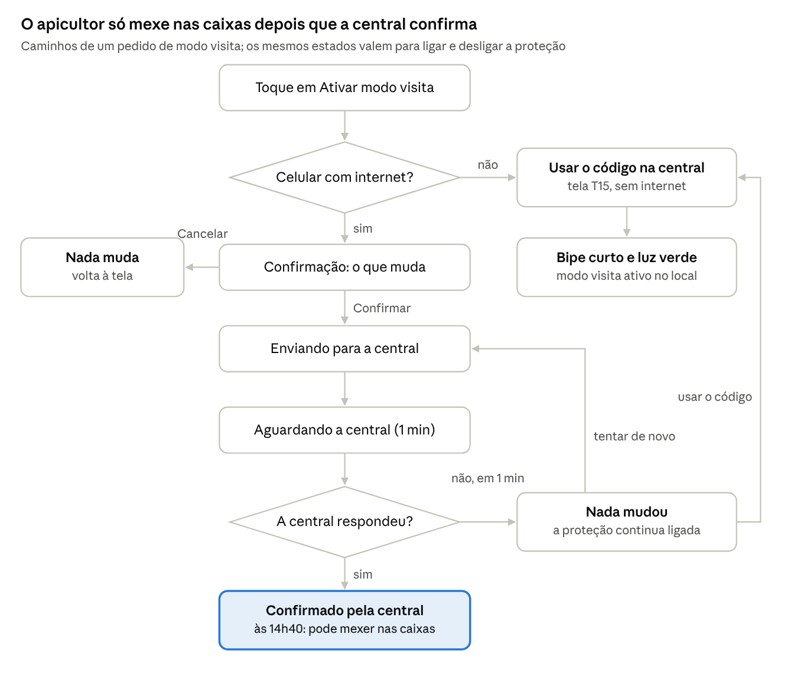
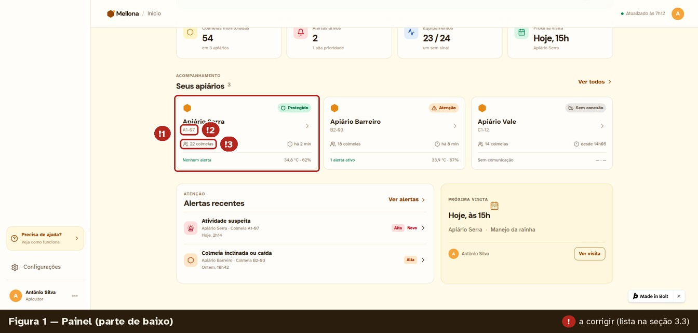
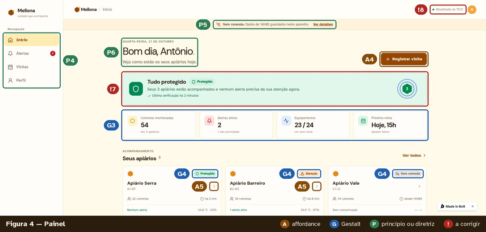
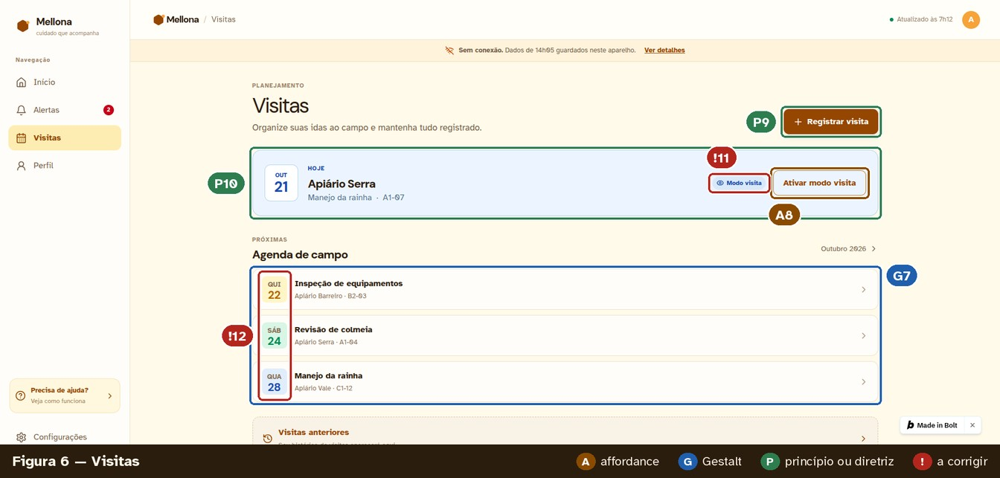
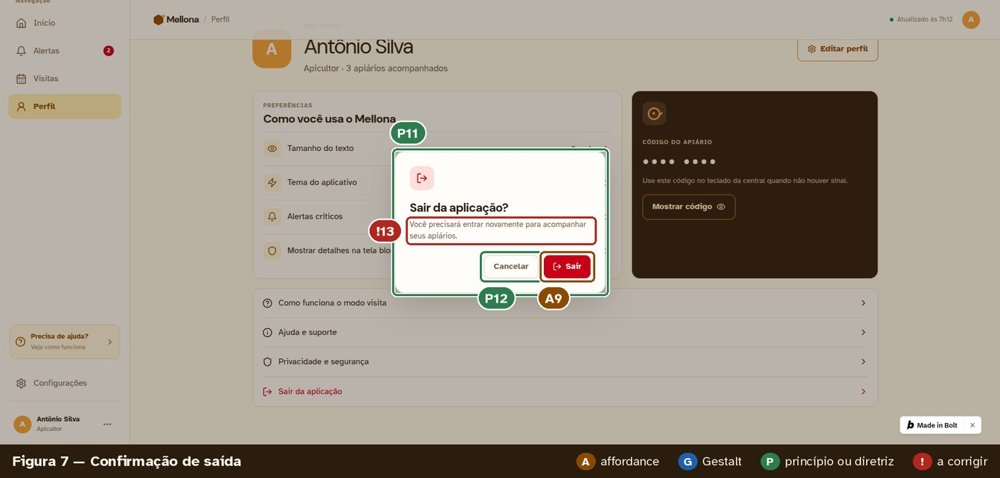
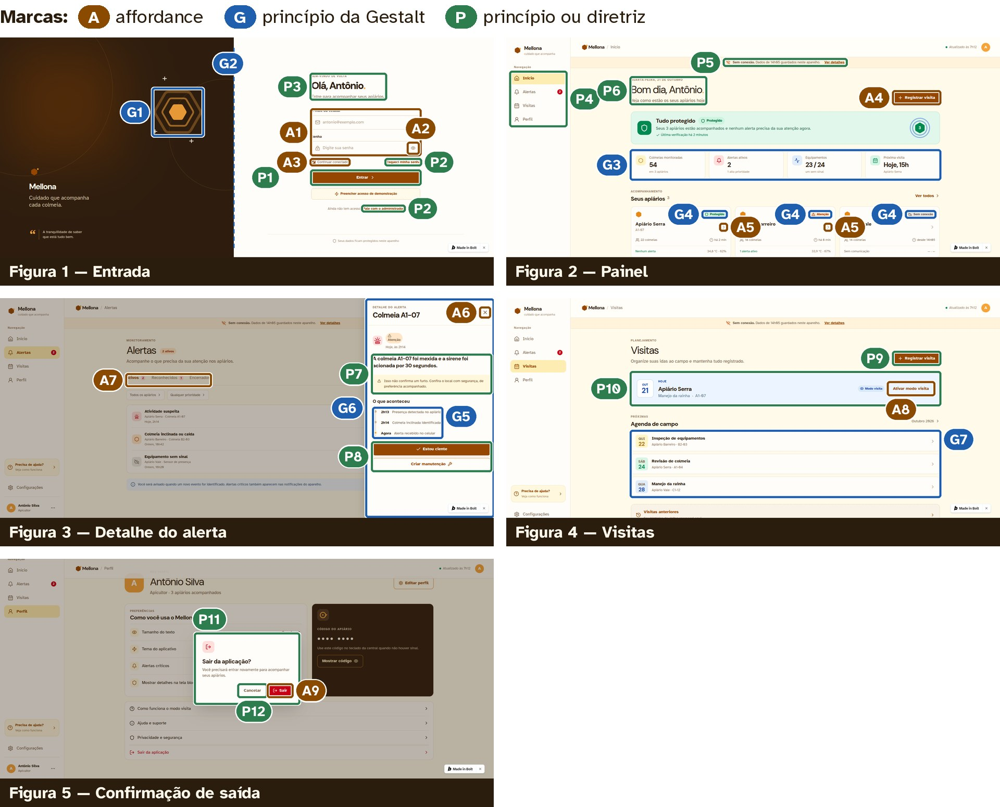
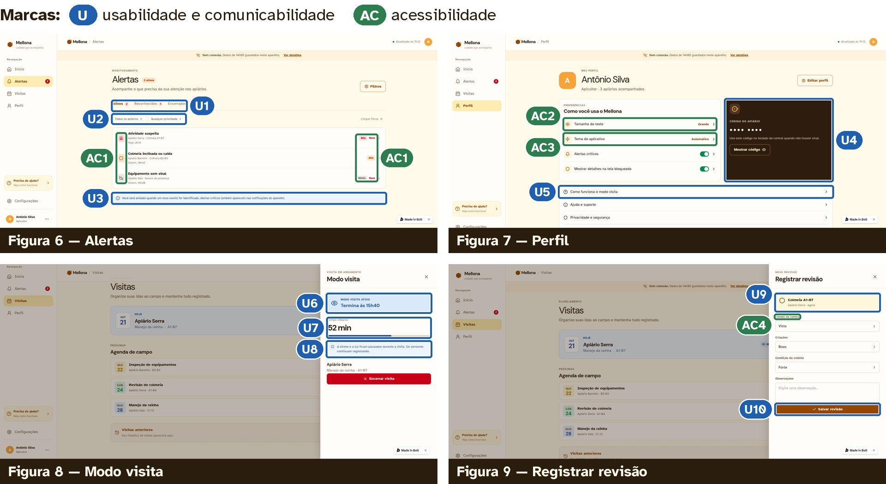

# Mellona — Protótipos e análise da PF2

Autora: Bárbara Nogueira. Disciplina: Interação Humano-Computador, INF/UFG. Organização documental: 05/11/2026.

## 1. Apresentação da Etapa 2

A PF2 registra as decisões de design do Mellona em um guia de estilo e as aplica em um
protótipo digital navegável feito no bolt.new. A primeira versão do protótipo cobre 9 das 18
telas especificadas. O projeto é individual, de Bárbara Nogueira.

```text
  Item pedido no enunciado                                         Onde está neste documento

  Escrever um guia de estilo                                       Documento de guia de estilo

  1. Definir a ferramenta para a criação do protótipo              Seção 3.1

  2. Criar um protótipo digital navegável                          Seções 3.2 e 3.3

  3. Citar e indicar affordances, princípios da Gestalt            Seção 3.4
  (Aula 2) e princípios e diretrizes de Silva e Barbosa
  (2010) (Aula 3)

  4. Citar e indicar os critérios de usabilidade e                 Seção 3.5
  acessibilidade (Aula 1)
```

Lugar no ciclo de vida em estrela. A PF1 percorreu a análise e a especificação de
requisitos. A PF2 percorre o projeto da interface (especificação das telas e guia de estilo)
e a prototipação. Como manda a estrela, cada saída volta ao centro, a avaliação: a revisão
das telas do protótipo (seção 3.3) é uma avaliação informal, feita pela própria designer; a
avaliação formal, em sala de aula, é a PF3.

Fontes históricas desta etapa: ERS v1.1, PF1 e especificação das 18 telas. As personas ainda são provisórias porque o estudo de campo com vídeos de apicultores e o brainstorming da PF1 não foram aplicados; o protótipo usa dados simulados.

**Documentos de referência atuais:** [Guia de estilo e especificação das telas](guia-de-estilo-e-especificacao-das-telas.md), [PF1](../pf1-planejamento/PF1.md) e [ERS](../../docs/ERS.md). As versões do ERS citadas na análise identificam a base usada na época; não significam que os requisitos posteriores foram conferidos.

## 2. Situação documentada e critérios de leitura

Este documento registra o protótipo e a **revisão informal realizada pela própria autora na PF2**. A avaliação formal em sala, seu método, execução e resultados pertencem à [PF3](../pf3-avaliacao/README.md), ainda pendente. As capturas e tabelas são registros da primeira versão, não evidências de que as correções já foram aplicadas.

| Item | Situação documentada |
| --- | --- |
| Telas no bolt.new | 7 feitas e 2 parciais, de 18 especificadas |
| Dados | Simulados; sem integração com a central do apiário ou com a API |
| Figma | Incluído no fluxo em 28/10/2026; link e evidências do trabalho pendentes |
| Endereço do Figma | A preencher |
| Endereço do bolt.new | A preencher após publicação |
| Revisão informal | 25 problemas identificados, sendo seis graves |
| Próximas telas para os cenários C2 a C4 | T13, T15, T14 completa, T17, T05 e T07 |
| Verificações pendentes | Largura de 360 px, tipografia, contraste e demais itens indicados na análise |

A seção 3 mantém a numeração da análise detalhada da PF2: 3.1 ferramentas, 3.2 navegação, 3.3 revisão das telas, 3.4 affordances e princípios, 3.5 usabilidade e acessibilidade. O Apêndice A preserva as instruções da camada de anotações; o Apêndice B guarda os painéis visuais da versão resumida.

## 3. Protótipos e análise

### 3.1 Ferramentas: Figma e bolt.new

O fluxo definido na revisão de 28/10/2026 atribui papéis complementares a duas ferramentas: o Figma desenha as telas,
guarda o guia como biblioteca e indica os princípios em anotações; o bolt.new gera o
protótipo em código, que roda no celular e permite testar a acessibilidade.

No Figma, o modo de protótipo liga quadros por conexões com gatilho, ação e animação,
organiza fluxos e os compartilha por link (guia); as anotações prendem notas aos
elementos da tela (anotações) e estão no plano Educação, gratuito para estudantes. O
bolt.new, da StackBlitz, gera aplicações web a partir de pedidos em texto e as publica em
um endereço bolt.host (suporte do Bolt).

```text
  Critério                               Figma                              bolt.new

  Papel no projeto                       Telas desenhadas e biblioteca      Protótipo funcional em código,
                                         do guia: estilos de cor e de       gerado por pedidos em texto
                                         texto e componentes (botão,
                                         etiqueta, campo)

  Navegação                              Conexões entre quadros e um        Menu, abas, gavetas e
                                         fluxo por cenário (C1 a C4),       formulários funcionam; estados
                                         compartilhados por link            como "Sem conexão" são
                                                                            simulados

  Indicação de princípios                Anotações sobre cada               Capturas anotadas (Figuras 3 a
  e critérios                            elemento, com os códigos A, G,     11)
                                         P, U e AC das seções 3.4 e 3.5

  Acessibilidade                         Contraste e tamanhos               Leitor de tela, texto ampliado e
                                         conferidos nos estilos, antes da   teclado podem ser testados de
                                         implementação                      verdade
```

**Fontes e links:**

- [Figma](<https://www.figma.com/>)
- [guia](<https://help.figma.com/hc/en-us/articles/360040314193>)
- [anotações](<https://help.figma.com/hc/en-us/articles/20774752502935>)
- [bolt.new](<https://stackblitz.com/>)
- [suporte do Bolt](<https://support.bolt.new/cloud/hosting/publish>)

```text
  Critério                               Figma                            bolt.new

  Limitação                              Não testa leitor de tela nem o   A IA gera inconsistências sem
                                         layout responsivo real           avisar; controle fino de layout
                                                                          menor; sem anotações nativas
```

O fluxo prevê redesenhar as telas já feitas no bolt.new no Figma com a biblioteca do guia; as próximas devem nascer no Figma e seguir para o bolt.new com os mesmos valores. A execução desse trabalho ainda precisa ser comprovada por links e evidências. As duas
versões usam dados simulados, e os participantes da PF3 devem ouvir que se trata de um
protótipo, porque a aparência acabada inibe críticas (efeito estética-usabilidade).

Endereços: Figma — a preencher; bolt.new — a preencher, depois de publicar pelo botão
Publish.

A justificativa abaixo registra a decisão inicial, anterior à inclusão do Figma. Ela preserva os motivos e limitações do uso do bolt.new; a decisão atual é o fluxo complementar descrito acima.

#### 3.1.1 Histórico da escolha inicial pelo bolt.new

O protótipo é feito no bolt.new, da StackBlitz. A ferramenta gera aplicações web a partir
de pedidos em texto: um agente de IA escreve o código e o executa no próprio navegador,
com a tecnologia WebContainers, sem instalação (descrição do projeto). O botão Publish
gera um endereço no domínio bolt.host, público no plano gratuito, e o botão Update
atualiza o site depois de cada mudança (suporte do Bolt).

Justificativa inicial da preferência pelo bolt.new em relação a uma ferramenta de desenho como Figma ou Proto.io.



**Fontes e links:**

- [bolt.new](<https://stackblitz.com/>)
- [descrição do projeto](<https://www.sourcepulse.org/projects/1272029>)
- [suporte do Bolt](<https://support.bolt.new/cloud/hosting/publish>)

```text
  Critério                                       O que o bolt.new oferece ao Mellona

  Navegação real                                 As telas são código: menu, abas, gavetas,
                                                 formulários e confirmações funcionam, e estados
                                                 como "Sem conexão" podem ser simulados

  Responsividade real                            A mesma tela se reorganiza no celular e no
                                                 notebook, então a avaliação pode acontecer no
                                                 celular do participante, como o de Antônio

  Acessibilidade testável                        Por ser uma página web de verdade, o leitor de tela,
                                                 a ampliação do texto e o teclado funcionam; um
                                                 protótipo desenhado não permite esse teste

  Iteração rápida                                Os ajustes que a avaliação pedir são feitos com
                                                 novos pedidos em texto

  Compartilhamento                               Um endereço público para avaliadores e
                                                 professores
```

Limitações e como são tratadas.

A IA gera inconsistências sem avisar. Toda tela é revisada contra o [guia de estilo](guia-de-estilo-e-especificacao-das-telas.md) antes de ser
dada por pronta; a revisão da primeira versão está na seção 3.3.
O controle fino do layout é menor do que em uma ferramenta de desenho, e não há
camada de anotações nativa. Por isso, os princípios e critérios são indicados sobre
capturas numeradas (3.4 e 3.5) e, se desejado, em uma camada de anotações dentro
do próprio protótipo (Apêndice A).
A aparência acabada pode inibir críticas na avaliação (efeito estética-usabilidade,
Aula 2). Na PF3, os participantes devem ouvir que se trata de um protótipo e que
apontar problemas é o objetivo.
O protótipo usa dados simulados e não se comunica com a central do apiário nem com
a API do projeto.
O uso do agente consome créditos do plano; pedidos devem ser agrupados por tela.

### 3.2 Protótipo digital navegável

A primeira versão tem 7 telas feitas e 2 parciais, das 18 especificadas, com fidelidade alta
na aparência e média no comportamento. A entrada usa o botão "Preencher acesso de
demonstração" (usuário antonio@mellona.app).

Endereço publicado: falta publicar o projeto pelo botão Publish e colar aqui o endereço
bolt.host.

As capturas foram feitas a 1920 px de largura, no layout de computador. Como o usuário
principal usa um celular, o protótipo precisa ser conferido a 360 px antes da PF3.

```text
  Tela                                    Situação no   Necessária para as   Observação
                                          protótipo     tarefas da PF3

  T01 Entrada                              ​ Feita      Sim                  Três estados: vazia, senha
                                                                             oculta e senha visível

  T02 Primeiro acesso                      ​ A fazer    Não

  T03 Painel                               ​ Feita      Sim (C4)             Precisa de ajustes (3.3)

  T04 Apiário                              ​ Parcial    Sim (C4)             Gaveta resumida; faltam a
                                                                             lista de colmeias e a aba
                                                                             Manutenções

  T05 Colmeia                              ​ A fazer    Sim (C4)

  T06 Histórico                            ​ A fazer    Não                  O atalho existe na gaveta do
                                                                             apiário

  T07 Equipamentos                         ​ A fazer    Sim (C4)             O atalho existe na gaveta do
                                                                             apiário

  T08 Alertas                              ​ Feita      Sim (C1, C3)

  T09 Detalhe do                           ​ Feita      Sim (C1, C3)         Precisa de ajustes (3.3)
  alerta

  T10 Notificação                          ​ A fazer    Sim (C1)             Pode ser simulada por um
                                                                             aviso no topo da tela

  T11 Proteção                             ​ A fazer    Não                  O atalho existe na gaveta do
                                                                             apiário

  T12 Visitas                              ​ Feita      Sim (C2)

  T13 Registrar visita                     ​ A fazer    Sim (C2)             O botão existe no Painel e
                                                                             em Visitas

  T14 Modo visita                          ​ Parcial    Sim (C2)             Só o estado ativo; faltam a
                                                                             confirmação e os estados
                                                                             aguardando, sem resposta e
                                                                             encerrado

  T15 Modo visita sem                      ​ A fazer    Sim (C2)             É a tarefa mais crítica do
  conexão                                                                    aplicativo

  Tela                                    Situação no   Necessária para as   Observação
                                          protótipo     tarefas da PF3

  T16 Registrar                            ​ Feita      Sim (C2)             Precisa de ajustes (3.3)
  revisão

  T17 Nova                                 ​ A fazer    Sim (C3)             O botão existe no detalhe do
  manutenção                                                                 alerta

  T18 Perfil                               ​ Feita      Não                  Inclui a confirmação de saída
```

No Figma, o fluxo previsto usa a mesma numeração T01 a T18 e um fluxo por cenário C1 a C4.

As próximas telas a construir, na ordem, são T13, T15, T14 completa, T17, T05 e T07: sem
elas, os cenários C2, C3 e C4 não podem ser percorridos na avaliação.

### 3.3 Telas do protótipo e ajustes antes da PF3

Esta é a revisão informal da autora, com os resultados originalmente registrados. Não substitui a avaliação formal da PF3.

A primeira versão já segue a paleta, o vocabulário e o padrão de gavetas do guia, mas tem
25 pontos a corrigir. Seis são graves porque fazem o aplicativo afirmar uma situação que
não é a real, o que contraria a regra central do guia.

Fluxos navegáveis na primeira versão: Entrada → Painel; Painel → gaveta do apiário; Painel
e Alertas → detalhe do alerta; Visitas → modo visita e registrar revisão; Perfil →
confirmação de saída.

O que já segue o guia: a paleta do apiário e o botão principal em marrom; a faixa "Sem
conexão" com a hora dos dados; etiquetas de estado com ícone e texto; a ressalva "Isso
não confirma um furto"; o botão "Estou ciente"; a confirmação de saída com "Cancelar"
primeiro; o código mascarado com "Mostrar código"; as preferências de tamanho do texto
e de tema; rótulos acima dos campos e "Mostrar senha"; o detalhe em gaveta lateral no
computador.

As Figuras 1 e 2 mostram as duas telas que não aparecem nas seções seguintes; as marcas
vermelhas são os pontos a corrigir.

```text
 Nº          Onde                      O que está no protótipo     Correção pelo guia        Gravidade Situação

 !1          Painel (Figura            O Apiário Serra aparece     O cartão mostra a         ​ Alta     ​ A corrigir
             1)                        "Protegido" e com           situação mais grave do
                                       "Nenhum alerta", embora     apiário e o número de
                                       haja uma atividade          alertas ativos
                                       suspeita ativa na colmeia
                                       A1-07

 !2          Painel (Figura            Sob o nome de cada          Mostrar só o nome do      ​ Baixa    ​ A corrigir
             1)                        apiário aparece um          apiário; as colmeias
                                       identificador de colmeia    ficam na gaveta
                                       (A1-07)

 !3          Painel (Figura            "22 colmeias" vem com o     Usar o hexágono vazado,   ​ Baixa    ​ A corrigir
             1)                        ícone de pessoas            ícone de colmeia
```




```text
 Nº          Onde                      O que está no protótipo       Correção pelo guia           Gravidade Situação

 !4          Gaveta do                 A ação principal é "Fechar    Ação principal "Vou a        ​ Média    ​ A corrigir
             apiário (Figura           detalhes"                     este apiário"; fechar pelo
             2)                                                      X ou pela tecla Esc

 !5          Gaveta do                 "34,8 °C" e "62 %"            Dizer de onde vem o          ​ Média    ​ A corrigir
             apiário (Figura           aparecem como se fossem       valor: "média de 22
             2)                        do apiário inteiro            colmeias" ou "de 33,9 a
                                                                     35,2 °C"

 !6          Gaveta do                 "Equipamentos" usa a          Usar activity para           ​ Baixa    ​ A corrigir
             apiário (Figura           chave inglesa, que            equipamentos
             2)                        também é o ícone de
                                       manutenção

 !7          Painel (Figura            "Tudo protegido" e            O estado geral mostra a      ​ Alta     ​ A corrigir
             4)                        "nenhum alerta precisa da     situação mais grave, na
                                       sua atenção", com 2           ordem definida para a
                                       alertas de prioridade alta,   T03
                                       um apiário em atenção e
                                       outro sem comunicação

 !8          Painel (Figura            "Atualizado às 7h12" com      Uma única hora dos           ​ Alta     ​ A corrigir
             4)                        ponto verde, ao lado da       dados; sem conexão, o
                                       faixa "Sem conexão. Dados     ponto verde some
                                       de 14h05"

 !9          Detalhe do                O título é a colmeia, e não   Título "Atividade            ​ Média    ​ A corrigir
             alerta (Figura            o alerta; a etiqueta          suspeita", subtítulo
             5)                        "Atenção" aparece num         "Apiário Serra · Colmeia
                                       alerta de prioridade alta     A1-07" e etiqueta "Alta"

 !10         Detalhe do                A linha do tempo diz          Usar os termos do            ​ Alta     ​ A corrigir
             alerta (Figura            "Colmeia inclinada" para      glossário, informar sirene
             5)                        uma colmeia mexida; às        e luz conforme o período
                                       2h14, de noite, a luz         e incluir a explicação da
                                       também deveria ter sido       decisão
                                       acionada (RN-59); falta
                                       "Por que a sirene tocou"
                                       (RF-07)

 !11         Visitas (Figura           A etiqueta azul "Modo         A etiqueta azul só           ​ Alta     ​ A corrigir
             6)                        visita" aparece no cartão     aparece com o modo
                                       de hoje antes de o modo       visita confirmado; antes,
                                       ser ativado                   "Modo visita não
                                                                     ativado"

 !12         Visitas (Figura           Os dias da agenda têm         Mesma cor para todos os      ​ Baixa    ​ A corrigir
             6)                        cores diferentes (amarelo,    dias
                                       verde e azul) sem
                                       significado

 !13         Saída (Figura             A confirmação não avisa       Quando houver, dizer         ​ Média    ​ A corrigir
             7)                        sobre registros ainda não     quantos são e oferecer
                                       enviados                      "Enviar primeiro"

 Nº          Onde                      O que está no protótipo       Correção pelo guia          Gravidade Situação

 !14         Alertas (Figura           A aba diz "Ativos 2", mas a   Contagens iguais na aba,    ​ Média    ​ A corrigir
             8)                        lista mostra 3 alertas        no título, no menu e no
                                                                     Painel

 !15         Alertas (Figura           Linhas de apoio com cerca     16 px na cor Casca          ​ Média    ​ A corrigir
             8)                        de 12 px e contraste de       (7,99:1)
                                       3,98:1

 !16         Perfil (Figura            Interruptores e setas na      Só o interruptor; a seta    ​ Baixa    ​ A corrigir
             9)                        mesma linha                   fica para linhas que
                                                                     abrem outra tela

 !17         Perfil (Figura            "Código do apiário" sugere    "Meu código da central":    ​ Média    ​ A corrigir
             9)                        um código compartilhado       o código é pessoal

 !18         Modo visita               "Encerrar visita" está em     Botão principal, linha de   ​ Média    ​ A corrigir
             (Figura 10)               vermelho; falta               confirmação e botão
                                       "Confirmado pela central      secundário "Registrar
                                       às 14h40" e o atalho para     revisão"
                                       registrar revisão

 !19         Modo visita               O ícone do modo visita é      Usar user-check             ​ Baixa    ​ A corrigir
             (Figura 10)               um olho, que no aplicativo
                                       significa "mostrar"

 !20         Registrar                 Cada escolha abre uma         Seletores com as três       ​ Média    ​ A corrigir
             revisão (Figura           lista (um toque a mais por    opções visíveis; o campo
             11)                       campo, difícil de luvas); o   se chama "Crias"
                                       campo se chama
                                       "Criações"

 !21         Todas                     A família tipográfica não é   Aplicar a tipografia da     ​ Média    ​ A corrigir
                                       a Atkinson Hyperlegible, e    seção 2.3 do guia
                                       vários textos secundários
                                       têm menos de 16 px

 !22         Todas                     As telas foram vistas só a    Conferir e ajustar no       ​ Alta     ​ A corrigir
                                       1920 px; a navegação          celular antes da PF3
                                       inferior e a largura de 360
                                       px não foram conferidas

 !23         Menu lateral              "Configurações" e "Precisa Manter quatro destinos;        ​ Baixa    ​ A corrigir
                                       de ajuda?" aparecem        configurações e ajuda
                                       como destinos extras,      ficam em Perfil
                                       além de Perfil

 !24         Todas                     O selo "Made in Bolt"         Esconder o selo antes da    ​ Baixa    ​ A corrigir
                                       cobre parte da tela           avaliação

 !25         Dados                     3 apiários e 54 colmeias,     Alinhar os dados            ​ Baixa    ​ A corrigir
             simulados                 enquanto a persona            simulados à persona ou
                                       Antônio tem cerca de 40       atualizar a persona
                                       colmeias em 2 apiários
```

A coluna Situação serve para acompanhar as correções no bolt.new até a PF3.

### 3.4 Affordances, princípios da Gestalt e princípios e diretrizes

No fluxo previsto para o Figma, os mesmos códigos A, G, P, U e AC devem aparecer em anotações sobre os elementos. As capturas abaixo mantêm a numeração da análise detalhada; os painéis da revisão resumida no Apêndice B têm numeração própria.

O protótipo aplica 9 affordances, os seis princípios da Gestalt vistos nas Aulas 2 e 3 e os
nove princípios e diretrizes de Silva e Barbosa (2010). Cada aplicação está marcada nas
Figuras 3 a 7 com o código das tabelas: A para affordance, G para Gestalt, P para princípio
ou diretriz e ! para o que ainda falha.







Affordances

Affordance é o conjunto de características de um objeto que sugere que ação se pode
fazer com ele (Gibson, citado na Aula 1).

```text
  Código            Elemento                                 O que a aparência sugere

  A1                Campos de entrada (Figura 3)             Borda, fundo branco e ícones de
                                                             envelope e cadeado dizem "digite aqui";
                                                             o rótulo acima diz o quê

  A2                Olho dentro do campo de senha            Tocar mostra a senha digitada
                    (Figura 3)

  A3                Caixa "Continuar conectado" (Figura 3)   Quadrado com marca de verificação:
                                                             liga e desliga

  A4                Botão "+ Registrar visita" (Figura 4)    Preenchido e com sombra, parece
                                                             pressionável; o sinal de mais diz que cria
                                                             algo

  A5                Seta nos cartões de apiário (Figura 4)   O cartão abre um detalhe

  A6                X no canto da gaveta (Figura 5)          Fecha a gaveta

  A7                Abas com sublinhado (Figura 5)           Alternam entre listas; o sublinhado
                                                             marca a atual

  A8                "Ativar modo visita" com contorno        É clicável, mas secundário
                    (Figura 6)
```



```text
  Código            Elemento                                           O que a aparência sugere

  A9                Botão "Sair" vermelho com ícone de                 A ação tem consequência
                    saída (Figura 7)
```

Duas affordances enganam e estão na lista de ajustes: a seta ao lado de interruptores
sugere que a linha abre outra tela (!16), e a etiqueta azul "Modo visita" antes da ativação
sugere um estado que não existe (!11).

Princípios da Gestalt

```text
  Código            Princípio                    Onde                         Como se aplica

  G1                Fecho                        Logotipo (Figura 3)          Contornos de hexágonos que o
                                                                              olho completa como um favo

  G2                Simetria                     Entrada (Figura 3)           A tela se divide em duas
                                                                              metades de mesmo peso:
                                                                              identidade à esquerda,
                                                                              formulário à direita

  G3                Proximidade                  Indicadores do Painel        Os quatro indicadores ficam
                                                 (Figura 4)                   juntos e afastados do resto,
                                                                              lidos como um resumo

  G4                Similaridade                 Etiquetas de estado          Todas têm a mesma forma de
                                                 (Figura 4)                   cápsula, então o olho as
                                                                              compara e lê a cor, o ícone e o
                                                                              texto como a diferença

  G5                Continuidade                 Linha do tempo do            A linha vertical leva o olho de um
                                                 alerta (Figura 5)            evento ao seguinte, na ordem
                                                                              dos horários

  G6                Destino comum                Gaveta do alerta             Todo o conteúdo da gaveta
                                                 (Figura 5)                   desliza junto, da direita, e é lido
                                                                              como uma unidade separada da
                                                                              lista ao fundo

  G7                Similaridade e               Agenda de campo              Itens com a mesma estrutura e o
                    proximidade                  (Figura 6)                   mesmo espaçamento são lidos
                                                                              como uma lista de iguais
```

Na agenda, as cores diferentes dos dias quebram a similaridade e sugerem categorias que
não existem (!12).

Princípios e diretrizes de Silva e Barbosa (2010)

```text
  Princípio ou diretriz                          Código    Como o protótipo aplica     Onde ainda falha

  Correspondência com as                         P3, P6    Saudação pelo nome,         "Código do apiário"
  expectativas dos usuários                                data por extenso e "E-      (!17) e "Criações" (!20)
                                                           mail ou celular", que
                                                           aceita o que o apicultor
                                                           tem; vocabulário do
                                                           apiário (Figuras 3 e 4)

  Simplicidade nas                               P1        Entrar exige dois campos    Na revisão, cada
  estruturas das tarefas                                   e um botão (Figura 3)       escolha abre uma lista
                                                                                       (!20)

  Equilíbrio entre controle e                    P12       "Cancelar" vem primeiro
  liberdade do usuário                                     na confirmação de saída;
                                                           toda gaveta fecha pelo X
                                                           (Figura 7)

  Consistência e                                 P9        "+ Registrar visita" fica   A chave inglesa e o
  padronização                                             no mesmo lugar e com a      olho têm dois
                                                           mesma aparência no          significados cada (!6,
                                                           Painel e em Visitas         !19)
                                                           (Figura 6)

  Promoção da eficiência do                      P8        "Estou ciente" e "Criar
  usuário                                                  manutenção" ficam no
                                                           próprio alerta (Figura 5)

  Antecipação das                                P2, P5    "Esqueci minha senha" e
  necessidades do usuário                                  "Fale com o
                                                           administrador" para
                                                           quem não consegue
                                                           entrar; faixa "Sem
                                                           conexão" com a hora dos
                                                           dados guardados
                                                           (Figuras 3 e 4)

  Visibilidade e                                 P4, P10   Menu sempre visível,
  reconhecimento                                           com o número de alertas;
                                                           a visita de hoje
                                                           destacada em azul no
                                                           topo de Visitas (Figuras
                                                           4 e 6)

  Princípio ou diretriz                          Código   Como o protótipo aplica    Onde ainda falha

  Conteúdo relevante e                           P7       O alerta começa por uma    Título e termos do
  expressão adequada                                      frase com o que            alerta (!9, !10)
                                                          aconteceu e traz a
                                                          ressalva "Isso não
                                                          confirma um furto"
                                                          (Figura 5)

  Projeto para erros                             P11      Confirmação antes de       O Painel afirma "Tudo
                                                          sair, com a consequência   protegido" com alertas
                                                          (Figura 7)                 ativos (!7, !8); a saída
                                                                                     não avisa sobre
                                                                                     registros não enviados
                                                                                     (!13)
```

Outras diretrizes aplicadas (leis da psicologia aplicadas a UX, Aula 2). Lei de Fitts:
botões principais largos, na base das gavetas. Lei de Hick-Hyman: quatro destinos fixos na
navegação. Lei de Jakob: a entrada segue o padrão de login conhecido de outros
aplicativos. Lei de Miller: o código da central aparece em dois grupos de quatro dígitos
(Figura 9). Efeito von Restorff: só o cartão de estado do Painel tem fundo colorido.

### 3.5 Critérios de usabilidade e acessibilidade

O protótipo aplica as seis metas de usabilidade, a comunicabilidade e a acessibilidade
vistas na Aula 1; o ponto mais fraco é o contraste dos textos de apoio, abaixo do mínimo
em 8 de 16 textos medidos. As aplicações estão marcadas nas Figuras 8 a 11 com U
(usabilidade e comunicabilidade) e AC (acessibilidade). A referência de acessibilidade é a
WCAG 2.2, nível AA, na tradução oficial em português.


**Fontes e links:**

- [https://www.w3.org/Translations/WCAG22-pt-BR/](<https://www.w3.org/Translations/WCAG22-pt-BR/>)
- [tradução oficial em português](<https://www.w3.org/Translations/WCAG22-pt-BR/>)


Metas de usabilidade, experiência do usuário e comunicabilidade

```text
  Critério                                Código    Como o protótipo          Requisito   Onde falha
                                                    aplica                    da PF1

  Eficácia                                U1, U10   Abas separam              RNF-01      Contagem errada
                                                    alertas ativos,                       (!14)
                                                    reconhecidos e
                                                    encerrados, com
                                                    contagem; "Salvar
                                                    revisão" fica fixo na
                                                    base (Figuras 8 e 11)

  Eficiência                              U2, U7,   Filtros por apiário e     RNF-02      Escolhas em lista na
                                          U9        prioridade; colmeia e                 revisão (!20)
                                                    hora já preenchidas
                                                    na revisão; tempo
                                                    restante do modo
                                                    visita à vista (Figuras
                                                    8, 10 e 11)

  Segurança de uso                        U4, U8    Código mascarado          RNF-03      Falta "Confirmado
                                                    até "Mostrar código";                 pela central" (!18); o
                                                    o modo visita explica                 Painel afirma "Tudo
                                                    que sirene e luz                      protegido" (!7)
                                                    ficam pausadas e os
                                                    sensores continuam
                                                    (Figuras 9 e 10)
```


```text
  Critério                                Código   Como o protótipo         Requisito   Onde falha
                                                   aplica                   da PF1

  Utilidade                               U3       Aviso de que alertas     RNF-04
                                                   críticos também
                                                   chegam como
                                                   notificação do
                                                   celular (Figura 8)

  Facilidade de                           U5       "Como funciona o         RNF-05      "Criações" (!20)
  aprendizado                                      modo visita" no
                                                   Perfil; vocabulário do
                                                   apicultor (Figura 9)

  Facilidade de                           U6, U7   As mesmas                RNF-06      Destinos extras no
  memorização                                      etiquetas de estado                  menu (!23)
                                                   em todas as telas; o
                                                   modo visita mostra a
                                                   hora de término, que
                                                   não precisa ser
                                                   calculada (Figura 10)

  Comunicabilidade                        U6, U8   O modo visita            RNF-07      Etiqueta "Modo
                                                   anuncia em                           visita" antes da
                                                   destaque o estado, a                 ativação (!11)
                                                   hora de término e o
                                                   que muda no apiário:
                                                   visibilidade, bom
                                                   modelo conceitual e
                                                   feedback (Figura 10)

  Experiência do                          —        Saudação pelo nome,      —           A aparência
  usuário                                          tom acolhedor                        acabada pode
                                                   ("Cuidado que                        esconder problemas
                                                   acompanha cada                       na avaliação (efeito
                                                   colmeia") e paleta do                estética-
                                                   apiário (Figuras 3 e                 usabilidade)
                                                   4)
```

Acessibilidade

```text
  Critério (WCAG 2.2)                            Nível   Código   Como o protótipo aplica       Situação

  1.4.1 Uso de Cores                             A       AC1      Prioridade escrita por        ​ Atende
                                                                  extenso ("Alta", "Média") e
                                                                  um ícone por tipo de
                                                                  alerta (Figura 8)

  1.4.3 Contraste (Mínimo)                       AA      —        Textos principais e           ​ Não atende
                                                                  etiquetas passam de 4,5:1;
                                                                  textos de apoio não
                                                                  (gráfico abaixo; !15, !21)

  1.4.4 Redimensionar Texto                      AA      AC2      Ajuste "Tamanho do            ​ A conferir
                                                                  texto" no Perfil (Figura 9)

  3.3.2 Rótulos ou Instruções                    A       AC4      Rótulos sempre visíveis       ​ Atende
                                                                  acima dos campos
                                                                  (Figuras 3 e 11)

  3.3.8 Autenticação                             AA      A2       A senha pode ser              ​ Atende
  Acessível (Mínimo)                                              mostrada e preenchida
                                                                  por gerenciador de
                                                                  senhas; não há desafio do
                                                                  tipo CAPTCHA (Figura 3)

  2.5.8 Tamanho do Alvo                          AA      —        Botões principais com         ​ A conferir
  (Mínimo)                                                        cerca de 48 px de altura,
                                                                  acima do mínimo de 24 ×
                                                                  24 px; o guia pede 48 × 48
                                                                  px também para setas e
                                                                  "Limpar filtros"

  2.4.7 Foco Visível e 2.4.11                    AA      —        O guia define o anel de       ​ A conferir
  Foco não Obscurecido                                            foco em Céu; o selo
  (Mínimo)                                                        "Made in Bolt" pode cobrir
                                                                  elementos em foco (!24)

  1.4.10 Realinhar e 1.3.4                       AA      —        Layout responsivo, ainda      ​ A conferir
  Orientação                                                      não visto a 320–360 px
                                                                  (!22)

  2.3.1 Três Flashes ou Abaixo                   A       —        Nenhum elemento pisca         ​ A conferir
  do Limite                                                       nas capturas; falta
                                                                  conferir os anéis do Painel
                                                                  em movimento
```

O tema automático, claro de dia e escuro à noite (AC3, Figura 9), atende ao princípio
Adaptável do Design Universal (Aula 3). A Lei Brasileira de Inclusão (Lei 13.146/2015),
indicada na Aula 1, reforça a meta de acessibilidade.

medido nas capturas do protótipo no bolt.new, 21/10/2026 · 16 textos

Sete dos oito textos que falham estão em marrom-claro (de #88746C a #B49C87 nas
capturas); o oitavo é o verde de "Nenhum alerta". Usar a cor Casca (#5C4A36) nos textos
de apoio e o verde de etiqueta (#1E5C38) resolve os oito. Os valores são aproximados,
porque a suavização das letras clareia os pixels; a conferência final deve usar as cores
definidas no código do protótipo.

## Apêndice A — Anotações dentro do próprio protótipo

As Figuras 3 a 11 indicam os princípios sobre capturas. Para que a indicação também fique
no protótipo navegável, o pedido abaixo pode ser colado no bolt.new: ele cria uma camada
de anotações, desligada por padrão, com os mesmos códigos deste documento.


Adicione ao protótipo uma camada de anotações de IHC, desligada por padrão.

1. No menu lateral (e no Perfil, no celular), crie o interruptor "Mostrar
anotações de IHC". O atalho Alt+A também liga e desliga.
2. Com a camada ligada, mostre sobre cada elemento listado abaixo uma
etiqueta redonda com o código (por exemplo, "A4"), presa ao canto superior
esquerdo do elemento, sem mudar o layout. Cores: A em #8A4B00, G em #1F5FAD,
P em #2E7D4F, U em #1F5FAD, AC em #2E7D4F; texto branco em negrito, 14 px.
3. Ao tocar ou passar o mouse sobre a etiqueta, mostre um balão com o nome do
princípio e uma frase de explicação.
4. Crie um botão "Legenda" que abre uma gaveta com a lista completa dos
códigos.
5. As etiquetas não podem bloquear os cliques nos elementos e devem ser lidas
pelo leitor de tela, por exemplo: "Anotação A4: botão Registrar visita,
affordance".

Elementos e códigos:
\- Entrada: A1 campos de e-mail e senha (affordance); A2 ícone de mostrar
senha (affordance); A3 caixa Continuar conectado (affordance); G1 logotipo em
hexágonos (Gestalt: fecho); G2 divisão da tela em duas metades (Gestalt:
simetria); P1 botão Entrar (simplicidade nas estruturas das tarefas); P2
Esqueci minha senha e Fale com o administrador (antecipação das necessidades
do usuário); P3 saudação e rótulo E-mail ou celular (correspondência com as
expectativas dos usuários).
\- Painel: A4 botão Registrar visita (affordance); A5 setas dos cartões
(affordance); G3 indicadores (Gestalt: proximidade); G4 etiquetas de estado
(Gestalt: similaridade); P4 menu com a contagem de alertas (visibilidade e
reconhecimento); P5 faixa Sem conexão (antecipação das necessidades do
usuário); P6 saudação e data (correspondência com as expectativas dos
usuários).
\- Detalhe do alerta: A6 botão fechar (affordance); A7 abas (affordance); G5
linha do tempo (Gestalt: continuidade); G6 gaveta (Gestalt: destino comum);
P7 resumo e ressalva (conteúdo relevante e expressão adequada); P8 Estou
ciente e Criar manutenção (promoção da eficiência do usuário).
\- Visitas: A8 Ativar modo visita (affordance); G7 agenda (Gestalt:
similaridade e proximidade); P9 Registrar visita no mesmo lugar do Painel
(consistência e padronização); P10 cartão de hoje (visibilidade e
reconhecimento).
\- Confirmação de saída: A9 botão Sair (affordance); P11 caixa de confirmação
(projeto para erros); P12 botão Cancelar (equilíbrio entre controle e
liberdade do usuário).
\- Alertas: U1 abas com contagem (eficácia); U2 filtros (eficiência); U3 aviso
sobre notificações (utilidade); AC1 prioridade por extenso e ícones
(acessibilidade: uso de cores).
\- Perfil: AC2 tamanho do texto (acessibilidade: redimensionar texto); AC3
tema automático (Design Universal: adaptável); U4 código mascarado (segurança

de uso); U5 Como funciona o modo visita (facilidade de aprendizado).
\- Modo visita: U6 estado e hora de término (comunicabilidade); U7 tempo
restante (eficiência e memorização); U8 explicação da pausa da sirene
(segurança de uso).
\- Registrar revisão: U9 colmeia e hora preenchidas (eficiência); AC4 rótulos
visíveis (acessibilidade: rótulos ou instruções); U10 Salvar revisão
(eficácia).

## Apêndice B — Painéis visuais da revisão resumida

Os painéis abaixo preservam as capturas agrupadas da revisão resumida de 28/10/2026. A numeração interna é independente da análise detalhada: figuras 1 a 5 correspondem às figuras 3 a 7 da seção 3.4; figuras 6 a 9 correspondem às figuras 8 a 11 da seção 3.5. Os códigos A, G, P, U e AC identificam as mesmas aplicações.

### Affordances, Gestalt e diretrizes — figuras 1 a 5 da revisão resumida

 

### Usabilidade, comunicabilidade e acessibilidade — figuras 6 a 9 da revisão resumida

 

A revisão resumida registra oito de dezesseis textos de apoio medidos abaixo do contraste mínimo. A correção deve ser aplicada nos estilos compartilhados do Figma e nas telas do bolt.new, incluindo Casca (#5C4A36) nos textos de apoio e o verde de etiqueta (#1E5C38); a conferência final deve usar as cores reais do código, como ressalva a análise detalhada. Esse registro não comprova correção nem conformidade global com a WCAG.

## Referências

BRASIL. Lei nº 13.146, de 6 de julho de 2015. Institui a Lei Brasileira de Inclusão da
Pessoa com Deficiência (Estatuto da Pessoa com Deficiência).
GIBSON, J. J. The theory of affordances. In: SHAW, R.; BRANSFORD, J. (ed.).
Perceiving, Acting and Knowing. Hillsdale, NJ: Erlbaum, 1977.
HIX, D.; HARTSON, H. R. Developing User Interfaces: Ensuring Usability Through
Product and Process. New York: John Wiley & Sons, 1993.
NASCIMENTO, H. A. D.; BERRETTA, L. IHC — Aula 01: Conceitos Básicos; Aula 02:
Abordagens Teóricas; Aula 03: Conceitos de Design de Interação. Goiânia: INF/UFG,
2026. Slides de aula.
NASCIMENTO, H. A. D.; BERRETTA, L. Projeto Final (PF) da Disciplina de IHC e
Atividade — Guia de Estilo. Goiânia: INF/UFG, 2026. Enunciados.
SILVA, B. S.; BARBOSA, S. D. J. Interação Humano-Computador: Projetando a
Experiência Perfeita. Rio de Janeiro: Campus, 2010.
STACKBLITZ. Bolt.new e WebContainers. Acesso em: 21 out. 2026.
STACKBLITZ. Publish your project. Suporte do Bolt. Acesso em: 21 out. 2026.
SOURCEPULSE. bolt.new by StackBlitz. Acesso em: 21 out. 2026.
W3C. Diretrizes de Acessibilidade para Conteúdo Web (WCAG) 2.2. Tradução
autorizada para o português do Brasil. Acesso em: 21 out. 2026.

```text
Documentos do projeto: Mellona — Especificação de Requisitos de Software (ERS) v1.1;
  ​Mellona — Projeto Final de IHC — Etapa 1 (PF1)   ;   ​Mellona — Guia de estilo e especificação das telas   .
```

**Fontes e links:**

- [Bolt.new e WebContainers](<https://stackblitz.com/>)
- [Publish your project](<https://support.bolt.new/cloud/hosting/publish>)
- [bolt.new by StackBlitz](<https://www.sourcepulse.org/projects/1272029>)
- [Diretrizes de Acessibilidade para Conteúdo Web (WCAG) 2.2](<https://www.w3.org/Translations/WCAG22-pt-BR/>)

### Referências complementares da revisão 1.1

BRASIL. Lei nº 13.146, de 6 de julho de 2015 (Lei Brasileira de Inclusão).
FIGMA. Guide to prototyping; Add annotations; Figma for Education. Acesso em: 28
out. 2026.

**Fontes e links:**

- [Guide to prototyping](<https://help.figma.com/hc/en-us/articles/360040314193>)
- [https://help.figma.com/hc/en-us/articles/20774752502935](<https://help.figma.com/hc/en-us/articles/20774752502935>)
- [Add annotations](<https://help.figma.com/hc/en-us/articles/20774752502935>)
- [Figma for Education](<https://www.figma.com/education/higher-education/>)

GIBSON, J. J. The theory of affordances. In: SHAW, R.; BRANSFORD, J. (ed.).
Perceiving, Acting and Knowing. Hillsdale: Erlbaum, 1977.
NASCIMENTO, H. A. D.; BERRETTA, L. IHC: Aulas 01 a 03, Projeto Final e Atividade Guia
de Estilo. Goiânia: INF/UFG, 2026.
SILVA, B. S.; BARBOSA, S. D. J. Interação Humano-Computador. Rio de Janeiro:
Campus, 2010.
STACKBLITZ. Bolt.new; Publish your project. Acesso em: 21 out. 2026.
W3C. WCAG 2.2, tradução autorizada para o português. Acesso em: 21 out. 2026.

Documentos do projeto: Mellona — ERS v1.1; Mellona — Projeto Final de IHC — Etapa 1
(PF1); Mellona — Guia de estilo e especificação das telas.

**Fontes e links:**

- [Bolt.new](<https://stackblitz.com/>)
- [Publish your project](<https://support.bolt.new/cloud/hosting/publish>)
- [WCAG 2.2, tradução autorizada para o português](<https://www.w3.org/Translations/WCAG22-pt-BR/>)
