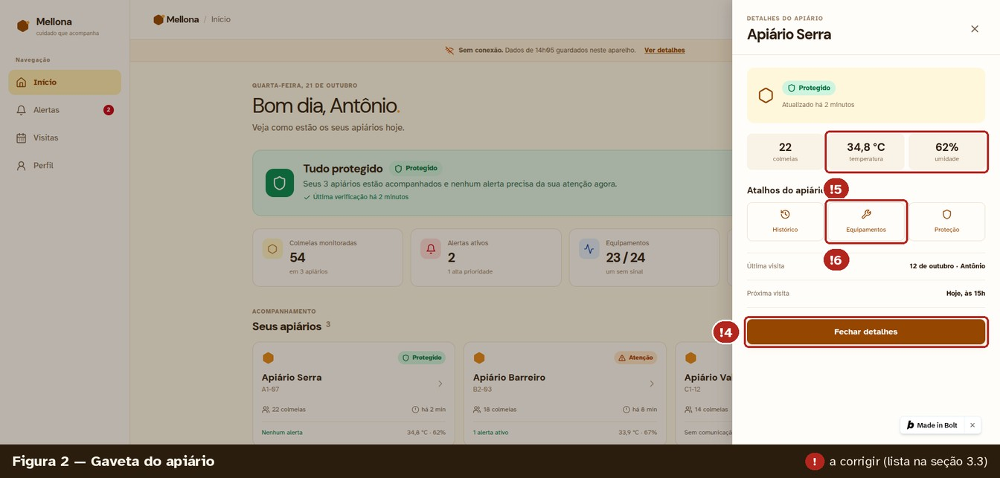
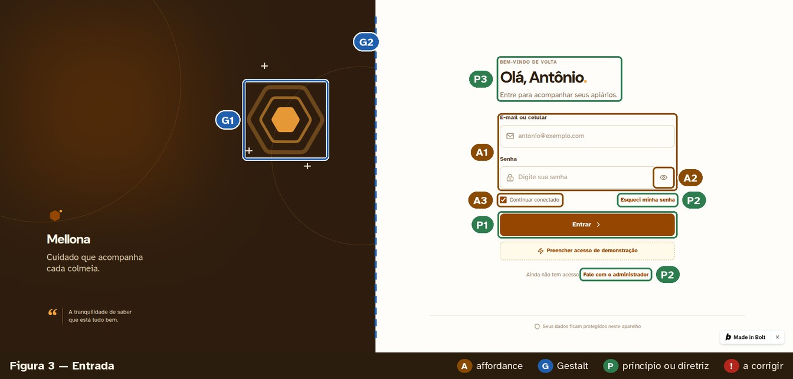
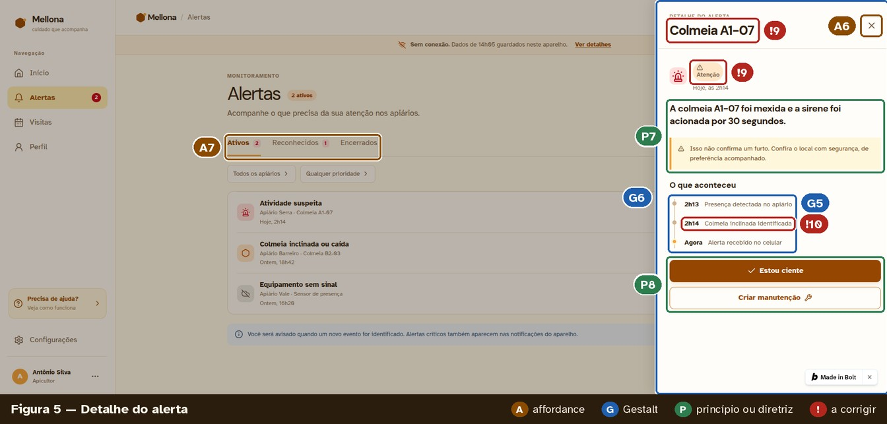
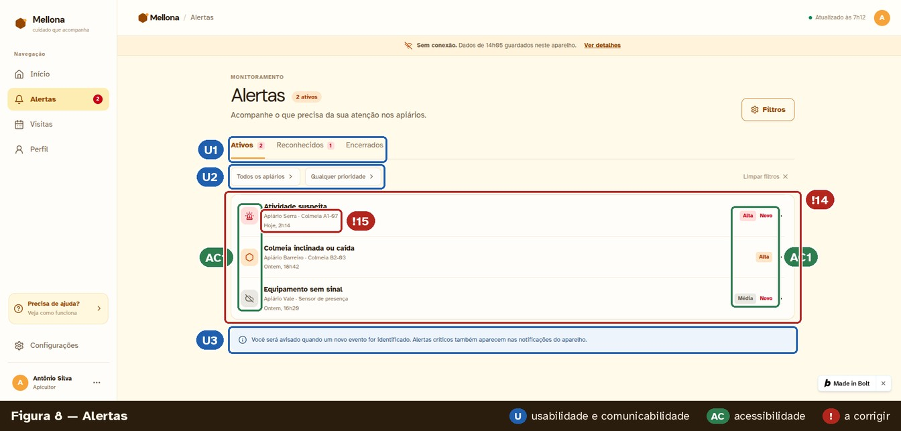
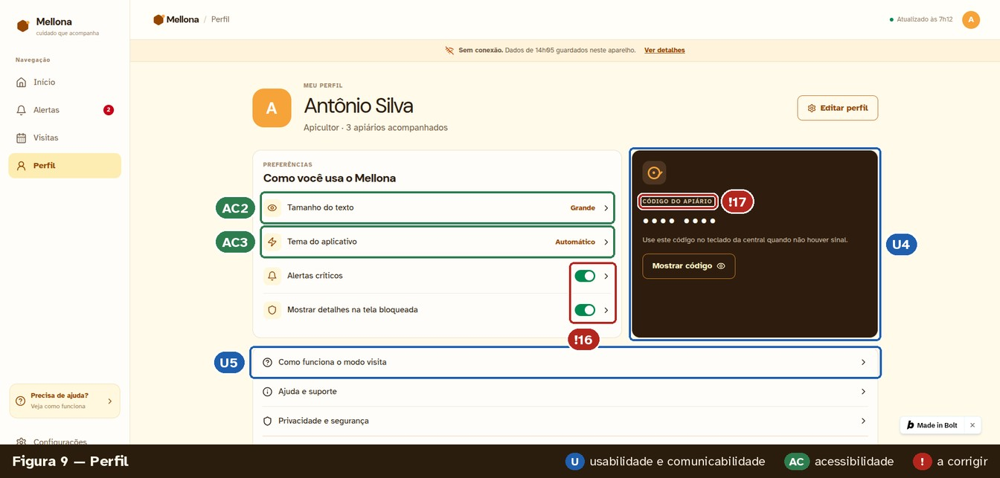
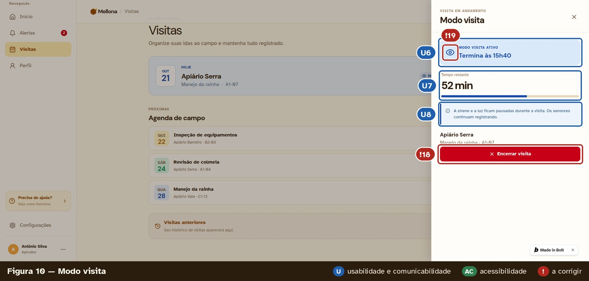
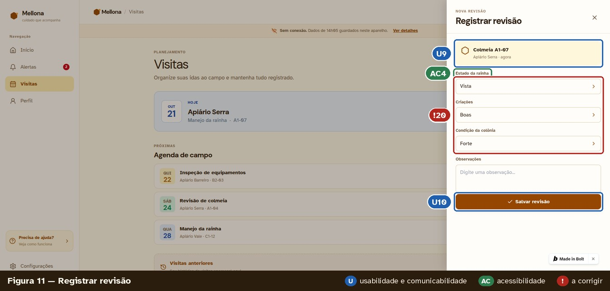
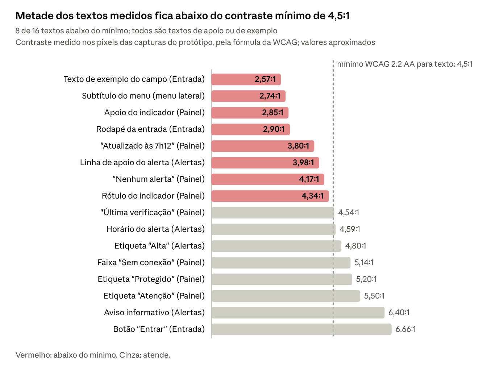

# Mellona — Protótipos e análise da PF2

| Identificação | Registro |
| --- | --- |
| Autora | Bárbara Nogueira |
| Disciplina | Interação Humano-Computador — INF/UFG |
| Etapa | PF2 — prototipação e revisão informal |
| Base da análise | Capturas da primeira versão no bolt.new; revisão registrada em outubro de 2026 |
| Revisão documental | 05/11/2026 |
| Estado | Implementação parcial, links pendentes e correções ainda não comprovadas |

## Sumário

1. [Objetivo e limites](#1-objetivo-e-limites)
2. [Ferramentas e acesso](#2-ferramentas-e-acesso)
3. [Cobertura das telas e navegação](#3-cobertura-das-telas-e-navegação)
4. [Capturas analisadas](#4-capturas-analisadas)
5. [Problemas e correções](#5-problemas-e-correções)
6. [Affordances, Gestalt e diretrizes](#6-affordances-gestalt-e-diretrizes)
7. [Usabilidade e acessibilidade](#7-usabilidade-e-acessibilidade)
8. [Anotações no protótipo](#8-anotações-no-protótipo)
9. [Preparação para a PF3](#9-preparação-para-a-pf3)
10. [Referências](#10-referências)

## 1. Objetivo e limites

Este documento apresenta o protótipo do Mellona, suas ferramentas, a cobertura das telas e a análise da primeira versão. As regras de design e o comportamento esperado de cada tela estão no [Guia de estilo e especificação das telas](guia-de-estilo-e-especificacao-das-telas.md). Aqui, essas regras são referenciadas para explicar problemas e orientar correções, sem reproduzir o guia.

No ciclo de vida em estrela adotado pelo projeto, a PF1 corresponde à análise e à especificação de requisitos; a PF2, ao design e à prototipação. A revisão apresentada a seguir foi realizada informalmente pela própria autora. **Ela não substitui a avaliação formal em sala da PF3**, que deve registrar método, execução e resultados.

O protótipo usa dados simulados e não se comunica com a central do apiário nem com a API do projeto. Sua fidelidade é alta na aparência e média no comportamento. As capturas são de computador, com 1920 px de largura; não comprovam funcionamento no celular de Antônio, de 360 px, nem acessibilidade por teclado ou leitor de tela.

As personas continuam provisórias, pois o estudo de campo com vídeos de apicultores e o brainstorming previstos na PF1 ainda precisam ser aplicados. A análise original utilizou o ERS v1.1; alterações posteriores de requisitos devem ser conferidas antes da avaliação.

| Exigência da PF2 | Onde consultar |
| --- | --- |
| Guia de estilo | Documento de guia, seções 1 a 6 |
| Ferramenta de prototipação | Seção 2 deste documento |
| Protótipo digital navegável | Seção 3 e links da seção 2 |
| Affordances, Gestalt e diretrizes | Capturas da seção 4, análise da seção 6 e anotações da seção 8 |
| Usabilidade e acessibilidade | Seção 7 |

## 2. Ferramentas e acesso

### 2.1 Papel de cada ferramenta

A primeira versão documentada foi produzida no **bolt.new**. A revisão de 28/10/2026 incluiu o **Figma** no fluxo de trabalho. Essa inclusão é uma decisão de processo; não comprova que as telas já foram redesenhadas ou que a biblioteca foi concluída.

| Critério | Figma — fluxo definido | bolt.new — primeira versão documentada |
| --- | --- | --- |
| Finalidade | Desenhar telas e manter biblioteca de estilos e componentes | Gerar e executar o protótipo web em código |
| Navegação | Conectar quadros por gatilho, ação e animação; um fluxo por cenário C1 a C4 | Exercitar menus, abas, gavetas, formulários e confirmações |
| Indicação de princípios | Anotações com os códigos A, G, P, U e AC sobre os elementos | Capturas anotadas e camada de anotações proposta na seção 8 |
| Acessibilidade | Conferir cores, tamanhos e organização do desenho | Possibilitar testes de teclado, ampliação e leitor de tela na aplicação web |
| Responsividade | Planejar variantes de layout | Testar a reorganização real do conteúdo em diferentes larguras |
| Limitações | A navegação entre desenhos não comprova acessibilidade nem comportamento responsivo real | A IA pode gerar inconsistências; há menor controle fino do layout e ausência de anotações nativas |

A escolha inicial do bolt.new foi motivada pela navegação funcional, responsividade testável, compartilhamento por endereço público e iteração por pedidos em texto. A tecnologia WebContainers permite executar o código no navegador. O fluxo posterior combina essa implementação com o planejamento visual no Figma: redesenhar as telas existentes com a biblioteca e usar os mesmos valores nas próximas telas.

Toda tela gerada deve ser revisada contra o guia. Os pedidos podem ser agrupados por tela para administrar o consumo de créditos. A aparência acabada pode inibir críticas — efeito estética-usabilidade —, por isso os participantes da PF3 devem ser informados de que apontar problemas é o objetivo da avaliação.

### 2.2 Links e execução

| Recurso | Situação |
| --- | --- |
| Protótipo Figma | Link a preencher; execução do fluxo previsto ainda sem evidência registrada |
| Protótipo bolt.new | Endereço publicado a preencher |
| Acesso de demonstração | Botão “Preencher acesso de demonstração”; usuário `antonio@mellona.app` |
| Publicação no fluxo descrito pela PF2 | Publish gera o endereço; Update publica alterações posteriores |

Os enunciados e capturas não substituem um endereço navegável. Os links devem ser preenchidos e conferidos antes da avaliação.

## 3. Cobertura das telas e navegação

### 3.1 Inventário da primeira versão

Há **7 telas feitas, 2 parciais e 9 a fazer**, das 18 especificadas. “Feita” indica presença na primeira versão; não significa aprovação na revisão.

| Tela | Situação registrada | Relação com a PF3 | Observação |
| --- | --- | --- | --- |
| T01 — Entrada | Feita | Acesso aos cenários | Vazia, senha oculta e senha visível |
| T02 — Primeiro acesso | A fazer | Não prevista nas tarefas iniciais | Fluxo introdutório |
| T03 — Painel | Feita | C4 | Precisa dos ajustes da seção 5 |
| T04 — Apiário | Parcial | C4 | Gaveta resumida; faltam lista de colmeias e aba Manutenções |
| T05 — Colmeia | A fazer | C4 | Tela detalhada pendente |
| T06 — Histórico | A fazer | Não prevista nas tarefas iniciais | Há atalho na gaveta do apiário |
| T07 — Equipamentos | A fazer | C4 | Há atalho na gaveta do apiário |
| T08 — Alertas | Feita | C1 e C3 | Contagens e legibilidade a corrigir |
| T09 — Detalhe do alerta | Feita | C1 e C3 | Termos, prioridade e explicação da decisão a corrigir |
| T10 — Notificação | A fazer | C1 | Pode ser simulada por aviso no topo durante o teste |
| T11 — Proteção | A fazer | Não prevista nas tarefas iniciais | Há atalho na gaveta do apiário |
| T12 — Visitas | Feita | C2 | Estado anterior à ativação precisa de correção |
| T13 — Registrar visita | A fazer | C2 | Há botão no Painel e em Visitas |
| T14 — Modo visita | Parcial | C2 | Só estado ativo; faltam confirmação, espera, ausência de resposta e encerramento |
| T15 — Modo visita sem conexão | A fazer | C2 | Procedimento crítico de autorização local |
| T16 — Registrar revisão | Feita | C2 | Seletores e vocabulário a corrigir |
| T17 — Nova manutenção | A fazer | C3 | Há botão no detalhe do alerta |
| T18 — Perfil | Feita | Apoio | Inclui confirmação de saída |

A especificação completa e os requisitos de cada tela estão na seção 8 do guia. No Figma, o fluxo definido mantém os mesmos identificadores T01 a T18 e os cenários C1 a C4.

A revisão dos componentes também registra folha inferior, aviso temporário e notificação do sistema como ainda não presentes na primeira versão. Essa ausência precisa ser conferida na implementação dos fluxos.

### 3.2 Caminhos disponíveis

Os caminhos descritos para a primeira versão são:

- Entrada → Painel.
- Painel → gaveta do apiário.
- Painel ou Alertas → detalhe do alerta.
- Visitas → modo visita ou registro de revisão.
- Perfil → confirmação de saída.

A sequência de construção priorizada é **T13, T15, T14 completa, T17, T05 e T07**. Essas entregas permitem percorrer os cenários C2 a C4. T10 também precisa ser implementada ou ter sua simulação explicitada para C1.

## 4. Capturas analisadas

As figuras abaixo são registros da primeira versão. Os códigos vermelhos `!1` a `!25` remetem à seção 5; A, G, P, U e AC identificam as aplicações analisadas nas seções 6 e 7. Cada captura aparece uma única vez neste documento.

### Figura 1 — Painel, parte inferior

### Figura 2 — Gaveta do apiário

### Figura 3 — Entrada

### Figura 4 — Painel

### Figura 5 — Detalhe do alerta

### Figura 6 — Visitas

### Figura 7 — Confirmação de saída

### Figura 8 — Alertas

### Figura 9 — Perfil

### Figura 10 — Modo visita

### Figura 11 — Registrar revisão

## 5. Problemas e correções

A revisão identificou **25 problemas: 6 de gravidade alta, 10 média e 9 baixa**. Todos permanecem registrados como **a corrigir**, pois os documentos não contêm evidências de execução dos ajustes. Os identificadores das imagens foram preservados.

As ocorrências de gravidade alta são **!1, !7, !8, !10, !11 e !22**. As cinco primeiras comprometem a interpretação do estado ou da resposta do sistema; !22 impede verificar a interface no contexto principal de uso.

### !1 — Painel inferior — Figura 1

**Gravidade:** Alta.

**Achado:** O Apiário Serra aparece Protegido e com Nenhum alerta, embora haja atividade suspeita ativa na colmeia A1-07.

**Correção proposta:** O cartão deve refletir a situação mais grave e a quantidade de alertas ativos.

**Referência:** [Guia — regra relacionada](guia-de-estilo-e-especificacao-das-telas.md#8-especificação-das-18-telas).

### !2 — Painel inferior — Figura 1

**Gravidade:** Baixa.

**Achado:** Um identificador de colmeia, A1-07, aparece sob o nome de cada apiário.

**Correção proposta:** Manter o nome do apiário no cartão; apresentar as colmeias em seu detalhe.

**Referência:** [Guia — regra relacionada](guia-de-estilo-e-especificacao-das-telas.md#8-especificação-das-18-telas).

### !3 — Painel inferior — Figura 1

**Gravidade:** Baixa.

**Achado:** A contagem 22 colmeias usa ícone de pessoas.

**Correção proposta:** Usar o hexágono vazado definido para colmeias.

**Referência:** [Guia — regra relacionada](guia-de-estilo-e-especificacao-das-telas.md#35-símbolos-não-tipográficos).

### !4 — Gaveta do apiário — Figura 2

**Gravidade:** Média.

**Achado:** A ação principal é Fechar detalhes.

**Correção proposta:** Usar Vou a este apiário como ação principal; fechar pelo X ou Esc.

**Referência:** [Guia — regra relacionada](guia-de-estilo-e-especificacao-das-telas.md#8-especificação-das-18-telas).

### !5 — Gaveta do apiário — Figura 2

**Gravidade:** Média.

**Achado:** 34,8 °C e 62 % parecem representar o apiário inteiro, sem identificação da origem.

**Correção proposta:** Explicitar a agregação, como média de 22 colmeias ou de 33,9 a 35,2 °C.

**Referência:** [Guia — regra relacionada](guia-de-estilo-e-especificacao-das-telas.md#38-visualização-de-informação).

### !6 — Gaveta do apiário — Figura 2

**Gravidade:** Baixa.

**Achado:** Equipamentos e manutenção usam a mesma chave inglesa.

**Correção proposta:** Usar activity para equipamentos e reservar wrench a manutenção.

**Referência:** [Guia — regra relacionada](guia-de-estilo-e-especificacao-das-telas.md#35-símbolos-não-tipográficos).

### !7 — Painel — Figura 4

**Gravidade:** Alta.

**Achado:** Tudo protegido e nenhum alerta precisa da sua atenção aparecem com dois alertas de prioridade alta, um apiário em atenção e outro sem comunicação.

**Correção proposta:** O estado geral deve seguir a ordem de gravidade especificada em T03.

**Referência:** [Guia — regra relacionada](guia-de-estilo-e-especificacao-das-telas.md#8-especificação-das-18-telas).

### !8 — Painel — Figura 4

**Gravidade:** Alta.

**Achado:** Atualizado às 7h12, com ponto verde, aparece ao lado de Sem conexão. Dados de 14h05.

**Correção proposta:** Mostrar uma única referência temporal coerente; remover a indicação de atualização atual quando não houver conexão.

**Referência:** [Guia — regra relacionada](guia-de-estilo-e-especificacao-das-telas.md#94-conexão).

### !9 — Detalhe do alerta — Figura 5

**Gravidade:** Média.

**Achado:** O título é a colmeia; a etiqueta Atenção representa um alerta de prioridade alta.

**Correção proposta:** Usar Atividade suspeita como título, Apiário Serra · Colmeia A1-07 como subtítulo e a prioridade Alta por extenso.

**Referência:** [Guia — regra relacionada](guia-de-estilo-e-especificacao-das-telas.md#8-especificação-das-18-telas).

### !10 — Detalhe do alerta — Figura 5

**Gravidade:** Alta.

**Achado:** A linha do tempo diz Colmeia inclinada para uma colmeia mexida. Às 2h14, período noturno, a luz também deveria ser acionada (RN-59). Falta Por que a sirene tocou (RF-07).

**Correção proposta:** Corrigir o vocabulário, informar sirene e luz conforme o período e apresentar as condições que justificaram a decisão.

**Referência:** [Guia — regra relacionada](guia-de-estilo-e-especificacao-das-telas.md#8-especificação-das-18-telas).

### !11 — Visitas — Figura 6

**Gravidade:** Alta.

**Achado:** A etiqueta azul Modo visita aparece na visita de hoje antes da ativação.

**Correção proposta:** Exibir Modo visita não ativado até a confirmação da central; só depois aplicar a etiqueta de estado ativo.

**Referência:** [Guia — regra relacionada](guia-de-estilo-e-especificacao-das-telas.md#92-estado-de-um-comando-enviado-à-central).

### !12 — Visitas — Figura 6

**Gravidade:** Baixa.

**Achado:** Dias da agenda têm cores amarelo, verde e azul sem significado definido.

**Correção proposta:** Usar apresentação consistente dos dias; reservar cores de estado a situações com significado.

**Referência:** [Guia — regra relacionada](guia-de-estilo-e-especificacao-das-telas.md#34-cores).

### !13 — Confirmação de saída — Figura 7

**Gravidade:** Média.

**Achado:** O diálogo não avisa sobre registros ainda não enviados.

**Correção proposta:** Quando houver pendências, informar quantas são e oferecer Enviar primeiro.

**Referência:** [Guia — regra relacionada](guia-de-estilo-e-especificacao-das-telas.md#63-sequências-de-diálogo).

### !14 — Alertas — Figura 8

**Gravidade:** Média.

**Achado:** A aba indica Ativos 2, mas a lista contém três alertas.

**Correção proposta:** Sincronizar contagens da aba, título, menu e Painel.

**Referência:** [Guia — regra relacionada](guia-de-estilo-e-especificacao-das-telas.md#8-especificação-das-18-telas).

### !15 — Alertas — Figura 8

**Gravidade:** Média.

**Achado:** Linhas de apoio têm cerca de 12 px e contraste de 3,98:1.

**Correção proposta:** Aplicar texto de pelo menos 16 px em Casca, cujo contraste registrado sobre Cera é 7,99:1.

**Referência:** [Guia — regra relacionada](guia-de-estilo-e-especificacao-das-telas.md#33-tipografia).

### !16 — Perfil — Figura 9

**Gravidade:** Baixa.

**Achado:** Interruptor e seta aparecem na mesma linha, sugerindo dois comportamentos.

**Correção proposta:** Manter apenas o interruptor; usar seta em linhas que abrem outra tela.

**Referência:** [Guia — regra relacionada](guia-de-estilo-e-especificacao-das-telas.md#52-seleção).

### !17 — Perfil — Figura 9

**Gravidade:** Média.

**Achado:** Código do apiário sugere um código compartilhado por todas as pessoas.

**Correção proposta:** Usar Meu código da central e explicitar que o código é pessoal.

**Referência:** [Guia — regra relacionada](guia-de-estilo-e-especificacao-das-telas.md#61-terminologia-e-tom).

### !18 — Modo visita — Figura 10

**Gravidade:** Média.

**Achado:** Encerrar visita aparece em vermelho. Faltam Confirmado pela central às 14h40 e o atalho para registrar revisão.

**Correção proposta:** Usar ação principal, linha de confirmação e ação secundária Registrar revisão.

**Referência:** [Guia — regra relacionada](guia-de-estilo-e-especificacao-das-telas.md#53-ativação).

### !19 — Modo visita — Figura 10

**Gravidade:** Baixa.

**Achado:** O ícone é um olho, já usado para mostrar senha e código.

**Correção proposta:** Usar user-check para modo visita.

**Referência:** [Guia — regra relacionada](guia-de-estilo-e-especificacao-das-telas.md#35-símbolos-não-tipográficos).

### !20 — Registrar revisão — Figura 11

**Gravidade:** Média.

**Achado:** Cada escolha abre uma lista, acrescentando um toque e dificultando o uso de luvas. O campo se chama Criações.

**Correção proposta:** Usar seletores com as três opções visíveis e substituir o rótulo por Crias.

**Referência:** [Guia — regra relacionada](guia-de-estilo-e-especificacao-das-telas.md#52-seleção).

### !21 — Todas as telas

**Gravidade:** Média.

**Achado:** A família não é Atkinson Hyperlegible e vários textos secundários têm menos de 16 px.

**Correção proposta:** Aplicar a escala e a família tipográfica definidas no guia.

**Referência:** [Guia — regra relacionada](guia-de-estilo-e-especificacao-das-telas.md#33-tipografia).

### !22 — Todas as telas

**Gravidade:** Alta.

**Achado:** A inspeção usou somente 1920 px; navegação inferior e largura de 360 px não foram conferidas.

**Correção proposta:** Conferir e ajustar o celular antes da PF3, incluindo os estados e caminhos previstos para a avaliação.

**Referência:** [Guia — regra relacionada](guia-de-estilo-e-especificacao-das-telas.md#10-responsividade).

### !23 — Menu lateral

**Gravidade:** Baixa.

**Achado:** Configurações e Precisa de ajuda? aparecem como destinos extras, além de Perfil.

**Correção proposta:** Manter os quatro destinos principais; colocar configurações e ajuda dentro de Perfil.

**Referência:** [Guia — regra relacionada](guia-de-estilo-e-especificacao-das-telas.md#7-navegação-e-tarefas-críticas).

### !24 — Todas as telas

**Gravidade:** Baixa.

**Achado:** O selo Made in Bolt cobre parte do conteúdo.

**Correção proposta:** Resolver a sobreposição antes da avaliação; a revisão original propõe esconder o selo, se a ferramenta permitir.

**Referência:** [Guia — regra relacionada](guia-de-estilo-e-especificacao-das-telas.md#11-acessibilidade).

### !25 — Dados simulados

**Gravidade:** Baixa.

**Achado:** Há três apiários e 54 colmeias, enquanto Antônio foi descrito com cerca de 40 colmeias em dois apiários.

**Correção proposta:** Alinhar os dados de demonstração à persona ou revisar a persona, deixando a decisão registrada.

**Referência:** [Guia — regra relacionada](guia-de-estilo-e-especificacao-das-telas.md#2-resultados-de-análise).

## 6. Affordances, Gestalt e diretrizes

A análise usa as figuras da seção 4 para relacionar elementos visuais e conceitos de IHC. As marcações mostram a intenção e o comportamento aparente das capturas; as falhas da seção 5 continuam válidas.

### 6.1 Affordances

Affordance é o conjunto de características de um objeto que sugere a ação possível com ele, conforme Gibson, citado na Aula 1.

| Código | Elemento observado | Ação sugerida pela aparência |
| --- | --- | --- |
| A1 | Campos de entrada (Figura 3) | Borda, fundo branco e ícones de envelope e cadeado dizem "digite aqui"; o rótulo acima diz o quê |
| A2 | Olho dentro do campo de senha (Figura 3) | Tocar mostra a senha digitada |
| A3 | Caixa "Continuar conectado" (Figura 3) | Quadrado com marca de verificação: liga e desliga |
| A4 | Botão "+ Registrar visita" (Figura 4) | Preenchido e com sombra, parece pressionável; o sinal de mais diz que cria algo |
| A5 | Seta nos cartões de apiário (Figura 4) | O cartão abre um detalhe |
| A6 | X no canto da gaveta (Figura 5) | Fecha a gaveta |
| A7 | Abas com sublinhado (Figura 5) | Alternam entre listas; o sublinhado marca a atual |
| A8 | "Ativar modo visita" com contorno (Figura 6) | É clicável, mas secundário |
| A9 | Botão "Sair" vermelho com ícone de saída (Figura 7) | A ação tem consequência |

A seta ao lado de interruptores sugere abertura de outra tela (!16). A etiqueta azul de modo visita antes da ativação sugere um estado ainda não confirmado (!11). São exemplos em que a aparência pode induzir uma interpretação incorreta.

### 6.2 Gestalt

Há sete aplicações identificadas, G1 a G7, envolvendo seis princípios; similaridade e proximidade reaparecem na agenda.

| Código | Princípio | Onde | Aplicação observada |
| --- | --- | --- | --- |
| G1 | Fecho | Logotipo (Figura 3) | Contornos de hexágonos que o olho completa como um favo |
| G2 | Simetria | Entrada (Figura 3) | A tela se divide em duas metades de mesmo peso: identidade à esquerda, formulário à direita |
| G3 | Proximidade | Indicadores do Painel (Figura 4) | Os quatro indicadores ficam juntos e afastados do resto, lidos como um resumo |
| G4 | Similaridade | Etiquetas de estado (Figura 4) | Todas têm a mesma forma de cápsula, então o olho as compara e lê a cor, o ícone e o texto como a diferença |
| G5 | Continuidade | Linha do tempo do alerta (Figura 5) | A linha vertical leva o olho de um evento ao seguinte, na ordem dos horários |
| G6 | Destino comum | Gaveta do alerta (Figura 5) | Todo o conteúdo da gaveta desliza junto, da direita, e é lido como uma unidade separada da lista ao fundo |
| G7 | Similaridade e proximidade | Agenda de campo (Figura 6) | Itens com a mesma estrutura e o mesmo espaçamento são lidos como uma lista de iguais |

As cores sem significado nos dias da agenda prejudicam a similaridade pretendida (!12).

### 6.3 Princípios e diretrizes de Silva e Barbosa

| Princípio ou diretriz | Códigos | Evidência nas capturas | Falha relacionada |
| --- | --- | --- | --- |
| Correspondência com as expectativas dos usuários | P3, P6 | Saudação pelo nome, data por extenso e "E-mail ou celular", que aceita o que o apicultor tem; vocabulário do apiário (Figuras 3 e 4) | "Código do apiário" (!17) e "Criações" (!20) |
| Simplicidade nas estruturas das tarefas | P1 | Entrar exige dois campos e um botão (Figura 3) | Na revisão, cada escolha abre uma lista (!20) |
| Equilíbrio entre controle e liberdade do usuário | P12 | "Cancelar" vem primeiro na confirmação de saída; toda gaveta fecha pelo X (Figura 7) |  |
| Consistência e padronização | P9 | "+ Registrar visita" fica no mesmo lugar e com a mesma aparência no Painel e em Visitas (Figura 6) | A chave inglesa e o olho têm dois significados cada (!6, !19) |
| Promoção da eficiência do usuário | P8 | "Estou ciente" e "Criar manutenção" ficam no próprio alerta (Figura 5) |  |
| Antecipação das necessidades do usuário | P2, P5 | "Esqueci minha senha" e "Fale com o administrador" para quem não consegue entrar; faixa "Sem conexão" com a hora dos dados guardados (Figuras 3 e 4) |  |
| Visibilidade e reconhecimento | P4, P10 | Menu sempre visível, com o número de alertas; a visita de hoje destacada em azul no topo de Visitas (Figuras 4 e 6) |  |
| Conteúdo relevante e expressão adequada | P7 | O alerta começa por uma frase com o que aconteceu e traz a ressalva "Isso não confirma um furto" (Figura 5) | Título e termos do alerta (!9, !10) |
| Projeto para erros | P11 | Confirmação antes de sair, com a consequência (Figura 7) | O Painel afirma "Tudo protegido" com alertas ativos (!7, !8); a saída não avisa sobre registros não enviados (!13) |

### 6.4 Outras relações com as aulas

| Conceito | Aplicação descrita |
| --- | --- |
| Lei de Fitts | Botões principais largos e próximos da base das gavetas |
| Lei de Hick-Hyman | Quatro destinos fixos de navegação |
| Lei de Jakob | Padrão conhecido de entrada em conta |
| Lei de Miller | Código da central em dois grupos de quatro dígitos, na Figura 9 |
| Efeito von Restorff | Destaque de fundo concentrado no cartão de estado do Painel |
| Efeito estética-usabilidade | Aparência acabada pode esconder problemas e inibir críticas na avaliação |

## 7. Usabilidade e acessibilidade

### 7.1 Metas de usabilidade, experiência e comunicabilidade

Os identificadores RNF abaixo são os da PF1 de IHC. A tabela registra evidências nas capturas e os limites encontrados, sem repetir as regras normativas do guia.

| Meta | Códigos | Evidência nas capturas | Limitação registrada |
| --- | --- | --- | --- |
| Eficácia — RNF-01 | U1, U10 | Abas de estado com contagem; Salvar revisão na base, Figuras 8 e 11 | Contagem inconsistente, !14 |
| Eficiência — RNF-02 | U2, U7, U9 | Filtros por apiário e prioridade, colmeia e hora preenchidas, tempo restante visível; Figuras 8, 10 e 11 | Escolhas em listas exigem toque adicional, !20 |
| Segurança de uso — RNF-03 | U4, U8 | Código mascarado e explicação da pausa de sirene e luz, Figuras 9 e 10 | Falta confirmação da central, !18; estado geral incorreto, !7 |
| Utilidade — RNF-04 | U3 | Aviso de que alertas críticos chegam como notificação, Figura 8 | A notificação T10 ainda precisa ser implementada ou simulada explicitamente |
| Aprendizado — RNF-05 | U5 | Ajuda Como funciona o modo visita e vocabulário do apicultor, Figura 9 | “Criações” diverge do vocabulário, !20 |
| Memorização — RNF-06 | U6, U7 | Etiquetas consistentes e horário de término, Figura 10 | Destinos extras no menu, !23 |
| Comunicabilidade — RNF-07 | U6, U8 | Estado, horário e consequências do modo visita, Figura 10 | Etiqueta antes da ativação, !11 |
| Experiência do usuário | — | Saudação, tom “Cuidado que acompanha cada colmeia” e paleta do apiário, Figuras 3 e 4 | A aparência acabada pode ocultar defeitos; ainda não há resultado de avaliação com usuários |

### 7.2 Contraste

A revisão original também observou diferenças entre as cores do código e as do guia: botão principal em `#954600` e vermelho em `#C80017`. Esses valores observados precisam ser alinhados aos tokens definidos no guia, sem presumir que a correção já ocorreu.

A análise das capturas de 21/10/2026 mediu 16 textos. **Oito ficaram abaixo do contraste mínimo**: sete textos em marrom-claro, entre `#88746C` e `#B49C87`, e o verde de “Nenhum alerta”.

A correção proposta é aplicar os tokens do guia — Casca `#5C4A36` no apoio textual e verde de etiqueta `#1E5C38` — tanto nos estilos do Figma quanto no código do bolt.new. A medição em captura é aproximada, porque a suavização das letras altera os pixels; a conferência final precisa usar as cores reais do código. Nenhum resultado de remedição foi registrado.

### 7.3 Critérios de acessibilidade

A referência adotada na PF2 é WCAG 2.2 AA. “Atende nas capturas” reproduz a observação limitada da revisão visual, não uma declaração de conformidade integral.

| Critério | Nível | Evidência ou pendência | Situação na revisão |
| --- | --- | --- | --- |
| 1.4.1 Uso de cores | A | Prioridade por extenso e ícone por tipo de alerta; AC1, Figura 8 | Atende nas capturas |
| 1.4.3 Contraste mínimo | AA | Oito dos 16 textos medidos falham; !15 e !21 | Não atende |
| 1.4.4 Redimensionar texto | AA | Ajuste no Perfil; AC2, Figura 9. Ampliação real ainda sem teste registrado | A conferir |
| 3.3.2 Rótulos ou instruções | A | Rótulos acima dos campos; AC4, Figuras 3 e 11 | Atende nas capturas |
| 3.3.8 Autenticação acessível | AA | Mostrar senha, suporte previsto a gerenciador e ausência de CAPTCHA; A2, Figura 3 | Atende à inspeção descrita; preenchimento automático exige teste funcional |
| 2.5.8 Tamanho do alvo | AA | Botões principais próximos de 48 px; conferir também setas e Limpar filtros. O guia estabelece meta própria de 48 × 48 | A conferir |
| 2.4.7 Foco visível e 2.4.11 foco não obscurecido | AA | Foco deve seguir o guia; selo Made in Bolt pode cobrir elementos, !24 | A conferir |
| 1.4.10 Refluxo e 1.3.4 orientação | AA | Capturas apenas a 1920 px; falta verificar 320–360 px e mudança de orientação, !22 | A conferir |
| 2.3.1 Três flashes ou abaixo do limite | A | Capturas não mostram movimento; verificar os anéis do Painel em execução | A conferir |

O tema automático claro/escuro é indicado por AC3 na Figura 9 e foi relacionado ao princípio Adaptável do Design Universal. Seu funcionamento ainda precisa ser conferido. A Lei Brasileira de Inclusão é citada nas aulas e no projeto como fundamento da meta de acessibilidade.

## 8. Anotações no protótipo

As capturas já contêm marcações. A camada navegável abaixo é uma **proposta de implementação**, não uma funcionalidade comprovada:

1. Criar em Perfil ou no menu de apoio o interruptor Mostrar anotações de IHC, desligado por padrão; Alt + A alterna a camada.
2. Exibir uma etiqueta redonda com o código no canto do elemento, sem alterar o layout. Texto branco em negrito de 14 px; A em `#8A4B00`, G e U em `#1F5FAD`, P e AC em `#2E7D4F`.
3. Ao tocar ou passar o mouse, mostrar o nome do princípio e uma frase de explicação.
4. Oferecer Legenda com todos os códigos em uma gaveta.
5. Não bloquear a interação original; fornecer nome acessível, como “Anotação A4: botão Registrar visita, affordance”.

No fluxo do Figma, os mesmos códigos devem aparecer como anotações nos elementos correspondentes.

| Tela ou elemento | Códigos a indicar |
| --- | --- |
| Entrada | A1 campos; A2 mostrar senha; A3 continuar conectado; G1 fecho do logotipo; G2 simetria; P1 simplicidade; P2 ajuda para acesso; P3 correspondência com expectativas |
| Painel | A4 Registrar visita; A5 cartões; G3 proximidade; G4 similaridade; P4 contagem de alertas; P5 aviso de conexão; P6 saudação e data |
| Detalhe do alerta | A6 fechar; A7 abas; G5 continuidade; G6 destino comum; P7 resumo e ressalva; P8 ações no alerta |
| Visitas | A8 Ativar modo visita; G7 agenda; P9 consistência; P10 visibilidade da visita de hoje |
| Confirmação de saída | A9 Sair; P11 prevenção de erros; P12 Cancelar e liberdade de controle |
| Alertas | U1 eficácia das abas; U2 filtros; U3 notificação; AC1 prioridade por texto e ícone |
| Perfil | U4 código mascarado; U5 ajuda; AC2 tamanho do texto; AC3 tema automático |
| Modo visita | U6 estado e término; U7 tempo restante; U8 consequências da pausa |
| Registrar revisão | U9 preenchimento antecipado; U10 Salvar revisão; AC4 rótulos |

## 9. Preparação para a PF3

A próxima revisão deve primeiro corrigir os seis problemas de gravidade alta da seção 5, concluir os caminhos faltantes da seção 3 e validar o celular de 360 px. Depois, conferir os demais ajustes, preencher os links e executar as verificações de acessibilidade especificadas na seção 11 do guia.

Para cada correção, registrar tela, alteração, data e evidência. Só então mudar sua situação de a corrigir para corrigido. Na PF3, documentar o método escolhido, a aplicação em sala, as tarefas executadas e os resultados observados. Não reutilizar a revisão informal como se fosse resultado de teste com participantes.

## 10. Referências

- **Artefatos do projeto:** [Guia de estilo e especificação das telas](guia-de-estilo-e-especificacao-das-telas.md), [PF1](../pf1-planejamento/PF1.md), [ERS](../../docs/ERS.md) e [PF3](../pf3-avaliacao/README.md).
- **Enunciado:** Projeto Final de IHC — PF2: guia de estilo, ferramenta, protótipo navegável e indicação de princípios, usabilidade e acessibilidade.
- GIBSON, J. J. *The theory of affordances*. In: SHAW, R.; BRANSFORD, J. *Perceiving, Acting and Knowing*. Erlbaum, 1977.
- NASCIMENTO, H. A. D.; BERRETTA, L. IHC — Aulas 01 a 03, Projeto Final e Atividade Guia de Estilo. INF/UFG, 2026.
- SILVA, B. S.; BARBOSA, S. D. J. *Interação Humano-Computador: Projetando a Experiência Perfeita*. Campus, 2010.
- FIGMA. [Guide to prototyping](https://help.figma.com/hc/en-us/articles/360040314193), [Add annotations](https://help.figma.com/hc/en-us/articles/20774752502935), [Figma for Education](https://www.figma.com/education/higher-education/). Acesso registrado na revisão de origem: 28/10/2026.
- STACKBLITZ. [Bolt.new e WebContainers](https://stackblitz.com/); [Publish your project](https://support.bolt.new/cloud/hosting/publish). Acesso registrado no material de origem: 21/10/2026.
- W3C. [WCAG 2.2 — tradução autorizada para português](https://www.w3.org/Translations/WCAG22-pt-BR/). Acesso registrado no material de origem: 21/10/2026.
- BRASIL. Lei nº 13.146, de 6 de julho de 2015. Lei Brasileira de Inclusão.
