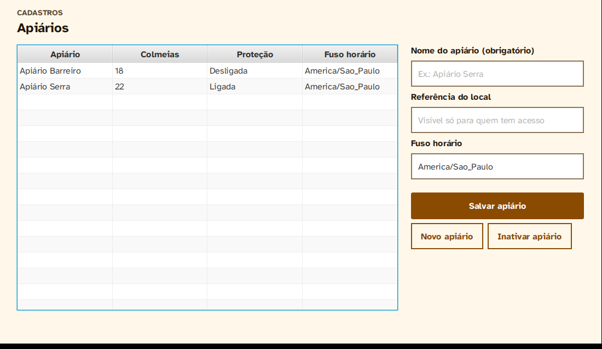

# Mellona — Software para Persistência de Dados

O Mellona monitora e protege apiários e colmeias em áreas rurais. Esta pasta tem a camada de dados do sistema, desenvolvida na disciplina Software para Persistência de Dados (INF/UFG). Os cadastros da gestão ficam numa base relacional (SQLite, via ORMLite). Os eventos do monitoramento ficam numa base de documentos (MongoDB, via Spring Data). Um integrador por eventos (Redis Pub/Sub) mantém iguais nas duas bases as entidades que elas compartilham.

| Item | Registro |
| --- | --- |
| Equipe | Bárbara Nogueira (projeto individual) · GitHub: [BarbaraNogueiraCS](https://github.com/BarbaraNogueiraCS) |
| Tema | Mellona — monitoramento e proteção de apiários e colmeias |
| Etapa | 1 — planejamento e iniciação |
| Repositório | [BarbaraNogueiraCS/mellona](https://github.com/BarbaraNogueiraCS/mellona.git) |
| Requisitos | ERS do Mellona v1.1 (seções 7, 8, 11.1, 11.10 e 13); versão atual em [`docs/ERS.md`](../docs/ERS.md) |

O documento da Etapa 1 (introdução, plano, tarefas, modelagem, documentação e testes) está em [`docs/etapa-1.md`](docs/etapa-1.md).

## Estrutura

```
spd/
├── pom.xml                      projeto Maven agregador (Java 17)
├── docker-compose.yml           MongoDB e Redis para desenvolvimento
├── docs/
│   ├── etapa-1.md               documento da Etapa 1 (seções 1 a 6)
│   ├── diagramas/               PlantUML (.puml) e imagens (.png)
│   └── img/                     capturas de tela
├── mellona-gestao/              I1 — desktop JavaFX (MVC) + ORMLite + SQLite
│   └── src/main/java/br/ufg/inf/mellona/gestao/
│       ├── App.java             ponto de entrada
│       ├── controller/          controladores das telas
│       └── model/               entidades, repositórios e casos de uso (Cadastro*)
├── mellona-monitoramento/       I3 — API REST JSON (Spring Boot) + Spring Data MongoDB
│   └── src/main/java/br/ufg/inf/mellona/monitoramento/
│       ├── model/               documentos Ocorrencia e Medicao
│       ├── repository/          repositórios Spring Data
│       └── controller/          recursos REST e tratamento de erros
└── mellona-integrador/          contrato e regras da sincronização (Redis na Etapa 2)
```

## Pré-requisitos

- JDK 17 ou mais recente (testado também com o JDK 21).
- Maven 3.9 ou mais recente.
- Docker, para o MongoDB e o Redis. Só é necessário para executar a API e os testes de integração; os testes unitários não precisam dele.

## Instalar

```bash
git clone https://github.com/BarbaraNogueiraCS/mellona.git
cd mellona/spd
mvn clean install        # baixa as dependências, compila e roda os testes unitários dos três módulos
```

## Executar

**Aplicação de gestão (JavaFX).** A base `mellona-gestao.sqlite` é criada na pasta do módulo. Duas variáveis de ambiente ajustam a execução: `MELLONA_DB` escolhe outro arquivo, e `MELLONA_EXEMPLO=1` grava dados de demonstração (Apiário Serra com 22 colmeias, Apiário Barreiro com 18, e os usuários Antônio e Carla) quando a base está vazia.

```bash
mvn -pl mellona-gestao javafx:run
MELLONA_EXEMPLO=1 mvn -pl mellona-gestao javafx:run        # com dados de demonstração (Linux e macOS)
set MELLONA_EXEMPLO=1 && mvn -pl mellona-gestao javafx:run  # o mesmo no Prompt do Windows
```



**API de monitoramento (Spring Boot).** Suba o MongoDB e rode a aplicação; ela responde em `http://localhost:8080`.

```bash
docker compose up -d mongodb
mvn -pl mellona-monitoramento spring-boot:run
```

Exemplos de uso:

```bash
# registrar uma leitura (o mesmo eventId enviado de novo devolve 200, sem duplicar)
curl -X POST http://localhost:8080/api/v1/medicoes -H "Content-Type: application/json" -d '{
  "eventId": "9d47e2c1-6a3b-4f58-b0e7-3c1d8a5f2e64", "eventType": "leitura.temperatura",
  "deviceId": "no-colmeia-A1-07", "entityId": "colmeia:A1-07",
  "eventTime": "2026-10-21T05:14:00Z", "timeSource": "RTC", "sequence": 1841, "value": 34.8 }'

# histórico de uma colmeia
curl "http://localhost:8080/api/v1/medicoes?entidade=colmeia:A1-07&de=2026-10-21T00:00:00Z&ate=2026-10-22T00:00:00Z"

# criar um alerta e marcá-lo como visto ("Estou ciente")
curl -X POST http://localhost:8080/api/v1/ocorrencias -H "Content-Type: application/json" -d '{
  "apiarioUuid": "<uuid do apiário>", "tipo": "OCORRENCIA_SUSPEITA", "prioridade": "ALTA",
  "instante": "2026-10-21T05:14:32Z", "periodoDia": "NOTURNO",
  "motivoDecisao": "Presença e colmeia A1-07 mexida em 18 s" }'
curl -X POST http://localhost:8080/api/v1/ocorrencias/<uuid>/reconhecimento -H "Content-Type: application/json" -d '{"usuario": "<uuid do usuário>"}'
```

| Método e caminho | O que faz |
| --- | --- |
| `POST /api/v1/medicoes` | Recebe uma leitura; 201 se nova, 200 se o `eventId` já existe (RN-67) |
| `GET /api/v1/medicoes?entidade=&de=&ate=` | Histórico de uma colmeia no período |
| `GET /api/v1/ocorrencias?apiario=[&estado=]` | Alertas de um apiário, mais recentes primeiro |
| `GET /api/v1/ocorrencias/{uuid}` | Detalhe de um alerta |
| `POST /api/v1/ocorrencias` | Cria um alerta ativo |
| `POST /api/v1/ocorrencias/{uuid}/reconhecimento` | "Estou ciente": ativo → reconhecido |
| `POST /api/v1/ocorrencias/{uuid}/resolucao` | "Encerrar alerta": → resolvido |

Erros voltam em JSON, como `{"erro": "..."}`: 400 para dados inválidos, 404 para recurso inexistente e 409 para mudança de estado não permitida.

## Testar

```bash
mvn test                                    # testes unitários dos três módulos (69 casos)
mvn -pl mellona-gestao test                 # só a gestão (SQLite em pasta temporária)
mvn -pl mellona-monitoramento test -Dgroups=integracao -Dtestes.excluidos=   # repositórios contra o MongoDB do docker compose
```

Os testes da gestão usam um arquivo SQLite novo em cada caso (`@TempDir`) e não dependem de base existente. Os testes de integração com o MongoDB ficam fora do `mvn test` padrão porque exigem o container no ar.

## Documentação do código

O código é comentado em JavaDoc. Para gerar as páginas HTML de cada módulo em `target/site/apidocs`:

```bash
mvn javadoc:javadoc
```

Os diagramas estão em `docs/diagramas`, como texto PlantUML (versionável) e imagem PNG. Para regerar as imagens, use a extensão PlantUML do VS Code ou `java -jar plantuml.jar docs/diagramas/*.puml`.

| Diagrama | Arquivo |
| --- | --- |
| Classes da gestão (1:1, 1:N, N:N) | `docs/diagramas/classes-gestao.puml` |
| Documentos do monitoramento | `docs/diagramas/documentos-monitoramento.puml` |
| Componentes | `docs/diagramas/componentes.puml` |
| Sequência ORM → ODM (colmeia) | `docs/diagramas/sequencia-colmeia-orm-odm.puml` |
| Sequência ODM → ORM (alerta) | `docs/diagramas/sequencia-alerta-odm-orm.puml` |

## Rastreabilidade com o ERS

| Regra | Onde é garantida | Teste |
| --- | --- | --- |
| RN-01 código de colmeia único | `CadastroColmeias.cadastrar` e UNIQUE na tabela | `ColmeiaTest` |
| RN-02 colmeia em um só apiário ativo | chave estrangeira obrigatória; `CadastroColmeias`, `CadastroApiarios.inativar` | `ColmeiaTest` |
| RN-03 associações de dispositivo sem conflito | `CadastroDispositivos.associar` | `AssociacaoDispositivoTest` |
| RN-04 histórico preservado | inativação em vez de exclusão; associações com `fim` | `ColmeiaTest`, `AssociacaoDispositivoTest`, `AcessoApiarioTest` |
| RN-24, RN-51, RN-52 inspeções e visitas | `RegistroDeCampo` | `RegistroDeCampoTest` |
| RN-73 identificador universal | `EntidadeBase.uuid` (UNIQUE, sem setter) | `RepositorioTest` |
| RN-74 operação aplicada uma vez, sem voltar à origem | `OperacaoSincronizacao`, `ControleDeAplicacao` | `OperacaoSincronizacaoTest`, `ControleDeAplicacaoTest` |
| RN-75 conflito: vence a alteração mais recente | `ControleDeAplicacao` | `ControleDeAplicacaoTest` |
| RN-07, PAR-04 a PAR-06 qualidade das leituras | `Medicao.avaliar`, `Medicao.qualidadeEm` | `MedicaoTest` |
| RN-21 estados do alerta | `Ocorrencia.reconhecer`, `Ocorrencia.resolver` | `OcorrenciaTest`, `ControllersTest` |
| RN-67 leitura reenviada não duplica | índice único em `eventId`; `MedicaoController` | `ControllersTest`, `RepositoriosMongoTest` |
| PAR-10 a PAR-14 parâmetros de segurança | `ConfiguracaoSeguranca` | `ApiarioConfiguracaoTest` |

## Termos da interface

As telas usam o vocabulário do guia de estilo de IHC, e o código usa os nomes do ERS:

| Na tela | No código |
| --- | --- |
| Alerta | `Ocorrencia` |
| Estou ciente / Encerrar alerta | `reconhecer` / `resolver` (RN-21) |
| Proteção ligada / desligada | `ConfiguracaoSeguranca.armada` |
| Revisão | `Inspecao` |
| Central do apiário / Sensor da colmeia | `TipoDispositivo.SEGURANCA_LOCAL` / `NO_COLMEIA` |
| Modo visita | `AutorizacaoManutencao` (Etapa 2) |
