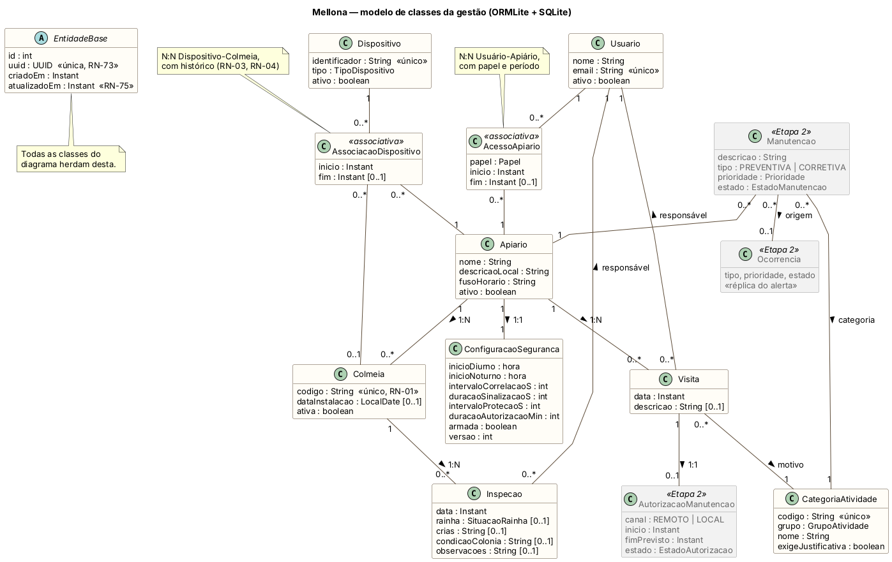
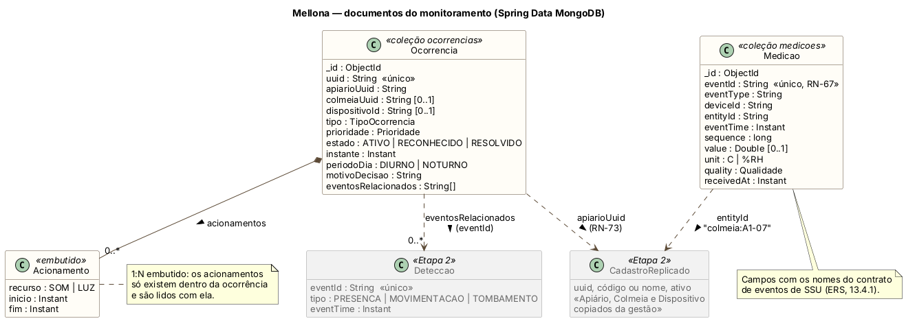
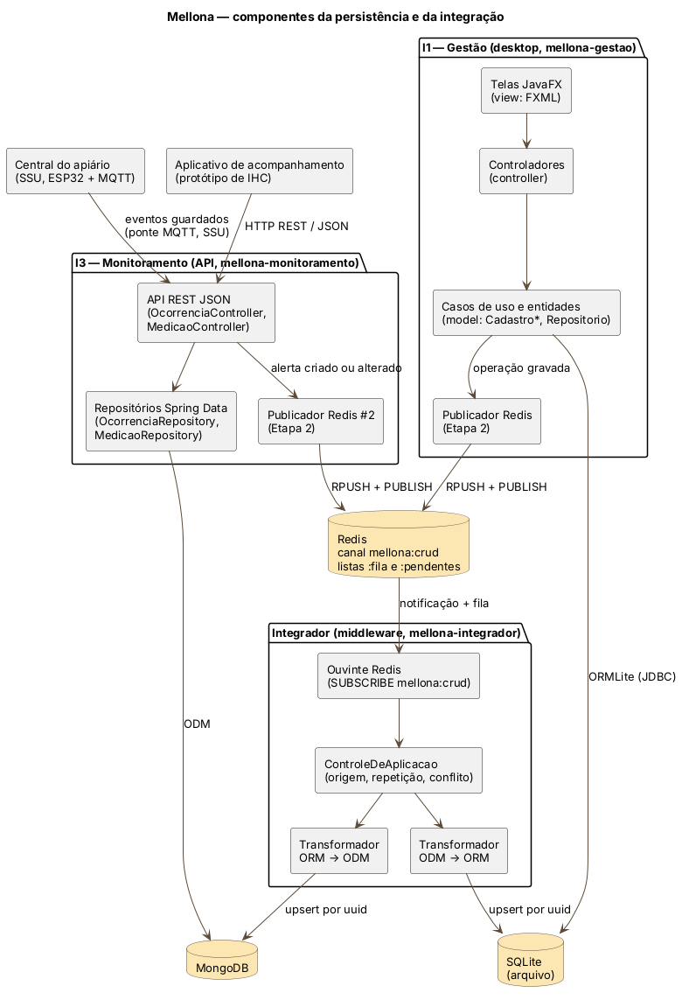
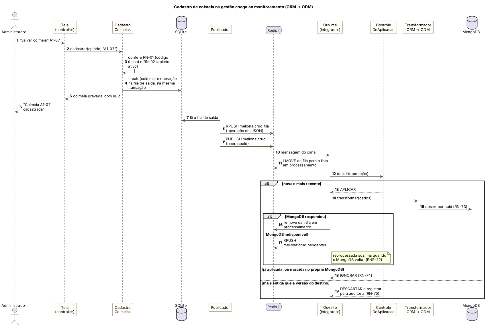
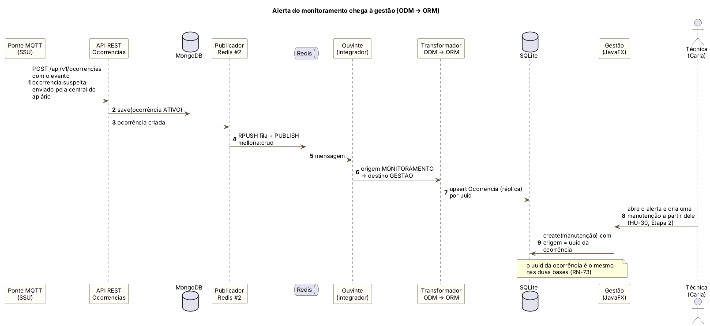
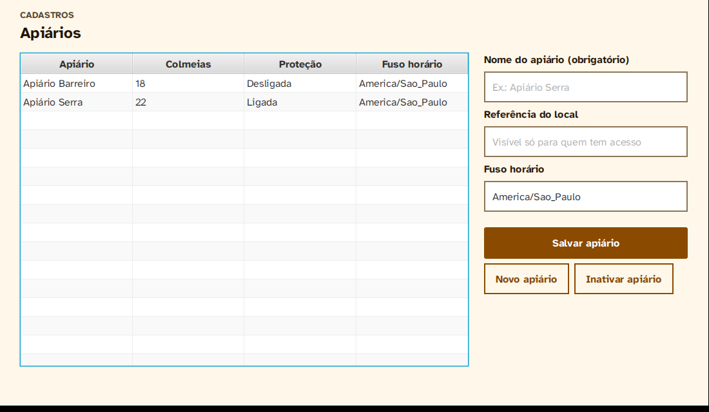

# Mellona — Software para Persistência de Dados — Projeto, Etapa 1

29/10/2026 · Bárbara Nogueira

## Identificação

O Mellona guarda os dados em duas bases de naturezas diferentes. Os cadastros da gestão ficam numa base relacional (ORM, SQLite), e os eventos do monitoramento ficam numa base de documentos (ODM, MongoDB). Um integrador mantém as entidades compartilhadas iguais nas duas. Esta etapa planeja o projeto e entrega o modelo de classes e o código inicial das três partes, com testes: a gestão relacional, o início da API de monitoramento e o contrato do integrador, que fica completo na Etapa 2.

| Item | Registro |
| --- | --- |
| Disciplina | Software para Persistência de Dados, INF/UFG |
| Equipe | Bárbara Nogueira (projeto individual); usuário GitHub: [BarbaraNogueiraCS](https://github.com/BarbaraNogueiraCS) |
| Tema | Mellona: monitoramento e proteção de apiários e colmeias |
| Repositório | Pasta `spd/` do repositório do projeto (`ssu-2026-grupo-N`, nome a confirmar) |
| Base do projeto | ERS do Mellona v1.1 (seções 7, 8, 11.1, 11.10 e 13); IHC PF1 e PF2; SSU Atividade 01 |

## 1. Introdução

**Problema.** Muitos apiários ficam em áreas rurais afastadas, e o apicultor só sabe como estão as colmeias quando vai até lá. Furtos, vandalismo e caixas tombadas são descobertos dias depois (ERS, 3.2). O Mellona monitora as colmeias com sensores, decide a sinalização no próprio apiário e avisa o apicultor; o funcionamento de campo é objeto de Software para Sistemas Ubíquos.

**O problema de persistência.** O sistema tem duas faces que guardam dados diferentes, mas falam das mesmas coisas:

| Interface (ERS, 7.1) | O que guarda | Natureza dos dados |
| --- | --- | --- |
| I1 — Aplicação de gestão (desktop) | Usuários, apiários, colmeias, dispositivos, visitas, inspeções e manutenções | Poucos registros, muitas relações e regras de integridade: código de colmeia único (RN-01), uma colmeia em um só apiário ativo (RN-02), associações de dispositivo sem conflito (RN-03), histórico preservado (RN-04) |
| I3 — API de monitoramento | Medições, detecções, ocorrências (alertas) e acionamentos | Grande volume, só acréscimo, campos que variam por tipo de evento e consultas por apiário e período |

Só a carga de simulação do ERS (30 colmeias em 3 apiários, PAR-18), com temperatura e umidade a cada 60 s, gera cerca de 86 mil medições por dia (30 × 2 × 1.440).

**Justificativa.** Cada natureza pede um modelo de dados diferente. Os cadastros precisam de chaves estrangeiras, unicidade e tabelas associativas, o que favorece o modelo relacional. Os eventos são documentos autocontidos, com campos opcionais (`value`, `unit`, `relatedEventIds`), e cabem melhor em coleções de documentos (persistência poliglota). O preço é manter as duas bases coerentes. Um apiário cadastrado na gestão precisa existir no monitoramento, e um alerta do monitoramento precisa chegar à gestão para virar manutenção (HU-38, HU-30), sem duplicar nem perder operações (RN-74, RNF-22).

**Motivação.** A arquitetura da disciplina (ORM, ODM e integrador por eventos) corresponde exatamente a essa divisão do Mellona, que já está especificada no ERS (RES-01 a RES-05). O projeto também costura as três disciplinas: o serviço remoto da atividade de SSU é a API de monitoramento deste projeto, e o aplicativo prototipado em IHC consome essa mesma API.

## 2. Plano

**Objetivo geral.** Implementar a camada de dados do Mellona. Ela reúne um modelo de entidades com relações 1:1, 1:N e N:N, persistido numa base relacional (gestão) e numa base de documentos (monitoramento). As entidades compartilhadas são sincronizadas por um integrador baseado em eventos, e testes automatizados comprovam a conformidade com o modelo.

**Objetivos específicos.** Um por conceito exigido pela disciplina:

| Conceito | Objetivo no Mellona | Etapa |
| --- | --- | --- |
| Entidades | Modelar as entidades do ERS (13.1) com as relações 1:1 (Apiário–Configuração de segurança), 1:N (Apiário–Colmeia, Colmeia–Inspeção e outras) e N:N com atributos (Usuário–Apiário, Dispositivo–Colmeia) | 1 |
| ORM | Persistir os cadastros da gestão em SQLite com ORMLite, por um repositório genérico, com identificador universal (RN-73) e inativação lógica (RN-04) | 1 |
| MVC | Construir a aplicação desktop de gestão (I1) em JavaFX, com telas de cadastro sobre a camada ORM | 1 (Apiários) e 2 (demais) |
| ODM | Persistir medições, detecções, ocorrências e acionamentos em MongoDB com Spring Data MongoDB | 1 (ocorrências e medições) e 2 |
| Backend JSON | Oferecer a API REST de monitoramento (I3) com criação, consulta, alteração e inativação, no formato de evento combinado com SSU (ERS, 13.4) | 1 (recursos iniciais) e 2 |
| Integrador | Sincronizar as entidades compartilhadas por Redis Pub/Sub com Lettuce, com operação aplicada uma única vez (RN-74), conflito resolvido pelo instante mais recente (RN-75) e fila de reprocessamento, porque o Pub/Sub não retém mensagens (RES-03, RNF-22) | Contrato na 1; implementação na 2 |
| Testes unitários | Testar com JUnit as classes de domínio e os repositórios, cobrindo RN-01 a RN-04 e RN-73 a RN-75 (RNF-23) | Todas |

**Tecnologias e ferramentas.**

| Tecnologia | Uso | Versão |
| --- | --- | --- |
| Java e Maven | Linguagem e gerenciador de build dos três módulos | Java 17 (LTS); Maven 3.9 |
| JavaFX, FXML e Scene Builder | Interface desktop de gestão, no padrão MVC | JavaFX 21 (LTS) |
| ORMLite e SQLite JDBC | ORM e base relacional embutida, em arquivo | ORMLite 6.1; sqlite-jdbc 3.46.0.0 |
| Spring Boot e Spring Data MongoDB | API REST JSON e ODM | Spring Boot 3.3 |
| MongoDB Community, em Docker | Base de documentos do monitoramento | Última imagem `mongodb/mongodb-community-server` |
| Redis, Lettuce e Gson | Barramento de eventos, cliente Java e serialização JSON do integrador | Lettuce 6.7.1; Gson 2.11.0 |
| JUnit 5 | Testes unitários | JUnit Jupiter 5.10 |
| PlantUML | Diagramas de classes, componentes e sequência, versionados como texto | — |
| JavaDoc e Markdown | Documentação do código e do repositório | — |
| Git e GitHub | Versionamento, issues e quadro de tarefas | — |

## 3. Divisão de tarefas

O projeto é individual: Bárbara Nogueira é responsável por todas as tarefas, registradas como issues no GitHub com o rótulo da etapa. A Etapa 1 fecha com as issues 1 a 9; as datas são planejadas e devem ser ajustadas às entregas oficiais da disciplina.

| # | Issue | Etapa | Prazo planejado | Estado |
| --- | --- | --- | --- | --- |
| 1 | Criar o repositório, o README e o projeto Maven com três módulos | 1 | 05/11 | Em andamento |
| 2 | Diagrama de classes com relações 1:1, 1:N e N:N | 1 | 05/11 | Feita |
| 3 | Diagramas de componentes e de sequência da integração | 1 | 05/11 | Feita |
| 4 | Entidades da gestão com ORMLite e repositório genérico | 1 | 05/11 | Feita |
| 5 | Regras de cadastro RN-01 a RN-04 e identificador universal (RN-73) | 1 | 05/11 | Feita |
| 6 | Testes JUnit das entidades e dos repositórios da gestão | 1 | 05/11 | Feita |
| 7 | Tela JavaFX de Apiários (MVC) | 1 | 05/11 | Feita |
| 8 | Documentos e API inicial de ocorrências e medições (ODM) | 1 | 05/11 | Feita |
| 9 | Contrato da operação de sincronização e seu teste | 1 | 05/11 | Feita |
| 10 | Telas de colmeias, dispositivos, associações, visitas e inspeções | 2 | 19/11 | A fazer |
| 11 | Entidades Manutenção, Autorização de visita e Ocorrência recebida na gestão | 2 | 19/11 | A fazer |
| 12 | Documentos de detecções, acionamentos e réplicas dos cadastros (ODM) | 2 | 19/11 | A fazer |
| 13 | API REST completa de monitoramento, com inativação | 2 | 19/11 | A fazer |
| 14 | Integrador: publicador, ouvinte e transformadores ORM ↔ ODM | 2 | 03/12 | A fazer |
| 15 | Fila de reprocessamento, idempotência e conflitos (RN-74, RN-75, RNF-22) | 2 | 03/12 | A fazer |
| 16 | Testes de integração entre as bases (HU-38) | Final | 10/12 | A fazer |
| 17 | Relatório final e apresentação | Final | 10/12 | A fazer |

| Frente | Período planejado |
| --- | --- |
| Etapa 1: planejamento e iniciação | 29/10 a 05/11/2026 |
| Gestão: telas MVC e entidades restantes | 06/11 a 19/11/2026 |
| Monitoramento: ODM e API REST completa | 06/11 a 19/11/2026 |
| Etapa 2: integrador Redis | 20/11 a 03/12/2026 |
| Testes de integração, relatório e apresentação | 04/12 a 10/12/2026 |

Gestão e monitoramento correm em paralelo até 19/11, e o integrador só começa depois, porque transforma as entidades dos dois lados.

## 4. Modelagem inicial

O modelo parte do modelo conceitual do ERS (13.1 a 13.3) e o divide entre as duas bases: cadastros e registros de campo na relacional, eventos do monitoramento na de documentos. Os diagramas estão em PlantUML no repositório (`docs/diagramas`), como texto versionado.

### 4.1 Diagrama de classes da gestão



Todas as classes herdam de `EntidadeBase`, que dá a cada registro uma chave interna do SQLite e um `uuid` universal, gerado na criação, imutável e único (RN-73). É o `uuid`, e nunca a chave interna, que identifica o mesmo registro nas duas bases. As três formas de relação ficam assim no SQLite:

| Relação | Tipo | Como é persistida (ORMLite) |
| --- | --- | --- |
| Apiário – Configuração de segurança | 1:1 | Chave `apiario_id` obrigatória e única em `configuracao_seguranca`; as duas linhas são criadas na mesma transação |
| Apiário – Colmeia | 1:N | Chave `apiario_id` obrigatória em `colmeia`; o apiário navega até as colmeias por `@ForeignCollectionField` |
| Colmeia – Inspeção; Apiário – Visita; Categoria – Visita | 1:N | Chave estrangeira no lado N |
| Usuário – Apiário | N:N com atributos | Tabela associativa `acesso_apiario`, com papel, início e fim |
| Dispositivo – Colmeia | N:N com histórico | Tabela associativa `associacao_dispositivo`; fim nulo indica vínculo ativo, e vínculos encerrados nunca são apagados (RN-03, RN-04) |
| Visita – Autorização de manutenção | 1:0..1 | Etapa 2 |

Duas decisões vêm das outras disciplinas. A situação da rainha na inspeção é um enum com as três opções do seletor da tela "Registrar revisão" do protótipo de IHC (Vista, Sinais de rainha, Não encontrada). O identificador do dispositivo é o mesmo `deviceId` que os equipamentos enviam nos eventos de SSU.

### 4.2 Modelo de documentos do monitoramento



No MongoDB, a relação 1:N entre ocorrência e acionamento é modelada por documentos embutidos, porque os acionamentos só existem dentro do alerta e são lidos com ele. As demais ligações são referências pelo `uuid` dos cadastros que vêm da gestão. A medição guarda o evento com os mesmos nomes de campo do contrato de SSU (`eventId`, `deviceId`, `entityId`, `eventTime`, `quality`), e o índice único em `eventId` impede que um reenvio da central do apiário duplique leituras (RN-67).

### 4.3 Arquitetura em componentes



A gestão segue o padrão MVC: telas FXML, controladores e o modelo, que reúne entidades, repositório genérico e casos de uso. A API de monitoramento é consumida pelo aplicativo prototipado em IHC e recebe os eventos da central do apiário pela ponte MQTT de SSU. O integrador assina o canal do Redis e aplica as operações na outra base. As decisões abaixo orientam a implementação do integrador na Etapa 2.

| Decisão | Motivo |
| --- | --- |
| Cada operação vai primeiro para uma fila de saída na própria base, na mesma transação do cadastro | Se o Redis estiver fora do ar, a operação não se perde (RNF-22) |
| O publicador grava a operação na lista `mellona:crud:fila` e avisa pelo canal `mellona:crud` | O Pub/Sub só entrega a quem está ouvindo naquele instante; a lista retém a operação até o integrador processá-la (RES-03) |
| Falhas no destino vão para `mellona:crud:pendentes` e são reprocessadas | Nenhuma operação é perdida em silêncio (RNF-22) |
| Inativação no lugar de exclusão, também na propagação | Histórico preservado nas duas bases (RN-04, 11.10) |

### 4.4 Sequência das operações de integração

Os dois sentidos de propagação do ERS (RN-74) têm um diagrama cada. No primeiro, uma colmeia cadastrada na gestão chega ao monitoramento. As regras e a gravação do cadastro (passos 2 a 5) já estão implementadas e testadas; a tela de colmeias, a fila de saída e o integrador (passo 7 em diante) são da Etapa 2.



No segundo, um alerta criado no monitoramento chega à gestão, onde a técnica cria uma manutenção a partir dele (HU-30, HU-38).



A decisão de aplicar, ignorar ou descartar cada operação (`ControleDeAplicacao`) já está implementada e testada no módulo do integrador. Uma operação repetida ou nascida na própria base é ignorada (RN-74), e uma versão mais antiga que a do destino é descartada e registrada para auditoria (RN-75).

### 4.5 Coerência com IHC e SSU

| Artefato | Como este projeto o usa |
| --- | --- |
| Guia de estilo e protótipo (IHC, PF2) | A tela JavaFX usa a paleta, a família Atkinson Hyperlegible, botões com verbo e objeto e confirmação antes de inativar. Os termos da tela seguem o glossário: Alerta (`Ocorrencia`), Estou ciente e Encerrar alerta (RN-21), Proteção ligada (`armada`), Revisão (`Inspecao`) |
| Personas e cenários (IHC, PF1) | Os testes usam Antônio (apicultor) e Carla (técnica com acesso a dois apiários) |
| Atividade 01 (SSU) | O serviço remoto de SSU é a API de monitoramento; os eventos chegam com o contrato do ERS (13.4.1); a configuração de segurança tem versão, enviada à central no comando de configuração |
| ERS v1.1 | Entidades e relações de 13.1 a 13.3, restrições RES-01 a RES-05 e regras de 11.1, 11.10 e 11.11 |

## 5. Documentação do código inicial

O código inicial está organizado em três módulos Maven, um por parte da arquitetura. O README do repositório, em Markdown, traz instalação, execução, testes, rotas da API e a rastreabilidade de cada regra até a classe e o teste que a garantem. As classes públicas têm JavaDoc, que cita a regra do ERS atendida.

| Módulo | O que a Etapa 1 entrega | Tecnologias |
| --- | --- | --- |
| `mellona-gestao` | 10 entidades com as relações 1:1, 1:N e N:N; repositório genérico; casos de uso de apiários, colmeias, dispositivos, acessos e registros de campo; tela JavaFX de apiários | JavaFX 21, ORMLite 6.1, SQLite |
| `mellona-monitoramento` | Documentos de ocorrência (com acionamentos embutidos) e de medição; dois repositórios; sete rotas REST com respostas de erro em JSON | Spring Boot 3.3, Spring Data MongoDB |
| `mellona-integrador` | Contrato da operação de sincronização em JSON; sentido de propagação de cada entidade; decisão de aplicar, ignorar ou descartar | Gson; Lettuce a partir da Etapa 2 |

**Instalar, executar e testar.** Pré-requisitos: JDK 17 ou mais recente, Maven 3.9 e Docker (só para o MongoDB e o Redis).

```bash
git clone https://github.com/BarbaraNogueiraCS/mellona.git
cd mellona/spd
mvn clean install                          # baixa dependências, compila e roda os testes unitários
mvn -pl mellona-gestao javafx:run          # aplicação de gestão; cria mellona-gestao.sqlite
MELLONA_EXEMPLO=1 mvn -pl mellona-gestao javafx:run   # idem, com dados de demonstração
docker compose up -d mongodb               # MongoDB para a API
mvn -pl mellona-monitoramento spring-boot:run   # API em http://localhost:8080
mvn test                                   # só os testes unitários
mvn javadoc:javadoc                        # JavaDoc em target/site/apidocs de cada módulo
```



A tela de apiários já segue o padrão MVC sobre a camada ORM. Com os dados de demonstração (`MELLONA_EXEMPLO=1`), o Apiário Serra tem 22 colmeias e a proteção ligada, e o Barreiro tem 18, como as cerca de 40 colmeias da persona Antônio.

| Rota da API | O que faz |
| --- | --- |
| `POST /api/v1/medicoes` | Recebe uma leitura: 201 se é nova, 200 se o `eventId` já existe (RN-67) |
| `GET /api/v1/medicoes?entidade=&de=&ate=` | Histórico de uma colmeia no período (HU-07) |
| `GET /api/v1/ocorrencias?apiario=&estado=` | Alertas do apiário, mais recentes primeiro (HU-17) |
| `GET /api/v1/ocorrencias/{uuid}` | Detalhe de um alerta |
| `POST /api/v1/ocorrencias` | Cria um alerta ativo |
| `POST /api/v1/ocorrencias/{uuid}/reconhecimento` | "Estou ciente" |
| `POST /api/v1/ocorrencias/{uuid}/resolucao` | "Encerrar alerta" |

## 6. Testes unitários

Os 69 testes unitários passaram na execução de 29/10/2026. Eles comprovam as três formas de relação do modelo e as regras de cadastro e de integração: 35 na gestão, 23 no monitoramento e 11 no integrador. Outros 3 testes, de repositório contra o MongoDB, rodam quando o container está no ar.

**Como os testes são montados.**

- **Gestão:** cada teste abre um arquivo SQLite novo numa pasta temporária (`@TempDir`), e o ORMLite cria as tabelas. Assim os testes usam o banco de verdade, mas não dependem uns dos outros. Cada recusa é conferida pelo código da regra (`RegraDeNegocioException.getRegra()`), o que liga o teste ao requisito.
- **Monitoramento:** as regras dos documentos são testadas sem banco, e os controladores, com repositórios simulados (Mockito). Os testes com MongoDB real levam a marca `integracao` e ficam fora do `mvn test` padrão.
- **Integrador:** o contrato JSON é testado em ida e volta, junto com o sentido de propagação, a idempotência e a resolução de conflitos.

| Classe de teste | O que comprova | Casos |
| --- | --- | --- |
| `RepositorioTest` | Operações do repositório genérico; `uuid` único e imutável (RN-73) | 5 |
| `ApiarioConfiguracaoTest` | Relação 1:1; faixas PAR-10 a PAR-14; fuso horário (RN-60) | 6 |
| `ColmeiaTest` | Relação 1:N Apiário–Colmeia; RN-01, RN-02 e RN-04 | 6 |
| `AssociacaoDispositivoTest` | Relação N:N Dispositivo–Colmeia com histórico; RN-03 e RN-04 | 8 |
| `AcessoApiarioTest` | Relação N:N Usuário–Apiário nos dois sentidos; revogação sem perda | 4 |
| `RegistroDeCampoTest` | Relação 1:N Colmeia–Inspeção; visitas (RN-24, RN-51, RN-52, RNF-16); categorias | 6 |
| `MedicaoTest` | Faixas válidas (PAR-05, PAR-06), leitura ausente (RN-07), leitura antiga (PAR-04) | 13 |
| `OcorrenciaTest` | Estados do alerta (RN-21); acionamentos embutidos | 5 |
| `ControllersTest` | Leitura reenviada sem duplicar (RN-67); criação e reconhecimento de alerta | 5 |
| `OperacaoSincronizacaoTest` | Contrato JSON; sentido de propagação e não repropagação (RN-74) | 6 |
| `ControleDeAplicacaoTest` | Operação aplicada uma vez (RN-74); vence a mais recente, com empate determinístico (RN-75) | 5 |
| `RepositoriosMongoTest` | Índice único de `eventId` e consultas por período e estado, no MongoDB | 3 (integração) |

Um exemplo, da relação N:N com histórico:

```java
@Test
@DisplayName("N:N — um equipamento passa por várias colmeias, e o histórico guarda cada período")
void historicoDeColmeias() {
    dispositivos.associar(no, serra, a107, T0);
    dispositivos.encerrarAssociacao(no, T0.plus(Duration.ofDays(30)));
    dispositivos.associar(no, serra, a108, T0.plus(Duration.ofDays(30)));

    List<AssociacaoDispositivo> historico = dispositivos.historico(no);

    assertEquals(2, historico.size());
    assertEquals("A1-07", historico.get(0).getColmeia().getCodigo());
    assertFalse(historico.get(0).isAtiva());
    assertTrue(historico.get(1).isAtiva());
}
```

## Referências

- AKIRA, M. Tutoriais da disciplina: ORM e acesso a banco de dados; JavaFX CRUD, partes 1 e 2; Java ODM com Spring Data MongoDB; Integrador Redis I (arquitetura Pub/Sub com Lettuce). Disponíveis em [github.com/marceloakira/tutorials](https://github.com/marceloakira/tutorials).
- ARANTES, G. F. *MongoDB*. Slides da disciplina Desenvolvimento de Software para Persistência. INF/UFG.
- ELIAS, Prof. *Redis* e *JSON*. Slides da disciplina. INF/UFG.
- McMURTRY, D. et al. *Data Access for Highly-Scalable Solutions: Using SQL, NoSQL and Polyglot Persistence*. Microsoft patterns & practices, 2013.
- MELLONA. *Especificação de Requisitos de Software (ERS)*, versão 1.1. 2026. Seções 7, 8, 10, 11, 12 e 13.
- MELLONA. *Projeto Final de IHC*, Etapas 1 e 2 (personas, cenários e guia de estilo); *Software para Sistemas Ubíquos*, Atividade 01 (arquitetura e contrato de eventos). 2026.
- ORMLITE. [Documentação do ORMLite](https://ormlite.com/), versão 6.1.
- SPRING. [Accessing Data with MongoDB](https://spring.io/guides/gs/accessing-data-mongodb) e [Spring Data MongoDB](https://spring.io/projects/spring-data-mongodb).
