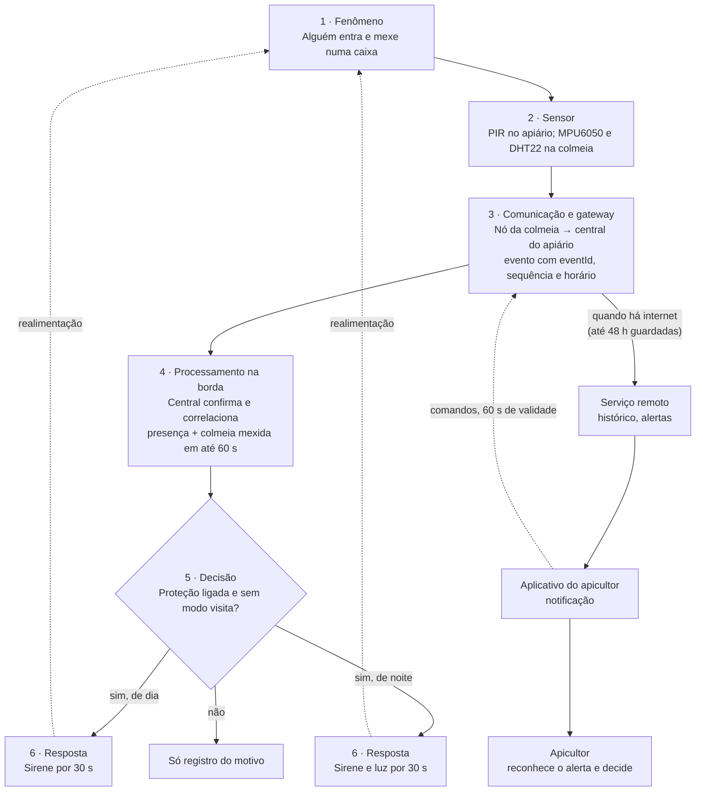

# Mellona — Software para Sistemas Ubíquos — Atividade 01

## Identificação

O Mellona protege e monitora apiários em áreas rurais. A principal decisão de projeto é esta: a segurança é decidida no próprio apiário, sem depender da internet, e a nuvem só consolida os dados e avisa o apicultor.

| Item | Registro |
| --- | --- |
| Disciplina | Software para Sistemas Ubíquos, INF/UFG, Prof. Otávio Calaça Xavier |
| Atividade | Atividade em Grupo 01: análise inicial de um sistema ubíquo |
| Cenário | Próprio: Mellona, monitoramento e proteção de apiários e colmeias (não é um dos cenários de exemplo) |
| Onde registrar | `ssu/atividade-01.md`, no repositório do projeto |
| Base | ERS do Mellona, versão 1.1, e Aulas 01 a 05 da disciplina |

**Integrante:** Bárbara Nogueira (atividade individual). **Falta preencher:** o usuário GitHub.

As respostas abaixo seguem a ordem do enunciado: Parte 1 (itens 1 a 5) e Parte 2 (itens 6 a 9). Como pede a orientação da atividade, as escolhas de tecnologia são hipóteses iniciais, justificadas pelo problema, e podem mudar nas próximas atividades.

## Parte 1 — Compreensão do problema

### 1. Problema e usuários

**Problema.** Muitos apiários ficam em áreas rurais afastadas, e o apicultor só sabe como estão as colmeias quando vai até lá. Entre uma visita e outra, caixas podem ser furtadas, vandalizadas ou tombadas pelo vento ou por animais, e o apicultor descobre dias depois, com a colônia perdida ou enfraquecida. O ERS resume o problema assim: como permitir que o apicultor identifique à distância situações relevantes, iniba acessos suspeitos com uma sinalização adequada e organize o manejo (ERS, 3.2).

**Usuários.**

| Usuário | Relação com o sistema | O que precisa |
| --- | --- | --- |
| Apicultor (principal) | Direta | Saber se os apiários estão bem sem viajar, ser avisado de ocorrências e entrar no apiário sem disparar a sirene |
| Técnico de cooperativa | Direta | Saber quais equipamentos estão sem sinal e o que consertar primeiro |
| Administrador | Direta | Cadastrar apiários, dispositivos, usuários e parâmetros |
| Auxiliares, donos das terras e vizinhança | Indireta | Entender o modo visita; tolerar som e luz noturnos |
| Colônias de abelhas | Indireta, não humana | Não ser perturbadas por som, luz e manuseio em excesso |

**Situação de uso.** Os dispositivos ficam fixos no apiário, ligados 24 horas por dia, com sinal de internet fraco ou ausente. O apicultor está quase sempre longe: em casa, na estrada ou em outro apiário, e consulta o celular. Durante as visitas, está no apiário, de luvas e véu, e muitas vezes sem sinal. As características desses usuários ainda são hipóteses de pesquisa secundária e serão validadas na PF1 de IHC, com estudo de campo em vídeos de apicultores e brainstorming (ERS, 6.3 e 6.4).

### 2. Contexto

O sistema precisa perceber nove informações de contexto. Algumas são observadas diretamente por um sensor; outras são derivadas de várias leituras ou inferidas, e quanto maior a inferência, maior a exigência de evidência (Aula 4).

| Contexto | Sobre | Tipo | Como é obtido | Por que importa |
| --- | --- | --- | --- | --- |
| Movimento e inclinação da colmeia | Ambiente | Observado e derivado | Acelerômetro na colmeia; movimentação confirmada se a variação durar 2 s, possível tombamento se passar de 15° por 10 s | Indica caixa mexida ou caída; vibração rápida não conta |
| Presença na área do apiário | Ambiente | Observado e derivado | Sensor de presença; confirmada com 2 ativações em 10 s | Sozinha não aciona nada, porque pode ser um animal ou um passante |
| Atividade suspeita | Ambiente | Inferido | Presença e colmeia mexida no mesmo apiário em até 60 s | É o que aciona a sirene; nunca é apresentada como furto confirmado |
| Temperatura e umidade dentro da colmeia | Ambiente | Observado | Sensor na colmeia, a cada 60 s | Acompanhamento remoto; não é diagnóstico da colônia |
| Período do dia | Ambiente | Derivado | Relógio local da central e horário configurado (dia das 6h00 às 17h59) | À noite, a resposta inclui a luz |
| Visita autorizada em curso | Usuário | Observado | Modo visita confirmado pelo aplicativo ou pelo código digitado na central | Durante a visita, as detecções não acionam a sirene |
| Estado da proteção e permissão de quem comanda | Usuário | Observado | Escolha explícita no aplicativo; usuário autenticado e autorizado | Só quem tem acesso ao apiário liga ou desliga a proteção |
| Saúde dos dispositivos | Sistema | Derivado | Sinal periódico de funcionamento a cada 60 s; silêncio após 180 s; sensor de presença ativo sem parar por mais de 10 min | Sensor mudo não pode ser lido como "tudo bem" |
| Conectividade e horário válido | Sistema | Observado | Estado da conexão com a internet e validade do relógio local | Sem internet, os eventos ficam guardados; sem relógio, adota-se o período noturno |

De propósito, o sistema **não** percebe quem é a pessoa no apiário: ele detecta presença, não identifica pessoas (ERS, HU-26). A localização do apiário também não circula nos eventos, porque facilitaria furtos.

Todo contexto tem prazo de validade. Uma medição com mais de 180 s é marcada como desatualizada, um valor fora da faixa válida é inválido, e uma presença antiga deixa de valer para a correlação (ERS, PAR-04 a PAR-06 e PAR-10).

### 3. Dispositivos e comunicação

Participam cinco tipos de dispositivo, organizados em estrela em volta da central de cada apiário.

| Dispositivo | Onde fica | Função |
| --- | --- | --- |
| Nó da colmeia | Um em cada colmeia | Mede inclinação, movimento, temperatura e umidade; confirma movimentação e tombamento; envia eventos e sinal de funcionamento |
| Sensor de presença | Na entrada ou na área do apiário | Detecta movimento de pessoas ou animais na área |
| Central do apiário | No apiário, protegida do tempo | Recebe os eventos, correlaciona, decide, aciona sirene e luz, aceita o código do modo visita, guarda os eventos sem internet e os envia depois |
| Serviço remoto | Nuvem ou servidor do projeto | Histórico, painel, alertas, notificações, cadastros e detecção de apiário silencioso |
| Celular do apicultor e computador da cooperativa | Com o usuário | Aplicativo de acompanhamento e aplicação de gestão |

**O que trafega.** Seguindo a classificação da Aula 2, há quatro tipos de mensagem:

| Tipo | Direção | Exemplo no Mellona |
| --- | --- | --- |
| Telemetria | Dispositivo → sistema | Temperatura e umidade da colmeia a cada 60 s; sinal de funcionamento a cada 60 s |
| Evento | Mudança → assinantes | Colmeia mexida, presença confirmada, atividade suspeita, sirene iniciada |
| Comando | Sistema → dispositivo | Ligar ou desligar a proteção; ativar ou encerrar o modo visita |
| Confirmação | Dispositivo → sistema | "Modo visita confirmado pela central às 14h40"; comando expirado ou recusado |

Todo evento leva identidade, tempo e controle: tipo, dispositivo de origem, entidade observada (por exemplo, `colmeia:A1-07`), instante da ocorrência, número de sequência e identificador único. Todo comando leva identificador, autor, instante de emissão e prazo de validade de 60 s; um comando que chega depois do prazo não é executado (ERS, 13.4 e RN-76).

**Como trocam informações (hipótese inicial).**

| Trecho | Hipótese | Por que | Alternativa a avaliar |
| --- | --- | --- | --- |
| Nós e sensor de presença → central | Rádio local de curto alcance; no protótipo, Wi-Fi do ESP32 | Distâncias de dezenas de metros e sem dependência de internet | Rádio de baixo consumo (LoRa ou ESP-NOW) em campo; fora do protótipo acadêmico (ERS, RES-08) |
| Central ↔ serviço remoto | MQTT por publicação e assinatura, com confirmação de entrega (QoS 1) | Vários consumidores do mesmo evento (serviço, painel, aplicativo); conexão intermitente; mensagem "will" revela quando a central cai | HTTP com reenvio, se o grupo preferir uma API única |
| Aplicativos ↔ serviço remoto | HTTP com API REST e JSON | Consultas e comandos explícitos; já é a interface definida em SPD (ERS, RES-02) | — |
| Uplink do apiário | Modem de rede celular ou Wi-Fi da propriedade, quando houver | Áreas rurais raramente têm rede fixa | Satélite, se não houver cobertura celular |

Como QoS 1 pode entregar a mesma mensagem duas vezes, o serviço reconhece repetições pelo identificador do evento e pela sequência (ERS, RN-67). Os tópicos usam códigos, nunca nomes de lugar: por exemplo, `mellona/apiario/A1/colmeia/A1-07/evento` e `mellona/apiario/A1/comando/seguranca`.

### 4. Processamento e resposta

O processamento fica o mais perto possível do fenômeno quando a resposta precisa ser rápida ou funcionar sem internet, e vai para a nuvem quando precisa de visão de vários apiários ou de histórico longo.

| Nível | O que processa | Por que ali |
| --- | --- | --- |
| Dispositivo (nó da colmeia) | Amostragem, validação de faixa, confirmação de movimentação (2 s) e de tombamento (10 s, com histerese: só encerra abaixo de 12°), numeração dos eventos | Descarta vibração passageira na origem e reduz mensagens e consumo de energia |
| Borda (central do apiário) | Correlação de presença e movimentação em janela deslizante de 60 s pelo tempo do evento; período do dia; estado da proteção e modo visita; acionamento por 30 s com intervalo de proteção de 120 s; estado degradado; retenção de 48 h; detecção de nós silenciosos | A resposta precisa começar em até 2 s e funcionar sem internet (ERS, RNF-03 e RNF-20) |
| Névoa | Não usada na primeira versão | Um apiário não precisa coordenar com outro para decidir; poderia servir no futuro a uma cooperativa com muitos apiários próximos |
| Nuvem (serviço remoto) | Histórico, painel, alertas e notificações, detecção do apiário inteiro em silêncio, integração entre as bases, relatórios | Visão de todos os apiários; um apiário mudo não consegue avisar a própria falha |

**Respostas produzidas.**

| Resposta | Tipo | Exemplo |
| --- | --- | --- |
| Atuar no mundo físico | Física | Atividade suspeita de dia: sirene por 30 s. De noite: sirene e luz da área por 30 s |
| Informar | Informacional | Alerta e notificação "Atividade suspeita — Apiário Serra, colmeia A1-07, 2h14"; painel com estado e hora de cada medição |
| Recomendar | Informacional | Após um tombamento, sugerir a manutenção de cavaletes e suportes; após um sensor mudo, a de equipamentos |
| Explicar | Informacional | "A sirene não tocou porque não houve presença junto com a colmeia inclinada" (ERS, HU-39) |
| Ação humana | Humana | O apicultor reconhece o alerta, liga para o dono da terra ou vai ao apiário |

Um tombamento sem presença gera alerta, mas não sirene: a sirene não levanta a caixa e só perturbaria as abelhas e a vizinhança.

### 5. Risco principal

O risco principal é a **confiabilidade da decisão local de segurança**: errar para os dois lados custa caro, e o erro acontece no apiário, longe de qualquer pessoa que possa corrigi-lo na hora (ERS, R1).

| Erro | O que acontece | Consequência |
| --- | --- | --- |
| Falso positivo: sirene sem motivo | Vento, um animal ou o próprio apicultor sem modo visita disparam a sinalização | Abelhas ficam defensivas, vizinhos reclamam, o apicultor perde a confiança e acaba desligando a proteção |
| Falso negativo: silêncio com furto | Sensor de presença com falha, comando de desligar indevido ou correlação perdida | O apiário fica desprotegido justamente quando parecia protegido |

**Por que este, e não outro.** Conectividade, energia e privacidade também são riscos reais, mas todos têm uma saída que preserva a função principal: sem internet, a central decide sozinha; sem energia, o silêncio é detectado; a localização não circula nos eventos. Já um erro na decisão de segurança atinge a própria razão de existir do sistema, e nos dois sentidos ao mesmo tempo: reduzir os alarmes falsos aumenta o risco de deixar passar um furto, e vice-versa.

**Como o projeto trata o risco.**

- **Duas evidências, não uma.** A sirene só toca com presença e colmeia mexida no mesmo apiário em até 60 s; cada detecção é confirmada antes (2 ativações em 10 s; variação mantida por 2 s).
- **Tempo do evento.** A correlação usa o instante da ocorrência, e não o de chegada; eventos que chegam juntos depois de uma queda de rede não são correlacionados por engano.
- **Falha visível.** Sensor de presença mudo ou travado coloca a segurança em estado degradado e gera alerta de prioridade alta, em vez de parecer "tudo bem".
- **Visita sem sirene, mesmo sem internet.** O modo visita pode ser ativado pelo código na própria central.
- **Comandos seguros.** Comandos têm autor, prazo de validade e confirmação; um comando atrasado não é executado.
- **Parâmetros ajustáveis e testados.** Os limites são configuráveis e passam por testes no limiar e por testes adversariais (ERS, D.2.2).

**Outros riscos e compromissos considerados.**

| Risco | Tratamento |
| --- | --- |
| Conectividade fraca na área rural | Decisão local e retenção de 48 h de eventos |
| Privacidade e sigilo da localização | Nenhuma identificação de pessoas; localização fora dos eventos e restrita a usuários autorizados |
| Energia em campo | Amostragem de 60 s, confirmação no próprio nó e detecção de silêncio; meta inicial de 24 h de autonomia em laboratório |
| Bem-estar das abelhas e da vizinhança | Sinalização de 30 s e intervalo de 120 s antes de tocar de novo |
| Uso indevido de comandos remotos | Autenticação, permissão por apiário e registro de quem comandou |

Os compromissos são três: a sinalização é automática, mas suspendê-la exige autorização explícita (automação × controle); as funções críticas ficam no apiário e o histórico, na nuvem (borda × nuvem); e o sistema percebe presença sem identificar pessoas (conveniência × privacidade).

## Parte 2 — Modelagem do sistema

### 6. Sensores, atuadores e gateway

Sensores percebem, atuadores respondem e o gateway conecta (Aula 2). No Mellona, a central do apiário exerce dois papéis ao mesmo tempo: é gateway, porque liga a rede local dos nós à internet, e é nó de borda, porque mantém estado, executa a regra e continua funcionando sem a nuvem (Aula 3).

| Elemento | Tipo | Papel no sistema | No protótipo (Wokwi) |
| --- | --- | --- | --- |
| Acelerômetro e giroscópio da colmeia | Sensor | Mede inclinação e aceleração; base para colmeia mexida e possível tombamento | MPU6050 |
| Sensor de temperatura e umidade | Sensor | Mede o clima dentro da colmeia, para acompanhamento remoto | DHT22 |
| Sensor de presença | Sensor | Detecta movimento na área do apiário; uma das duas evidências da atividade suspeita | PIR |
| Relógio de tempo real | Sensor de contexto | Dá o horário local sem internet e define se é dia ou noite | DS1307 |
| Teclado da central | Entrada do usuário | Recebe o código pessoal que ativa e encerra o modo visita sem internet | Teclado matricial |
| Sirene | Atuador | Sinal sonoro de 30 s para inibir a ação suspeita | Buzzer |
| Luz da área | Atuador | Ilumina o apiário à noite junto com a sirene | Relé com LED representando a lâmpada |
| Indicador de estado | Atuador | Bipe curto e luz verde confirmam o modo visita; luz vermelha indica código recusado | LEDs e buzzer |
| Nó da colmeia | Dispositivo final | Reúne sensores, validação, confirmação e envio de eventos | ESP32 |
| Central do apiário | Gateway e nó de borda | Recebe os eventos, correlaciona, decide, aciona, guarda e encaminha | ESP32 |
| Broker MQTT | Middleware | Distribui os eventos da central para os assinantes; não é gateway | Broker público de testes acessado pelo ESP32 simulado |

O protótipo deve declarar duas limitações: o Wokwi reproduz a interface dos sensores, mas não sua precisão, ruído ou instalação no campo; e o rádio de baixo consumo, que seria usado entre os nós e a central em um apiário real, fica fora da simulação (Aula 4; ERS, RES-06 e RES-08).

### 7. Fluxo do sistema

O caminho segue a cadeia do enunciado: fenômeno físico, sensor, comunicação e gateway, processamento, decisão e resposta.

Em texto: **pessoa entra e mexe numa caixa** → PIR e acelerômetro da colmeia detectam → o nó confirma a movimentação e envia o evento à central → a central correlaciona presença e movimentação em até 60 s, pelo tempo do evento → verifica proteção ligada, ausência de modo visita e período do dia → aciona a sirene (de dia) ou a sirene e a luz (de noite) por 30 s e registra o motivo → quando há internet, o serviço remoto recebe o evento e o aplicativo notifica o apicultor. Os comandos fazem o caminho inverso, com prazo de validade, e a próxima leitura observa o efeito da sirene sobre o ambiente.

### 8. Classificação

O Mellona se encaixa nas quatro classificações, mas em papéis diferentes: rede de sensores e IoT descrevem a infraestrutura; sistema ciberfísico e aplicação ubíqua descrevem o que o torna valioso.

| Classificação | Foco (Aula 2) | Justificativa no Mellona |
| --- | --- | --- |
| Rede de sensores | Coleta distribuída | Os nós das colmeias e o sensor de presença cobrem o apiário em conjunto e enviam as medições até a central, em topologia de estrela; a rede precisa continuar útil quando um nó falha |
| Internet das Coisas | Objetos conectados a serviços | Cada colmeia tem identidade própria e está ligada a um serviço de histórico, painel e alertas; há telemetria, eventos, comandos e confirmações |
| Sistema ciberfísico | Controle com realimentação | O software observa um fenômeno físico (presença e movimento da caixa), decide e atua no ambiente (sirene e luz). A atuação muda o ambiente, e a leitura seguinte observa o efeito: se a presença continua, uma nova ocorrência é registrada |
| Aplicação ubíqua sensível ao contexto | Contexto e adaptação | A mesma detecção produz respostas diferentes conforme o período do dia, o estado da proteção e a visita autorizada; a segurança funciona sem que o apicultor precise comandar o alarme |

Nem tudo o que é conectado é ubíquo (Aula 1). Sem a correlação com o contexto, o Mellona seria apenas uma rede de sensores que envia medições; é a decisão que considera dia ou noite e visita autorizada que o torna ubíquo.

**Dimensões de classificação (Aula 1).**

| Dimensão | Mellona |
| --- | --- |
| Interação | Híbrida: implícita na segurança; explícita na gestão, na proteção e no modo visita |
| Mobilidade | Dispositivos fixos no apiário; usuário móvel |
| Abrangência | Local (um apiário), com consolidação global de todos os apiários do usuário |
| Processamento | Dispositivo e borda para as funções críticas; nuvem para histórico e gestão |
| Resposta | Informar (alertas e painel), recomendar (manutenções) e atuar (sirene e luz) |

### 9. Contexto e adaptação

A mudança de contexto central é a **passagem do dia para a noite**: a mesma atividade suspeita, que de dia aciona só a sirene, à noite aciona a sirene e acende a luz da área (ERS, RN-58 e RN-59). No escuro, a luz aumenta a visibilidade do local e ajuda a inibir a ação; de dia, não acrescenta nada e só gastaria energia.

A Aula 4 trata a adaptação como uma política, e não como uma sequência de condições. Para essa mudança, a política é:

| Elemento da política | No Mellona |
| --- | --- |
| Objetivo | Inibir a ação suspeita com o menor incômodo possível para abelhas e vizinhos |
| Gatilho | O relógio local da central passa das 17h59 (início da noite) ou das 5h59 (início do dia); horários configuráveis |
| Prioridade | O modo visita confirmado e a proteção desligada prevalecem: nesses casos, nem de noite há sinalização |
| Limite | Luz e sirene por no máximo 30 s; uma nova ocorrência dentro de 120 s é registrada, mas não reinicia a sinalização |
| Reversão | Ao fim dos 30 s, a luz apaga e a sirene para; o próximo amanhecer volta à resposta diurna |
| Explicação | Cada decisão registra o período usado e o motivo: "período da noite, por isso sirene e luz" |
| Falha | Sem horário válido, a central adota o período noturno, que é o mais protetor, e registra a condição (ERS, RN-64) |

**Outras mudanças de contexto e a adaptação esperada.**

| Mudança de contexto | Adaptação |
| --- | --- |
| Começa uma visita com modo visita confirmado | As detecções continuam registradas, mas não acionam a sinalização; ao fim do prazo, a proteção volta sozinha |
| A internet cai | A central continua decidindo e acionando; os eventos ficam guardados e são enviados depois, sem duplicação |
| O sensor de presença para ou fica travado | A segurança passa ao estado degradado, o apicultor recebe alerta de prioridade alta e as detecções desse sensor deixam de entrar na correlação |
| Um nó de colmeia fica em silêncio por 180 s | O equipamento aparece como sem sinal; a ausência de dado nunca é lida como ausência de risco |

Toda adaptação que reduz a proteção depende de uma ação explícita e confirmada do usuário. As adaptações automáticas só aumentam a proteção ou tornam uma falha visível.

## Apresentação em dois minutos

1. **0:00–0:30, problema:** apiários afastados, furtos e tombamentos descobertos dias depois.
2. **0:30–1:00, fluxo:** presença e colmeia mexida são confirmadas, correlacionadas em 60 s e geram sirene, ou sirene e luz.
3. **1:00–1:30, decisão principal:** a segurança é decidida na central do apiário, porque precisa responder em 2 s e funcionar sem internet; a nuvem consolida e avisa.
4. **1:30–2:00, risco e adaptação:** o risco principal é errar a decisão para os dois lados, tratado com duas evidências, tempo do evento e falha visível; o contexto que muda a resposta é dia ou noite e visita autorizada.

## Entrega no repositório

- [ ] Criar o repositório do projeto (`ssu-2026-grupo-N`, nome a confirmar com o professor)
- [ ] Preencher o usuário GitHub na seção Identificação
- [ ] Registrar estas respostas em atividade-01.md, com o fluxo do item 7
- [ ] Informar a conclusão na planilha compartilhada

## Referências

- XAVIER, O. C. *Software para Sistemas Ubíquos*: Aulas 01 a 05 e Atividade em Grupo 01. Goiânia: INF/UFG, 2026. Slides e enunciado.
- MELLONA. *Especificação de Requisitos de Software (ERS)*, versão 1.1. 2026. Seções 2.5, 3, 7, 11, 12, 13.4 a 13.6 e Apêndice D.2.
- AKYILDIZ, I. F. et al. Wireless Sensor Networks: A Survey. *Computer Networks*, 2002. Citado na Aula 02.
- DEY, A. K. Understanding and Using Context. *Personal and Ubiquitous Computing*, 2001. Citado na Aula 02.
- NIST. *Fog Computing Conceptual Model*. SP 500-325, 2018. Citado na Aula 03.
- OASIS. *MQTT Version 5.0*. OASIS Standard. Citado na Aula 05.
