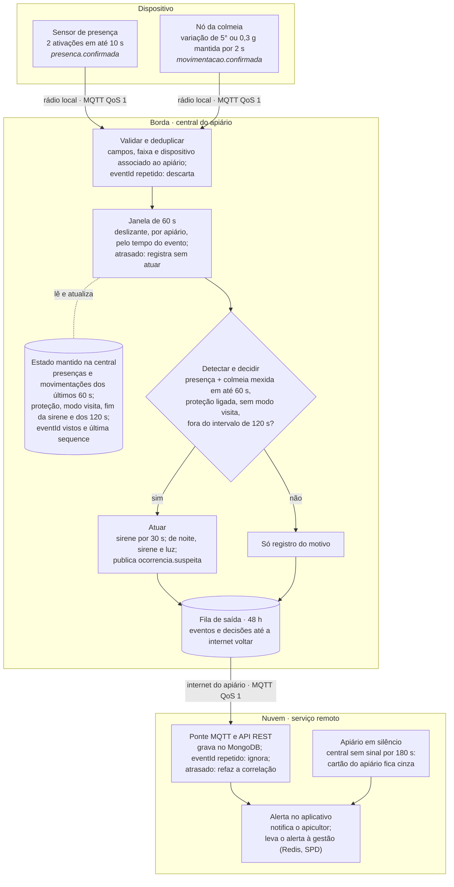

# Mellona — Software para Sistemas Ubíquos — Atividade 02

29/10/2026 · Bárbara Nogueira

## Identificação

A regra modelada aqui é a que aciona a sirene: **presença e colmeia mexida no mesmo apiário em até 60 s**, avaliadas na central do apiário pelo tempo do evento. A nuvem só guarda o histórico, avisa o apicultor e percebe quando um apiário fica em silêncio.

| Item | Registro |
| --- | --- |
| Disciplina | Software para Sistemas Ubíquos, INF/UFG, Prof. Otávio Calaça Xavier |
| Atividade | Atividade em Grupo 02: processamento e distribuição de responsabilidades |
| Integrante | Bárbara Nogueira (atividade individual) · GitHub: _a preencher_ |
| Cenário | O mesmo da Atividade 01: Mellona, proteção e monitoramento de apiários e colmeias. Situação modelada: alguém entra no Apiário Serra à noite e mexe na colmeia A1-07 |
| Onde registrar | `ssu/atividade-02.md`, no mesmo repositório da Atividade 01 |
| Base | ERS do Mellona, versão 1.1.1 (11.7, 11.11, 11.12, 12 e 13.4 a 13.6), Atividade 01 e Aula 03 |

**Ajustes desde a Atividade 01.**

- A atividade passou a ser individual. A Atividade 01 ainda previa um grupo de três ou quatro pessoas.
- O contrato dos eventos é o mesmo que a API de monitoramento de SPD já usa: `eventId`, `deviceId`, `entityId`, `eventTime`, `quality` e `receivedAt`, com índice único em `eventId` no MongoDB.
- Esta atividade definiu a **tolerância de atraso de 5 s** na central, usada para decidir quando uma janela está fechada (item 8). Ela foi registrada no ERS como PAR-21 e será calibrada nos testes da Atividade 03.

Os nomes das telas seguem o guia de estilo de IHC: "Atividade suspeita", "Colmeia inclinada ou caída", "central do apiário" e "sensor da colmeia", que no código e no ERS é o nó da colmeia.

## Parte 1 — Eventos do sistema

### 1. Tipos de evento

A decisão é **acionar ou não a sinalização** (sirene, e luz à noite). Ela depende de dois eventos que vêm de dispositivos diferentes e representam ocorrências diferentes: alguém na área do apiário, e uma caixa saindo do lugar.

| Evento | Ocorrência representada | Papel na decisão |
| --- | --- | --- |
| `presenca.confirmada` | Movimento na área do apiário, com pelo menos 2 ativações do sensor em até 10 s (PAR-07) | Primeira evidência. Sozinha não aciona nada: pode ser um animal ou um passante (RN-62) |
| `movimentacao.confirmada` | Colmeia fora da posição de referência: variação de inclinação de 5° ou mais, ou de aceleração de 0,3 g ou mais, mantida por 2 s (PAR-08) | Segunda evidência. Sozinha vira o alerta "Colmeia mexida", sem sirene |

Um `tombamento.possivel` (inclinação acima de 15° por 10 s) conta como movimentação confirmada para esta regra (RN-68), sem deixar de gerar o alerta "Colmeia inclinada ou caída".

### 2. Contrato dos eventos

Os dois tipos seguem o contrato único do ERS (13.4.1). A tabela mostra o que muda entre eles.

| Atributo | `presenca.confirmada` | `movimentacao.confirmada` |
| --- | --- | --- |
| Nome (`eventType`) | `presenca.confirmada` | `movimentacao.confirmada` |
| Produtor (`deviceId`) | Sensor de presença do apiário, por exemplo `presenca-apiario-A1` | Nó da colmeia, por exemplo `no-colmeia-A1-07` |
| Entidade observada (`entityId`) | O apiário: `apiario:A1` | A colmeia: `colmeia:A1-07` |
| Tempo do evento (`eventTime`) | Instante da ativação que completou a confirmação | Instante em que a variação completou 2 s |
| Origem do horário (`timeSource`) | `RTC`; `RELATIVO` quando a central está sem horário válido | Igual |
| Campos próprios | `activations`: ativações contadas na confirmação | `value`: maior variação observada, no critério que confirmou |
| Unidade | Não se aplica (contagem) | `deg` para inclinação; `g` para aceleração |
| Identificação | `eventId` (UUID) e `sequence`, crescente por dispositivo e preservada após reinício | Igual |
| Demais campos | `schemaVersion`, `state` e `quality`; `receivedAt` é preenchido por quem recebe | Igual |

Os dispositivos acertam o relógio com a central ao se conectar, e a central tem o relógio de tempo real (RTC). Assim, todos os `eventTime` de um apiário estão na mesma referência e podem ser comparados.

### 3. Exemplos

As instâncias abaixo são as duas detecções da ocorrência usada como exemplo no ERS (13.4.4) e nas telas de IHC: "Atividade suspeita — Apiário Serra, colmeia A1-07, 2h14". Elas ocorreram com 18 s de diferença.

```json
{
  "schemaVersion": 1,
  "eventId": "0c8e1b57-3a9d-4b62-9f14-7d2e5c8a1b90",
  "eventType": "presenca.confirmada",
  "deviceId": "presenca-apiario-A1",
  "entityId": "apiario:A1",
  "eventTime": "2026-10-21T02:14:13-03:00",
  "timeSource": "RTC",
  "sequence": 527,
  "activations": 2,
  "state": "PRESENCA_CONFIRMADA",
  "quality": "VALIDO"
}
```

```json
{
  "schemaVersion": 1,
  "eventId": "6f1c2a9e-5b7d-4e1a-9c3f-2d8b7a1e4f00",
  "eventType": "movimentacao.confirmada",
  "deviceId": "no-colmeia-A1-07",
  "entityId": "colmeia:A1-07",
  "eventTime": "2026-10-21T02:14:31-03:00",
  "timeSource": "RTC",
  "sequence": 1842,
  "value": 7.5,
  "unit": "deg",
  "state": "MOVIMENTACAO_ANORMAL",
  "quality": "VALIDO"
}
```

### 4. Qualidade

**Validação necessária:** um evento só entra na regra se estiver completo, vier de um dispositivo com associação ativa ao mesmo apiário (RN-03) e tiver tempo do evento confiável. Quem decide se é válido, repetido ou desatualizado é a central, antes da janela.

| Situação | Como a central reconhece | O que acontece |
| --- | --- | --- |
| Inválido | Falta campo obrigatório ou `schemaVersion` é desconhecida; `deviceId` sem associação ativa ao apiário; valor fora da faixa (presença com menos de 2 ativações, movimentação abaixo de 5° e de 0,3 g); `eventTime` mais de 5 s à frente do relógio da central | `quality = INVALIDO`. O evento é registrado, mas não entra na janela. Leituras inválidas repetidas do sensor de presença levam ao estado degradado (RN-72) |
| Duplicado | `eventId` já processado. O QoS 1 do MQTT pode entregar a mesma mensagem duas vezes | Descartado sem efeito. A nuvem repete a checagem com o índice único de `eventId` no MongoDB (RN-67) |
| Fora de ordem ou perdido | `sequence` menor que a última do dispositivo, com `eventId` novo; ou salto na `sequence` | Fora de ordem: avaliado pelo `eventTime`. Salto: registrado como possível perda |
| Desatualizado | `eventTime` anterior à marca d'água menos 60 s: a janela a que pertence já se fechou (item 8) | `quality = ATRASADO`. Registrado e enviado à nuvem; não aciona a sinalização (RN-66) |

## Parte 2 — Processamento temporal

### 5. Operações

As duas detecções passam por sete operações. As duas primeiras rodam no dispositivo e as outras cinco na central do apiário; a nuvem só recebe o resultado.

| Operação | No Mellona | Onde |
| --- | --- | --- |
| Filtrar | Descarta vibração com menos de 2 s e ativação isolada do sensor de presença | Dispositivo |
| Transformar | Converte a aceleração em inclinação (graus) em relação à posição de referência; carimba `eventId`, `sequence` e `eventTime` | Dispositivo |
| Validar | Confere contrato, origem, faixa e tempo; descarta repetições (item 4) | Central |
| Agrupar | Usa o apiário como chave: a colmeia A1-07 pertence ao apiário A1 pela associação vigente | Central |
| Agregar | Mantém, por apiário, a última presença e as movimentações dos últimos 60 s | Central |
| Detectar | Procura o par presença e movimentação com até 60 s entre os tempos do evento | Central |
| Atuar | Confere proteção, modo visita, intervalo de proteção e período do dia; aciona a sirene por 30 s, e a luz à noite; publica `ocorrencia.suspeita` | Central |

Na forma mínima: `presenca.confirmada` e `movimentacao.confirmada` → validar → agrupar por apiário → janela de 60 s → par encontrado → proteção ligada e sem modo visita → sirene por 30 s, com luz à noite, e alerta "Atividade suspeita".

### 6. Estado e janela

**Regra:** há atividade suspeita quando uma presença confirmada e uma movimentação confirmada de colmeia do mesmo apiário ocorrem com no máximo 60 s de diferença, com a proteção ligada e sem modo visita confirmado (RN-31, RN-61).

| Item | Decisão |
| --- | --- |
| Tipo de janela | Deslizante, por apiário, ancorada em cada detecção: cada evento novo procura o complementar até 60 s antes ou depois do seu tempo do evento |
| Duração | 60 s entre os tempos do evento (PAR-10, configurável de 10 a 300 s) |
| Frequência de avaliação | A cada detecção válida que chega, e a cada 1 s por um relógio local, que expira o estado antigo e encerra sinalização, intervalo de proteção e modo visita |
| Chave | O apiário (`apiario:A1`) |

Uma janela fixa não serve: dividida em minutos, ela separaria uma presença às 2h13min50s de uma movimentação às 2h14min10s, que estão a 20 s uma da outra.

| Escopo | Estado mantido na central | Quando sai do estado |
| --- | --- | --- |
| Apiário | Presenças confirmadas válidas (`eventId`, `eventTime`) | Tempo do evento mais de 60 s atrás da marca d'água |
| Apiário | Movimentações e tombamentos confirmados (`eventId`, colmeia, `eventTime`) | Igual |
| Apiário | Proteção (ligada, desligada ou degradada), fim do modo visita, fim da sinalização, fim do intervalo de 120 s, ocorrência em curso, versão da configuração | Muda por comando, código local ou relógio; fica em memória não volátil |
| Dispositivo | `eventId` dos eventos ainda na janela, última `sequence`, último sinal de funcionamento | `sequence` e sinal: atualizados a cada evento |
| Central | Marca d'água: relógio local menos a tolerância de 5 s | Avança com o relógio |

### 7. Semântica temporal

A regra usa o **tempo do evento** (RN-65). Ela pergunta se duas coisas aconteceram perto uma da outra no apiário, e isso é um fato do mundo físico, não da rede.

- **Rajadas depois de uma falha.** Se o rádio local falhar, um nó reenvia de uma vez os eventos guardados. Pelo tempo de processamento, uma presença das 2h14 e uma colmeia mexida das 2h40 pareceriam simultâneas e tocariam a sirene sem motivo. Esse é o falso positivo do risco principal da Atividade 01.
- **O contrário também.** Um atraso na rede pode afastar duas detecções de um furto real, e o tempo de chegada esconderia o par.
- **Testes reprodutíveis.** Na Atividade 03, o resultado de um teste depende só dos eventos, e não do momento em que ele roda.

O relógio da central entra em dois pontos, e nos dois de propósito: a marca d'água, que diz quando uma janela fecha, e as durações da atuação (30 s de sinalização e 120 s de intervalo de proteção), que são medidas no presente.

### 8. Eventos atrasados

A central fecha a janela de uma detecção quando a marca d'água (relógio local menos 5 s) passa do seu tempo do evento mais 60 s. Um evento que chega depois disso é atrasado: a central já produziu o resultado daquela janela.

A política é diferente para cada consequência do evento (Aula 03):

| Caso | Política | O que acontece |
| --- | --- | --- |
| Sinalização | Não aciona | Nunca há sirene retroativa. Minutos depois, ela não inibe uma ação que já passou e só perturba abelhas e vizinhos (RN-66) |
| Atrasado que completa um par que a central não viu | Corrigir | A nuvem refaz a correlação no histórico e cria o alerta "Atividade suspeita, detectada com atraso", de prioridade alta, com o motivo "sirene não acionada: evento chegou depois da janela" |
| Atrasado de uma ocorrência que já existe | Aceitar | É vinculado à ocorrência pelo `correlationId`; o histórico passa a mostrar, por exemplo, uma segunda colmeia mexida |
| Diagnóstico | Separar | O atraso (`receivedAt` menos `eventTime`) vai para análise por dispositivo. Atrasos repetidos de um nó apontam problema de rádio ou de relógio e sugerem uma manutenção de equipamento |
| Atrasado repetido | Descartar | Mesmo `eventId` já registrado: ignorado |

**Exemplo.** A presença das 2h14min13s chega na hora. A movimentação das 2h14min31s fica presa no nó por uma falha de rádio e chega às 2h16min05s, quando a marca d'água já é 2h16min00s. A janela fechou às 2h15min31s, então a central não aciona a sirene e envia o evento como `ATRASADO`. A nuvem encontra o par e avisa o apicultor de que houve atividade suspeita sem sinalização.

### 9. Pseudocódigo

As marcas `[janela]`, `[validade]`, `[condição]` e `[resposta]` indicam onde cada elemento da regra pode ser verificado.

```text
PARÂMETROS
  JANELA      = 60 s    # PAR-10, entre tempos do evento
  TOLERANCIA  = 5 s     # atraso aceito na rede local (proposta desta atividade)
  SINALIZACAO = 30 s    # PAR-11
  PROTECAO    = 120 s   # PAR-12, contado do fim da sinalização

ESTADO POR APIÁRIO a
  presencas[a], movimentos[a]       # detecções válidas ainda na janela
  protecao[a]                       # LIGADA | DESLIGADA | DEGRADADA
  visitaAte[a], sinalizandoAte[a], protecaoAte[a], ocorrencia[a]
ESTADO POR DISPOSITIVO d
  vistos[d], ultimaSeq[d]

marcaDagua() = relogioCentral() - TOLERANCIA

AO RECEBER evento e:
  se não valido(e): registrar(e, INVALIDO); retornar           # [validade] contrato, origem, faixa, tempo
  se e.eventId ∈ vistos[e.deviceId]: retornar                  # [validade] entrega repetida do QoS 1
  marcar(e)                                                    # salto de sequence → possível perda
  a ← apiarioDe(e)                                             # colmeia → apiário pela associação vigente
  se e.eventTime < marcaDagua() - JANELA:                      # [janela] já fechou
      registrar(e, ATRASADO); enviarNuvem(e); retornar         # sem sirene retroativa (RN-66)
  se e é presença e protecao[a] = DEGRADADA:                   # [validade] sensor em falha (RN-72)
      registrar(e, VALIDO); retornar
  guardar(e, a)
  par ← complementar(e, a)                                     # [janela] outro tipo, |Δt| ≤ JANELA
  se par = nulo: registrar(e, VALIDO); retornar                # detecção isolada (RN-62)
  decidir(a, e, par)

decidir(a, e, par):
  agora ← relogioCentral()
  motivo ← "presença e colmeia " + colmeia(e, par) + " em " + |Δt| + " s"
  se protecao[a] = DESLIGADA:                                  # [condição]
      publicar(avaliacao(a, motivo, "proteção desligada")); retornar
  se visitaAte[a] ≠ nulo e agora < visitaAte[a]:               # [condição]
      publicar(avaliacao(a, motivo, "modo visita")); retornar
  se agora < sinalizandoAte[a] ou agora < protecaoAte[a]:      # [condição] mesma situação (RN-69)
      vincular(ocorrencia[a], e, par); retornar
  periodo ← periodoDoDia(agora)                                # sem horário válido: NOTURNO (RN-64)
  recursos ← {SOM} ∪ ({LUZ} se periodo = NOTURNO)
  acionar(recursos, SINALIZACAO)                               # [resposta] em até 2 s (PAR-17)
  sinalizandoAte[a] ← agora + SINALIZACAO
  ocorrencia[a] ← novoCorrelationId()
  publicar(ocorrenciaSuspeita(a, e, par, periodo, recursos, motivo))   # [resposta]

A CADA 1 s, para cada apiário a:
  remover de presencas[a] e movimentos[a] o que tiver eventTime < marcaDagua() - JANELA   # [janela]
  se sinalizandoAte[a] venceu: desligar(SOM, LUZ); protecaoAte[a] ← agora + PROTECAO
  se visitaAte[a] venceu: visitaAte[a] ← nulo; publicar(autorizacao EXPIRADA)
```

## Parte 3 — Distribuição e resiliência

### 10. Distribuição de responsabilidades

O Mellona usa três níveis: **dispositivo, borda e nuvem**. A regra inteira, do evento à sirene, fecha no apiário; a nuvem entra depois.

| Responsabilidade | Local | Estado mantido ali |
| --- | --- | --- |
| Amostrar, filtrar vibração, confirmar movimentação (2 s), tombamento (10 s) e presença (2 ativações em 10 s); numerar e carimbar o evento | Dispositivo: nó da colmeia e sensor de presença | Posição de referência, início da condição, ativações recentes, última `sequence` |
| Validar, deduplicar, agrupar por apiário, manter a janela, detectar o par, decidir e acionar sirene e luz | Borda: central do apiário | Janela de 60 s, proteção, modo visita, sinalização, intervalo de 120 s, `eventId` vistos, marca d'água |
| Aceitar o código do modo visita sem internet | Borda | Fim do modo visita |
| Guardar eventos e decisões enquanto não há internet | Borda | Fila de saída de 48 h (PAR-15) |
| Perceber nó mudo (180 s) e sensor de presença travado (10 min) | Borda | Último sinal de funcionamento de cada dispositivo |
| Receber e guardar o histórico, descartar repetidos, refazer a correlação dos atrasados, alertar e notificar, propagar o alerta à gestão | Nuvem: ponte MQTT, API REST, MongoDB e Redis (projeto de SPD) | Histórico com `eventId` único; estado dos alertas (ativo, reconhecido, resolvido) |
| Perceber o apiário inteiro em silêncio | Nuvem | Último contato de cada central |

**Névoa não é usada.** Nenhuma decisão do Mellona precisa juntar dados de vários apiários em segundos: cada apiário se protege sozinho, e a visão de conjunto pode esperar a nuvem. A névoa só faria sentido para uma cooperativa com muitos apiários vizinhos que quisesse coordenar uma resposta entre eles, o que não está no escopo.

### 11. Justificativas

**Decisão 1: janela, decisão e atuação na borda, e não na nuvem.**

- **Latência.** A sirene precisa começar em até 2 s após a confirmação (PAR-17), enquanto a pessoa ainda está junto às caixas. Uma ida e volta à nuvem por rede celular rural não garante esse prazo.
- **Conectividade.** Apiários têm sinal fraco ou nenhum (hipótese H2 da PF1 de IHC), e a proteção precisa funcionar sem internet (RN-35). Na nuvem, um furto durante uma queda de sinal ficaria sem resposta, e a queda é a situação comum, não a exceção.

**Decisão 2: silêncio do apiário e correção do histórico na nuvem, e não na borda.**

- **Visão global e disponibilidade.** Um apiário sem energia ou sem conexão não consegue avisar a própria falha. Só um componente fora dele percebe a ausência de sinais por mais de 180 s, com ajuda da mensagem de última vontade (will) do MQTT.
- **Volume e capacidade.** A central guarda 48 h. O histórico de meses (86.400 leituras por dia na carga de simulação de 30 colmeias, PAR-18) e a correlação de um atrasado com tudo o que já chegou de outros dispositivos pedem um armazenamento que a central não tem.

### 12. Comportamento diante de falhas

**Falha escolhida: o apiário fica sem internet.** É a falha mais provável no campo. O sistema perde a visibilidade remota, mas não a proteção.

| Função | Durante a falha |
| --- | --- |
| Detecção, janela, sirene e luz | Continuam iguais: não dependem da internet |
| Modo visita | O pedido pelo aplicativo não chega e expira em 60 s (PAR-20). O aplicativo mostra "Sem conexão" e orienta o uso do código na central, que confirma com bipe e luz verde (cenário C2 da PF1) |
| Ligar ou desligar a proteção a distância | Indisponível. O comando expira e aparece como não confirmado, nunca como executado (RN-30) |
| Eventos e decisões | Vão para a fila de saída. Na volta da conexão, a central envia em ordem de `sequence`; a nuvem descarta repetidos pelo `eventId` e recebe os atrasados já marcados |
| Aviso ao apicultor | Depois de 180 s sem sinal da central, o cartão do apiário fica cinza, com "Sem comunicação com o apiário desde 2h10. Último estado: protegido", e a ajuda explica que sirene e luz continuam funcionando no local (especificação das telas) |
| Ocorrências durante a queda | Chegam depois, com o horário real (`eventTime`) e a hora de recebimento lado a lado |

**Limite.** Se a queda passar de 48 h, os registros mais antigos da fila são sobrescritos. A perda aparece na nuvem como salto de `sequence`, e não como período tranquilo.

O reinício da central é tratado da mesma forma: proteção, modo visita e configuração ficam em memória não volátil, e o relógio de tempo real mantém a hora. Perde-se apenas o conteúdo da janela, isto é, no máximo 60 s de detecções.

### 13. Diagrama



Os eventos sobem do dispositivo à central por rádio local. Validação, janela, decisão e sirene ficam na central, que guarda o estado e a fila de 48 h. A nuvem só recebe o resultado pela internet do apiário: guarda o histórico, refaz a correlação dos atrasados e avisa quando o apiário fica mudo.

## Apresentação em dois minutos

1. **0:00–0:30, a regra.** Presença e colmeia mexida no mesmo apiário, com até 60 s entre os tempos do evento, acionam a sirene, e à noite também a luz. A janela é deslizante e por apiário, e o estado guarda as detecções recentes, a proteção e o modo visita.
2. **0:30–1:00, tempo e validade.** Vale o tempo do evento, porque rajadas depois de uma falha de rádio não podem formar pares falsos. Evento inválido, repetido ou chegado depois da janela não aciona nada; o atrasado vai para o histórico, e a nuvem avisa o apicultor se ele completar um par.
3. **1:00–1:30, o local.** Tudo isso roda na central do apiário, porque a sirene precisa tocar em até 2 s e funcionar sem internet. A nuvem guarda o histórico e percebe quando o apiário inteiro fica mudo.
4. **1:30–2:00, a falha.** Sem internet, a proteção continua igual; os eventos esperam numa fila de 48 h, o modo visita é ativado pelo código na central e, depois de 180 s, a nuvem avisa que o apiário está sem comunicação.

## Coerência com os demais artefatos

| Artefato | O que esta atividade mantém igual |
| --- | --- |
| ERS, versão 1.1.1 | Contrato e tipos de evento (13.4), janela e estado (13.5.2), tempo do evento e atrasados (13.5.3), localidade do processamento (13.6) e parâmetros PAR-07 a PAR-20 |
| Atividade 01 de SSU | Os mesmos dispositivos e a mesma divisão entre dispositivo, borda e nuvem, sem névoa; o risco principal de errar a decisão para os dois lados |
| IHC (PF1, PF2 e especificação das telas) | Os textos dos alertas; o modo visita sem conexão pelo código na central (cenário C2); comandos sempre mostrados como pendentes, confirmados ou com falha (RNF-07) |
| SPD, Etapa 1 | A API de monitoramento recebe os eventos com os mesmos campos e repete a deduplicação com o índice único de `eventId`; a ponte MQTT cria o alerta pela API, e o integrador Redis o leva à gestão |

Duas definições nasceram nesta atividade e já foram levadas aos outros artefatos: a **tolerância de atraso de 5 s**, que virou o PAR-21 do ERS, e o alerta **"Atividade suspeita, detectada com atraso"**, que entrou na RN-66 do ERS e na especificação das telas.

## Entrega no repositório

- [ ] Registrar estas respostas em `ssu/atividade-02.md`, com o esquema dos eventos, o pseudocódigo e o diagrama
- [ ] Preencher o usuário GitHub na seção Identificação
- [ ] Informar a conclusão na planilha compartilhada

## Referências

- XAVIER, O. C. *Software para Sistemas Ubíquos*: Aula 03 (processamento de streams e contínuo borda–névoa–nuvem) e Atividade em Grupo 02. Goiânia: INF/UFG, 2026. Slides e enunciado.
- MELLONA. *Especificação de Requisitos de Software (ERS)*, versão 1.1.1. 2026. Seções 11.7, 11.11, 11.12, 12 e 13.4 a 13.6.
- NOGUEIRA, B. *Mellona — Software para Sistemas Ubíquos — Atividade 01*. Goiânia, 2026.
- NOGUEIRA, B. *Mellona — Projeto Final de IHC — Etapas 1 e 2*. Goiânia, 2026.
- NOGUEIRA, B. *Mellona — Software para Persistência de Dados — Projeto, Etapa 1*. Goiânia, 2026.
- AKIDAU, T.; CHERNYAK, S.; LAX, R. *Streaming Systems*. O'Reilly, 2018. Citado na Aula 03.
- NIST. *Fog Computing Conceptual Model*. SP 500-325, 2018. Citado na Aula 03.
- OASIS. *MQTT Version 5.0*. OASIS Standard. Citado na Aula 05.
